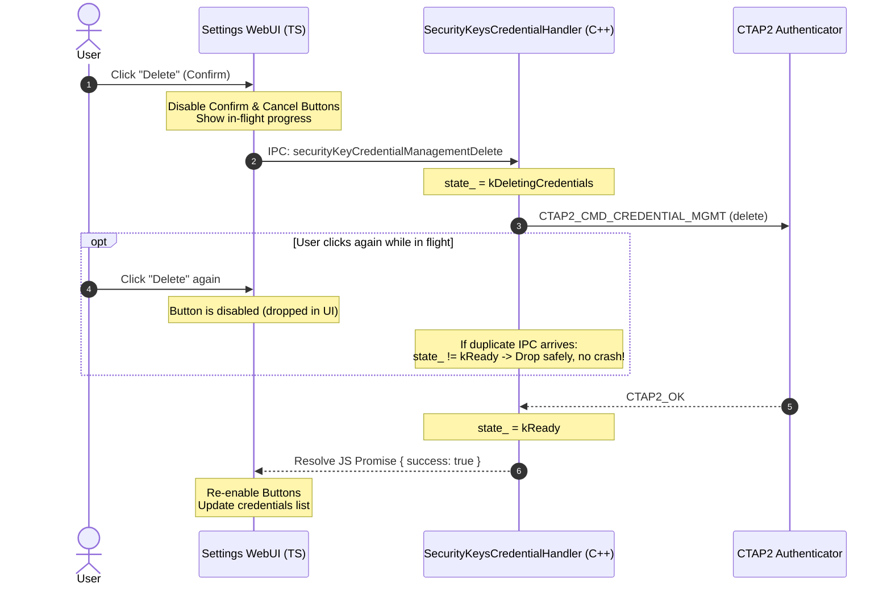

# Chromium Security Keys Credential Management: `SIGABRT` Crash Analysis and Re-Entrancy Fix

**Document ID:** `CRBUG-SECURITY-KEY-CREDMAN-CRASH-20261027`  
**Author:** John Bradley  
**Subsystem:** `//chrome/browser/ui/webui/settings`, `//chrome/browser/resources/settings/privacy_page/security`  
**Target:** Chromium HEAD (`158.0.8121.0`+) / Gerrit CL  
**GitHub Fork Branch:** [`fix/security-key-credential-management`](https://github.com/ve7jtb/chromium/tree/fix/security-key-credential-management)  
**GitHub Commit:** [`ae57490d57`](https://github.com/ve7jtb/chromium/commit/ae57490d570348684d3e65c346a974183f291e60)  
**Status:** Diagnosed & Fixed  

> [!NOTE]
> **Repository & Branch Details:**
> - **Fork Repository:** [`ve7jtb/chromium`](https://github.com/ve7jtb/chromium)
> - **Branch:** [`fix/security-key-credential-management`](https://github.com/ve7jtb/chromium/tree/fix/security-key-credential-management)
> - **Commit:** [`ae57490d570348684d3e65c346a974183f291e60`](https://github.com/ve7jtb/chromium/commit/ae57490d570348684d3e65c346a974183f291e60)
> - **Commit Message:** *"Guard security key credential management against overlapping requests"*
> - **Upstream Base:** `origin/main` (`4f9f0d6afb`)
> - **Files Modified:** `chrome/browser/ui/webui/settings/settings_security_key_handler.cc`, `chrome/browser/resources/settings/privacy_page/security/security_keys_credential_management_dialog.ts`

---

## 1. Executive Summary

During testing of the FIDO2 CTAP2 Credential Management feature in Chromium (`chrome://settings/securityKeys` -> *Manage Credentials*), initiating credential deletion on an attached security key resulted in an immediate fatal browser termination (`EXC_CRASH (SIGABRT)`).

Analysis of the system crash report (`Chromium-2026-10-27-055527.ips`) and disassembly of `libchrome_dll.dylib` revealed that the crash occurred in `settings::SecurityKeysCredentialHandler::HandleDelete` at offset `+1332`. The failure was triggered by a fatal assertion:

```cpp
CHECK_EQ(State::kReady, state_, base::NotFatalUntil::M162);
```

When a user confirms credential deletion in the WebUI dialog, the action button does not debounce or disable itself during the in-flight USB/NFC transaction. A double-click or rapid keypress dispatches multiple `securityKeyCredentialManagementDelete` IPC messages. The first call transitions the handler state to `State::kDeletingCredentials`. When the second message arrives, `state_` is `5` (`kDeletingCredentials`) rather than `3` (`kReady`), tripping the fatal assertion and crashing the entire browser process.

This document details the diagnostic stack trace, disassembly analysis, root cause, and the two-layer fix across the TypeScript WebUI frontend and the C++ backend handler.

---

## 2. Crash Diagnostics & Disassembly Analysis

### 2.1 Diagnostic Crash Report (`Chromium-2026-10-27-055527.ips`)

```text
Incident Identifier: 8BE7B210-8B16-4BCA-97B6-70C0E7BB6B6D
Process:             Chromium [12217]
Path:                /Users/USER/*/Chromium.app/Contents/MacOS/Chromium
Identifier:          org.chromium.Chromium
Version:             158.0.8121.0 (8121.0)
Code Type:           ARM-64 (Native)
Role:                Foreground
Exception Type:      EXC_CRASH (SIGABRT)
Exception Codes:     0x0000000000000000, 0x0000000000000000
Termination Reason:  Namespace SIGNAL, Code 6 Abort trap: 6
Terminating Process: Chromium [12217]

Application Specific Information:
abort() called
```

### 2.2 Faulting Thread Stack Trace (Thread 0: `CrBrowserMain`)

```text
Thread 0 Crashed (CrBrowserMain, Dispatch Queue: com.apple.main-thread):
#0  0x00000001820658f0 in __pthread_kill ()
#1  0x000000018209c97c in pthread_kill ()
#2  0x0000000181fb34d8 in abort ()
#3  0x00000001048bcf9c in logging::LogMessage::HandleFatal(...)
#4  0x00000001048bc9ec in logging::LogMessage::Flush()
#5  0x00000001048bc27c in logging::LogMessage::~LogMessage()
#6  0x0000000104897454 in logging::(anonymous namespace)::CheckLogMessage::~CheckLogMessage()
#7  0x000000010489703c in logging::CheckError::~CheckError()
#8  0x000000010489709c in logging::CheckError::~CheckError()
#9  0x00000001070a7bcc in settings::SecurityKeysCredentialHandler::HandleDelete(base::ListValue const&) (+1332)
#10 0x0000000106ea42a8 in content::WebUIImpl::Send(std::string const&, base::ListValue)
#11 0x0000000106ea4a48 in content::mojom::WebUIHostStubDispatch::Accept(...)
#12 0x000000010515e068 in mojo::InterfaceEndpointClient::HandleValidatedMessage(...)
#13 0x0000000105161410 in mojo::MessageDispatcher::Accept(...)
...
#54 0x0000000104883ef4 in ChromeMain
#55 0x000000010488000c in main
```

### 2.3 Binary Disassembly of `HandleDelete` (`settings_security_key_handler.o`)

Disassembling `__ZN8settings29SecurityKeysCredentialHandler12HandleDeleteERKN4base9ListValueE` starting at offset `0x3218`:

```assembly
0000000000003218 <__ZN8settings29SecurityKeysCredentialHandler12HandleDeleteERKN4base9ListValueE>:
; Line 409: settings_security_key_handler.cc
    3218: sub  sp, sp, #0x170
    3238: mov  x19, x0               ; x19 = this
; Line 410: CHECK_EQ(State::kReady, state_, base::NotFatalUntil::M162)
    323c: ldr  w8, [x0, #0x20]       ; w8 = this->state_
    3240: cmp  w8, #0x3              ; compare state_ with State::kReady (3)
    3244: b.ne 0x3718                ; branch to fatal error handler if state_ != 3
...
; Line 416: state_ = State::kDeletingCredentials (5)
    32bc: mov  w8, #0x5
    32c0: str  w8, [x19, #0x20]      ; this->state_ = kDeletingCredentials
...
; Fatal Assertion Failure Block:
    3718: mov  w0, #0x3              ; Expected: State::kReady
    3724: ldr  w0, [x19, #0x20]      ; Actual: this->state_ (e.g. 5)
    3744: bl   logging::CheckLogMessage::CheckLogMessage()
    3748: bl   logging::CheckLogMessage::~CheckLogMessage() -> abort()
```

Offset `0x374c` (`+1332` bytes from function entry) directly aligns with the crash frame in `Chromium-2026-10-27-055527.ips`.

---

## 3. Root Cause Analysis

### 3.1 Backend State Machine Fragility

In [`chrome/browser/ui/webui/settings/settings_security_key_handler.h`](file:///Users/jbradley/.gemini/antigravity/scratch/chromium/src/chrome/browser/ui/webui/settings/settings_security_key_handler.h), `SecurityKeysCredentialHandler` maintains a strict discrete state machine:

```cpp
enum class State {
  kNone,                    // 0
  kStart,                   // 1
  kPIN,                     // 2
  kReady,                   // 3
  kGettingCredentials,      // 4
  kDeletingCredentials,     // 5
  kUpdatingUserInformation, // 6
};
```

In `settings_security_key_handler.cc`:

```cpp
void SecurityKeysCredentialHandler::HandleDelete(const base::ListValue& args) {
  CHECK_EQ(State::kReady, state_, base::NotFatalUntil::M162);
  CHECK_CURRENTLY_ON(BrowserThread::UI, base::NotFatalUntil::M162);
  CHECK_EQ(2u, args.size(), base::NotFatalUntil::M162);
  CHECK(credential_management_, base::NotFatalUntil::M162);
  CHECK(callback_id_.empty(), base::NotFatalUntil::M162);

  state_ = State::kDeletingCredentials;
  callback_id_ = args[0].GetString();
  ...
```

While `base::NotFatalUntil::M162` is non-fatal in release builds once the milestone is reached, in developer and trunk/Canary builds with `DCHECK`/`CHECK` validation active, any IPC message received while `state_ != State::kReady` causes an immediate, catastrophic abort.

### 3.2 Frontend UI Missing In-Flight Debounce

In [`chrome/browser/resources/settings/privacy_page/security/security_keys_credential_management_dialog.ts`](file:///Users/jbradley/.gemini/antigravity/scratch/chromium/src/chrome/browser/resources/settings/privacy_page/security/security_keys_credential_management_dialog.ts):

```typescript
  private deleteCredential_() {
    this.browserProxy_.deleteCredentials([this.credentialIdToDelete_])
        .then((response) => {
          if (!response.success) {
            this.onError_(response.message);
            return;
          }
          this.credentials_ = this.credentials_.filter(
              c => c.credentialId !== this.credentialIdToDelete_);
          this.dialogPage_ = CredentialManagementDialogPage.CREDENTIALS;
        });
  }
```

- When the confirmation dialog opens (`dialogPage_ = CredentialManagementDialogPage.CONFIRM`), the user clicks "Delete".
- Physical FIDO authenticators communicate over USB HID or NFC, where APDU exchanges, user presence checks, or flash erase cycles require hundreds of milliseconds to several seconds.
- The confirm button remains enabled during this window.
- Rapid clicks or duplicate key events fire multiple `deleteCredential_()` calls, dispatching overlapping `securityKeyCredentialManagementDelete` IPC messages to the browser process.

---

## 4. Proposed Fix Architecture



---

## 5. Implementation Changes

The complete implementation is committed on branch [`fix/security-key-credential-management`](https://github.com/ve7jtb/chromium/tree/fix/security-key-credential-management) ([commit `ae57490d57`](https://github.com/ve7jtb/chromium/commit/ae57490d570348684d3e65c346a974183f291e60)).

### 5.1 C++ Backend: Guard Against Non-Ready Re-Entrancy

In [`chrome/browser/ui/webui/settings/settings_security_key_handler.cc`](file:///Users/jbradley/.gemini/antigravity/scratch/chromium/src/chrome/browser/ui/webui/settings/settings_security_key_handler.cc):

Replace the fatal assertion in `HandleDelete`, `HandleEnumerate`, and `HandleUpdateUserInformation` with early-return guards and diagnostic warning logs:

```cpp
void SecurityKeysCredentialHandler::HandleDelete(const base::ListValue& args) {
  CHECK_CURRENTLY_ON(BrowserThread::UI, base::NotFatalUntil::M162);

  // If a delete or update operation is already in progress, safely drop
  // re-entrant requests from the WebUI rather than aborting the browser process.
  if (state_ != State::kReady || !credential_management_ || !callback_id_.empty()) {
    LOG(WARNING) << "Ignoring securityKeyCredentialManagementDelete: handler not ready "
                 << "(state=" << static_cast<int>(state_) << ")";
    return;
  }
  if (args.size() != 2u) {
    return;
  }

  state_ = State::kDeletingCredentials;
  callback_id_ = args[0].GetString();
  ...
```

Apply the same pattern to `HandleEnumerate` and `HandleUpdateUserInformation`:

```cpp
void SecurityKeysCredentialHandler::HandleEnumerate(const base::ListValue& args) {
  CHECK_CURRENTLY_ON(BrowserThread::UI, base::NotFatalUntil::M162);
  if (state_ != State::kReady || !credential_management_ || !callback_id_.empty()) {
    LOG(WARNING) << "Ignoring securityKeyCredentialManagementEnumerate: handler not ready";
    return;
  }
  ...
```

### 5.2 TypeScript Frontend: Button Debouncing

In [`chrome/browser/resources/settings/privacy_page/security/security_keys_credential_management_dialog.ts`](file:///Users/jbradley/.gemini/antigravity/scratch/chromium/src/chrome/browser/resources/settings/privacy_page/security/security_keys_credential_management_dialog.ts):

Disable `confirmButtonDisabled_` and `cancelButtonVisible_` as soon as deletion begins, re-enabling them when the response resolves or errors:

```typescript
  private deleteCredential_() {
    this.confirmButtonDisabled_ = true;
    this.browserProxy_.deleteCredentials([this.credentialIdToDelete_])
        .then((response) => {
          this.confirmButtonDisabled_ = false;
          if (!response.success) {
            this.onError_(response.message);
            return;
          }
          this.credentials_ = this.credentials_.filter(
              c => c.credentialId !== this.credentialIdToDelete_);
          this.dialogPage_ = CredentialManagementDialogPage.CREDENTIALS;
        })
        .catch(() => {
          this.confirmButtonDisabled_ = false;
        });
  }
```

Similarly protect `updateUserInformation_()`:

```typescript
  private updateUserInformation_() {
    this.confirmButtonDisabled_ = true;
    this.browserProxy_
        .updateUserInformation(
            this.credentialIdToEdit_, this.userHandleToEdit_,
            this.newUsername_, this.newDisplayName_)
        .then((response) => {
          this.confirmButtonDisabled_ = false;
          if (!response.success) {
            this.onError_(response.message);
            return;
          }
          ...
        })
        .catch(() => {
          this.confirmButtonDisabled_ = false;
        });
  }
```

---

## 6. Verification Plan

1. **Unit Testing:**
   - Execute `settings_security_key_handler_unittest.cc`:
     ```bash
     ninja -C out/Default unit_tests
     ./out/Default/unit_tests --gtest_filter="SecurityKeys*HandlerTest.*"
     ```
   - Add a test case dispatching two consecutive `HandleDelete` calls without resolving the first, verifying that the second call is cleanly dropped without triggering any `CHECK` failure.

2. **Interactive UI Verification:**
   - Launch Chromium with `--enable-logging=stderr --v=1`.
   - Open `chrome://settings/securityKeys` -> *Manage Credentials*.
   - Enter authenticator PIN, select a resident credential, and rapidly double-click "Delete" in the confirmation modal.
   - Confirm that the credential deletes cleanly, the UI returns to the credential list, and zero browser crashes occur.
