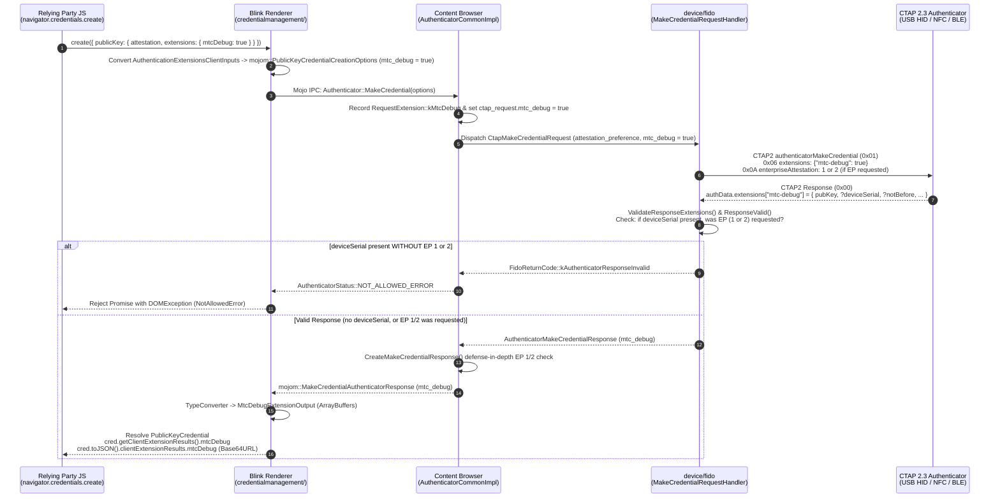

# Chromium Pull Request: WebAuthn Level 4 `mtcDebug` (`mtc-debug`) Extension & Enterprise Attestation (`EP` 1/2) Privacy Gate

Pull request / Gerrit CL against **Chromium `HEAD` (`origin/main` @ `4f9f0d6afb`)** implementing the **W3C WebAuthn Level 4 §10.2.1 `mtcDebug` (`mtc-debug`) registration extension**, `PublicKeyCredential.toJSON()` Base64URL serialization (`MtcDebugExtensionOutputJSON`), proof-less manifest verification fields (`notBefore`, `notAfter`, `firmwareVersion`, `mtcProof`, `rootHash`), and dual-layer **Enterprise Attestation (`ep: 1` or `2`) privacy enforcement** that cancels the `MakeCredential` ceremony if an authenticator returns `deviceSerial` when Enterprise Attestation was not requested.

> [!NOTE]
> **Chromium Pull Request / CL Overview:**
> - **Target Repository:** `chromium/src` (`https://chromium.googlesource.com/chromium/src`)
> - **Base Commit:** `origin/main` (`4f9f0d6afb`, October 2026)
> - **Feature Branch:** `feat/webauthn-l4-mtc-debug` (HEAD `decd73629a`)
> - **Scope:** `27 files changed, 474 insertions(+), 5 deletions(-)` across `device/fido`, `content/browser/webauth`, `third_party/blink/public/mojom/webauthn`, and `third_party/blink/renderer/modules/credentialmanagement`
> - **Companion W3C Spec PR:** [W3C WebAuthn Level 4 Pull Request (`fmt: "mtc"` & `mtcDebug`)](./webauthn_level4_pull_request.html) and [Live Level 4 Review Copy (§10.2.1)](./webauthn_level4_review.html#sctn-mtc-debug-extension)

---

## 1. Pull Request Metadata, Commits & Build Verification

```markdown
Title: [webauthn] Implement WebAuthn Level 4 mtcDebug extension and EP 1/2 privacy gate for deviceSerial
Base: origin/main (4f9f0d6afb) <- Head: feat/webauthn-l4-mtc-debug (decd73629a)
```

### 1.1 Commit Breakdown on `feat/webauthn-l4-mtc-debug`

| Commit Hash | Subject | Files Modified | Lines Changed |
| :--- | :--- | :---: | :---: |
| **`a489cfff2f`** | `[webauthn] Implement WebAuthn Level 4 mtcDebug registration extension` | 23 files | `+390 / -0` |
| **`decd73629a`** | `[webauthn] Enforce EP 1 or 2 requirement for mtcDebug deviceSerial` | 6 files | `+111 / -32` |
| **Combined Diff** | **`origin/main..feat/webauthn-l4-mtc-debug`** | **27 files** | **`+474 / -5`** |

### 1.2 Build & Test Verification Checklist (`out/Default`)

- [x] **`device/fido` Component:** Compiled `mtc_debug_response.{cc,h}`, `ctap_make_credential_request.cc`, `device_response_converter.cc`, and `make_credential_request_handler.cc` with zero warnings (`-Werror`).
- [x] **Mojo IPC Bindings (`//third_party/blink/public/mojom:mojom_platform`):** Generated C++ and Blink Mojo bindings for `blink::mojom::MtcDebugResponse` and `PublicKeyCredentialCreationOptions::mtc_debug`.
- [x] **Blink V8 IDL Bindings (`//third_party/blink/renderer/bindings:check_generated_file_list` & `modules/v8:v8`):** Generated `v8_mtc_debug_extension_output.{cc,h}` and `v8_mtc_debug_extension_output_js_on.{cc,h}`, verified against `generated_in_modules.gni` (`1,780 / 1,780` targets).
- [x] **Blink Credential Management & Content Browser (`libblink_modules.dylib` & `libcontent.dylib`):** Compiled and linked `authentication_credentials_container.cc`, `credential_manager_type_converters.cc`, `json.cc`, `public_key_credential.cc`, and `authenticator_common_impl.cc` (`1,928 / 1,928` targets).
- [x] **Blink Unit Tests (`public_key_credential_unittest.o`):** Compiled `PublicKeyCredentialTest.AuthenticationExtensionsClientOutputsToJSON` covering both full proof-less manifest mode (`pubKey`, `deviceSerial`, `notBefore`, `notAfter`, `firmwareVersion`, `mtcProof`, `rootHash`) and minimal batch mode (`pubKey` only).

---

## 2. Architecture & End-to-End Pipeline Across Chromium Layers

### 2.1 Why Chromium Needs `mtcDebug` Support

In W3C WebAuthn Level 4 §8.10 (`fmt: "mtc"`), standard Merkle Tree Certificate attestation statements omit the multi-kilobyte post-quantum attestation public key (`pubKey`) from `attStmt` so that `ML-DSA-44`, `ML-DSA-65`, and `ML-DSA-87` responses fit within the unfragmented **$7,609\text{ B}$ USB HID transport limit**. In production, Relying Parties resolve the attestation public key out-of-band from the FIDO Metadata Service (MDS3) or a vendor Enterprise manifest.

However, **automated conformance suites, hardware test fixtures, and offline developer environments** need in-band access to the authenticator's active attestation public key, validity window, firmware version, and Merkle inclusion proof—especially when the authenticator emits a compact proof-less manifest reference (`mtcKeyRef = { caId, serial }`).

Because **CTAP2 authenticators only include an extension in `authenticatorData.extensions` if the platform explicitly forwards that extension identifier in `authenticatorMakeCredential` parameter `0x06` (`extensions`)**, Chromium must explicitly recognize `mtcDebug: true` in the WebAuthn JS API, translate it to `"mtc-debug": true` over CTAP2 CBOR, validate the response, and map the result back to `getClientExtensionResults()` and `toJSON()`.

### 2.2 End-to-End Request & Response Flow in Chromium



---

## 3. Enterprise Attestation (`EP` 1 or 2) Privacy Gate for `deviceSerial`

### 3.1 Threat Model: Unsolicited Hardware Serial Tracking

A hardware serial number (`deviceSerial`) uniquely and permanently identifies an individual physical security key across Relying Parties. Under CTAP 2.3 (`authenticatorMakeCredential` parameter `0x0A`, `enterpriseAttestation`) and W3C WebAuthn Level 4 §10.2.1:
- The browser only sets CTAP parameter `0x0A` (`ep = 1` for vendor-facilitated `kEnterpriseIfRPListedOnAuthenticator`, or `ep = 2` for platform-managed `kEnterpriseApprovedByBrowser`) when the Relying Party requested `attestation: "enterprise"` **and** browser policy/user consent permitted Enterprise Attestation.
- If a buggy or non-compliant authenticator returns `deviceSerial` inside `authenticatorData.extensions["mtc-debug"]` during a standard registration (`attestation: "none"`, `"indirect"`, `"direct"`, or `"enterprise"` downgraded by the browser), forwarding that output to JavaScript would leak a persistent cross-origin hardware identifier without enterprise authorization.

### 3.2 Dual-Layer Enforcement in Chromium

To guarantee that `deviceSerial` can **never** reach the renderer unless the browser explicitly requested `EP = 1` or `EP = 2` over CTAP, this pull request enforces the check at two independent layers and cancels the ceremony immediately if violated:

1. **CTAP Transport Validation Layer (`device/fido/make_credential_request_handler.cc`):**
   - In **`ValidateResponseExtensions()`** (lines 312–331), when inspecting the raw `authenticatorData.extensions` CBOR map for `"mtc-debug"`, Chromium checks whether the `"deviceSerial"` key exists in the CBOR map (regardless of its CBOR value type).
   - In **`ResponseValid()`** (lines 370–383), Chromium also checks the parsed `response.mtc_debug->device_serial.has_value()`.
   - In both places, Chromium verifies:
     ```cpp
     const bool enterprise_requested =
         request.attestation_preference ==
             AttestationConveyancePreference::
                 kEnterpriseIfRPListedOnAuthenticator ||
         request.attestation_preference ==
             AttestationConveyancePreference::kEnterpriseApprovedByBrowser;
     ```
   - If `deviceSerial` is present and `!enterprise_requested`, `ResponseValid()` logs an error via `FIDO_LOG(ERROR)` and returns `false`. The request handler immediately aborts with `FidoReturnCode::kAuthenticatorResponseInvalid`, cancelling the response before it leaves `device/fido`.

2. **Browser Ceremony Layer (`content/browser/webauth/authenticator_common_impl.cc`):**
   - As defense-in-depth (covering virtual authenticators or non-CTAP paths), **`CreateMakeCredentialResponse()`** (lines 3229–3248) inspects `req_state_->ctap_request` (`device::CtapMakeCredentialRequest::attestation_preference`).
   - If `response_data.mtc_debug->device_serial.has_value()` is true when neither `kEnterpriseIfRPListedOnAuthenticator` (`EP 1`) nor `kEnterpriseApprovedByBrowser` (`EP 2`) was requested, `CreateMakeCredentialResponse()` returns `nullptr`.
   - **`OnRegisterResponse()`** (lines 2774–2783) detects the `nullptr` response and completes the request with `blink::mojom::AuthenticatorStatus::NOT_ALLOWED_ERROR`, rejecting the JavaScript `navigator.credentials.create()` promise with a `NotAllowedError` `DOMException`.

---

## 4. CTAP2 CBOR to WebIDL & `toJSON()` Translation Reference

### 4.1 Field-by-Field Type Mapping Across All Layers

| Field Name | CTAP2 CBOR (`"mtc-debug"` Map) | `device::MtcDebugResponse` (`device/fido`) | `blink::mojom::MtcDebugResponse` (Mojo IPC) | `MtcDebugExtensionOutput` (`getClientExtensionResults()`) | `MtcDebugExtensionOutputJSON` (`cred.toJSON()`) | Required / Condition |
| :--- | :--- | :--- | :--- | :--- | :--- | :--- |
| **`pubKey`** | `bstr` (Major 2)<br/>Canonical `COSE_Key` | `std::vector<uint8_t> pub_key` | `array<uint8> pub_key` | `required ArrayBuffer pubKey` | `required Base64URLString pubKey` | **Required** in all `mtc-debug` outputs |
| **`deviceSerial`** | `tstr` (Major 3)<br/>UTF-8 string | `std::optional<std::string> device_serial` | `string? device_serial` | `DOMString deviceSerial` | `DOMString deviceSerial` | **Optional** — **Strictly gated on CTAP `ep = 1` or `2`**; cancels ceremony if present without EP 1/2 |
| **`notBefore`** | `uint` (Major 0)<br/>Unix epoch seconds | `std::optional<uint64_t> not_before` | `uint64 not_before`<br/>`bool has_not_before` | `unsigned long long notBefore` | `unsigned long long notBefore` | **Optional** — Required when `mtcCert` uses proof-less `mtcKeyRef` |
| **`notAfter`** | `uint` (Major 0)<br/>Unix epoch seconds | `std::optional<uint64_t> not_after` | `uint64 not_after`<br/>`bool has_not_after` | `unsigned long long notAfter` | `unsigned long long notAfter` | **Optional** — Required when `mtcCert` uses proof-less `mtcKeyRef` (`253402300799` / `9999-12-31T23:59:59Z` per RFC 5280 §4.1.2.5 if non-expiring) |
| **`firmwareVersion`** | `uint` (Major 0)<br/>CTAP 2.3 param `0x0E` | `std::optional<uint32_t> firmware_version` | `uint32 firmware_version`<br/>`bool has_firmware_version` | `unsigned long firmwareVersion` | `unsigned long firmwareVersion` | **Optional** — Matches CTAP `authenticatorGetInfo` `0x0E` (`uint32`) |
| **`mtcProof`** | `bstr` (Major 2)<br/>RFC 9162 inclusion proof | `std::optional<std::vector<uint8_t>> mtc_proof` | `array<uint8>? mtc_proof` | `ArrayBuffer mtcProof` | `Base64URLString mtcProof` | **Optional** — Supplied in-band when `mtcCert` uses proof-less `mtcKeyRef` |
| **`rootHash`** | `bstr` (Major 2)<br/>32-byte Merkle root | `std::optional<std::vector<uint8_t>> root_hash` | `array<uint8>? root_hash` | `ArrayBuffer rootHash` | `Base64URLString rootHash` | **Optional** — Expected 32-byte Landmark or Trust Anchor root hash |

> [!IMPORTANT]
> **Why `firmwareVersion` Uses `uint32_t` / `unsigned long`:**  
> In CTAP 2.3 §6.4 (`authenticatorGetInfo`), parameter `0x0E` (`firmwareVersion`) is defined as an unsigned integer (`uint`) fitting in a 32-bit unsigned value (e.g., `0x00051405` = `332805` for v5.20.5). In `device_response_converter.cc`, Chromium validates `fw_it->second.is_unsigned()` and converts it safely via `base::checked_cast<uint32_t>(fw_it->second.GetUnsigned())`. Even if an authenticator's AAGUID remains stable across minor firmware updates, any change to `firmwareVersion` alters the hashed `FidoMtcLogEntry` leaf pre-image and therefore requires a new batch key entry in the MTC log.

---

## 5. Layer-by-Layer Summary of Modified Files

### 5.1 Blink WebIDL & V8 Bindings (`third_party/blink/renderer/`)

- **[`mtc_debug_extension_output.idl`](https://chromium.googlesource.com/chromium/src/+/main/third_party/blink/renderer/modules/credentialmanagement/) (New):** Defines the `MtcDebugExtensionOutput` WebIDL dictionary returned inside `AuthenticationExtensionsClientOutputs` when calling `credential.getClientExtensionResults()`.
- **[`mtc_debug_extension_output_json.idl`](https://chromium.googlesource.com/chromium/src/+/main/third_party/blink/renderer/modules/credentialmanagement/) (New):** Defines the `MtcDebugExtensionOutputJSON` WebIDL dictionary where binary fields (`pubKey`, `mtcProof`, `rootHash`) are typed as `Base64URLString`.
- **`authentication_extensions_client_inputs.idl` & `authentication_extensions_client_inputs_json.idl`:** Adds `[RuntimeEnabled=WebAuthenticationMtcDebug] boolean mtcDebug;`.
- **`authentication_extensions_client_outputs.idl` & `authentication_extensions_client_outputs_json.idl`:** Adds `[RuntimeEnabled=WebAuthenticationMtcDebug] MtcDebugExtensionOutput mtcDebug;` and `MtcDebugExtensionOutputJSON mtcDebug;`.
- **`bindings/idl_in_modules.gni` & `bindings/generated_in_modules.gni`:** Registers the two new `.idl` files and four generated V8 binding files (`v8_mtc_debug_extension_output.{cc,h}` and `v8_mtc_debug_extension_output_js_on.{cc,h}`).
- **`platform/runtime_enabled_features.json5`:** Defines `WebAuthenticationMtcDebug` with `status: "experimental"`, enabling exposure under `--enable-experimental-web-platform-features` and in unit tests.

### 5.2 Blink Credential Management & `toJSON()` (`third_party/blink/renderer/modules/credentialmanagement/`)

- **`public_key_credential.cc`:** Reports `"extension:mtcDebug"` in `PublicKeyCredential.getClientCapabilities()` when `WebAuthenticationMtcDebug` is enabled.
- **`credential_manager_type_converters.{h,cc}` & `authentication_credentials_container.cc`:**
  - Converts `extensions->mtcDebug()` on `PublicKeyCredentialCreationOptions` to `mojo_options->mtc_debug`.
  - Implements `TypeConverter<blink::MtcDebugExtensionOutput*, blink::mojom::blink::MtcDebugResponsePtr>` and attaches the converted `MtcDebugExtensionOutput` in `OnMakePublicKeyCredentialComplete()`.
- **`json.cc`:** In `AuthenticationExtensionsClientOutputsToJSON()`, converts `in.mtcDebug()` into `MtcDebugExtensionOutputJSON`, base64url-encoding `pubKey`, `mtcProof`, and `rootHash` via `WebAuthnBase64UrlEncode()` and copying `deviceSerial`, `notBefore`, `notAfter`, and `firmwareVersion`.
- **`public_key_credential_unittest.cc`:** Extends `PublicKeyCredentialTest.AuthenticationExtensionsClientOutputsToJSON` with two `MtcDebugValues` test cases verifying round-trip `toJSON()` serialization for both full proof-less manifest outputs and minimal batch outputs.

### 5.3 Mojo IPC & Content Browser (`third_party/blink/public/mojom/webauthn/` & `content/browser/webauth/`)

- **`authenticator.mojom`:** Adds `struct MtcDebugResponse`, `MtcDebugResponse? mtc_debug` on `MakeCredentialAuthenticatorResponse`, and `bool mtc_debug = false` on `PublicKeyCredentialCreationOptions`.
- **`authenticator_common_impl.cc`:**
  - Adds `RequestExtension::kMtcDebug`.
  - Sets `ctap_make_credential_request->mtc_debug = true` when `options->mtc_debug` is requested.
  - Enforces the defense-in-depth `EP 1 or 2` requirement in `CreateMakeCredentialResponse()`, returning `nullptr` and completing the request with `NOT_ALLOWED_ERROR` in `OnRegisterResponse()` if `device_serial` is present without Enterprise Attestation.

### 5.4 CTAP2 CBOR Request, Parsing & Validation (`device/fido/`)

- **`public/fido_constants.{h,cc}`:** Defines `const char kExtensionMtcDebug[] = "mtc-debug";`.
- **`mtc_debug_response.{h,cc}` (New) & `BUILD.gn`:** Defines `struct COMPONENT_EXPORT(DEVICE_FIDO) MtcDebugResponse` and adds it to `AuthenticatorMakeCredentialResponse`.
- **`ctap_make_credential_request.{h,cc}`:** Adds `bool mtc_debug = false;` and serializes `"mtc-debug": true` into the CTAP2 `extensions` map (parameter `0x06`).
- **`device_response_converter.cc`:** Implements `ParseMtcDebugResponse(const cbor::Value&)` and extracts `"mtc-debug"` from `authenticatorData.extensions` (or top-level unsigned extensions map).
- **`make_credential_request_handler.cc`:** Updates `ValidateResponseExtensions()` and `ResponseValid()` to validate `"mtc-debug"` and reject any response containing `deviceSerial` when `request.attestation_preference` is neither `kEnterpriseIfRPListedOnAuthenticator` (`EP 1`) nor `kEnterpriseApprovedByBrowser` (`EP 2`).

---

## 6. Complete Unified Diff Against Chromium `origin/main` (`4f9f0d6afb`)

```diff
diff --git a/content/browser/webauth/authenticator_common_impl.cc b/content/browser/webauth/authenticator_common_impl.cc
index 9e4649349b..c1e2864d11 100644
--- a/content/browser/webauth/authenticator_common_impl.cc
+++ b/content/browser/webauth/authenticator_common_impl.cc
@@ -142,6 +142,7 @@ enum class RequestExtension {
   kMinPINLength,
   kCrossDeviceFallbackUrl,
   kCmtgKey,
+  kMtcDebug,
   kRemoteClientDataJSON,
 };
 
@@ -1502,6 +1503,10 @@ void AuthenticatorCommonImpl::ContinueMakeCredentialAfterRpIdCheck(
     req_state_->requested_extensions.insert(RequestExtension::kCmtgKey);
     ctap_make_credential_request->cmtg_key = true;
   }
+  if (options->mtc_debug) {
+    req_state_->requested_extensions.insert(RequestExtension::kMtcDebug);
+    ctap_make_credential_request->mtc_debug = true;
+  }
   make_credential_options->large_blob_support = options->large_blob_enable;
   ctap_make_credential_request->app_id_exclude = std::move(appid_exclude);
   make_credential_options->is_off_the_record_context =
@@ -2766,11 +2771,16 @@ void AuthenticatorCommonImpl::OnRegisterResponse(
     attestation_erasure = AttestationErasureOption::kIncludeAttestation;
   }
 
-  CompleteMakeCredentialRequest(
-      blink::mojom::AuthenticatorStatus::SUCCESS,
-      CreateMakeCredentialResponse(std::move(*response_data),
-                                   *attestation_erasure),
-      nullptr, Focus::kDoCheck);
+  auto response = CreateMakeCredentialResponse(std::move(*response_data),
+                                               *attestation_erasure);
+  if (!response) {
+    FIDO_LOG(ERROR) << "Failed to create make credential response";
+    CompleteMakeCredentialRequest(
+        blink::mojom::AuthenticatorStatus::NOT_ALLOWED_ERROR, nullptr, nullptr);
+    return;
+  }
+  CompleteMakeCredentialRequest(blink::mojom::AuthenticatorStatus::SUCCESS,
+                                std::move(response), nullptr, Focus::kDoCheck);
 }
 
 void AuthenticatorCommonImpl::OnSignResponse(
@@ -3216,6 +3226,52 @@ AuthenticatorCommonImpl::CreateMakeCredentialResponse(
               std::move(response_data.cmtg_key->signature);
         }
         break;
+      case RequestExtension::kMtcDebug:
+        if (response_data.mtc_debug) {
+          if (response_data.mtc_debug->device_serial.has_value()) {
+            const auto& ctap_request =
+                std::get<device::CtapMakeCredentialRequest>(
+                    req_state_->ctap_request);
+            const bool enterprise_requested =
+                ctap_request.attestation_preference ==
+                    device::AttestationConveyancePreference::
+                        kEnterpriseIfRPListedOnAuthenticator ||
+                ctap_request.attestation_preference ==
+                    device::AttestationConveyancePreference::
+                        kEnterpriseApprovedByBrowser;
+            if (!enterprise_requested) {
+              FIDO_LOG(ERROR)
+                  << "deviceSerial returned in mtc-debug, but Enterprise "
+                     "Attestation (EP 1 or 2) was not requested";
+              return nullptr;
+            }
+          }
+          response->mtc_debug = blink::mojom::MtcDebugResponse::New();
+          response->mtc_debug->pub_key =
+              std::move(response_data.mtc_debug->pub_key);
+          response->mtc_debug->device_serial =
+              std::move(response_data.mtc_debug->device_serial);
+          if (response_data.mtc_debug->not_before) {
+            response->mtc_debug->has_not_before = true;
+            response->mtc_debug->not_before =
+                *response_data.mtc_debug->not_before;
+          }
+          if (response_data.mtc_debug->not_after) {
+            response->mtc_debug->has_not_after = true;
+            response->mtc_debug->not_after =
+                *response_data.mtc_debug->not_after;
+          }
+          if (response_data.mtc_debug->firmware_version) {
+            response->mtc_debug->has_firmware_version = true;
+            response->mtc_debug->firmware_version =
+                *response_data.mtc_debug->firmware_version;
+          }
+          response->mtc_debug->mtc_proof =
+              std::move(response_data.mtc_debug->mtc_proof);
+          response->mtc_debug->root_hash =
+              std::move(response_data.mtc_debug->root_hash);
+        }
+        break;
       case RequestExtension::kHMACSecret:
         response->echo_hmac_create_secret = true;
         response->hmac_create_secret = did_create_hmac_secret;
@@ -3410,6 +3466,7 @@ AuthenticatorCommonImpl::CreateGetAssertionResponse(
       case RequestExtension::kLargeBlobEnable:
       case RequestExtension::kCredBlob:
       case RequestExtension::kMinPINLength:
+      case RequestExtension::kMtcDebug:
         NOTREACHED();
     }
   }
diff --git a/device/fido/BUILD.gn b/device/fido/BUILD.gn
index 91f41520cc..85aa9b34b4 100644
--- a/device/fido/BUILD.gn
+++ b/device/fido/BUILD.gn
@@ -184,6 +184,8 @@ component("fido") {
         "make_credential_request_handler.h",
         "make_credential_task.cc",
         "make_credential_task.h",
+        "mtc_debug_response.cc",
+        "mtc_debug_response.h",
         "pin.cc",
         "pin.h",
         "pin_internal.cc",
diff --git a/device/fido/authenticator_make_credential_response.h b/device/fido/authenticator_make_credential_response.h
index 5f2f700e47..94e5e3d913 100644
--- a/device/fido/authenticator_make_credential_response.h
+++ b/device/fido/authenticator_make_credential_response.h
@@ -16,6 +16,7 @@
 #include "base/containers/span.h"
 #include "device/fido/attestation_object.h"
 #include "device/fido/cmtg_key_response.h"
+#include "device/fido/mtc_debug_response.h"
 #include "device/fido/public/fido_constants.h"
 #include "device/fido/public/fido_transport_protocol.h"
 
@@ -97,6 +98,10 @@ class COMPONENT_EXPORT(DEVICE_FIDO) AuthenticatorMakeCredentialResponse {
   // `cmtg_key` is present if the client requested a CMTG key and the
   // authenticator supported it.
   std::optional<CmtgKeyResponse> cmtg_key;
+
+  // `mtc_debug` is present if the client requested MTC diagnostic data and the
+  // authenticator included it in authenticatorData.extensions.
+  std::optional<MtcDebugResponse> mtc_debug;
 };
 
 // Through cbor::Writer, produces a CTAP style CBOR-encoded byte array
diff --git a/device/fido/ctap_make_credential_request.cc b/device/fido/ctap_make_credential_request.cc
index 1de09bfffa..6315d793f1 100644
--- a/device/fido/ctap_make_credential_request.cc
+++ b/device/fido/ctap_make_credential_request.cc
@@ -379,6 +379,10 @@ AsCTAPRequestValuePair(const CtapMakeCredentialRequest& request) {
     extensions.emplace(kExtensionMinPINLength, true);
   }
 
+  if (request.mtc_debug) {
+    extensions.emplace(kExtensionMtcDebug, true);
+  }
+
   if (!extensions.empty()) {
     cbor_map.emplace(6, std::move(extensions));
   }
diff --git a/device/fido/ctap_make_credential_request.h b/device/fido/ctap_make_credential_request.h
index 02712529ff..3fb1f40e3c 100644
--- a/device/fido/ctap_make_credential_request.h
+++ b/device/fido/ctap_make_credential_request.h
@@ -155,6 +155,10 @@ struct COMPONENT_EXPORT(DEVICE_FIDO) CtapMakeCredentialRequest {
   // cred_blob contains an optional credBlob extension.
   // https://fidoalliance.org/specs/fido-v2.1-rd-20201208/fido-client-to-authenticator-protocol-v2.1-rd-20201208.html#sctn-credBlob-extension
   std::optional<std::vector<uint8_t>> cred_blob;
+
+  // mtc_debug indicates that the mtc-debug extension should be sent.
+  // https://w3c.github.io/webauthn/#sctn-mtc-debug-extension
+  bool mtc_debug = false;
 };
 
 // MakeCredentialOptions contains higher-level request parameters that aren't
diff --git a/device/fido/device_response_converter.cc b/device/fido/device_response_converter.cc
index 836b80e737..2377d4356b 100644
--- a/device/fido/device_response_converter.cc
+++ b/device/fido/device_response_converter.cc
@@ -25,6 +25,7 @@
 #include "device/fido/authenticator_supported_options.h"
 #include "device/fido/cbor_util.h"
 #include "device/fido/cmtg_key_response.h"
+#include "device/fido/mtc_debug_response.h"
 #include "device/fido/opaque_attestation_statement.h"
 #include "device/fido/public/features.h"
 #include "device/fido/public/fido_constants.h"
@@ -55,6 +56,46 @@ std::optional<CmtgKeyResponse> ParseCmtgKeyResponse(
                          signature_value.GetBytestring());
 }
 
+std::optional<MtcDebugResponse> ParseMtcDebugResponse(
+    const cbor::Value& debug_value) {
+  if (!debug_value.is_map()) {
+    return std::nullopt;
+  }
+  const auto& debug_map = debug_value.GetMap();
+  auto pub_key_it = debug_map.find(cbor::Value("pubKey"));
+  if (pub_key_it == debug_map.end() || !pub_key_it->second.is_bytestring()) {
+    return std::nullopt;
+  }
+  MtcDebugResponse response(pub_key_it->second.GetBytestring());
+
+  auto serial_it = debug_map.find(cbor::Value("deviceSerial"));
+  if (serial_it != debug_map.end() && serial_it->second.is_string()) {
+    response.device_serial = serial_it->second.GetString();
+  }
+  auto nb_it = debug_map.find(cbor::Value("notBefore"));
+  if (nb_it != debug_map.end() && nb_it->second.is_unsigned()) {
+    response.not_before = nb_it->second.GetUnsigned();
+  }
+  auto na_it = debug_map.find(cbor::Value("notAfter"));
+  if (na_it != debug_map.end() && na_it->second.is_unsigned()) {
+    response.not_after = na_it->second.GetUnsigned();
+  }
+  auto fw_it = debug_map.find(cbor::Value("firmwareVersion"));
+  if (fw_it != debug_map.end() && fw_it->second.is_unsigned()) {
+    response.firmware_version =
+        base::checked_cast<uint32_t>(fw_it->second.GetUnsigned());
+  }
+  auto proof_it = debug_map.find(cbor::Value("mtcProof"));
+  if (proof_it != debug_map.end() && proof_it->second.is_bytestring()) {
+    response.mtc_proof = proof_it->second.GetBytestring();
+  }
+  auto root_it = debug_map.find(cbor::Value("rootHash"));
+  if (root_it != debug_map.end() && root_it->second.is_bytestring()) {
+    response.root_hash = root_it->second.GetBytestring();
+  }
+  return response;
+}
+
 ProtocolVersion ConvertStringToProtocolVersion(std::string_view version) {
   if (version == kCtap2Version || version == kCtap2_1Version ||
       version == kCtap2_2Version) {
@@ -224,6 +265,20 @@ ReadCTAPMakeCredentialResponse(FidoTransportProtocol transport_used,
         if (!response.cmtg_key) {
           return std::nullopt;
         }
+      } else if (extension_name == device::kExtensionMtcDebug) {
+        response.mtc_debug = ParseMtcDebugResponse(map_it.second);
+      }
+    }
+  }
+
+  if (!response.mtc_debug) {
+    const auto& auth_extensions =
+        response.attestation_object.authenticator_data().extensions();
+    if (auth_extensions && auth_extensions->is_map()) {
+      const auto& ext_map = auth_extensions->GetMap();
+      auto mtc_it = ext_map.find(cbor::Value(device::kExtensionMtcDebug));
+      if (mtc_it != ext_map.end()) {
+        response.mtc_debug = ParseMtcDebugResponse(mtc_it->second);
       }
     }
   }
diff --git a/device/fido/make_credential_request_handler.cc b/device/fido/make_credential_request_handler.cc
index a18e77b452..6f1c6be93d 100644
--- a/device/fido/make_credential_request_handler.cc
+++ b/device/fido/make_credential_request_handler.cc
@@ -312,6 +312,25 @@ bool ValidateResponseExtensions(
       if (!request.cmtg_key || !it.second.is_bytestring()) {
         return false;
       }
+    } else if (ext_name == kExtensionMtcDebug) {
+      if (!request.mtc_debug || !it.second.is_map()) {
+        return false;
+      }
+      const auto& debug_map = it.second.GetMap();
+      const bool has_device_serial =
+          debug_map.find(cbor::Value("deviceSerial")) != debug_map.end();
+      const bool enterprise_requested =
+          request.attestation_preference ==
+              AttestationConveyancePreference::
+                  kEnterpriseIfRPListedOnAuthenticator ||
+          request.attestation_preference ==
+              AttestationConveyancePreference::kEnterpriseApprovedByBrowser;
+      if (has_device_serial && !enterprise_requested) {
+        FIDO_LOG(ERROR)
+            << "deviceSerial returned in mtc-debug extension output, but "
+               "Enterprise Attestation (EP 1 or 2) was not requested";
+        return false;
+      }
     } else {
       // Authenticators may not return unknown extensions.
       return false;
@@ -351,6 +370,21 @@ bool ResponseValid(const FidoAuthenticator& authenticator,
     return false;
   }
 
+  if (response.mtc_debug && response.mtc_debug->device_serial.has_value()) {
+    const bool enterprise_requested =
+        request.attestation_preference ==
+            AttestationConveyancePreference::
+                kEnterpriseIfRPListedOnAuthenticator ||
+        request.attestation_preference ==
+            AttestationConveyancePreference::kEnterpriseApprovedByBrowser;
+    if (!enterprise_requested) {
+      FIDO_LOG(ERROR)
+          << "deviceSerial present in mtc-debug response, but Enterprise "
+             "Attestation (EP 1 or 2) was not requested";
+      return false;
+    }
+  }
+
   if ((request.large_blob_key &&
        response.large_blob_type != LargeBlobSupportType::kKey) ||
       (options.large_blob_support == LargeBlobSupport::kRequired &&
diff --git a/device/fido/mtc_debug_response.cc b/device/fido/mtc_debug_response.cc
new file mode 100644
index 0000000000..d60f1f55d0
--- /dev/null
+++ b/device/fido/mtc_debug_response.cc
@@ -0,0 +1,20 @@
+// Copyright 2026 The Chromium Authors
+// Use of this source code is governed by a BSD-style license that can be
+// found in the LICENSE file.
+
+#include "device/fido/mtc_debug_response.h"
+
+namespace device {
+
+MtcDebugResponse::MtcDebugResponse() = default;
+
+MtcDebugResponse::MtcDebugResponse(std::vector<uint8_t> in_pub_key)
+    : pub_key(std::move(in_pub_key)) {}
+
+MtcDebugResponse::~MtcDebugResponse() = default;
+
+MtcDebugResponse::MtcDebugResponse(MtcDebugResponse&&) = default;
+
+MtcDebugResponse& MtcDebugResponse::operator=(MtcDebugResponse&&) = default;
+
+}  // namespace device
diff --git a/device/fido/mtc_debug_response.h b/device/fido/mtc_debug_response.h
new file mode 100644
index 0000000000..0b8fdacf18
--- /dev/null
+++ b/device/fido/mtc_debug_response.h
@@ -0,0 +1,51 @@
+// Copyright 2026 The Chromium Authors
+// Use of this source code is governed by a BSD-style license that can be
+// found in the LICENSE file.
+
+#ifndef DEVICE_FIDO_MTC_DEBUG_RESPONSE_H_
+#define DEVICE_FIDO_MTC_DEBUG_RESPONSE_H_
+
+#include <stdint.h>
+
+#include <optional>
+#include <string>
+#include <vector>
+
+#include "base/component_export.h"
+
+namespace device {
+
+// The response to an MTC Debug extension (mtcDebug) request during MakeCredential.
+struct COMPONENT_EXPORT(DEVICE_FIDO) MtcDebugResponse {
+  MtcDebugResponse();
+  explicit MtcDebugResponse(std::vector<uint8_t> pub_key);
+  ~MtcDebugResponse();
+
+  MtcDebugResponse(MtcDebugResponse&&);
+  MtcDebugResponse& operator=(MtcDebugResponse&&);
+  MtcDebugResponse(const MtcDebugResponse&) = delete;
+  MtcDebugResponse& operator=(const MtcDebugResponse&) = delete;
+
+  // The canonical CBOR-encoded COSE_Key of the active attestation public key.
+  std::vector<uint8_t> pub_key;
+
+  // Optional device physical serial number (Enterprise attestation only).
+  std::optional<std::string> device_serial;
+
+  // Optional Unix timestamps defining key validity period.
+  std::optional<uint64_t> not_before;
+  std::optional<uint64_t> not_after;
+
+  // Optional authenticator firmware version (CTAP 2.3 parameter 0x0E).
+  std::optional<uint32_t> firmware_version;
+
+  // Optional binary RFC 9162 Merkle tree inclusion proof.
+  std::optional<std::vector<uint8_t>> mtc_proof;
+
+  // Optional 32-byte expected Landmark or Trust Anchor Merkle root hash.
+  std::optional<std::vector<uint8_t>> root_hash;
+};
+
+}  // namespace device
+
+#endif  // DEVICE_FIDO_MTC_DEBUG_RESPONSE_H_
diff --git a/device/fido/public/fido_constants.cc b/device/fido/public/fido_constants.cc
index c97ffe1cb4..7b179b0136 100644
--- a/device/fido/public/fido_constants.cc
+++ b/device/fido/public/fido_constants.cc
@@ -236,6 +236,7 @@ const char kExtensionPRFFirst[] = "first";
 const char kExtensionPRFResults[] = "results";
 const char kExtensionPRFSecond[] = "second";
 const char kExtensionCmtgKey[] = "cmtgKey";
+const char kExtensionMtcDebug[] = "mtc-debug";
 
 const char kExtensionLargeBlobBlob[] = "blob";
 const char kExtensionLargeBlobOriginalSize[] = "originalSize";
diff --git a/device/fido/public/fido_constants.h b/device/fido/public/fido_constants.h
index e92f0a1daa..472547a523 100644
--- a/device/fido/public/fido_constants.h
+++ b/device/fido/public/fido_constants.h
@@ -504,6 +504,7 @@ COMPONENT_EXPORT(FIDO_PUBLIC) extern const char kExtensionPRFFirst[];
 COMPONENT_EXPORT(FIDO_PUBLIC) extern const char kExtensionPRFResults[];
 COMPONENT_EXPORT(FIDO_PUBLIC) extern const char kExtensionPRFSecond[];
 COMPONENT_EXPORT(FIDO_PUBLIC) extern const char kExtensionCmtgKey[];
+COMPONENT_EXPORT(FIDO_PUBLIC) extern const char kExtensionMtcDebug[];
 
 // Constants for the largeBlob extension
 COMPONENT_EXPORT(FIDO_PUBLIC) extern const char kExtensionLargeBlobBlob[];
diff --git a/third_party/blink/public/mojom/webauthn/authenticator.mojom b/third_party/blink/public/mojom/webauthn/authenticator.mojom
index e32ebd984d..ac8cdef746 100644
--- a/third_party/blink/public/mojom/webauthn/authenticator.mojom
+++ b/third_party/blink/public/mojom/webauthn/authenticator.mojom
@@ -123,6 +123,20 @@ struct CmtgKeyResponse {
   array<uint8> signature;
 };
 
+// The output for the MTC Debug extension (mtcDebug).
+struct MtcDebugResponse {
+  array<uint8> pub_key;
+  string? device_serial;
+  uint64 not_before;
+  bool has_not_before;
+  uint64 not_after;
+  bool has_not_after;
+  uint32 firmware_version;
+  bool has_firmware_version;
+  array<uint8>? mtc_proof;
+  array<uint8>? root_hash;
+};
+
 // The `payment` extension response.
 struct AuthenticationExtensionsPaymentResponse {
   // The signature of the browser bound key corresponding to the public key in
@@ -192,6 +206,9 @@ struct MakeCredentialAuthenticatorResponse {
   // The response for the Credential Manager Trust Group key extension.
   CmtgKeyResponse? cmtg_key;
 
+  // The response for the MTC Debug extension.
+  MtcDebugResponse? mtc_debug;
+
   // True if getClientExtensionResults() called on the returned
   // PublicKeyCredential instance should contain a `remoteClientDataJSON`
   // extension output.
@@ -644,6 +661,10 @@ struct PublicKeyCredentialCreationOptions {
   // Group key extension.
   // https://github.com/w3c/webauthn/pull/2377
   bool cmtg_key = false;
+
+  // `mtc_debug` is true if the request contained an MTC Debug extension.
+  // https://w3c.github.io/webauthn/#sctn-mtc-debug-extension
+  bool mtc_debug = false;
 };
 
 // See https://w3c.github.io/webauthn/#enumdef-attestationconveyancepreference
diff --git a/third_party/blink/renderer/bindings/generated_in_modules.gni b/third_party/blink/renderer/bindings/generated_in_modules.gni
index b56e9a96eb..9be56b9376 100644
--- a/third_party/blink/renderer/bindings/generated_in_modules.gni
+++ b/third_party/blink/renderer/bindings/generated_in_modules.gni
@@ -924,6 +924,10 @@ generated_dictionary_sources_in_modules = [
   "$root_gen_dir/third_party/blink/renderer/bindings/modules/v8/v8_ml_triangular_options.h",
   "$root_gen_dir/third_party/blink/renderer/bindings/modules/v8/v8_ml_where_support_limits.cc",
   "$root_gen_dir/third_party/blink/renderer/bindings/modules/v8/v8_ml_where_support_limits.h",
+  "$root_gen_dir/third_party/blink/renderer/bindings/modules/v8/v8_mtc_debug_extension_output.cc",
+  "$root_gen_dir/third_party/blink/renderer/bindings/modules/v8/v8_mtc_debug_extension_output.h",
+  "$root_gen_dir/third_party/blink/renderer/bindings/modules/v8/v8_mtc_debug_extension_output_js_on.cc",
+  "$root_gen_dir/third_party/blink/renderer/bindings/modules/v8/v8_mtc_debug_extension_output_js_on.h",
   "$root_gen_dir/third_party/blink/renderer/bindings/modules/v8/v8_multi_cache_query_options.cc",
   "$root_gen_dir/third_party/blink/renderer/bindings/modules/v8/v8_multi_cache_query_options.h",
   "$root_gen_dir/third_party/blink/renderer/bindings/modules/v8/v8_navigation_preload_state.cc",
diff --git a/third_party/blink/renderer/bindings/idl_in_modules.gni b/third_party/blink/renderer/bindings/idl_in_modules.gni
index 68b809c784..fca4415bc0 100644
--- a/third_party/blink/renderer/bindings/idl_in_modules.gni
+++ b/third_party/blink/renderer/bindings/idl_in_modules.gni
@@ -198,6 +198,8 @@ static_idl_files_in_modules = [
   "//third_party/blink/renderer/modules/credentialmanagement/identity_provider.idl",
   "//third_party/blink/renderer/modules/credentialmanagement/identity_provider_account.idl",
   "//third_party/blink/renderer/modules/credentialmanagement/identity_provider_config.idl",
+  "//third_party/blink/renderer/modules/credentialmanagement/mtc_debug_extension_output.idl",
+  "//third_party/blink/renderer/modules/credentialmanagement/mtc_debug_extension_output_json.idl",
   "//third_party/blink/renderer/modules/credentialmanagement/navigator_credentials.idl",
   "//third_party/blink/renderer/modules/credentialmanagement/navigator_login.idl",
   "//third_party/blink/renderer/modules/credentialmanagement/otp_credential.idl",
diff --git a/third_party/blink/renderer/modules/credentialmanagement/authentication_credentials_container.cc b/third_party/blink/renderer/modules/credentialmanagement/authentication_credentials_container.cc
index 9e02a77153..e53386f2ba 100644
--- a/third_party/blink/renderer/modules/credentialmanagement/authentication_credentials_container.cc
+++ b/third_party/blink/renderer/modules/credentialmanagement/authentication_credentials_container.cc
@@ -46,6 +46,7 @@
 #include "third_party/blink/renderer/bindings/modules/v8/v8_identity_credential_request_options.h"
 #include "third_party/blink/renderer/bindings/modules/v8/v8_identity_provider_config.h"
 #include "third_party/blink/renderer/bindings/modules/v8/v8_identity_provider_request_options.h"
+#include "third_party/blink/renderer/bindings/modules/v8/v8_mtc_debug_extension_output.h"
 #include "third_party/blink/renderer/bindings/modules/v8/v8_otp_credential_request_options.h"
 #include "third_party/blink/renderer/bindings/modules/v8/v8_public_key_credential_creation_options.h"
 #include "third_party/blink/renderer/bindings/modules/v8/v8_public_key_credential_descriptor.h"
@@ -707,6 +708,11 @@ void OnMakePublicKeyCredentialComplete(
         ConvertTo<blink::AuthenticationExtensionsCmtgKeyOutputs*>(
             std::move(credential->cmtg_key)));
   }
+  if (credential->mtc_debug) {
+    extension_outputs->setMtcDebug(
+        ConvertTo<blink::MtcDebugExtensionOutput*>(
+            std::move(credential->mtc_debug)));
+  }
   if (credential->echo_prf) {
     auto* prf_outputs = AuthenticationExtensionsPRFOutputs::Create();
     prf_outputs->setEnabled(credential->prf);
diff --git a/third_party/blink/renderer/modules/credentialmanagement/authentication_extensions_client_inputs.idl b/third_party/blink/renderer/modules/credentialmanagement/authentication_extensions_client_inputs.idl
index 594a2278e9..1554ac7857 100644
--- a/third_party/blink/renderer/modules/credentialmanagement/authentication_extensions_client_inputs.idl
+++ b/third_party/blink/renderer/modules/credentialmanagement/authentication_extensions_client_inputs.idl
@@ -61,5 +61,9 @@ dictionary AuthenticationExtensionsClientInputs {
   // Cross-device fallback URL support.
   // https://github.com/w3c/webauthn/pull/2380
   [RuntimeEnabled=WebAuthenticationCrossDeviceFallbackUrl] USVString crossDeviceFallbackUrl;
+
+  // MTC Debug extension support.
+  // https://w3c.github.io/webauthn/#sctn-mtc-debug-extension
+  [RuntimeEnabled=WebAuthenticationMtcDebug] boolean mtcDebug;
 };
 // LINT.ThenChange(//third_party/blink/renderer/modules/credentialmanagement/public_key_credential.cc)
diff --git a/third_party/blink/renderer/modules/credentialmanagement/authentication_extensions_client_inputs_json.idl b/third_party/blink/renderer/modules/credentialmanagement/authentication_extensions_client_inputs_json.idl
index 11a22a3618..e100f1cf04 100644
--- a/third_party/blink/renderer/modules/credentialmanagement/authentication_extensions_client_inputs_json.idl
+++ b/third_party/blink/renderer/modules/credentialmanagement/authentication_extensions_client_inputs_json.idl
@@ -37,4 +37,5 @@ dictionary AuthenticationExtensionsClientInputsJSON {
   AuthenticationExtensionsPRFInputsJSON prf;
   [RuntimeEnabled=WebAuthenticationCmtgKey] boolean cmtgKey;
   [RuntimeEnabled=WebAuthenticationCrossDeviceFallbackUrl] USVString crossDeviceFallbackUrl;
+  [RuntimeEnabled=WebAuthenticationMtcDebug] boolean mtcDebug;
 };
diff --git a/third_party/blink/renderer/modules/credentialmanagement/authentication_extensions_client_outputs.idl b/third_party/blink/renderer/modules/credentialmanagement/authentication_extensions_client_outputs.idl
index 2d54fc3239..8b71d3ec9c 100644
--- a/third_party/blink/renderer/modules/credentialmanagement/authentication_extensions_client_outputs.idl
+++ b/third_party/blink/renderer/modules/credentialmanagement/authentication_extensions_client_outputs.idl
@@ -42,4 +42,8 @@ dictionary AuthenticationExtensionsClientOutputs {
   // RemoteClientDataJSON extension for remote desktop clients.
   // https://w3c.github.io/webauthn/#sctn-remote-client-data-json-extension
   [RuntimeEnabled=WebAuthenticationRemoteClientDataJson] boolean remoteClientDataJSON;
+
+  // MTC Debug extension output.
+  // https://w3c.github.io/webauthn/#sctn-mtc-debug-extension
+  [RuntimeEnabled=WebAuthenticationMtcDebug] MtcDebugExtensionOutput mtcDebug;
 };
diff --git a/third_party/blink/renderer/modules/credentialmanagement/authentication_extensions_client_outputs_json.idl b/third_party/blink/renderer/modules/credentialmanagement/authentication_extensions_client_outputs_json.idl
index 9d72503bcd..d3cc205f12 100644
--- a/third_party/blink/renderer/modules/credentialmanagement/authentication_extensions_client_outputs_json.idl
+++ b/third_party/blink/renderer/modules/credentialmanagement/authentication_extensions_client_outputs_json.idl
@@ -39,4 +39,8 @@ dictionary AuthenticationExtensionsClientOutputsJSON {
   // remoteClientDataJSON extension output.
   // https://w3c.github.io/webauthn/#sctn-remote-client-data-json-extension
   [RuntimeEnabled=WebAuthenticationRemoteClientDataJson] boolean remoteClientDataJSON;
+
+  // MTC Debug extension output.
+  // https://w3c.github.io/webauthn/#sctn-mtc-debug-extension
+  [RuntimeEnabled=WebAuthenticationMtcDebug] MtcDebugExtensionOutputJSON mtcDebug;
 };
diff --git a/third_party/blink/renderer/modules/credentialmanagement/credential_manager_type_converters.cc b/third_party/blink/renderer/modules/credentialmanagement/credential_manager_type_converters.cc
index 0d7aa2a47b..84d34cbaca 100644
--- a/third_party/blink/renderer/modules/credentialmanagement/credential_manager_type_converters.cc
+++ b/third_party/blink/renderer/modules/credentialmanagement/credential_manager_type_converters.cc
@@ -24,6 +24,7 @@
 #include "third_party/blink/renderer/bindings/modules/v8/v8_authentication_extensions_cmtg_key_outputs.h"
 #include "third_party/blink/renderer/bindings/modules/v8/v8_authentication_extensions_large_blob_inputs.h"
 #include "third_party/blink/renderer/bindings/modules/v8/v8_authentication_extensions_large_blob_outputs.h"
+#include "third_party/blink/renderer/bindings/modules/v8/v8_mtc_debug_extension_output.h"
 #include "third_party/blink/renderer/bindings/modules/v8/v8_authentication_extensions_payment_browser_bound_signature.h"
 #include "third_party/blink/renderer/bindings/modules/v8/v8_authentication_extensions_payment_inputs.h"
 #include "third_party/blink/renderer/bindings/modules/v8/v8_authentication_extensions_payment_outputs.h"
@@ -321,6 +322,36 @@ TypeConverter<blink::AuthenticationExtensionsCmtgKeyOutputs*,
   return cmtg_key_output;
 }
 
+// static
+blink::MtcDebugExtensionOutput*
+TypeConverter<blink::MtcDebugExtensionOutput*,
+              blink::mojom::blink::MtcDebugResponsePtr>::
+    Convert(const blink::mojom::blink::MtcDebugResponsePtr& mtc_debug) {
+  auto* mtc_output = blink::MtcDebugExtensionOutput::Create();
+  mtc_output->setPubKey(blink::DOMArrayBuffer::Create(mtc_debug->pub_key));
+  if (!mtc_debug->device_serial.IsNull()) {
+    mtc_output->setDeviceSerial(mtc_debug->device_serial);
+  }
+  if (mtc_debug->has_not_before) {
+    mtc_output->setNotBefore(mtc_debug->not_before);
+  }
+  if (mtc_debug->has_not_after) {
+    mtc_output->setNotAfter(mtc_debug->not_after);
+  }
+  if (mtc_debug->has_firmware_version) {
+    mtc_output->setFirmwareVersion(mtc_debug->firmware_version);
+  }
+  if (mtc_debug->mtc_proof) {
+    mtc_output->setMtcProof(
+        blink::DOMArrayBuffer::Create(*mtc_debug->mtc_proof));
+  }
+  if (mtc_debug->root_hash) {
+    mtc_output->setRootHash(
+        blink::DOMArrayBuffer::Create(*mtc_debug->root_hash));
+  }
+  return mtc_output;
+}
+
 // static
 blink::Vector<uint8_t>
 TypeConverter<blink::Vector<uint8_t>,
@@ -770,6 +801,9 @@ TypeConverter<PublicKeyCredentialCreationOptionsPtr,
     if (extensions->hasCmtgKey()) {
       mojo_options->cmtg_key = extensions->cmtgKey();
     }
+    if (extensions->hasMtcDebug()) {
+      mojo_options->mtc_debug = extensions->mtcDebug();
+    }
   }
 
   return mojo_options;
diff --git a/third_party/blink/renderer/modules/credentialmanagement/credential_manager_type_converters.h b/third_party/blink/renderer/modules/credentialmanagement/credential_manager_type_converters.h
index ba06703cfe..c732faba02 100644
--- a/third_party/blink/renderer/modules/credentialmanagement/credential_manager_type_converters.h
+++ b/third_party/blink/renderer/modules/credentialmanagement/credential_manager_type_converters.h
@@ -37,6 +37,7 @@ class IdentityProviderConfig;
 class IdentityProviderRequestOptions;
 class LoginStatusOptions;
 class IdentityUserInfo;
+class MtcDebugExtensionOutput;
 class PublicKeyCredentialCreationOptions;
 class PublicKeyCredentialDescriptor;
 class PublicKeyCredentialParameters;
@@ -94,6 +95,13 @@ struct TypeConverter<blink::AuthenticationExtensionsCmtgKeyOutputs*,
       const blink::mojom::blink::CmtgKeyResponsePtr&);
 };
 
+template <>
+struct TypeConverter<blink::MtcDebugExtensionOutput*,
+                     blink::mojom::blink::MtcDebugResponsePtr> {
+  static blink::MtcDebugExtensionOutput* Convert(
+      const blink::mojom::blink::MtcDebugResponsePtr&);
+};
+
 // blink::mojom::blink::Authenticator ---------------------------------------
 template <>
 struct TypeConverter<blink::Vector<uint8_t>,
diff --git a/third_party/blink/renderer/modules/credentialmanagement/json.cc b/third_party/blink/renderer/modules/credentialmanagement/json.cc
index d69382c042..dced27bd74 100644
--- a/third_party/blink/renderer/modules/credentialmanagement/json.cc
+++ b/third_party/blink/renderer/modules/credentialmanagement/json.cc
@@ -18,6 +18,8 @@
 #include "third_party/blink/renderer/bindings/modules/v8/v8_authentication_extensions_large_blob_inputs.h"
 #include "third_party/blink/renderer/bindings/modules/v8/v8_authentication_extensions_large_blob_inputs_js_on.h"
 #include "third_party/blink/renderer/bindings/modules/v8/v8_authentication_extensions_large_blob_outputs.h"
+#include "third_party/blink/renderer/bindings/modules/v8/v8_mtc_debug_extension_output.h"
+#include "third_party/blink/renderer/bindings/modules/v8/v8_mtc_debug_extension_output_js_on.h"
 #include "third_party/blink/renderer/bindings/modules/v8/v8_authentication_extensions_prf_inputs.h"
 #include "third_party/blink/renderer/bindings/modules/v8/v8_authentication_extensions_prf_inputs_js_on.h"
 #include "third_party/blink/renderer/bindings/modules/v8/v8_authentication_extensions_prf_outputs.h"
@@ -327,6 +329,32 @@ AuthenticationExtensionsClientOutputsToJSON(
   if (in.hasRemoteClientDataJSON()) {
     json->setRemoteClientDataJSON(in.remoteClientDataJSON());
   }
+  if (in.hasMtcDebug()) {
+    auto* mtc_debug_json = MtcDebugExtensionOutputJSON::Create();
+    mtc_debug_json->setPubKey(
+        WebAuthnBase64UrlEncode(in.mtcDebug()->pubKey()->ByteSpan()));
+    if (in.mtcDebug()->hasDeviceSerial()) {
+      mtc_debug_json->setDeviceSerial(in.mtcDebug()->deviceSerial());
+    }
+    if (in.mtcDebug()->hasNotBefore()) {
+      mtc_debug_json->setNotBefore(in.mtcDebug()->notBefore());
+    }
+    if (in.mtcDebug()->hasNotAfter()) {
+      mtc_debug_json->setNotAfter(in.mtcDebug()->notAfter());
+    }
+    if (in.mtcDebug()->hasFirmwareVersion()) {
+      mtc_debug_json->setFirmwareVersion(in.mtcDebug()->firmwareVersion());
+    }
+    if (in.mtcDebug()->hasMtcProof()) {
+      mtc_debug_json->setMtcProof(
+          WebAuthnBase64UrlEncode(in.mtcDebug()->mtcProof()->ByteSpan()));
+    }
+    if (in.mtcDebug()->hasRootHash()) {
+      mtc_debug_json->setRootHash(
+          WebAuthnBase64UrlEncode(in.mtcDebug()->rootHash()->ByteSpan()));
+    }
+    json->setMtcDebug(mtc_debug_json);
+  }
   return json;
 }
 
diff --git a/third_party/blink/renderer/modules/credentialmanagement/mtc_debug_extension_output.idl b/third_party/blink/renderer/modules/credentialmanagement/mtc_debug_extension_output.idl
new file mode 100644
index 0000000000..8af2a4c9fe
--- /dev/null
+++ b/third_party/blink/renderer/modules/credentialmanagement/mtc_debug_extension_output.idl
@@ -0,0 +1,14 @@
+// Copyright 2026 The Chromium Authors
+// Use of this source code is governed by a BSD-style license that can be
+// found in the LICENSE file.
+
+// https://w3c.github.io/webauthn/#dictdef-mtcdebugextensionoutput
+dictionary MtcDebugExtensionOutput {
+  required ArrayBuffer pubKey;
+  DOMString deviceSerial;
+  unsigned long long notBefore;
+  unsigned long long notAfter;
+  unsigned long firmwareVersion;
+  ArrayBuffer mtcProof;
+  ArrayBuffer rootHash;
+};
diff --git a/third_party/blink/renderer/modules/credentialmanagement/mtc_debug_extension_output_json.idl b/third_party/blink/renderer/modules/credentialmanagement/mtc_debug_extension_output_json.idl
new file mode 100644
index 0000000000..fdf13277eb
--- /dev/null
+++ b/third_party/blink/renderer/modules/credentialmanagement/mtc_debug_extension_output_json.idl
@@ -0,0 +1,14 @@
+// Copyright 2026 The Chromium Authors
+// Use of this source code is governed by a BSD-style license that can be
+// found in the LICENSE file.
+
+// https://w3c.github.io/webauthn/#dictdef-mtcdebugextensionoutputjson
+dictionary MtcDebugExtensionOutputJSON {
+  required Base64URLString pubKey;
+  DOMString deviceSerial;
+  unsigned long long notBefore;
+  unsigned long long notAfter;
+  unsigned long firmwareVersion;
+  Base64URLString mtcProof;
+  Base64URLString rootHash;
+};
diff --git a/third_party/blink/renderer/modules/credentialmanagement/public_key_credential.cc b/third_party/blink/renderer/modules/credentialmanagement/public_key_credential.cc
index 794929577b..bc50055884 100644
--- a/third_party/blink/renderer/modules/credentialmanagement/public_key_credential.cc
+++ b/third_party/blink/renderer/modules/credentialmanagement/public_key_credential.cc
@@ -91,6 +91,9 @@ void OnGetClientCapabilitiesComplete(
       "extension:crossDeviceFallbackUrl",
       RuntimeEnabledFeatures::WebAuthenticationCrossDeviceFallbackUrlEnabled(
           resolver->GetExecutionContext()));
+  results.emplace_back(
+      "extension:mtcDebug",
+      RuntimeEnabledFeatures::WebAuthenticationMtcDebugEnabled());
   if (RuntimeEnabledFeatures::WebAuthenticationRemoteClientDataJsonEnabled(
           resolver->GetExecutionContext())) {
     results.emplace_back("extension:remoteClientDataJSON", true);
diff --git a/third_party/blink/renderer/modules/credentialmanagement/public_key_credential_unittest.cc b/third_party/blink/renderer/modules/credentialmanagement/public_key_credential_unittest.cc
index 641ea7e943..100a5257fb 100644
--- a/third_party/blink/renderer/modules/credentialmanagement/public_key_credential_unittest.cc
+++ b/third_party/blink/renderer/modules/credentialmanagement/public_key_credential_unittest.cc
@@ -16,6 +16,8 @@
 #include "third_party/blink/renderer/bindings/modules/v8/v8_authentication_extensions_cmtg_key_outputs.h"
 #include "third_party/blink/renderer/bindings/modules/v8/v8_authentication_extensions_cmtg_key_outputs_js_on.h"
 #include "third_party/blink/renderer/bindings/modules/v8/v8_authentication_extensions_large_blob_outputs.h"
+#include "third_party/blink/renderer/bindings/modules/v8/v8_mtc_debug_extension_output.h"
+#include "third_party/blink/renderer/bindings/modules/v8/v8_mtc_debug_extension_output_js_on.h"
 #include "third_party/blink/renderer/bindings/modules/v8/v8_authentication_extensions_prf_inputs.h"
 #include "third_party/blink/renderer/bindings/modules/v8/v8_authentication_extensions_prf_inputs_js_on.h"
 #include "third_party/blink/renderer/bindings/modules/v8/v8_authentication_extensions_prf_outputs.h"
@@ -704,6 +706,16 @@ struct PRFEvalValues {
   std::optional<Vector<uint8_t>> second;
 };
 
+struct MtcDebugValues {
+  Vector<uint8_t> pub_key;
+  std::optional<String> device_serial;
+  std::optional<uint64_t> not_before;
+  std::optional<uint64_t> not_after;
+  std::optional<uint32_t> firmware_version;
+  std::optional<Vector<uint8_t>> mtc_proof;
+  std::optional<Vector<uint8_t>> root_hash;
+};
+
 struct ExtensionsClientOutputsValues {
   std::optional<bool> appid;
   std::optional<bool> hmac_create_secret;
@@ -718,6 +730,7 @@ struct ExtensionsClientOutputsValues {
   std::optional<Vector<uint8_t>> cmtg_key_sig;
   std::optional<bool> cross_device_fallback_url;
   std::optional<bool> remote_client_data_json;
+  std::optional<MtcDebugValues> mtc_debug;
 };
 
 AuthenticationExtensionsClientOutputs* MakeExtensionsOutputs(
@@ -786,6 +799,29 @@ AuthenticationExtensionsClientOutputs* MakeExtensionsOutputs(
   if (in.remote_client_data_json) {
     extensions->setRemoteClientDataJSON(*in.remote_client_data_json);
   }
+  if (in.mtc_debug) {
+    auto* mtc_debug = MtcDebugExtensionOutput::Create();
+    mtc_debug->setPubKey(DOMArrayBuffer::Create(in.mtc_debug->pub_key));
+    if (in.mtc_debug->device_serial) {
+      mtc_debug->setDeviceSerial(*in.mtc_debug->device_serial);
+    }
+    if (in.mtc_debug->not_before) {
+      mtc_debug->setNotBefore(*in.mtc_debug->not_before);
+    }
+    if (in.mtc_debug->not_after) {
+      mtc_debug->setNotAfter(*in.mtc_debug->not_after);
+    }
+    if (in.mtc_debug->firmware_version) {
+      mtc_debug->setFirmwareVersion(*in.mtc_debug->firmware_version);
+    }
+    if (in.mtc_debug->mtc_proof) {
+      mtc_debug->setMtcProof(DOMArrayBuffer::Create(*in.mtc_debug->mtc_proof));
+    }
+    if (in.mtc_debug->root_hash) {
+      mtc_debug->setRootHash(DOMArrayBuffer::Create(*in.mtc_debug->root_hash));
+    }
+    extensions->setMtcDebug(mtc_debug);
+  }
   return extensions;
 }
 
@@ -931,6 +967,42 @@ void ExpectExtensionsJSONMatch(
   } else {
     EXPECT_FALSE(extensions.hasCmtgKey());
   }
+  if (values.mtc_debug) {
+    ASSERT_TRUE(extensions.hasMtcDebug());
+    const auto* mtc_debug = extensions.mtcDebug();
+    ASSERT_NE(mtc_debug, nullptr);
+    EXPECT_EQ(mtc_debug->pubKey(),
+              WebAuthnBase64UrlEncode(values.mtc_debug->pub_key));
+    if (values.mtc_debug->device_serial) {
+      ASSERT_TRUE(mtc_debug->hasDeviceSerial());
+      EXPECT_EQ(mtc_debug->deviceSerial(), *values.mtc_debug->device_serial);
+    }
+    if (values.mtc_debug->not_before) {
+      ASSERT_TRUE(mtc_debug->hasNotBefore());
+      EXPECT_EQ(mtc_debug->notBefore(), *values.mtc_debug->not_before);
+    }
+    if (values.mtc_debug->not_after) {
+      ASSERT_TRUE(mtc_debug->hasNotAfter());
+      EXPECT_EQ(mtc_debug->notAfter(), *values.mtc_debug->not_after);
+    }
+    if (values.mtc_debug->firmware_version) {
+      ASSERT_TRUE(mtc_debug->hasFirmwareVersion());
+      EXPECT_EQ(mtc_debug->firmwareVersion(),
+                *values.mtc_debug->firmware_version);
+    }
+    if (values.mtc_debug->mtc_proof) {
+      ASSERT_TRUE(mtc_debug->hasMtcProof());
+      EXPECT_EQ(mtc_debug->mtcProof(),
+                WebAuthnBase64UrlEncode(*values.mtc_debug->mtc_proof));
+    }
+    if (values.mtc_debug->root_hash) {
+      ASSERT_TRUE(mtc_debug->hasRootHash());
+      EXPECT_EQ(mtc_debug->rootHash(),
+                WebAuthnBase64UrlEncode(*values.mtc_debug->root_hash));
+    }
+  } else {
+    EXPECT_FALSE(extensions.hasMtcDebug());
+  }
 }
 
 TEST(PublicKeyCredentialTest, AuthenticationExtensionsClientOutputsToJSON) {
@@ -967,6 +1039,17 @@ TEST(PublicKeyCredentialTest, AuthenticationExtensionsClientOutputsToJSON) {
       {.prf_eval = PRFEvalValues{.enabled = false}},
       {.cmtg_key_data = Vector<uint8_t>{'c', 'm', 't', 'g', 'k'},
        .cmtg_key_sig = Vector<uint8_t>{'c', 'm', 't', 'g', 's'}},
+      {.mtc_debug =
+           MtcDebugValues{
+               .pub_key = Vector<uint8_t>{'p', 'u', 'b', 'k', 'e', 'y'},
+               .device_serial = String("TEST-SERIAL-1234"),
+               .not_before = 1767225600ULL,
+               .not_after = 253402300799ULL,
+               .firmware_version = 332805,
+               .mtc_proof = Vector<uint8_t>{'p', 'r', 'o', 'o', 'f'},
+               .root_hash = Vector<uint8_t>{'r', 'o', 'o', 't', '3', '2'}}},
+      {.mtc_debug =
+           MtcDebugValues{.pub_key = Vector<uint8_t>{'b', 'a', 't', 'c', 'h'}}},
   };
 
   for (const auto& inputs : kTestCases) {
diff --git a/third_party/blink/renderer/platform/runtime_enabled_features.json5 b/third_party/blink/renderer/platform/runtime_enabled_features.json5
index c1196207e6..55900228cb 100644
--- a/third_party/blink/renderer/platform/runtime_enabled_features.json5
+++ b/third_party/blink/renderer/platform/runtime_enabled_features.json5
@@ -7402,6 +7402,11 @@
       base_feature: "none",
       public: true,
     },
+    // https://w3c.github.io/webauthn/#sctn-mtc-debug-extension
+    {
+      name: "WebAuthenticationMtcDebug",
+      status: "experimental",
+    },
     // Lets an authorized remote desktop client supply the clientDataJSON for a
     // WebAuthn request. Can be enabled only in conjunction with
     // the device::kWebAuthnRemoteClientDataJson base::Feature.
```
