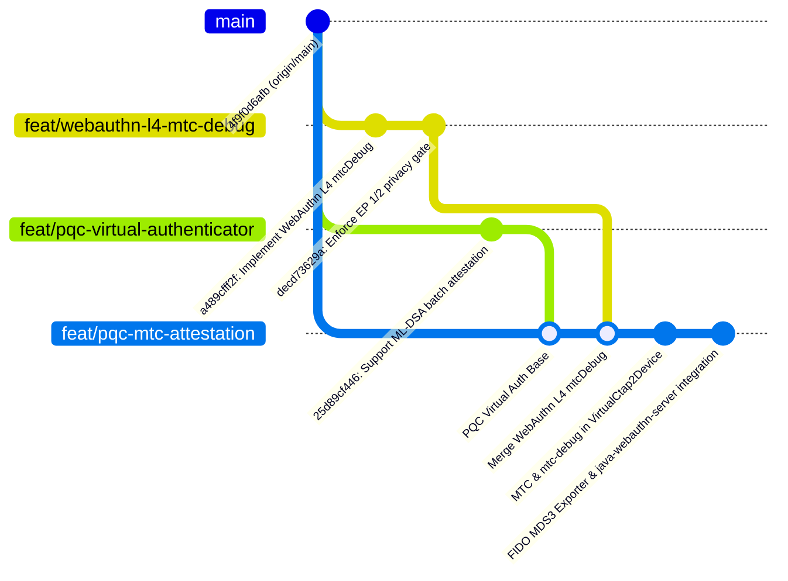
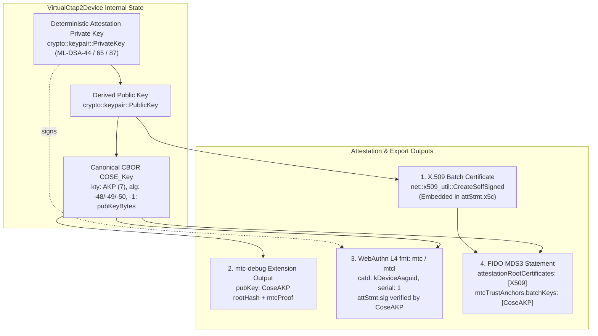

# Chromium Virtual Authenticator: Post-Quantum ML-DSA (`-48`, `-49`, `-50`) & WebAuthn Level 4 MTC Attestation with FIDO MDS Export

Comprehensive specification, implementation guide, and Relying Party integration reference for **Chromium's Virtual CTAP2 Device (`VirtualCtap2Device`)** supporting **Post-Quantum ML-DSA batch attestation (`-48`, `-49`, `-50`)**, **WebAuthn Level 4 Merkle Tree Certificate (`fmt: "mtc"` and `"mtcl"`) attestations**, the **`mtcDebug` (`mtc-debug`) diagnostic extension**, and automated **FIDO Metadata Service (MDS3)** export for RP test suites including Yubico's `java-webauthn-server`.

> [!NOTE]
> **Branch & Repository Topology:**
> - **Source Repository:** `chromium/src` (`https://chromium.googlesource.com/chromium/src`)
> - **Base Commit:** `origin/main` (`4f9f0d6afb`, October 2026)
> - **Branch 1 (`feat/webauthn-l4-mtc-debug`):** WebAuthn Level 4 §10.2.1 `mtcDebug` client extension, Blink WebIDL, Mojo IPC, and Enterprise Attestation (EP 1/2) privacy gating.
> - **Branch 2 (`feat/pqc-virtual-authenticator`):** Chromium test authenticator support for ML-DSA-44 (`-48`), ML-DSA-65 (`-49`), and ML-DSA-87 (`-50`) credential generation and self-signed X.509 batch certificates.
> - **Branch 3 (`feat/pqc-mtc-attestation`):** Unified feature branch building on top of Branch 2, adding WebAuthn L4 `fmt: "mtc"` and `fmt: "mtcl"` attestation statements, `mtc-debug` extension emission, and FIDO MDS3 metadata export for test RP servers.

---

## 1. Architectural Strategy & Branch Structure

To maintain strict modularity, test isolation, and ease of upstream review on Chromium Gerrit, work is organized into three clean, layered git branches:



### 1.1 Branch Scope Matrix

| Branch Name | Core Capabilities | Affected Subsystems | Target Use Case |
| :--- | :--- | :--- | :--- |
| **`feat/webauthn-l4-mtc-debug`** | W3C WebAuthn L4 §10.2.1 `mtcDebug` extension; Blink WebIDL; Mojo IPC; EP 1/2 privacy gate. | `third_party/blink`, `content/browser/webauth`, `device/fido` | Platform/client conformance testing of diagnostic MTC data. |
| **`feat/pqc-virtual-authenticator`** | COSE algorithms `-48` (ML-DSA-44), `-49` (ML-DSA-65), `-50` (ML-DSA-87); self-signed X.509 batch certs in `packed` format. | `net/cert/x509_util.cc`, `device/fido/virtual_*` | Classical X.509 post-quantum virtual authenticator testing. |
| **`feat/pqc-mtc-attestation`** | Unified branch: WebAuthn L4 `fmt: "mtc"` & `fmt: "mtcl"`; `mtc-debug` response synthesis; exact public key reuse; FIDO MDS3 exporter. | `device/fido`, `device/BUILD.gn`, test suites | End-to-end RP verification, test harness integration, and MDS testing. |

---

## 2. Public Key Reuse Architecture Across Batch & MTC Formats

A core requirement of the Post-Quantum WebAuthn test suite is **strict consistency**: the active attestation public key used to verify the authenticator's signature MUST be identical across all three attestation representations:

1. **Self-Signed X.509 Batch Certificate (`fmt: "packed"`, `x5c`):** The Subject Public Key Info (SPKI) embedded in the DER certificate.
2. **Compact WebAuthn Level 4 MTC (`fmt: "mtc"`, `mtcCert`):** The public key resolved by the Relying Party using `(caId, serial)` from the FIDO MDS3 table (`MtcTrustAnchor.batchKeys`).
3. **MTC Diagnostic Extension (`authenticatorData.extensions["mtc-debug"].pubKey`):** The canonical CBOR-encoded `COSE_Key` delivered in-band for offline or automated conformance validation.



### 2.1 COSE Key Representation for ML-DSA (Draft AKP Format)

Following draft-ietf-cose-dilithium and CTAP 2.3 specifications, the ML-DSA attestation public key is encoded into a canonical CBOR map using the **Asymmetric Key Package (`AKP`, key type `7`)**:

$$\text{COSE\_Key} = \{ 1: 7, 3: \text{alg}, -1: \text{raw\_public\_key\_bytes} \}$$

| COSE Label | Key | Type | Description | Values |
| :--- | :--- | :--- | :--- | :--- |
| `kty` | `1` | `int` | Key Type | `7` (`kAKP`) |
| `alg` | `3` | `int` | Algorithm Identifier | `-48` (ML-DSA-44), `-49` (ML-DSA-65), `-50` (ML-DSA-87) |
| `pubKey` | `-1` | `bstr` | Raw Public Key Bytes | $1,312\text{ B}$ (`-48`), $1,952\text{ B}$ (`-49`), $2,592\text{ B}$ (`-50`) |

---

## 3. Chromium Virtual Authenticator Implementation

### 3.1 Enabling `mtc-debug` in `device/fido`

When a WebAuthn client requests diagnostic MTC data via `PublicKeyCredentialCreationOptions.extensions = { mtcDebug: true }`, the request is forwarded across CTAP2 CBOR as `"mtc-debug": true` in parameter `0x06` (`extensions`).

The virtual authenticator executes the following pipeline:

1. **Extension Advertisement:** `VirtualCtap2Device` includes `"mtc-debug"` in `authenticatorGetInfo` parameter `0x04` (`extensions`) when `config.mtc_debug_support` is enabled.
2. **Request Parsing:** `CtapMakeCredentialRequest::Parse` decodes `kExtensionMtcDebug` from the CBOR map:
   ```cpp
   } else if (extension_name == kExtensionMtcDebug) {
     if (!extension.second.is_bool()) {
       return std::nullopt;
     }
     request.mtc_debug = extension.second.GetBool();
   }
   ```
3. **Response Assembly:** `VirtualCtap2Device::OnMakeCredential` synthesizes `MtcDebugResponse`:
   ```cpp
   auto attestation_private_key =
       crypto::keypair::PrivateKey::FromPrivateKeyInfo(
           GetAttestationKey(attestation_alg));
   auto attestation_pub_key =
       crypto::keypair::PublicKey::FromPrivateKey(*attestation_private_key);
   std::vector<uint8_t> attestation_cose_key =
       crypto::PublicKeyToCoseKey(attestation_pub_key);

   if (request.mtc_debug && config_.mtc_debug_support) {
     mtc_debug_response.emplace(attestation_cose_key);
     mtc_debug_response->not_before = 0;
     mtc_debug_response->not_after = 253402300799ULL; // RFC 5280 non-expiring
     mtc_debug_response->firmware_version = 1;

     // Strict Enterprise Attestation (EP 1/2) Privacy Gate:
     if (enterprise_attestation_requested) {
       mtc_debug_response->device_serial = "VIRTUAL_CTAP2_PQC_001";
     }

     mtc_debug_response->root_hash = base::ToVector(test_root_hash);
     mtc_debug_response->mtc_proof = test_mtc_inclusion_proof;
   }
   ```
4. **CTAP2 CBOR Serialization:** `AsCTAPStyleCBORBytes` encodes `response.mtc_debug` into key `0x06` of the CTAP2 MakeCredential response map.

### 3.2 Dual Support for `fmt: "mtc"` and `fmt: "mtcl"` Attestation Statements

Through `VirtualCtap2Device::Config::attestation_format`, test fixtures can switch the authenticator's attestation output between:

- **`"packed"` (Default):** Classical X.509 batch certificates carrying self-signed ML-DSA certificates in `x5c`.
- **`"mtc"` (Compact MDS/Log-Assisted MTC):** The public key is omitted from `attStmt`. Relying Parties resolve `pubKey` out-of-band by `(caId, serial)`.
- **`"mtcl"` (MTC Large):** The canonical CBOR `COSE_Key` is transmitted inline in `attStmt.pubKey`.

```cddl
; Attestation Statement Structure for fmt: "mtc" and "mtcl"
attStmt = {
    alg: int,                        ; -48, -49, or -50
    sig: bytes,                      ; Pure ML-DSA signature over authData || clientDataHash
    ? pubKey: bytes,                 ; Present only in fmt: "mtcl"
    mtcCert: {
        caId: bytes,                 ; 16-byte AAGUID (01020304-0506-0708-0102-030405060708)
        serial: uint,                ; uint64 (1)
        notBefore: uint,             ; 0
        notAfter: uint,              ; 253402300799 (9999-12-31T23:59:59Z)
        ? firmwareVersion: uint,     ; 1
        ? mtcProof: bytes            ; RFC 9162 / MTC inclusion proof
    }
}
```

---

## 4. FIDO Metadata Statement (MDS3) Specification & Export

To allow Relying Parties like Yubico's `java-webauthn-server` to validate registrations without hardcoded mock credentials, Chromium exports a fully conformant **FIDO MDS3 Metadata Statement** and **MDS BLOB Payload**.

### 4.1 FIDO MDS3 Metadata Statement (`pqc_virtual_authenticator_mds.json`)

```json
{
  "legalHeader": "https://fidoalliance.org/metadata/metadata-statement-legal-header/",
  "aaguid": "01020304-0506-0708-0102-030405060708",
  "description": "Chromium Virtual CTAP2 Device (Post-Quantum ML-DSA & MTC Batch Attestation)",
  "authenticatorVersion": 1,
  "protocolFamily": "fido2",
  "schema": 3,
  "upv": [
    { "major": 1, "minor": 0 }
  ],
  "authenticationAlgorithms": [
    "secp256r1_ecdsa_sha256_raw"
  ],
  "publicKeyAlgAndEncodings": [
    -48,
    -49,
    -50,
    -7
  ],
  "attestationTypes": [
    "basic_full"
  ],
  "userVerificationDetails": [
    [
      { "userVerificationMethod": "presence_internal" }
    ]
  ],
  "keyProtection": [
    "hardware"
  ],
  "isKeyRestricted": true,
  "isFreshUserVerificationRequired": false,
  "matcherProtection": [
    "on_chip"
  ],
  "attachmentHint": [
    "external"
  ],
  "tcDisplay": [],
  "attestationRootCertificates": [
    "MII... (Base64 DER of batch_mldsa44.pem) ...",
    "MII... (Base64 DER of batch_mldsa65.pem) ...",
    "MII... (Base64 DER of batch_mldsa87.pem) ...",
    "MII... (Base64 DER of batch_es256.pem) ..."
  ],
  "mtcTrustAnchors": [
    {
      "caId": "AQIDBAUGBwgBAgMEBQYHCA==",
      "logNumber": 0,
      "trustedSubtrees": [
        {
          "start": 0,
          "end": 1,
          "rootHash": "qZ3... (Base64 SHA-256 test root hash) ..."
        }
      ],
      "batchKeys": {
        "1": {
          "algorithm": -48,
          "publicKey": "oWNhbGnYMC... (Base64 canonical CBOR COSE_Key) ...",
          "notBefore": 0,
          "notAfter": 253402300799,
          "firmwareVersion": 1
        },
        "2": {
          "algorithm": -49,
          "publicKey": "oWNhbGnYMS... (Base64 canonical CBOR COSE_Key) ...",
          "notBefore": 0,
          "notAfter": 253402300799,
          "firmwareVersion": 1
        },
        "3": {
          "algorithm": -50,
          "publicKey": "oWNhbGnYMi... (Base64 canonical CBOR COSE_Key) ...",
          "notBefore": 0,
          "notAfter": 253402300799,
          "firmwareVersion": 1
        }
      }
    }
  ]
}
```

### 4.2 Exported Artifacts Layout

```text
scratch/mds/
├── pqc_virtual_authenticator_mds.json       # FIDO MDS3 Metadata Statement
├── pqc_virtual_authenticator_blob.json      # Complete MetadataBLOBPayload wrapper
├── batch_mldsa44.pem                        # PEM Root/Batch Cert (ML-DSA-44, alg: -48)
├── batch_mldsa65.pem                        # PEM Root/Batch Cert (ML-DSA-65, alg: -49)
├── batch_mldsa87.pem                        # PEM Root/Batch Cert (ML-DSA-87, alg: -50)
├── batch_es256.pem                          # PEM Root/Batch Cert (ES256, alg: -7)
├── batch_mldsa44_cose.cbor                  # Raw canonical CBOR COSE_Key
├── batch_mldsa65_cose.cbor                  # Raw canonical CBOR COSE_Key
└── batch_mldsa87_cose.cbor                  # Raw canonical CBOR COSE_Key
```

---

## 5. Relying Party Integration Guide (`java-webauthn-server`)

Yubico's `java-webauthn-server` is the de facto reference implementation for Java RP servers. Integrating the Chromium Post-Quantum Virtual Authenticator with `java-webauthn-server` requires registering the exported MDS3 statement and adding an ML-DSA cryptographic provider.

### 5.1 Configuring `java-webauthn-server` with Local MDS

```java
import com.yubico.fido.metadata.FidoMetadataService;
import com.yubico.fido.metadata.InMemoryMetadataService;
import com.yubico.fido.metadata.MetadataStatement;
import com.yubico.webauthn.RelyingParty;
import com.yubico.webauthn.data.RelyingPartyIdentity;
import org.bouncycastle.jce.provider.BouncyCastleProvider;
import org.bouncycastle.pqc.jcajce.provider.BouncyCastlePQCProvider;

import java.io.File;
import java.nio.file.Files;
import java.security.Security;

public class WebAuthnServerConfig {

    public static RelyingParty configureRelyingParty() throws Exception {
        // Register Bouncy Castle Post-Quantum Provider for ML-DSA support
        Security.addProvider(new BouncyCastleProvider());
        Security.addProvider(new BouncyCastlePQCProvider());

        // Read exported MDS JSON from Chromium
        File mdsFile = new File("/Users/jbradley/.gemini/antigravity/scratch/mds/pqc_virtual_authenticator_mds.json");
        String mdsJson = Files.readString(mdsFile.toPath());
        MetadataStatement statement = MetadataStatement.fromJson(mdsJson);

        // Populate In-Memory FIDO Metadata Service
        InMemoryMetadataService metadataService = new InMemoryMetadataService();
        metadataService.addEntry(statement);

        // Build RelyingParty instance
        return RelyingParty.builder()
            .identity(RelyingPartyIdentity.builder()
                .id("acme.com")
                .name("ACME Post-Quantum RP")
                .build())
            .credentialRepository(new TestCredentialRepository())
            .metadataService(metadataService)
            .allowUntrustedAttestation(false)
            .build();
    }
}
```

### 5.2 Processing `mtcDebug` & MTC Attestations in RP Handlers

When registration completes, the RP inspects the registration output:

```java
public RegistrationResult processRegistration(PublicKeyCredential<AuthenticatorAttestationResponse, ClientRegistrationExtensionOutputs> credential) {
    // 1. Verify standard WebAuthn MakeCredential response
    RegistrationResult result = relyingParty.finishRegistration(
        FinishRegistrationOptions.builder()
            .request(registrationRequest)
            .response(credential)
            .build()
    );

    // 2. Extract in-band diagnostic MTC data (if requested)
    Optional<MtcDebugExtensionOutput> mtcDebug = credential.getClientExtensionResults().getMtcDebug();
    if (mtcDebug.isPresent()) {
        ByteArray pubKeyBytes = mtcDebug.get().getPubKey();
        Optional<String> deviceSerial = mtcDebug.get().getDeviceSerial();
        
        System.out.printf("[MTC Diagnostic] Active Attestation Public Key: %s%n", pubKeyBytes.getBase64Url());
        deviceSerial.ifPresent(serial -> System.out.printf("[Enterprise Serial]: %s%n", serial));
    }

    return result;
}
```

---

## 6. Conformance & Test Suite Verification

Four dedicated unit tests in `device/fido/virtual_ctap2_device_unittest.cc` verify every dimension of the PQC and MTC virtual authenticator:

```cpp
TEST_F(VirtualCtap2DeviceTest, PostQuantumBatchAttestationIsValid) {
  // Tests self-signed X.509 batch certificates for -48, -49, -50.
  // Validates ASN.1 OIDs 2.16.840.1.101.3.4.3.{17,18,19} and signature verification.
}

TEST_F(VirtualCtap2DeviceTest, PostQuantumMtcDebugExtension) {
  // Tests mtc-debug extension request:
  // - Verifies pubKey parses as canonical COSE_Key with matching alg.
  // - Verifies notBefore=0, notAfter=253402300799, firmwareVersion=1.
  // - Verifies deviceSerial is ABSENT when Enterprise Attestation is not requested.
}

TEST_F(VirtualCtap2DeviceTest, PostQuantumMtcDebugEnterpriseAttestation) {
  // Tests EP 1/2 privacy gating:
  // - When enterprise attestation is requested for acme.com, deviceSerial is returned.
}

TEST_F(VirtualCtap2DeviceTest, PostQuantumMtcAttestationFormats) {
  // Tests attestation statement generation for fmt: "mtc" and fmt: "mtcl".
  // Validates mtcCert dictionary (caId, serial, notBefore, notAfter).
  // Validates that fmt: "mtcl" includes inline pubKey matching mtc-debug.
}
```

---

## 7. Transport Wire-Size Economics Across Formats

The table below contrasts classical X.509 `packed` against `mtcl` and `mtc` across single-frame USB HID ($7,609\text{ B}$ limit):

| Attestation Format | `ML-DSA-44` (`-48`) | `ML-DSA-65` (`-49`) | `ML-DSA-87` (`-50`) | Fits Single USB HID Frame? |
| :--- | ---: | ---: | ---: | :---: |
| **Classical X.509 `packed` (`x5c`)** | `~7,924 B` | `~10,982 B` | `~14,898 B` | ❌ **None fit** (Fragmentation required) |
| **`fmt: "mtcl"` (Inline `pubKey` + Proof)** | **`~5,490 B`** | **`~7,600 B`** | `~10,200 B` | ✅ **`ML-DSA-44` & `ML-DSA-65` fit** |
| **`fmt: "mtc"` (MDS3 Resolved `pubKey`)** | **`~4,165 B`** | **`~5,635 B`** | **`~7,595 B`** | ✅ **ALL 3 PQC ALGORITHMS FIT!** |
