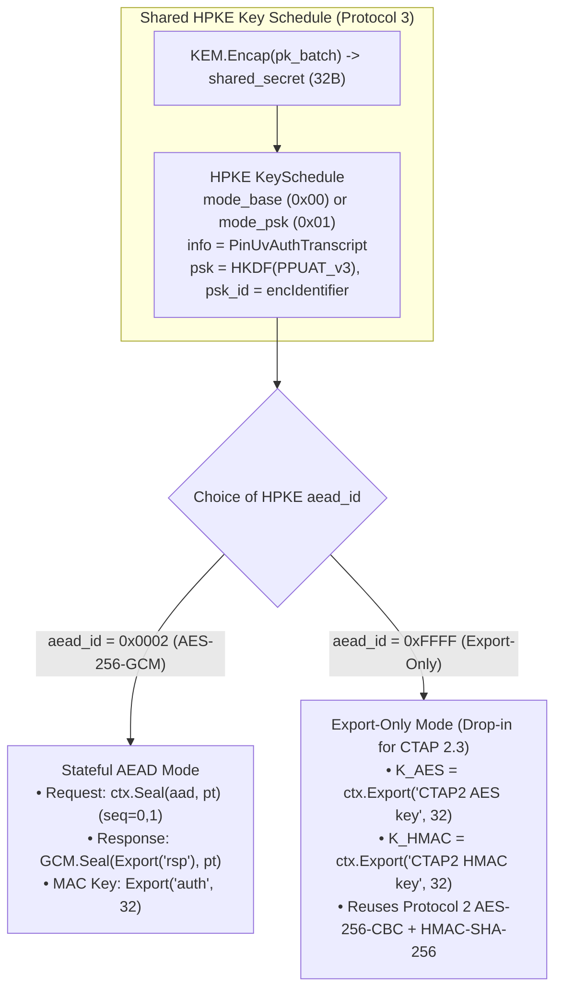
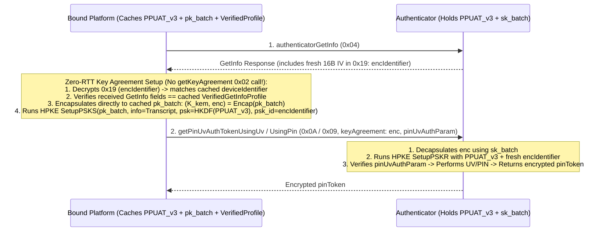
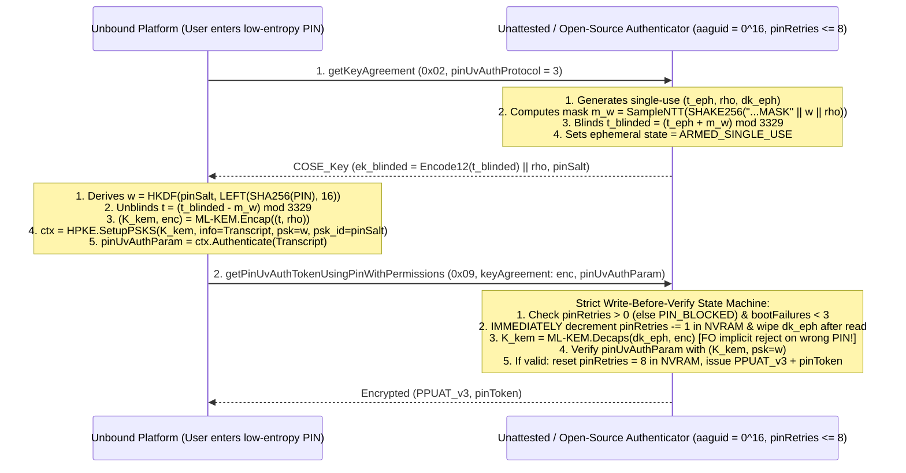
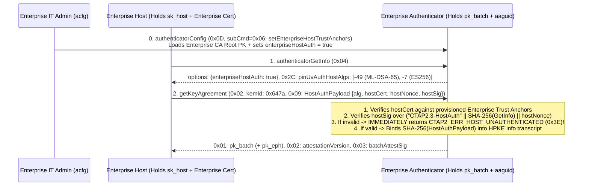
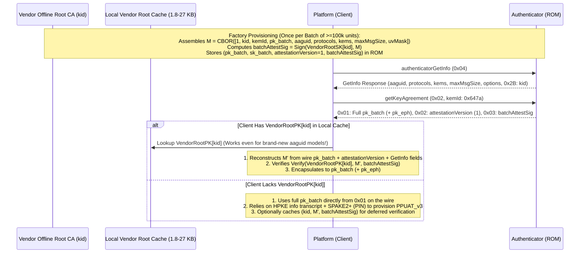
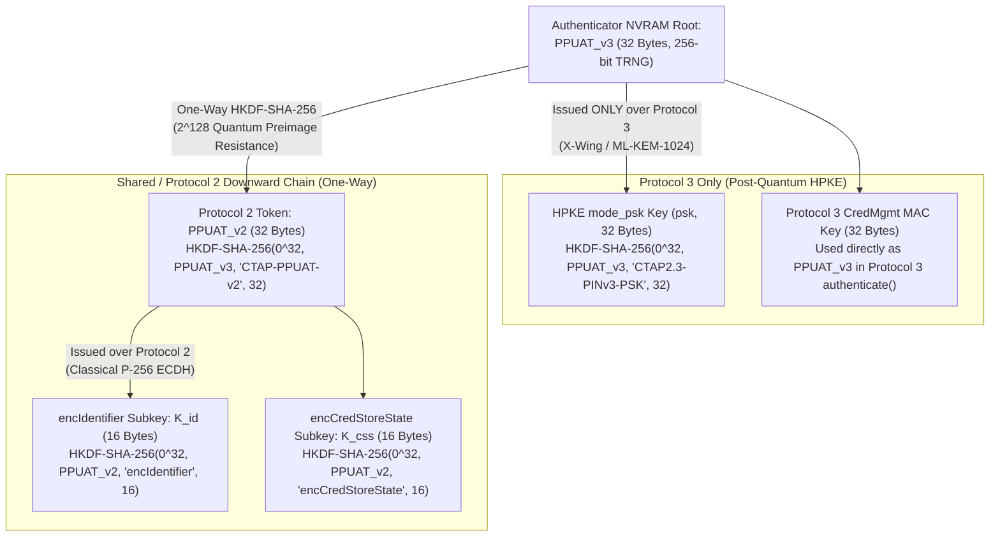

# CTAP 2.3+ Post-Quantum PIN/UV Auth Protocol 3 (`pinUvAuthProtocol = 3`): Architecture, Downgrade Integrity, Hierarchical PPUAT, and Encrypted Extensions

> [!IMPORTANT]
> **Notice:** This document is a very early draft for discussion only. It has not been adopted by the FIDO CTAP working group.

This specification defines a Post-Quantum **PIN/UV Auth Protocol 3 (`pinUvAuthProtocol = 3`)** for **FIDO2 CTAP 2.3+**, organized into four core architectural domains:
1. **[Section 1 — Core PIN Protocol `keyAgreement` Issues & Post-Quantum HPKE Architecture](#1-core-pin-protocol-keyagreement-issues--post-quantum-hpke-architecture)**
2. **[Section 2 — Downgrade Issues & `authenticatorGetInfo` Integrity](#2-downgrade-issues--authenticatorgetinfo-integrity)**
3. **[Section 3 — PPUAT Domain Separation Between PIN Protocols 2 and 3](#3-ppuat-domain-separation-between-pin-protocols-2-and-3)**
4. **[Section 4 — Extensions Using Encryption (`hmac-secret`, `largeBlobKey`, `credBlob`, and `sign` / `previewSign5`)](#4-extensions-using-encryption-hmac-secret-largeblobkey-credblob-and-sign--previewsign5)**

---

## 1. Core PIN Protocol `keyAgreement` Issues & Post-Quantum HPKE Architecture

### 1.1 Vulnerabilities in CTAP 2.0–2.3 PIN Protocols 1 and 2

In CTAP 2.0 through CTAP 2.3 (§6.5, `authenticatorClientPIN` `0x06`), PIN/UV Auth Protocols `1` and `2` establish a transport encryption channel between the Platform (OS/Browser) and the Authenticator using an ephemeral **P-256 ECDH** key exchange (`getKeyAgreement`, subcommand `0x02`). This design has **four fundamental cryptographic weaknesses**:

1. **Harvest-Now-Decrypt-Later (HNDL) Quantum Vulnerability:**
   * A passive adversary who records USB, NFC, BLE, or local IPC traffic today captures the Authenticator's P-256 public key $Q_{\text{auth}}$, the Platform's P-256 public key $Q_{\text{plat}}$, and the `AES-256-CBC` ciphertexts.
   * Once a Cryptographically Relevant Quantum Computer (CRQC) runs Shor's algorithm to recover the ephemeral scalar $d_{\text{auth}}$ from $Q_{\text{auth}}$, the attacker derives `sharedSecret` and decrypts **long-lived static secrets** sent in that session:
     * The user's static PIN hash `LEFT(SHA-256(PIN), 16)` in `pinHashEnc` (`0x06`) and `newPinEnc` (`0x05`).
     * The long-lived **Persistent PIN/UV Auth Token (`PPUAT`)** returned in `pinToken` (`0x02`).
     * Static vault/disk encryption keys derived via `hmac-secret` (`prf`) and `largeBlobKey` (`0x07`).
2. **Unauthenticated `keyAgreement` (Active Bus Man-in-the-Middle):**
   * `getKeyAgreement` (`0x02`) returns a raw, unauthenticated P-256 public key. An active MITM on the USB/BLE/NFC bus or local IPC layer can substitute its own ephemeral keypair on both sides:
     * **External PIN (`0x09`):** The MITM decrypts `pinHashEnc` in real time to steal `LEFT(SHA-256(PIN), 16)` and re-encrypts it to the Authenticator.
     * **Internal UV (`0x0A`, `getPinUvAuthTokenUsingUvWithPermissions`):** When on-device biometrics are used, there is **no shared PIN secret** between the Platform and Authenticator, and CTAP 2.3 does not even include a `pinUvAuthParam` (`0x04`) in the `0x0A` request! Any bus MITM can substitute `keyAgreement` in `0x0A` and intercept the returned `pinUvAuthToken` (including `pcfg` PPUAT tokens).
3. **Unauthenticated Symmetric Encryption (`AES-256-CBC` Without MAC on Responses):**
   * While requests authenticate ciphertexts via a separate `pinUvAuthParam` (`HMAC-SHA-256`), responses such as `pinToken` (`0x02`) and `hmac-secret` outputs use raw unauthenticated `AES-256-CBC`, leaving response ciphertexts malleable on the wire.
4. **Extra Round-Trip (`1-RTT`) Overhead on Every Ceremony:**
   * Every PIN/UV session begins with an explicit `getKeyAgreement` (`0x02`) round trip before invoking `0x09` or `0x0A`. With post-quantum KEM public keys (1.2–1.5 KB), fetching an ephemeral key on every login adds significant latency over NFC and BLE.

---

### 1.2 Mapping CTAP 2.3's Abstract KEM Interface to RFC 9180 HPKE & KEM Agility

CTAP 2.3 (§6.5.4) already models its PIN protocol around an asymmetric **KEM + DEM abstract interface** (`getPublicKey() -> coseKey`, `encapsulate(peerCoseKey) -> (coseKey, sharedSecret)`, `decapsulate(peerCoseKey) -> sharedSecret`).

**PIN/UV Auth Protocol 3 (`pinUvAuthProtocol = 3`)** maps this interface directly to **RFC 9180 (HPKE)** with **KEM agility** advertised via a new `authenticatorGetInfo` (`0x04`) field **`0x2A: pinUvAuthKems`** (a preference-ordered array of 16-bit IANA HPKE `kem_id` values):

| HPKE `kem_id` | Algorithm Name | Composition | Target Profile | `Npk` (`pkR`) | `Nenc` (`enc`) |
| :--- | :--- | :--- | :--- | :--- | :--- |
| **`0x647a`** | **`X-Wing`** (`MLKEM768-X25519`) | `ML-KEM-768` + `X25519` | Commercial / Consumer Hybrid Default | 1,216 B | 1,120 B |
| **`0x0050`** | **`MLKEM768-P256`** | `ML-KEM-768` + `P-256` | FIPS 140-3 Hybrid Hardware Keys | 1,249 B | 1,153 B |
| **`0x0042`** | **`ML-KEM-1024`** | Pure `ML-KEM-1024` (Cat 5) | **NSA CNSA 2.0** / High Assurance | 1,568 B | 1,568 B |
| **`0x0041`** | **`ML-KEM-768`** | Pure `ML-KEM-768` (Cat 3) | Pure PQ Standard | 1,184 B | 1,088 B |
| **`0x0040`** | **`ML-KEM-512`** | Pure `ML-KEM-512` (Cat 1) | Legacy `maxMsgSize: 1024` Constrained Keys | 800 B | 768 B |

#### MCU SRAM Optimization & Fujisaki-Okamoto (FO) Implicit Rejection
* **64-Byte Seed Storage:** Instead of holding an expanded 2,400-byte `ML-KEM-768` decapsulation key (`dk`) and 1,184-byte encapsulation key (`ek`) in scarce MCU SRAM, the Authenticator stores only the **64-byte master seed $(d, z)$** (or derives it from ROM/NVRAM for static batch keys) and streams expansion via hardware `SHAKE256`.
* **FO Implicit Rejection & `regenerate()`:** Because `ML-KEM` uses the Fujisaki-Okamoto transform with implicit rejection, `ML-KEM.Decaps()` never returns a decapsulation error on tampered ciphertexts; instead, it outputs a pseudorandom key derived from secret $z$, which causes `pinUvAuthParam` / AEAD verification to fail with `CTAP2_ERR_PIN_AUTH_INVALID`. Upon any authentication failure, the Authenticator rotates its ephemeral state per CTAP 2.3 §6.5.5.4.

---

### 1.3 Comparing HPKE Modes (RFC 9180 Authentication Modes & DEM Modes)

In RFC 9180, HPKE modes span **two orthogonal dimensions**: (1) the **Sender-Authentication Mode** (§5.1) and (2) the **Payload Encryption / DEM Mode** (§5.2–5.3).

#### A. Comparing the 4 HPKE Sender-Authentication Modes (RFC 9180 §5.1)

A critical post-quantum constraint in `draft-ietf-hpke-pq` is that **lattice KEMs (`ML-KEM-768`, `ML-KEM-1024`) and `X-Wing` (`0x647a`) do NOT support `AuthEncap` / `AuthDecap`**, because `AuthEncap` requires non-interactive static-ephemeral Diffie-Hellman ($\text{DH}(sk_S, pk_R) \parallel \text{DH}(sk_E, pk_R)$). Consequently, **`mode_base` (`0x00`)** and **`mode_psk` (`0x01`)** are the only two RFC 9180 modes compatible with Post-Quantum KEMs:

| HPKE Mode | ID | PQ KEM Compatible? | How Authenticator (`R`) Is Authenticated | How Platform (`S`) Is Authenticated | Role in CTAP 2.3 Protocol 3 |
| :--- | :---: | :---: | :--- | :--- | :--- |
| **`mode_base`** | `0x00` | **Yes** | `pk_batch` verified via Vendor `kid` (`FN-DSA` / `LMS` `batchAttestSig`) | **None** at the HPKE layer | **Initial `setPIN` (`0x03`)** on a factory-fresh key (when no PIN and no `PPUAT_v3` exist yet) or unauthenticated `uv=0` transport encryption. |
| **`mode_psk`** | `0x01` | **Yes** | `pk_batch` + possession of `PPUAT_v3` (or `SPAKE2+` PIN verifier) | Possession of 256-bit **`PPUAT_v3`** (or **`SPAKE2+`** PIN secret) + fresh `encIdentifier` (`psk_id`) | **Primary Mode for Protocol 3:**<br/>• **Unbound PC:** `psk` = `SPAKE2+` PIN secret (to provision `PPUAT_v3`).<br/>• **Bound PC (0-RTT):** `psk` = `HKDF(PPUAT_v3)`, `psk_id` = `encIdentifier` (`0x19`) for both Internal UV (`0x0A`) & External PIN (`0x09`). |
| **`mode_auth`** | `0x02` | **No** (`DHKEM` only) | `pkR` | Asymmetric Platform key `skS` via `AuthEncap` | **Not usable with `ML-KEM` / `X-Wing`** (Lattice KEMs lack non-interactive `AuthEncap`). |
| **`mode_auth_psk`** | `0x03` | **No** (`DHKEM` only) | `pkR` + `psk` | Asymmetric `skS` + `psk` | **Not usable with `ML-KEM` / `X-Wing`**; redundant once `PPUAT_v3` provides a 256-bit symmetric `psk`. |

#### B. Comparing the 2 HPKE DEM Modes (`AEAD` `0x0002` vs. `Export-Only` `0xFFFF`) & Bidirectional Keying

In RFC 9180, an HPKE `Context` is unidirectional (Sender $\to$ Receiver), whereas CTAP 2.3 encrypts data in **both directions** on a single handshake (e.g., Platform sends `pinHashEnc` or `saltEnc`; Authenticator responds with `pinToken` or `hmac-secret` `output`).



| Feature | Option 1: HPKE Stateful AEAD (`aead_id = 0x0002`, `AES-256-GCM`) | Option 2: HPKE Export-Only (`aead_id = 0xFFFF`) |
| :--- | :--- | :--- |
| **Platform $\to$ Authenticator (`newPinEnc`, `pinHashEnc`)** | Uses `ctx.Seal(aad, pt)` (`seq = 0` for `newPinEnc`, `seq = 1` for `pinHashEnc` in `changePIN`). | Exports $K_{\text{AES}} = \text{ctx.Export}(\text{"CTAP2 AES key"}, 32)$ and uses `IV_16 \|\| AES-256-CBC(K_AES, IV_16, pt)`. |
| **Authenticator $\to$ Platform (`pinToken` `0x02`)** | Exports $(K_{\text{rsp}}, N_{\text{rsp}}) = \text{ctx.Export}(\text{"CTAP2.3-PINv3-Rsp"}, 44)$ and uses `AES-256-GCM.Seal(K_rsp, N_rsp, aad, pt)`. | Reuses `IV_16 \|\| AES-256-CBC(K_AES, IV_16, pt)`. |
| **Standalone `authenticate()` Key** | Exports $K_{\text{HMAC}} = \text{ctx.Export}(\text{"CTAP2.3-PINv3-Auth"}, 32)$. | Exports $K_{\text{HMAC}} = \text{ctx.Export}(\text{"CTAP2 HMAC key"}, 32)$. |
| **Wire Overhead per Encrypted Field** | **+16 bytes** (16 B GCM tag, **0 B wire IV** because nonce is derived from `base_nonce ^ seq`). | **+16 bytes** (16 B prepended random CBC IV, **0 B tag**). |
| **Cryptographic Hygiene vs. Firmware Reuse** | **Highest Security:** Eliminates unauthenticated `AES-CBC` on responses (`pinToken`) and binds `AAD` into every ciphertext. | **Maximum Firmware Reuse:** Reuses 100% of Protocol 2's `encrypt()`, `decrypt()`, and `authenticate()` code; only replaces `kdf(Z)`! |

---

### 1.4 Zero-RTT `keyAgreement` Caching Against `PPUAT_v3` (Skipping `getKeyAgreement`)

Once a Platform has completed initial binding with an Authenticator—acquiring $\text{PPUAT}_{v3}$, receiving the Authenticator's static batch public key `pk_batch`, and validating the vendor attestation over `authenticatorGetInfo` (Section 2)—the Platform caches the tuple:
$$\text{CachedBinding} = \left(\text{deviceIdentifier}, \text{PPUAT}_{v3}, \text{kemId}, \text{pk}_{\text{batch}}, \text{VerifiedGetInfoProfile}\right)$$

On **every subsequent session** with that Authenticator, the Platform **completely skips the `getKeyAgreement` (`0x02`) round trip**:



#### Four Architectural Wins of Caching `pk_batch` Against `PPUAT_v3`:
1. **Eliminates 1 Full Round Trip & ~2.5 KB of Traffic per Login:** `pk_batch` (1.2–1.5 KB) and `batchAttestSig` (0.7–1.4 KB) are transmitted **only once per computer** (during initial binding). Every subsequent login goes directly from `authenticatorGetInfo` (`0x04`) to `getPinUvAuthToken...` (`0x09` / `0x0A`)—cutting NFC/BLE transport overhead by over **50%**.
2. **Eliminates Runtime `ML-KEM.KeyGen` on the Authenticator MCU:** On bound sessions, the Authenticator only executes fast **`ML-KEM.Decaps(sk_batch, enc)`**.
3. **Preserves Full Per-Session Bidirectional Freshness:**
   * **Platform Entropy:** `KEM.Encap(cached_pk_batch)` samples a fresh 256-bit random seed $m$ on every request, producing a fresh `enc` and `shared_secret`.
   * **Authenticator Entropy:** `authenticatorGetInfo` (`0x04`) generates a fresh 128-bit random $\text{IV}_{\text{id}}$ inside `encIdentifier` (`0x19`), bound as `psk_id` in HPKE `SetupPSKS` / `SetupPSKR` to prevent replay of captured `0x09` / `0x0A` requests.
4. **Instant $O(1)$ Downgrade Verification:** Matching `encIdentifier` (`0x19`) allows the Platform to immediately verify that the received `authenticatorGetInfo` fields match the cached `VerifiedGetInfoProfile` without re-running signature verification.

---

### 1.5 Unattested / Open-Source / Privacy Authenticators (`aaguid = 0^16`), Low-Entropy PINs in Key Agreement, and the 8-Try `pinRetries` State Machine

A critical real-world deployment class for `pinUvAuthProtocol = 3` is **open-source, DIY, small-vendor, or privacy-preserving authenticators** that intentionally have:
* **No Batch Attestation Certificate (`batchAttestSig` absent)** — because the project is open-source hardware/firmware where users flash their own MCUs and no secret vendor batch key can exist, or to eliminate batch-level correlation across Relying Parties and Platforms.
* **An All-Zero `aaguid` (`00000000-0000-0000-0000-000000000000`)** — so FIDO MDS lookup is impossible and the Platform cannot authenticate the Authenticator's public key `pk_auth` out-of-band during initial key establishment.

This raises two fundamental cryptographic questions:
1. **Is it safe to make a low-entropy device PIN part of the key agreement (`getKeyAgreement` / `0x09`) when the Authenticator has no batch certificate or `aaguid`?**
2. **How must the Authenticator's `pinRetries` counter (capped at 8 total tries, 3 per boot) work so that neither a malicious Platform nor a fake Authenticator / active MITM can test more than 8 PINs via key establishment?**

#### 1.5.1 Why Naive PIN-in-Key-Agreement (`HPKE mode_psk` with `psk = pinHash`) Is Catastrophically Broken Without Attestation

Suppose an unattested Authenticator simply returns an **unblinded** public key `pk_auth` in `getKeyAgreement` (`0x02`), and the Platform injects the user's low-entropy PIN directly into `HPKE.SetupPSKS(pk_auth, info = Transcript, psk = LEFT(SHA-256(PIN), 16))` when calling `getPinUvAuthTokenUsingPinWithPermissions` (`0x09`):

> [!CAUTION]
> **The 1-Try Offline Dictionary Attack by a Fake Authenticator / Active MITM:**
> Because `pk_auth` has no batch certificate or `aaguid`, an active MITM on the USB/NFC bus (or a malicious USB hub / fake authenticator) replaces `pk_auth` with its own keypair `(pk_mitm, sk_mitm)`.
> 1. The user types their 4–6 digit low-entropy PIN **once** on the Platform.
> 2. The Platform encapsulates `(K_kem, enc) = ML-KEM.Encap(pk_mitm)` and sends `(enc, pinUvAuthParam)` where `pinUvAuthParam` is derived from `(K_kem, psk = pinHash)`.
> 3. Because the MITM knows `sk_mitm`, it computes `K_kem = ML-KEM.Decaps(sk_mitm, enc)` and immediately runs an **offline brute-force loop** testing all $10^4\text{–}10^6$ human PINs against `pinUvAuthParam` in **under 1 millisecond**—recovering the user's PIN on the **very first try** while **completely bypassing the Authenticator's 8-try `pinRetries` counter**!

Similarly, pairing an unblinded `ML-KEM` key exchange with a **classical-only PAKE** (such as P-256 `SPAKE2+` or `CPace`) fails against a **Harvest-Now-Decrypt-Later (HNDL) Active MITM**: the MITM terminates the unauthenticated `ML-KEM` layer with `pk_mitm`, records the classical `SPAKE2+` points $(X = xG + w_0 M,\; Y = yG + w_0 N)$, and later uses a quantum computer (Shor's algorithm) to solve the discrete logarithm of $X$ and recover both the low-entropy PIN $w_0$ and the issued $\text{PPUAT}_{v3}$.

#### 1.5.2 When It IS Safe: Post-Quantum PAKE via `ML-KEM` $\hat{\mathbf{t}}$-Vector Blinding (`PQ-EKE` / `CAKE`)

Making the device PIN part of key agreement on an unattested authenticator **is** cryptographically safe—both classically and post-quantumly—**if and only if the Authenticator's ephemeral `ML-KEM` public key in `getKeyAgreement` (`0x02`) is blinded by a salted PIN verifier $w$ (forming a lattice Encrypted Key Exchange, `PQ-EKE` / `CAKE`), and `pinRetries <= 8` is decremented in NVRAM before decapsulation**:

1. **Salted PIN Verifier Provisioning (`setPIN` `0x03` / `changePIN` `0x04`):**
   When a PIN is set, the Authenticator generates a fresh 16-byte random `pinSalt` and stores the 32-byte verifier in NVRAM:
   $$w = \text{HKDF-SHA-256}\left(\text{salt}=\text{pinSalt},\; \text{IKM}=\text{LEFT}(\text{SHA-256}(\text{PIN}), 16),\; \text{info}=\text{"CTAP2.3-PINv3-PAKE"},\; L=32\right)$$
2. **Blinded `getKeyAgreement` (`0x02`) on Unbound Sessions:**
   The Authenticator generates a fresh single-use ephemeral `ML-KEM` keypair $(ek_{\text{eph}} = (\hat{\mathbf{t}}_{\text{eph}}, \rho),\; dk_{\text{eph}})$ where $\hat{\mathbf{t}}_{\text{eph}} = \hat{\mathbf{A}}\hat{\mathbf{s}} + \hat{\mathbf{e}} \bmod q$ ($q = 3329$ in $\mathbb{Z}_q^{k \times 256}$). Using `SHAKE256`, it derives a deterministic polynomial mask vector $\hat{\mathbf{m}}_w \in \mathbb{Z}_q^{k \times 256}$ and blinds $\hat{\mathbf{t}}_{\text{eph}}$ modularly before encoding:
   $$\hat{\mathbf{m}}_w = \text{SampleUniform}_{\mathbb{Z}_q^{k \times 256}}\left(\text{SHAKE256}(\text{"CTAP2.3-PINv3-PAKE-MASK"} \parallel w \parallel \rho)\right)$$
   $$\hat{\mathbf{t}}_{\text{blinded}} = (\hat{\mathbf{t}}_{\text{eph}} + \hat{\mathbf{m}}_w) \bmod q, \quad ek_{\text{blinded}} = \text{ByteEncode}_{12}(\hat{\mathbf{t}}_{\text{blinded}}) \parallel \rho$$
   The Authenticator returns `(ek_blinded, pinSalt)` in `getKeyAgreement` (`0x02`).
3. **Platform Unblinding & HPKE Encapsulation (`0x09`):**
   The Platform computes $w$ from the user-entered PIN and `pinSalt`, computes $\hat{\mathbf{m}}_w$, unblinds the `ML-KEM` vector:
   $$\hat{\mathbf{t}} = (\hat{\mathbf{t}}_{\text{blinded}} - \hat{\mathbf{m}}_w) \bmod q$$
   executes $(K_{\text{kem}}, \text{enc}) = \text{ML-KEM.Encap}((\hat{\mathbf{t}}, \rho))$, and runs `HPKE.SetupPSKS` with `psk = w` and `psk_id = pinSalt` to compute `pinUvAuthParam`. (Optionally, the Platform and Authenticator can run `X-Wing` where the P-256/X25519 component is simultaneously blinded via `SPAKE2+`/`CPace` for hybrid classical+PQ PAKE assurance.)



#### 1.5.3 Why Both Attack Directions Are Capped at $\le 1$ Guess per Message (and $\le 8$ Total)

| Threat Actor | Attack Vector | Why `ML-KEM` $\hat{\mathbf{t}}$-Blinding + `pinRetries` Completely Blocks Offline Guessing |
| :--- | :--- | :--- |
| **1. Malicious Platform Polling `getKeyAgreement` (`0x02`) Offline** | Platform calls `getKeyAgreement` (`0x02`) 1,000,000 times and tries to test all $10^6$ PINs $w'$ offline against $\hat{\mathbf{t}}_{\text{blinded}}$ without calling `0x09`. | By the **Module-LWE (MLWE)** assumption, $\hat{\mathbf{t}}_{\text{eph}} = \hat{\mathbf{A}}\hat{\mathbf{s}} + \hat{\mathbf{e}} \bmod q$ is computationally indistinguishable from uniform over $\mathbb{Z}_q^{k \times 256}$. Therefore, for **every** candidate PIN $w'$, the unblinded vector $\hat{\mathbf{t}}' = (\hat{\mathbf{t}}_{\text{blinded}} - \hat{\mathbf{m}}_{w'}) \bmod q$ is *also* a valid, uniform element of $\mathbb{Z}_q^{k \times 256}$! `getKeyAgreement` leaks **0 bits** of offline information about $w$; to test a single candidate $w'$, the Platform **must** submit `enc` in `0x09`. |
| **2. Fake Authenticator / Active MITM Attacking the Platform (`0x09`)** | Fake Authenticator sends a crafted $\hat{\mathbf{t}}_{\text{blinded}}^*$ in `0x02` so that when the Platform sends `(enc, pinUvAuthParam)` in `0x09`, the MITM can brute-force the user's PIN offline. | To know a secret trapdoor vector $\hat{\mathbf{s}}_{\text{mitm}}$ for the lattice public key the Platform encapsulates to, the MITM **must commit to a single PIN guess $w_{\text{guess}}$ before sending `0x02`**: $\hat{\mathbf{t}}_{\text{blinded}}^* = (\hat{\mathbf{A}}\hat{\mathbf{s}}_{\text{mitm}} + \hat{\mathbf{e}}_{\text{mitm}} + \hat{\mathbf{m}}_{w_{\text{guess}}}) \bmod q$. If $w_{\text{guess}} \neq w_{\text{user}}$, the Platform encapsulates to $\hat{\mathbf{t}}_{\text{plat}} = \hat{\mathbf{t}}_{\text{mitm}} + (\hat{\mathbf{m}}_{w_{\text{guess}}} - \hat{\mathbf{m}}_{w_{\text{user}}}) \bmod q = \hat{\mathbf{t}}_{\text{mitm}} + \Delta$. Because $\Delta$ is a uniform SHAKE256 output in $\mathbb{Z}_q^{k \times 256}$, no short vector $\mathbf{s}_\Delta$ exists such that $\mathbf{A}\mathbf{s}_\Delta \approx \Delta$ (**Module-SIS**), and recovering the Platform's ephemeral $\mathbf{r}$ from $\mathbf{u} = \mathbf{A}^T\mathbf{r} + \mathbf{e}_1$ is hard by **Module-LWE**. Thus the MITM gets **at most 1 online guess per user PIN entry** and **0 offline guesses**! |
| **3. Malicious Platform Testing Multiple PINs Against One `0x02`** | Platform calls `0x02` once and sends 8 rapid `0x09` requests or power-glitches the Authenticator during decapsulation. | Enforced by the **4-Rule `pinRetries` State Machine** below. |

#### 1.5.4 The 4 Mandatory Rules for the `pinRetries` Counter State Machine (Max 8 Total, Max 3 Per Boot)

To guarantee that a malicious Platform can never test more than **8 candidate PINs** via key establishment—even under USB power-tearing, timing analysis, or repeated `getKeyAgreement` calls—the Authenticator **MUST** enforce four state-machine invariants:

1. **Rule 1 (`getKeyAgreement` Does Not Decrement `pinRetries`, But $dk_{\text{eph}}$ Is Strictly Single-Use):**
   * Calling `getKeyAgreement` (`0x02`) **MUST NOT** decrement `pinRetries` (otherwise any unprivileged background process could lock out the token in 8 packets without knowing the PIN). Because $\hat{\mathbf{t}}_{\text{blinded}}$ is indistinguishable from uniform random (MLWE), calling `0x02` gives the attacker zero offline advantage.
   * However, the Authenticator holds **at most one** active ephemeral keypair $(ek_{\text{eph}}, dk_{\text{eph}})$ in RAM (`state = ARMED_SINGLE_USE`). The instant **any** `0x09` (`getPinUvAuthTokenUsingPinWithPermissions`) or `0x04` (`changePIN`) command arrives, $dk_{\text{eph}}$ is consumed and permanently zeroized before returning—preventing a Platform from reusing a single `getKeyAgreement` response across attempts.
2. **Rule 2 (Write-Before-Verify Anti-Tearing Decrement in `0x09` / `0x04`):**
   When `0x09` or `0x04` arrives, the Authenticator **MUST** execute in strict order:
   1. Verify `pinRetries > 0` (else immediately abort with `CTAP2_ERR_PIN_BLOCKED` `0x32`) and `bootMismatchCount < 3` (else abort with `CTAP2_ERR_PIN_AUTH_BLOCKED` `0x34`).
   2. **Commit `pinRetries = pinRetries - 1` to non-volatile memory (NVRAM) and `bootMismatchCount += 1` in RAM BEFORE calling `ML-KEM.Decaps(dk_eph, enc)` or checking `pinUvAuthParam`.** If the attacker yanks the USB cable (power-tearing) mid-computation, the retry counter is already decremented.
   3. Only after both `ML-KEM.Decaps` and `pinUvAuthParam` verify against $w$ does the Authenticator restore `pinRetries = 8` in NVRAM and reset `bootMismatchCount = 0`.
3. **Rule 3 (Constant-Time Fujisaki-Okamoto Implicit Rejection — Zero Oracle Leakage):**
   When the Platform supplies a wrong PIN $w' \neq w$, `enc` was encapsulated to $\hat{\mathbf{t}}_{\text{eph}} + \Delta$ instead of $\hat{\mathbf{t}}_{\text{eph}}$. When the Authenticator runs `ML-KEM.Decaps(dk_eph, enc)`, the Fujisaki-Okamoto (FO) re-encryption check $\text{enc}' \neq \text{enc}$ triggers **constant-time implicit rejection**, outputting a pseudorandom key $K_{\text{kem}}' = J(z \parallel \text{enc})$ rather than an error. The Authenticator then feeds $K_{\text{kem}}'$ into HPKE and verifies `pinUvAuthParam`, which fails with a single uniform error (`CTAP2_ERR_PIN_INVALID` `0x31`). This guarantees that an attacker cannot distinguish via timing or error codes between a corrupted `enc` and a wrong PIN guess.
4. **Rule 4 (Post-Binding 256-Bit `PPUAT_v3` Shielding — Zero `pinRetries` Exposure to MITMs):**
   Once the very first PIN ceremony succeeds on a Platform, the Authenticator issues the 256-bit `PPUAT_v3` and generates a **device-local persistent `ML-KEM` keypair** $(pk_{\text{local}}, sk_{\text{local}})$ cached alongside `PPUAT_v3` on that Platform. On all subsequent sessions on that computer, key establishment uses the **256-bit high-entropy `PPUAT_v3`** (`HPKE mode_psk`), and `pinRetries` is **only** decremented if the outer 256-bit `PPUAT_v3` authentication tag succeeds first—completely eliminating both online MITM PIN guessing and remote `pinRetries` lockout on bound hosts!

---

### 1.6 Multi-Tier Trust Hierarchy: Enterprise Host Authentication, Batch Key Pinning, Factory Pairing PINs, Evil-Twin Detection, and Dual Channel Modes (Asymmetric Pinning vs. Symmetric `PPUAT_v3`)

To support the full spectrum of deployments—from locked-down enterprise workstations to personal laptops, public kiosks, and unattested open-source tokens—`pinUvAuthProtocol = 3` defines a **three-tier trust and mutual authentication architecture**, a **MITM-safe initial setup/reset lifecycle**, and **two post-pairing channel modes**.

#### 1.6.1 Tier 1: Enterprise Mutually Authenticated Key Agreement (Host Authentication to Authenticator)

In high-security enterprise environments, an organization may require that corporate authenticators **only perform key agreement with authorized enterprise hosts** that hold a deployed enterprise certificate or public key. This capability is scoped to authenticators that possess a batch key (`pk_batch`) and a non-zero `aaguid`.

1. **Provisioning Trusted Host Keys/Certificates via `authenticatorConfig` (`0x0D`):**
   * Introduces `authenticatorConfig` subcommand **`0x06: setEnterpriseHostTrustAnchors`** (protected by the `acfg` `0x20` permission):
     ```cddl
     ; authenticatorConfig (0x0D) subCommand 0x06 parameter map (0x02):
     EnterpriseHostTrustConfig = {
         0x01: bool,                    ; enterpriseHostAuthRequired (true = mandatory, false = optional)
         0x02: [+ COSE_Key / bstr],     ; Trusted Enterprise Host CA Root Public Keys or Host Cert Fingerprints
         ? 0x03: [+ int]                ; Allowed COSE signature / KEM algorithms (e.g., -49 ML-DSA-65, -7 ES256)
     }
     ```
2. **`authenticatorGetInfo` (`0x04`) Advertisement:**
   * **`options.enterpriseHostAuth` (`bool`):**
     * `true`: The Authenticator is configured to **require** mutually authenticated key agreement with a trusted enterprise host; unauthenticated requests will error immediately at key agreement.
     * `false`: The Authenticator **supports** mutually authenticated key agreement if offered by the host, but does not require it.
     * *(Absent)*: Mutually authenticated host key agreement is not supported.
   * **`0x2C: pinUvAuthHostAlgs` (`[+ int]`):** Array of COSE algorithm identifiers (`COSEAlgorithms`) supported by the Authenticator for verifying the host's identity during key agreement (e.g., `-49` for `ML-DSA-65`, `-50` for `ML-DSA-87`, `-7` for `ES256`, or HPKE `mode_auth` KEM IDs `0x0041` `ML-KEM-768` / `0x647a` `X-Wing`).
3. **Host Authentication Handshake & Early Error at `getKeyAgreement` (`0x02`):**
   * When `options.enterpriseHostAuth` is present, the Platform passes **`0x09: hostAuth`** in `getKeyAgreement` (`0x02`) (or alongside a 0-RTT `0x09` / `0x0A` request):
     ```cddl
     HostAuthPayload = {
         0x01: int,                     ; Selected algorithm from 0x2C: pinUvAuthHostAlgs
         0x02: bstr,                    ; Host X.509 / CWT certificate (chaining to Enterprise CA) or COSE_Key ID
         0x03: bstr .size 32,           ; Fresh 256-bit hostNonce
         0x04: bstr                     ; Signature(sk_host, "CTAP2.3-HostAuth" || SHA-256(GetInfo) || hostNonce)
     }
     ```
   * **Immediate Rejection at Key Agreement:** If `options.enterpriseHostAuth == true` and `hostAuth` is omitted, uses an unsupported algorithm, fails certificate chain validation against the provisioned trust anchors, or has an invalid signature over `SHA-256(GetInfo) || hostNonce`, the Authenticator **immediately aborts `getKeyAgreement` (`0x02`) with `CTAP2_ERR_NOT_ALLOWED` (`0x27`) / `CTAP2_ERR_HOST_UNAUTHENTICATED` (`0x3E`)**—before exposing any key agreement state or allowing any PIN/UV interaction.
   * If valid, the verified `hostAuth` transcript (`SHA-256(HostAuthPayload)`) is bound directly into the HPKE `info` `PinUvAuthTranscript_v3`, cryptographically locking the resulting session keys and `PPUAT_v3` to the authenticated enterprise host.



---

#### 1.6.2 Tier 2: Authenticated Authenticator + `GetInfo` with Batch Key Pinning & Evil-Twin Same-Batch Detection

The next level in the trust hierarchy is **Authenticator + `authenticatorGetInfo` Authentication with Batch Key Pinning** on personal (non-kiosk) platforms:

1. **Batch Key Pinning (`pk_batch` Bound to `PPUAT_v3` + `deviceIdentifier`):**
   * Once a personal Platform completes initial pairing with an Authenticator—verifying `batchAttestSig` over `authenticatorGetInfo` (`Section 2.3`) and acquiring `(PPUAT_v3, deviceIdentifier)`—the Platform **pins `pk_batch` to `(deviceIdentifier, PPUAT_v3)`** (`PinnedAuthenticatorRecord`), analogous to TLS Public-Key Pinning.
   * **Mandatory `PPUAT` Revocation on Batch Key Rotation:** An Authenticator's `pk_batch` is static across its lifecycle. However, if a major security firmware update ever changes or rotates `pk_batch`, the Authenticator **MUST simultaneously revoke all existing `PPUAT`s** (by regenerating its internal master secrets $K_{\text{ppuat\_master}}$ and $K_{\text{id}}$). This forces all paired Platforms to run a fresh attested `getKeyAgreement` ceremony and re-pin the new `pk_batch`.
   * **Immunity to Man-in-the-Middle:** Once paired on a personal device, all subsequent sessions use the pinned `pk_batch` and 256-bit `PPUAT_v3`, making the paired Platform **completely immune to active MITM attacks**.
   * **Kiosk / Stateless Fallback:** On public kiosks or stateless hosts that do not persist `PPUAT_v3` after logout, the Platform relies on its cached FIDO MDS / Vendor Root (`batchAttestKid`) trust store to verify `pk_batch` and `authenticatorGetInfo` on every session.

2. **Defending Against the "Attacker-Supplied Same-Batch Authenticator" (`makeCredential` / Login Substitution Attack):**
   * **The Attack Scenario:** Suppose an attacker wants to trick a user on their personal laptop into calling `makeCredential` (or logging in) on an **attacker-supplied physical authenticator** (e.g., via physical swap or a malicious USB device), so that the newly created passkey resides on hardware the attacker controls. Even if the attacker buys a security key from the **exact same manufacturing batch** as the user's legitimate key (so it has the **identical `aaguid`, identical `pk_batch`, and identical `batchAttestSig`**) and pre-configures it with the user's PIN (if known):
   * **Why `encIdentifier` (`0x19`) + `PPUAT_v3` Detects the Evil Twin Immediately:**
     * Every individual authenticator generates its own unique random 128-bit `deviceIdentifier` and unique `PPUAT` master key ($K_{\text{id}}, K_{\text{ppuat\_master}}$) inside its Secure Element upon setup/reset.
     * When the attacker's same-batch device responds to `authenticatorGetInfo` (`0x04`), its `encIdentifier` (`0x19`) **cannot be decrypted** by any pinned `(deviceIdentifier, PPUAT_v3)` stored on the user's personal Platform!
     * **Mandatory Personal-Platform UI Policy:** On any personal (non-kiosk) Platform that already has one or more pinned authenticators, if a connected authenticator's `encIdentifier` (`0x19`) does not match any pinned `deviceIdentifier`—**even if its `aaguid` and `pk_batch` match an already-paired key!**—the Platform **MUST NOT** silently proceed with `makeCredential` or PIN entry. Instead, the OS/Browser **MUST display an explicit "New / Unrecognized Security Key Detected" warning ceremony** alerting the user that this is a *different physical authenticator* than their paired key and requiring explicit confirmation to pair a new device.

---

#### 1.6.3 Initial PIN Setup, Factory Reset, and the Temporary / Factory Pairing PIN (`forcePINChange = true`)

A classic vulnerability in CTAP 2.0–2.3 is **initial PIN setup (`setPIN` `0x03`)**: if an authenticator ships from the factory (or exits `authenticatorReset` `0x07`) with **no PIN configured** (`clientPin: false`), the very first `setPIN` (`0x03`) command has no shared PIN secret, allowing a bus MITM on an unattested channel to intercept or set the initial PIN.

`pinUvAuthProtocol = 3` closes this initial-setup gap using a **Pre-Provisioned Temporary / Factory Pairing PIN with `forcePINChange = true`**:

1. **Pre-Provisioned Temporary PIN (Enterprise) or Random 6-Digit Factory Pairing PIN (Consumer):**
   * **Enterprise Authenticators:** Provisioned by IT prior to issuance with a unique **Temporary PIN** (delivered out-of-band to the user) and `forcePINChange: true` in `authenticatorGetInfo` (`0x04`).
   * **Consumer / Open-Source Authenticators:** Ship with a **random 6-digit Factory Pairing PIN** (printed on a tamper-evident scratch-off insert inside the packaging, or displayed on an on-device screen / LED blink sequence during first boot) with `forcePINChange: true` enabled by default.
   * **MITM-Safe First-Use Ceremony:** Because the device already has a Temporary/Pairing PIN configured (`clientPin: true, forcePINChange: true`), initial setup uses **`changePIN` (`0x04`)** over the **PIN-blinded PQ-PAKE (`Section 1.5`)** (or attested `pk_batch` + `HPKE mode_psk` with the Pairing PIN). An active MITM who does not know the 6-digit scratch-off Pairing PIN cannot intercept initial PIN setup!
2. **How `authenticatorReset` (`0x07`) Restores the Temporary / Factory Pairing PIN & Solves Setup `pinRetries` Lockout:**
   * What if `pinRetries` (8 tries) is exhausted during initial setup (or normal use) and the user invokes **`authenticatorReset` (`0x07`)**?
   * Instead of resetting to an unauthenticated `clientPin: false` state, **`authenticatorReset` (`0x07`) restores the active PIN verifier $w$ back to the factory-immutable Pairing PIN (stored in a read-only factory flash slot)**, sets `forcePINChange = true`, regenerates `deviceIdentifier` and $K_{\text{ppuat\_master}}$, and resets **`pinRetries = 8`**!
   * This solves both problems simultaneously:
     1. If an attacker or user locks out the PIN during initial setup, resetting the token via physical presence (`0x07`) cleanly restores 8 fresh tries against the Factory Pairing PIN.
     2. Even after a factory reset, the authenticator **never** enters an unauthenticated `setPIN` state—every future re-pairing still requires the Factory Pairing PIN (or an IT-issued Temporary PIN).

---

#### 1.6.4 Dual Post-Pairing Channel Modes: Mode A (Asymmetric with `pk_batch` Pinning) vs. Mode B (Symmetric with High-Entropy `PPUAT_v3`)

Once initial PIN setup / pairing is complete and the Platform holds the **256-bit high-entropy `PPUAT_v3`** ($K_{\text{ppuat}} \in \{0,1\}^{256}$), how should the channel be authenticated on subsequent sessions—especially when the Authenticator has **no batch key (`pk_batch`)**?

`pinUvAuthProtocol = 3` defines **two post-pairing channel modes**—an **Asymmetric Pinned Mode (Mode A)** for authenticators with a batch key, and a **Symmetric High-Entropy `PPUAT_v3` Mode (Mode B)** for authenticators without a batch key:

| Feature | **Mode A: Asymmetric with `pk_batch` Pinning (`HPKE mode_psk`)** | **Mode B: Symmetric with High-Entropy `PPUAT_v3` (`SymPSK` / Optional Ephemeral KEM)** |
| :--- | :--- | :--- |
| **Target Authenticators** | Authenticators **with a static `pk_batch`** (Consumer & Enterprise vendors). | Authenticators **with NO `pk_batch`** (Open-source, DIY, small-vendor, or zero-`aaguid` privacy tokens). |
| **What the Platform Pins at Pairing** | `(deviceIdentifier, PPUAT_v3, kemId, pk_batch, VerifiedGetInfoProfile)` | `(deviceIdentifier, PPUAT_v3, VerifiedGetInfoProfile)` |
| **Round Trips on Paired Host** | **`0-RTT`** (`authenticatorGetInfo` `0x04` $\to$ `0x09` / `0x0A` directly; skips `getKeyAgreement` `0x02`). | **`0-RTT` in Mode B1 (Pure Symmetric)** (`authenticatorGetInfo` `0x04` $\to$ `0x09` / `0x0A` directly; skips `getKeyAgreement` `0x02`). *(Or `1-RTT` in Mode B2 if ephemeral KEM is requested).* |
| **Wire `keyAgreement` (`0x01`) in `0x09` / `0x0A`** | HPKE `enc` encapsulated to pinned `pk_batch` (`1088–1568 B`). | **Mode B1:** 32-byte random `clientNonce` (`COSE_Key` `{1: 4 (Symmetric), -1: clientNonce_32}`).<br/>**Mode B2:** Ephemeral `ML-KEM` `enc` (`1088 B`). |
| **Per-Session Key Derivation** | `HPKE.SetupPSKS(pk_batch, info = PinUvAuthTranscript_v3, psk = K_ppuat, psk_id = encIdentifier)` | **Mode B1 (Pure Symmetric):**<br/>`prk = HKDF-Extract(salt = IV_id \|\| clientNonce, IKM = K_ppuat)`<br/>`(key, nonce, K_HMAC) = HKDF-Expand(prk, "CTAP2.3-PINv3-SymPSK" \|\| PinUvAuthTranscript_v3, L)`<br/>**Mode B2 (Ephemeral KEM + Symmetric `PPUAT_v3`):**<br/>`HPKE.SetupPSKS(ek_eph, info = PinUvAuthTranscript_v3, psk = K_ppuat, psk_id = encIdentifier)` |
| **Post-Quantum & MITM Security** | **256-bit PQ mutual authentication** + hybrid asymmetric (`sk_batch`) and symmetric (`PPUAT_v3`) defense-in-depth. | **256-bit PQ mutual authentication** ($2^{128}$ Grover security via 256-bit `PPUAT_v3`). An active MITM without the 256-bit `PPUAT_v3` cannot forge `pinUvAuthParam`, decrypt responses, or modify `authenticatorGetInfo`! |

> [!TIP]
> **Why Symmetric Mode B (`PPUAT_v3` Shared Secret) Is Ideal for Batchless / Open-Source Authenticators:**
> Because `PPUAT_v3` is a **256-bit cryptographically random secret** established during the initial PIN-blinded PQ-PAKE (`Section 1.5`), it already has full post-quantum entropy. Using `PPUAT_v3` as a symmetric channel key on subsequent sessions (**Mode B1**) authenticates both the Authenticator and `authenticatorGetInfo` (`PinUvAuthTranscript_v3`) in **0-RTT with only 32 bytes on the wire**—requiring **zero batch certificates, zero `aaguid` metadata, and zero runtime `ML-KEM.KeyGen` on the open-source MCU** during daily logins! And whenever forward secrecy against future host compromise of `PPUAT_v3` is needed (such as during `changePIN` `0x04`), the Platform simply invokes **Mode B2** (`getKeyAgreement` `0x02` ephemeral `ML-KEM` authenticated by `psk = K_ppuat`).

---

## 2. Downgrade Issues & `authenticatorGetInfo` Integrity

### 2.1 The Four Downgrade & Relay Attack Surfaces in CTAP 2.3

Because `authenticatorGetInfo` (`0x04`) and `getKeyAgreement` (`0x02`) are transmitted **unauthenticated** over USB, NFC, BLE, or IPC, an active MITM can mount four distinct downgrade attacks:

| # | Attack Surface | How the MITM Executes the Attack | Why Naive HPKE Fails Without `GetInfo` Integrity |
| :--- | :--- | :--- | :--- |
| **1** | **Direct KEM Stripping (`0x2A: pinUvAuthKems`)** | Authenticator sends `pinUvAuthKems: [0x0042 (ML-KEM-1024), 0x647a (X-Wing), 0x0040 (ML-KEM-512)]`. MITM rewrites it to `[0x0040]` to force the weakest KEM. | HPKE's internal `suite_id` only binds the *selected* `kem_id` (`0x0040`), not the *offered* list of KEMs. |
| **2** | **Indirect Size Squeezing (`0x05: maxMsgSize`)** | MITM leaves `pinUvAuthKems` intact but rewrites `maxMsgSize: 2048` $\to$ `1024` so the Platform voluntarily avoids `ML-KEM-1024` (`1568 B`) and `X-Wing` (`1216 B`). | If `maxMsgSize` is not authenticated, the Platform is tricked into selecting a smaller/weaker KEM or protocol. |
| **3** | **Modality Downgrade (`0x04: options` `uv` $\to$ `clientPin`)** | Authenticator supports on-device biometrics (`uv: true`). MITM rewrites `options` to hide `uv` support (`uv: false`), forcing the user to type their PIN on the host keyboard where the MITM can phish or intercept it. | Unauthenticated `options` map allows the MITM to dictate the authentication ceremony type. |
| **4** | **Cross-Protocol Stripping & Back-to-Back Protocol-Translating Relay MITM** | MITM rewrites `pinUvAuthProtocols: [3, 2, 1]` $\to$ `[1]`. When the Platform speaks **Protocol 1** (P-256 ECDH) to the MITM, the MITM decrypts `pinHashEnc` and translates it into a **Protocol 3** request to the Authenticator! | Because the Authenticator sees a valid Protocol 3 request from the MITM, even an Authenticator-side NVRAM protocol ratchet cannot detect that the Platform was downgraded to Protocol 1! |

---

### 2.2 Why Naive Defenses Fail: Compatibility & WebAuthn RP Privacy Constraints

Two commonly suggested defenses fail under scrutiny:

1. **Why Adding Extra CBOR Keys (e.g., `-99: 3`) to `COSE_Key` Fails:**
   * **Breaks Legacy Protocol 1 Keys:** Early CTAP 2.0 authenticators use rigid CBOR decoders that assert the `keyAgreement` `COSE_Key` map has **exactly 5 keys** (`{1: 2, 3: -25, -1: 1, -2: x, -3: y}`), aborting with `CTAP2_ERR_INVALID_CBOR` if an unknown key is present.
   * **Trivially Stripped by a MITM:** In Protocols 1 and 2, the `keyAgreement` CBOR map is **not** covered by `pinUvAuthParam` (`0x04`), nor is it hashed into `kdf(Z)`. A MITM can strip `-99: 3` on the wire without affecting ECDH.
2. **Why Hashing `authenticatorGetInfo` Into `authenticatorData` Violates WebAuthn Privacy:**
   * `authenticatorData` is sent directly to the **Relying Party (RP)** in every `makeCredential` and `getAssertion` response.
   * `authenticatorGetInfo` contains sensitive device-identifying and dynamic fields (`aaguid`, `firmwareVersion`, `certifications`, and `remainingDiscoverableCredentials`—an exact count of how many passkeys the user has stored). Exposing any hash of `authenticatorGetInfo` inside `authenticatorData` creates a global cross-origin device fingerprint.
   * **Design Rule:** All `authenticatorGetInfo` integrity and downgrade detection MUST remain **100% CTAP-local (`Platform <-> Authenticator`)**, leaking **0 bits** into `authenticatorData`.

---

### 2.3 Multi-Batch Static PQ Key (`pk_batch`), Vendor `kid` (`0x2B`), & Client Reconstruction

To authenticate both the Authenticator's initial key agreement key (`pk_batch`) and its `authenticatorGetInfo` capabilities on an unbound Platform—without violating RP unlinkability—we combine a **Multi-Batch Static PQ Key (`pk_batch`)** with a **Vendor `kid` (`0x2B`) Factory Attestation Signature (`batchAttestSig`)** over a deterministic **Client-Reconstructed Schema**.

#### 1. Indexing by Vendor `kid` (`0x2B: batchAttestKid`) Instead of `aaguid`
* While there are hundreds of `aaguid` model identifiers (with new models launched regularly), there are only **~25–30 FIDO authenticator vendors** worldwide.
* `authenticatorGetInfo` (`0x04`) introduces **`0x2B: batchAttestKid`** (`bstr .size 4`, encoding `vendorId_16 || keyRev_16`), identifying the manufacturer's offline Factory Root Public Key (`VendorRootPK[kid]`).
* **Tiny Static Client Cache (~1.8 KB to ~27 KB):** Caching 30 vendor root keys requires only **~27 KB** for `FN-DSA-512` (or **~1.8 KB** for `LMS`), small enough to ship statically inside every OS and browser without requiring live online FIDO MDS lookups.
* **Zero-Day Support for New Authenticator Models:** When a vendor launches a brand-new security key model (with a new `aaguid`) signed by its existing `batchAttestKid`, platforms verify `batchAttestSig` immediately offline before any MDS update.

#### 2. Minimal 6-Field Security Profile (`ReconstructedAttestation_v1`)
To ensure field firmware updates (such as incrementing `firmwareVersion` or adding WebAuthn `extensions`) **never** invalidate the factory-burned `batchAttestSig`, only the **six strictly security-relevant downgrade fields** from `authenticatorGetInfo` are included in the reconstructed payload:

| Field in `ReconstructedAttestation_v1` | Source in `authenticatorGetInfo` (`0x04`) | Specific Downgrade Attack Prevented |
| :--- | :--- | :--- |
| **`batchAttestKid`** (`4 B`) | `0x2B` (`batchAttestKid`) | **Key ID Binding:** Binds the exact vendor root public key ID (`vendorId_16 \|\| keyRev_16`). |
| **`aaguid`** (`16 B`) | `0x03` (`aaguid`) | **Cross-Model Splicing:** Prevents replaying `(pk_batch, batchAttestSig)` across different authenticator models. |
| **`pinUvAuthProtocols`** (`[+ uint]`) | `0x06` (`pinUvAuthProtocols`) | **Cross-Protocol Stripping:** Prevents stripping `3` (e.g., `[3, 2]` $\to$ `[2]`) or reordering preference. |
| **`pinUvAuthKems`** (`[+ uint16]`) | `0x2A` (`pinUvAuthKems`) | **KEM Stripping / Reordering:** Prevents stripping stronger KEMs (`ML-KEM-1024`, `X-Wing`) to force weaker KEMs. |
| **`maxMsgSize`** (`uint`) | `0x05` (`maxMsgSize`) | **Indirect Size Squeezing:** Prevents lowering `maxMsgSize` (`2048` $\to$ `1024`) to force smaller KEMs. |
| **`uvCapabilityMask`** (`uint8`) | Key presence in `0x04` (`options`) | **Modality Downgrade (UV $\to$ PIN):** 3-bit hardware capability mask (`bit 0`: `clientPin` key present, `bit 1`: `uv` key present, `bit 2`: `pinUvAuthToken` key present) so a MITM cannot hide on-device biometric `uv` support. *(Uses key presence in `options`, not mutable `true`/`false` runtime configuration state).* |

#### 3. Wire Transmission & `attestationVersion`-Driven Reconstruction
To support **both** clients with the vendor `kid` cache and standalone clients without MDS/cache access:
* **`0x01` (`keyAgreement` `COSE_Key`)** in `getKeyAgreement` (`0x02`) **always transmits the full `pk_batch` on the wire** (plus an optional ephemeral classical share `pk_eph`), so uncached clients can immediately encapsulate to `pk_batch`.
* **`0x02` (`attestationVersion`, `uint8`)** specifies the deterministic reconstruction template (`1`), and **`0x03` (`batchAttestSig`)** carries the factory signature—requiring **zero duplicated `authenticatorGetInfo` bytes on the wire**:

```cddl
; Sent on the wire in getKeyAgreement (subCommand = 0x02) response:
GetKeyAgreementResponse = {
    0x01: COSE_Key,                 ; ALWAYS includes full pk_batch bytes on the wire
    ? 0x02: uint8,                  ; attestationVersion (e.g., 1)
    ? 0x03: bstr                    ; batchAttestSig (Static factory signature from ROM)
}

; Reconstructed in memory by the Manufacturer (at factory signing) and by the Client (at verification):
ReconstructedAttestation_v1 = [
    attestationVersion:  1,              ; Defines this exact v1 field layout
    batchAttestKid:      bstr .size 4,   ; From authenticatorGetInfo (0x2B: vendorId_16 || keyRev_16)
    kemId:               uint16,         ; From getKeyAgreement 0x01 COSE_Key (-1)
    pkBatch:             bstr,           ; From getKeyAgreement 0x01 COSE_Key (-2, sent on the wire)
    aaguid:              bstr .size 16,  ; From authenticatorGetInfo (0x03)
    pinUvAuthProtocols:  [+ uint],       ; From authenticatorGetInfo (0x06)
    pinUvAuthKems:       [+ uint16],     ; From authenticatorGetInfo (0x2A)
    maxMsgSize:          uint,           ; From authenticatorGetInfo (0x05, default 1024)
    uvCapabilityMask:    uint8           ; From authenticatorGetInfo (0x04 key presence: bit0=clientPin, bit1=uv, bit2=pinUvAuthToken)
]
```



---

### 2.4 Signature Size vs. Long-Term Security (15–20+ Year Horizon)

Because a hardware security key and a vendor root key (`batchAttestKid`) remain deployed for **15 to 20+ years**, and the vendor only signs **once per manufacturing batch of $\ge 100,000$ units** inside an offline factory HSM (e.g., $\le 1,024$ signatures over 20 years), **Stateful Hash-Based Signatures (`LMS` RFC 8554 / NIST SP 800-208)** are uniquely viable alongside **`FN-DSA` (FIPS 206)** and **`ML-DSA` (FIPS 204)**:

| Algorithm Candidate | NIST Level & Quantum Margin | Mathematical Assumption | `batchAttestSig` Wire Size | Total `getKeyAgreement` Resp (with 1216 B `X-Wing`) | Vendor Root PK Size | 30-Vendor Cache Size |
| :--- | :--- | :--- | :--- | :--- | :--- | :--- |
| **`FN-DSA-512`** (Falcon-512) | **Cat 1** (~128b classical / ~64b Grover) | Structured NTRU Lattice | **666 B** | **~1,900 B** (Fits 2 KB `maxMsgSize`) | 897 B | ~27 KB |
| **`LMS_SHA256_M24_H10` ($w=8$)** | **Cat 3** (192b hash / 96b Grover) | **Pure `SHA-256` Only** | **880 B** | **~2,110 B** (Fits 2.2 KB) | **52 B** | **~1.6 KB** |
| **`FN-DSA-1024`** (Falcon-1024) | **Cat 5** (256b classical / 128b Grover) | Structured NTRU Lattice | **1,280 B** | **~2,510 B** (Fits 4 KB `maxMsgSize`) | 1,793 B | ~54 KB |
| **`LMS_SHA256_M32_H10` ($w=8$)** | **Cat 5 / CNSA 2.0** (256b hash / 128b Grover) | **Pure `SHA-256` Only** | **1,420 B** | **~2,650 B** (Fits 4 KB `maxMsgSize`) | **60 B** | **~1.8 KB** |
| **`ML-DSA-65`** (Dilithium3) | **Cat 3 / CNSA 2.0** | Module-LWE / MSIS Lattice | **3,309 B** | **~4,540 B** | 1,952 B | ~59 KB |

> [!TIP]
> **Why `LMS` ($H=10, w=8$) Is an Ideal Long-Term Companion to `FN-DSA`:**
> 1. **Zero Lattice Monoculture Risk:** Since the KEM (`X-Wing` / `ML-KEM-1024`) relies on lattices, using hash-based `LMS` for the vendor root signature means an algebraic lattice breakthrough cannot compromise root attestation—its security depends **solely on `SHA-256`**.
> 2. **100 Million Keys per `kid`:** Tree height $H=10$ signs $2^{10} = 1,024$ batches ($\ge 100,000,000$ physical keys) per vendor `kid`.
> 3. **1.8 KB Client Cache & Zero New Primitives:** Thirty vendor `LMS` root public keys take **1.8 KB total**, verified using **only `SHA-256`**.
> 4. **Algorithm Agility via `batchAttestKid`:** Each `batchAttestKid` implicitly identifies its signature algorithm (`FN-DSA-512`, `FN-DSA-1024`, or `LMS_SHA256_M32_H10`).

---

### 2.5 Runtime Transcript Binding (`PinUvAuthTranscript` in HPKE `info`)

In addition to factory attestation via `batchAttestSig`, every Protocol 3 HPKE handshake binds the deterministic `PinUvAuthTranscript` as the RFC 9180 `info` parameter:
$$\text{info} = \text{CBOR}\left(\left[\text{"CTAP2.3-PINv3"}, \text{subCommand}, \text{kemId}, \text{pinUvAuthProtocols}, \text{pinUvAuthKems}, \text{maxMsgSize}, \text{uvCapabilityMask}\right]\right)$$
If an active MITM modifies any capability field in `authenticatorGetInfo` (`0x04`), the Platform and Authenticator compute divergent HPKE `info` transcripts, causing the HPKE `KeySchedule` to diverge and immediately failing `pinUvAuthParam` / AEAD verification with `CTAP2_ERR_PIN_AUTH_INVALID`.

---

## 3. PPUAT Domain Separation Between PIN Protocols 2 and 3

### 3.1 The Cross-Protocol Quantum Exposure Problem

In CTAP 2.3, the **Persistent PIN/UV Auth Token (`persistentPinUvAuthToken` / PPUAT)** is a 32-byte secret associated with the `pcfg` (`0x40`, Read-Only Credential Management) permission. It enables a Platform to:
1. Silently re-identify an authenticator across sessions via **`encIdentifier` (`0x19`)** in `authenticatorGetInfo` (`0x04`).
2. Detect changes to discoverable credentials (passkeys) via **`encCredStoreState` (`0x1E`)** in `authenticatorGetInfo` (`0x04`).
3. Authenticate read-only `authenticatorCredentialManagement` (`0x0A`) enumeration commands without re-prompting for PIN/UV.

**The Dilemma:**
* If the Authenticator returned the **same** raw 32-byte PPUAT over both **Protocol 2** (classical P-256 ECDH) and **Protocol 3** (Post-Quantum HPKE), then a quantum adversary who records a single session when the security key is plugged into a legacy Protocol 2 machine could break the P-256 ECDH handshake, recover the raw PPUAT, and compromise the **Protocol 3 HPKE `mode_psk` key (`psk`)** on all modern machines!
* Conversely, if the Authenticator stored two completely independent tokens ($\text{PPUAT}_{v2}$ and $\text{PPUAT}_{v3}$), it would neither fit in existing 32-byte NVRAM slots nor know which token to use when encrypting the single `encIdentifier` (`0x19`) and `encCredStoreState` (`0x1E`) fields in `authenticatorGetInfo` (`0x04`).

---

### 3.2 The One-Way Hierarchical PPUAT Derivation Tree

A **One-Way Hierarchical PPUAT Derivation** solves both problems simultaneously while requiring **only one 32-byte root secret ($\text{PPUAT}_{v3}$) in Authenticator NVRAM**:



> [!IMPORTANT]
> **One-Way Quantum Firewall:** Because $\text{PPUAT}_{v2} = \text{HKDF-SHA-256}(\text{salt}=0^{32}, \text{IKM}=\text{PPUAT}_{v3}, \text{info}=\text{"CTAP-PPUAT-v2"}, L=32)$, all keys in the lower branch ($\text{PPUAT}_{v2}$, $K_{\text{id}}$, $K_{\text{css}}$) are separated from $\text{PPUAT}_{v3}$ by a one-way 256-bit SHA-256 PRF. Compromising a Protocol 2 session via Shor's algorithm or breaking `AES-128-CBC` via $2^{64}$ Grover iterations **never** exposes $\text{PPUAT}_{v3}$ or the Protocol 3 HPKE `psk` ($2^{128}$ quantum preimage resistance).

---

### 3.3 Provisioning & Decrypting Fields Across Protocol 2 and Protocol 3 Platforms

#### 1. Provisioning the PPUAT (`permissions = pcfg` `0x40`)

| Requested `pinUvAuthProtocol` | Token Value Encrypted & Returned in `pinToken` (`0x02`) | Key Agreement Used to Encrypt `pinToken` |
| :--- | :--- | :--- |
| **`2` (CTAP 2.3 Protocol 2)** | $\text{PPUAT}_{v2} = \text{HKDF-SHA-256}(0^{32}, \text{PPUAT}_{v3}, \text{"CTAP-PPUAT-v2"}, 32)$ | Classical `P-256` ECDH + `AES-256-CBC` |
| **`3` (Proposed Protocol 3)** | $\text{PPUAT}_{v3}$ (the 32-byte NVRAM root token) | Post-Quantum HPKE (`X-Wing` / `ML-KEM-1024`) |

#### 2. Authenticator Encryption of `authenticatorGetInfo` (`0x04`) Fields
1. Derive $\text{PPUAT}_{v2} = \text{HKDF-SHA-256}(0^{32}, \text{PPUAT}_{v3}, \text{"CTAP-PPUAT-v2"}, 32)$.
2. Derive the two 16-byte `AES-128-CBC` subkeys per CTAP 2.3 §6.4:
   $$K_{\text{id}} = \text{HKDF-SHA-256}(0^{32}, \text{PPUAT}_{v2}, \text{"encIdentifier"}, 16), \quad K_{\text{css}} = \text{HKDF-SHA-256}(0^{32}, \text{PPUAT}_{v2}, \text{"encCredStoreState"}, 16)$$
3. Sample fresh 16-byte random IVs ($\text{IV}_{\text{id}}, \text{IV}_{\text{css}}$) and output:
   $$\text{encIdentifier (0x19)} = \text{IV}_{\text{id}} \parallel \text{AES-128-CBC}(K_{\text{id}}, \text{IV}_{\text{id}}, \text{deviceIdentifier})$$
   $$\text{encCredStoreState (0x1E)} = \text{IV}_{\text{css}} \parallel \text{AES-128-CBC}(K_{\text{css}}, \text{IV}_{\text{css}}, \text{credStoreState})$$

#### 3. Decryption on Protocol 2 vs. Protocol 3 Platforms
* **Protocol 2 Platform (Holds $\text{PPUAT}_{v2}$):** Derives $K_{\text{id}}$ and $K_{\text{css}}$ directly from `storedToken` ($=\text{PPUAT}_{v2}$) with **zero code changes** from CTAP 2.3.
* **Protocol 3 Platform (Holds $\text{PPUAT}_{v3}$):**
  1. **Step-Down for `GetInfo` Decryption:** Computes $\text{PPUAT}_{v2} = \text{HKDF-SHA-256}(0^{32}, \text{PPUAT}_{v3}, \text{"CTAP-PPUAT-v2"}, 32) \to K_{\text{id}}, K_{\text{css}}$ to decrypt `encIdentifier` (`0x19`) and `encCredStoreState` (`0x1E`).
  2. **Upward Derivation for Protocol 3 HPKE (`mode_psk`):** Computes $\text{psk} = \text{HKDF-SHA-256}(0^{32}, \text{PPUAT}_{v3}, \text{"CTAP2.3-PINv3-PSK"}, 32)$ and sets $\text{psk\_id} = \text{encIdentifier}$.
* **Seamless OS Upgrade Path:** If a Platform originally paired under Protocol 2 (holding $\text{PPUAT}_{v2}$) and later upgrades to Protocol 3, it continues decrypting `encIdentifier` with $\text{PPUAT}_{v2}$ and transparently upgrades its stored token to $\text{PPUAT}_{v3}$ on the next PIN/UV ceremony by requesting `pcfg` over `pinUvAuthProtocol = 3`.

#### 4. Complete Field Encryption/Decryption Reference Across Protocol 2 & Protocol 3

| CTAP 2.3 Field & Command | Direction | Protocol 2 (`pinUvAuthProtocol = 2`) | Protocol 3 (`pinUvAuthProtocol = 3`, HPKE AEAD Mode) |
| :--- | :--- | :--- | :--- |
| **`encIdentifier` (`0x19`)**<br/>(`authenticatorGetInfo`) | Auth $\to$ Plat | `IV_16 \|\| AES-128-CBC(K_id, IV_16, deviceId)`<br/>where $K_{\text{id}} = \text{HKDF}(\text{PPUAT}_{v2}, \text{"encIdentifier"}, 16)$ | Same wire bytes; Platform derives $\text{PPUAT}_{v2} = \text{HKDF}(\text{PPUAT}_{v3}, \text{"CTAP-PPUAT-v2"}, 32) \to K_{\text{id}}$ and decrypts with `AES-128-CBC`. |
| **`encCredStoreState` (`0x1E`)**<br/>(`authenticatorGetInfo`) | Auth $\to$ Plat | `IV_16 \|\| AES-128-CBC(K_css, IV_16, state)`<br/>where $K_{\text{css}} = \text{HKDF}(\text{PPUAT}_{v2}, \text{"encCredStoreState"}, 16)$ | Same wire bytes; Platform derives $\text{PPUAT}_{v2} \to K_{\text{css}}$ and decrypts with `AES-128-CBC`. |
| **`newPinEnc` (`0x05`)**<br/>(`ClientPIN`: `setPIN`, `changePIN`) | Plat $\to$ Auth | `IV_16 \|\| AES-256-CBC(K_AES, IV_16, paddedNewPin)` | `ctx.Seal(aad = PinUvAuthTranscript, pt = paddedNewPin)`<br/>(`AES-256-GCM` at HPKE sequence `seq = 0`). |
| **`pinHashEnc` (`0x06`)**<br/>(`ClientPIN`: `changePIN`, `getPinUvAuthTokenUsingPin`) | Plat $\to$ Auth | `IV_16 \|\| AES-256-CBC(K_AES, IV_16, LEFT(SHA-256(PIN), 16))` | **Bound Platform (Has $\text{PPUAT}_{v3}$):** `ctx.Seal(aad, LEFT(SHA-256(PIN), 16))` (`seq = 1` in `changePIN`, `seq = 0` in `0x09`).<br/>**Unbound Platform:** Blinded `SPAKE2+` share $X$. |
| **`pinToken` (`0x02`)**<br/>(`ClientPIN` response) | Auth $\to$ Plat | `IV_16 \|\| AES-256-CBC(K_AES, IV_16, token)`<br/>(Returns $\text{PPUAT}_{v2}$ if `pcfg` requested) | `AES-256-GCM.Seal(key = rspKey, nonce = rspNonce, aad = reqParams, pt = token)`<br/>(Returns $\text{PPUAT}_{v3}$ if `pcfg` requested). |
| **`credentialManagement` (`0x0A`)**<br/>Read-Only Enumeration | Plat $\to$ Auth | `pinUvAuthParam = HMAC-SHA-256(PPUAT_v2, subCommand \|\| params)` | `pinUvAuthParam = HMAC-SHA-256(PPUAT_v3, subCommand \|\| params)` |

#### 5. Reference Python Implementation (Authenticator & Platform PPUAT Hierarchy)

```python
import hmac
from cryptography.hazmat.primitives.kdf.hkdf import HKDF
from cryptography.hazmat.primitives import hashes
from cryptography.hazmat.primitives.ciphers import Cipher, algorithms, modes

def hkdf_sha256(ikm: bytes, info: bytes, length: int) -> bytes:
    return HKDF(
        algorithm=hashes.SHA256(),
        length=length,
        salt=b"\x00" * 32,
        info=info,
    ).derive(ikm)

# --- AUTHENTICATOR SIDE ---
class AuthenticatorPPUATState:
    def __init__(self, ppuat_v3: bytes, device_id: bytes, cred_store_state: bytes):
        self.ppuat_v3 = ppuat_v3                  # 32-byte NVRAM root secret
        self.device_id = device_id                # 16-byte NVRAM identifier
        self.cred_store_state = cred_store_state  # 16-byte NVRAM state

    def get_ppuat_for_protocol(self, protocol_version: int) -> bytes:
        if protocol_version == 3:
            return self.ppuat_v3
        elif protocol_version == 2:
            return hkdf_sha256(self.ppuat_v3, b"CTAP-PPUAT-v2", 32)
        raise ValueError("Unsupported protocol for PPUAT")

    def build_get_info_encrypted_fields(self, iv_id: bytes, iv_css: bytes) -> tuple[bytes, bytes]:
        ppuat_v2 = self.get_ppuat_for_protocol(2)
        k_id = hkdf_sha256(ppuat_v2, b"encIdentifier", 16)
        k_css = hkdf_sha256(ppuat_v2, b"encCredStoreState", 16)

        enc_id = iv_id + Cipher(algorithms.AES(k_id), modes.CBC(iv_id)).encryptor().update(self.device_id)
        enc_css = iv_css + Cipher(algorithms.AES(k_css), modes.CBC(iv_css)).encryptor().update(self.cred_store_state)
        return enc_id, enc_css

# --- PLATFORM SIDE (Supports both v2 and v3 cached tokens) ---
def platform_decrypt_get_info(
    stored_token: bytes,
    token_protocol: int,
    enc_identifier: bytes,
    enc_cred_store_state: bytes,
    expected_device_id: bytes,
) -> tuple[bool, bytes | None]:
    ppuat_v2 = (
        hkdf_sha256(stored_token, b"CTAP-PPUAT-v2", 32)
        if token_protocol == 3
        else stored_token
    )

    k_id = hkdf_sha256(ppuat_v2, b"encIdentifier", 16)
    iv_id, ct_id = enc_identifier[:16], enc_identifier[16:32]
    dec_id = Cipher(algorithms.AES(k_id), modes.CBC(iv_id)).decryptor().update(ct_id)

    if not hmac.compare_digest(dec_id, expected_device_id):
        return False, None

    k_css = hkdf_sha256(ppuat_v2, b"encCredStoreState", 16)
    iv_css, ct_css = enc_cred_store_state[:16], enc_cred_store_state[16:32]
    dec_css = Cipher(algorithms.AES(k_css), modes.CBC(iv_css)).decryptor().update(ct_css)
    return True, dec_css
```

---

## 4. Extensions Using Encryption (`hmac-secret`, `largeBlobKey`, `credBlob`, and `sign` / `previewSign5`)

### 4.1 `hmac-secret` (§12.1) and `hmac-secret-mc` (§12.1.1)

Because `hmac-secret` and `hmac-secret-mc` (exposed in WebAuthn as `prf`) output **static, deterministic 32-byte keys** used to encrypt local password vaults, filesystems, and E2EE backups, they are the #1 target for Harvest-Now-Decrypt-Later (HNDL) quantum attacks.

#### 1. Eliminating the Redundant 1.2–1.5 KB PQ Ciphertext When `pinUvAuthToken` Is Present (`keyAgreement` Elision)
* In Protocols 1 and 2, the Platform performs one ECDH handshake during `authenticatorClientPIN` (to obtain `pinUvAuthToken`) and then embeds a **second** ephemeral public key (`1: keyAgreement`, 77 B) inside `extensions["hmac-secret"]` during `makeCredential` or `getAssertion`.
* With Post-Quantum KEMs (`X-Wing` = 1,120 B, `ML-KEM-1024` = 1,568 B), sending a second `enc` inside `makeCredential` / `getAssertion` adds **1.1–1.5 KB** to the command (crowding out `allowList` credentials within `maxMsgSize`) and forces a **second `ML-KEM.Decaps()`** on the MCU.
* **Protocol 3 Optimization (Token-Bound Extension Keying):**
  * **Case A — When `pinUvAuthParam` (from a Protocol 3 `pinUvAuthToken`) is present on `makeCredential` / `getAssertion`:**
    The Platform **omits `1: keyAgreement`** in the `hmac-secret` / `hmac-secret-mc` input map. Both Platform and Authenticator derive the extension `sharedSecret` directly from the active Protocol 3 `pinUvAuthToken` and `clientDataHash`:
    $$\text{sharedSecret}_{\text{ext}} = \text{HKDF-SHA-256}\left(\text{salt}=\text{clientDataHash}, \text{IKM}=\text{pinUvAuthToken}, \text{info}=\text{"CTAP2.3-PINv3-HMAC-SECRET"}, L=64\right)$$
    This saves **1,120–1,568 bytes on the wire** and **eliminates the second `ML-KEM.Decaps()`** while cryptographically binding `hmac-secret` to the exact `pinUvAuthToken` and `clientDataHash`.
  * **Case B — Unauthenticated `getAssertion` (`uv = false`, no `pinUvAuthToken` present):**
    The Platform includes `1: keyAgreement` (`enc`) encapsulated to its **cached `pk_batch`** using **HPKE `mode_psk = 0x01`** (`psk = HKDF(PPUAT_v3)`, `psk_id = encIdentifier`), requiring **zero `getKeyAgreement` round trips**.

#### 2. Bidirectional Nonce Separation & 100% Byte-Length Compatibility (48 B / 80 B)
* **Platform $\to$ Authenticator (`saltEnc`):**
  * **HPKE AEAD Mode (`0x0002`):** `saltEnc = ctx.Seal(aad = "hmac-secret", pt = salt1 [|| salt2])` (`seq = 0`, 16-byte GCM tag; `3: saltAuth` omitted or set to the tag).
  * **HPKE Export-Only Mode (`0xFFFF`):** `saltEnc = IV_16 || AES-256-CBC(K_AES, IV_16, salt1 [|| salt2])` + `saltAuth = HMAC-SHA-256(K_HMAC, saltEnc)`.
* **Authenticator $\to$ Platform (`output` inside `authenticatorData`):**
  * **HPKE AEAD Mode (`0x0002`):** $\text{output} = \text{AES-256-GCM.Seal}(\text{key}=\text{rspKey}, \text{nonce}=\text{rspNonce}, \text{aad}=\text{h''}, \text{pt}=\text{output1}[\parallel \text{output2}])$.
  * **100% RP Parser Compatibility:** Output length is $32 + 16 = 48\text{ B}$ (1 salt) or $64 + 16 = 80\text{ B}$ (2 salts)—**identical in byte length** to Protocol 2's `16B CBC IV + 32B/64B ciphertext`.

---

### 4.2 Closing the CTAP 2.3 `largeBlobKey` (`0x07`) Plaintext Bus Leak

In CTAP 2.3 (§12.6), when `largeBlobKey: true` is requested in `makeCredential` or `getAssertion`:
* The Authenticator returns the **32-byte symmetric `largeBlobKey` (`0x07`) in plaintext** inside the outer CTAP CBOR response map, while reading the blob array via `authenticatorLargeBlobs` (`0x0C`, `get`) requires **no PIN or UV**. Any passive USB/NFC/BLE sniffer recording a single `getAssertion` response obtains `largeBlobKey` in plaintext.
* **Protocol 3 Fix:** Because `largeBlobKey` (`0x07`) resides in the **outer CTAP response map** (consumed by the Platform and never sent to the RP), when `pinUvAuthProtocol = 3` is used, the Authenticator MUST encrypt `largeBlobKey` (`0x07`) under the active Protocol 3 session (`encrypt(pinUvAuthToken_or_sharedSecret, largeBlobKey)`), turning `0x07` into a **48-byte encrypted key** (`16B tag/IV + 32B ciphertext`).

---

### 4.3 Deprecating `credBlob` (§12.5) in Favor of `largeBlobs` and `hmac-secret` (`prf`)

CTAP 2.3+ / Protocol 3 should **formally deprecate the `credBlob` extension (§12.5)** for five historical, architectural, and security reasons:

1. **Original Design Intent (Kerberos KDC Certificate Pinning) Was Never Released:**
   * `credBlob` was originally designed to store a **hash of the Kerberos Key Distribution Center (KDC) certificate** alongside a discoverable credential so that a workstation using FIDO2 for offline/domain desktop login could verify the KDC certificate against the authenticator-signed `authenticatorData.extensions["credBlob"]` and prevent KDC endpoint spoofing.
   * However, **this functionality has never been released in production**, leaving `credBlob` as an unused legacy artifact that still imposes mandatory NVRAM and wire-size costs on authenticators.
2. **Plaintext Exposure Without Mandatory UV:**
   * `credBlob` transmits raw application bytes in plaintext over the USB/NFC/BLE bus during `makeCredential` and returns them in plaintext inside `authenticatorData.extensions["credBlob"]` during `getAssertion` without requiring User Verification (`uv = true`).
3. **Architectural Conflict with `authenticatorData` Signatures:**
   * Because `credBlob` is embedded inside signed `authenticatorData`, it cannot be encrypted with an AEAD tag under the CTAP `sharedSecret` without breaking the Relying Party's signature check over `authenticatorData`.
4. **Authenticator NVRAM & Post-Quantum Packet Bloat:**
   * Every discoverable credential must reserve scarce NVRAM on the security key for `credBlob`, and inline `credBlob` bytes compete directly for `maxMsgSize` budget against large post-quantum signatures (`ML-DSA`).
5. **Completely Superseded by Superior CTAP 2.3 Primitives:**
   * **For On-Authenticator Storage (Including Enterprise / Desktop Login Metadata):** Use `largeBlobs` (`0x0C`) + Protocol 3 Encrypted `largeBlobKey` (`0x07`).
   * **For RP/Client-Stored Secrets:** Encrypt an arbitrary-size blob with `AES-256-GCM` using a key derived from `hmac-secret` (`prf`), consuming **0 bytes of Authenticator NVRAM**.

---

### 4.4 The WebAuthn `sign` (`previewSign5`) Extension & ARKG — CTAP Bus Security

The WebAuthn **`sign` extension** (`previewSign5`, snapshot `5-SNAPSHOT-2026-09-09T13:45`) enables a Relying Party or wallet (e.g., EUDI Wallet) to generate hardware-bound signing keys (`generateKey`) and produce **standalone, raw cryptographic signatures** over arbitrary `tbs` data (`sign`), with built-in support for **Asynchronous Remote Key Generation (ARKG)** (`draft-bradleylundberg-cfrg-arkg-08`).

#### 1. Three Severe Bus Vulnerabilities in Plaintext `previewSign5`
1. **Active Bus MITM "Raw Signing Oracle" (`tbs` & `flags` Substitution):**
   * In CTAP 2.0–2.3, `pinUvAuthParam` (`0x08`) only authenticates `clientDataHash` (`0x02`)—it **does not cover `0x04: extensions`**, and `clientDataJSON` does not include extension inputs.
   * Because `previewSign5` outputs a **standalone raw signature `6: sig` over `6: tbs` alone**, an active MITM on the CTAP bus during *any* authorized `getAssertion` or `makeCredential` ceremony can replace `6: tbs_honest` with `6: tbs_attacker` (or swap `2: keyHandle` / `7: additionalArgs`, or downgrade `4: flags` to `unattended` `0b000`). The Authenticator verifies `pinUvAuthParam` against the untouched `clientDataHash`, performs UV/UP, and outputs a valid hardware-backed signature `sig_attacker` over `tbs_attacker`!
2. **Complete Defeat of ARKG Unlinkability & Document Privacy on the CTAP Bus:**
   * `previewSign5` sends the static `2: keyHandle` (`kid`), `7: additionalArgs` (`arkgArgs`), and `6: tbs`, and returns `6: sig` and `7: att-obj` (containing the ARKG seed public key $(pk_{\text{bl}}, pk_{\text{kem}})$) in **plaintext** on the USB/NFC/BLE bus.
   * Any passive bus observer can link 100% of ARKG signing ceremonies via the static `keyHandle` and correlate the hardware token directly to the external verifier presentation via the matching `tbs` and `sig`.
3. **Harvest-Now-Decrypt-Later (HNDL) Quantum Break of Classical ARKG Unlinkability:**
   * Recording plaintext `att-obj` (`pkKem`) and `additionalArgs` (`arkgArgs`) for `ARKG-P256` on the bus allows a future CRQC to break $pk_{\text{kem}}$ with Shor's algorithm, recover every blinding scalar $\tau$, and retroactively link all historical EUDI Wallet presentations back to the seed key $pk_{\text{bl}}$.

#### 2. Protocol 3 CTAP Bus Fixes for `sign` (`previewSign5`)
1. **Mandatory Binding of `extensions` (`0x04`) into `pinUvAuthParam` & Encrypted Request Inputs:**
   * Under Protocol 3, `pinUvAuthParam` in `makeCredential` and `getAssertion` MUST authenticate `extensions` alongside `clientDataHash`:
     $$\text{pinUvAuthParam} = \text{authenticate}(\text{pinUvAuthToken}, \text{clientDataHash} \parallel \text{CBOR}(\text{extensions}))$$
   * Furthermore, the inner `previewSign5` input map (`{2: keyHandle, 3: algs, 4: flags, 6: tbs, 7: additionalArgs}`) is AEAD-encrypted under the Protocol 3 session (or a `uv = 0` session derived from `PPUAT_v3` / `pk_batch` when `flags` is `unattended` or `require-up`).
2. **Decoupling Raw `6: sig` from Signed `authenticatorData` (`sigCommitment` Pattern):**
   * Instead of embedding raw `6: sig` inside signed `authenticatorData.extensions["previewSign5"]` (which prevents bus encryption and bloats `authenticatorData` by $2.4\text{–}4.6\text{ KB}$ for post-quantum `ML-DSA` signatures), store a **32-byte commitment** inside signed `authenticatorData`:
     ```cbor
     ; Signed authenticatorData.extensions["previewSign5"] (always <= 45 bytes!)
     { ? 3: alg, ? 4: flags, ? 5: errorCode, ? 8: sigCommitment = SHA-256(tbs || sig) }
     ```
   * Move both raw `6: sig` and `7: att-obj` into **`unsignedExtensionOutputs["previewSign5"]`**, AEAD-encrypted under the Protocol 3 response key $K_{\text{rsp}}$. This preserves cryptographic transaction-confirmation binding while hiding `sig` and `att-obj` on the bus and keeping `authenticatorData` compact for `ML-DSA`.

---

### 4.5 `sign` (`previewSign5`) — RP-to-Authenticator End-to-End Bidirectional Encryption Options

While Section 4.4 secures the CTAP transport bus (`Platform <-> Authenticator`), `previewSign5` also passes raw `tbs` inputs and receives standalone `sig` and `att-obj` outputs **through the Browser / User Agent**. A compromised browser extension, WebView, or OS middleware sits as a Man-in-the-Middle between the Relying Party (RP / Wallet backend) and the Authenticator unless **end-to-end bidirectional encryption (`RP <-> Authenticator`)** is used.

```mermaid
sequenceDiagram
    autonumber
    participant RP as Relying Party / Wallet Backend
    participant UA as Browser / OS Platform (Untrusted Relay)
    participant Auth as FIDO2 Authenticator (Hardware Boundary)

    Note over RP,Auth: Phase 1: Key Generation (generateKey) — Option B + Option C/D Bootstrap
    RP->>RP: Generate ephemeral KEM keypair (pk_rp, sk_rp)<br/>Bind SHA-256(pk_rp || flags || algs) into challenge
    RP->>UA: navigator.credentials.create/get(challenge, sign.generateKey: {algs, flags, rpKemPub: pk_rp})
    UA->>Auth: CTAP MakeCredential / GetAssertion (clientDataHash, extensions["previewSign5"])
    Auth->>Auth: Generate signing seed (pk_bl, pk_kem, kid) & stateless K_e2e<br/>(ss, enc_auth) = KEM.Encaps(pk_rp)<br/>Sign rpKemHash = SHA-256(pk_rp) inside innerAuthData
    Auth->>UA: outerAuthData + unsignedExtOutputs: {enc_auth, AEAD(ss, att-obj || K_e2e || sig?)}
    UA->>RP: PublicKeyCredential (Browser cannot read pk_bl, pk_kem, kid, K_e2e, or sig!)
    RP->>RP: ss = KEM.Decaps(sk_rp, enc_auth)<br/>Decrypt att-obj & K_e2e; verify innerAuthData attStmt & rpKemHash

    Note over RP,Auth: Phase 2: Bidirectional Encrypted Signing (sign) — Option A / C / D
    RP->>RP: Setup HPKE context (to pk_kem and/or K_e2e)<br/>Seal({tbs, arkgCtx}) -> encReq; derive K_rsp
    RP->>UA: navigator.credentials.get(allowCredentials, sign: {keyHandleByCredential, encReq})
    UA->>Auth: CTAP GetAssertion (clientDataHash, extensions["previewSign5"]: {keyHandle, encReq})
    Auth->>Auth: Recover K_req & K_rsp (via sk_kem and/or K_e2e)<br/>Verify & decrypt tbs; compute raw sig = Sign(sk', tbs)<br/>Commit sigCommitment = SHA-256(tbs || sig) in outerAuthData
    Auth->>UA: outerAuthData (with sigCommitment) + unsignedExtOutputs: {AEAD(K_rsp, sig)}
    UA->>RP: PublicKeyCredential (Browser never sees plaintext tbs or raw sig!)
    RP->>RP: Decrypt sig = AEAD.Open(K_rsp, encRsp)<br/>Verify outerAuthData.sigCommitment == SHA-256(tbs || sig)
```

#### 1. Option A: Piggybacking on the ARKG `pk_kem` via Bidirectional HPKE (`RFC 9180` `mode_base`)
* **Mechanism:** Every ARKG seed key (`kty: ARKG-pub`, `-65537`) already contains a KEM public key `pkkem` (`-2`) whose private key $sk_{\text{kem}}$ never leaves the Authenticator. Instead of using `KEM-Encaps(pk_kem)` solely for the blinding scalar $\tau$, the RP establishes a full **HPKE sender context** to `pk_kem`:
  $$(\text{enc}, \text{ctx}_{\text{hpke}}) = \text{HPKE.SetupBaseS}(pk_{\text{kem}}, \text{info} = \text{"WebAuthn-Sign-ARKG-v1"} \parallel \text{rpIdHash} \parallel \text{credentialId})$$
  * **ARKG Blinding Seed:** $\text{ikm\_tau} = \text{ctx}_{\text{hpke}}\text{.Export}(\text{"ARKG-Derive-Key-BL"} \parallel \text{ctx}', L) \implies \tau = \text{BL-PRF}(\text{ikm\_tau}, \text{ctx}_{\text{bl}})$ (or $\tau = 0$ for static keys).
  * **Request Encryption (`RP -> Authenticator`):** $\text{ct}_{\text{req}} = \text{ctx}_{\text{hpke}}\text{.Seal}(\text{aad} = \text{rpIdHash} \parallel \text{credentialId} \parallel \text{keyHandle}, \text{pt} = \text{CBOR}(\{6: \text{tbs}, ? 8: \text{ctx}\}))$, sent inside `7: additionalArgs = enc || ct_req`.
  * **Response Encryption (`Authenticator -> RP`):** Exports $(K_{\text{rsp}}, N_{\text{rsp}}) = \text{ctx}_{\text{hpke}}\text{.Export}(\text{"WebAuthn-Sign-E2E-Rsp"}, 44)$ and encrypts `{6: sig}` in `unsignedExtensionOutputs["previewSign5"]`.
* **Trade-off:** Adds **only +16 B** of AEAD tag overhead on top of `arkgArgs` and provides per-signature forward secrecy, but on its own does not encrypt `generateKey` or authenticate the RP sender if the Browser knows `pk_kem`.

#### 2. Option B: Ephemeral RP KEM Key (`rpKemPub`) in `generateKey` — Bootstrapping E2EE Key Creation
* **Mechanism:** During `generateKey` (`makeCredential` or `getAssertion`), the RP generates an ephemeral KEM keypair $(pk_{\text{rp}}, sk_{\text{rp}})$ (e.g., `ML-KEM-768`) and passes `8: rpKemPub = pk_rp` while binding $\text{SHA-256}(pk_{\text{rp}} \parallel \text{CBOR}(\{3: \text{algs}, 4: \text{flags}, ? 6: \text{tbs}\}))$ into the WebAuthn `challenge`.
* **Anti-MITM Attestation & Response Encryption:** The Authenticator includes $\text{rpKemHash} = \text{SHA-256}(pk_{\text{rp}})$ inside the signed `innerAuthData.extensions["previewSign5"]` and HPKE-seals `{6: sig?, 7: att-obj}` to $pk_{\text{rp}}$ in `unsignedExtensionOutputs`.
* **Result:** The Browser never sees $(pk_{\text{bl}}, pk_{\text{kem}})$ or `kid` in plaintext, and cannot substitute $pk_{\text{rp}}$ without failing both the `challenge` check and `innerAuthData` attestation verification.

#### 3. Option C: Stateless Symmetric E2EE Key (`K_e2e`) Provisioned via Option B (Zero-KEM-Overhead Signing)
* **Mechanism:** During `generateKey`, the Authenticator deterministically derives a per-signing-key 256-bit key from its internal per-credential secret:
  $$K_{\text{e2e}} = \text{HKDF-Expand}(\text{credRandom}, \text{"WebAuthn-Sign-E2E-Sym"} \parallel \text{kid}, 32)$$
  (**0 bytes of NVRAM**) and delivers $K_{\text{e2e}}$ to the RP inside Option B's `ML-KEM-768`-encrypted `generateKey` response.
* **Bidirectional Signing:** Subsequent `sign` (`getAssertion`) calls use `AES-256-GCM` keyed by $K_{\text{e2e}}$ for both request (`tbs`) and response (`sig`), adding only **+28 B to requests / +16 B to responses**, providing strict RP sender authentication, and avoiding any asymmetric KEM overhead during `getAssertion` (ideal for static non-ARKG keys and NFC).

#### 4. Option D (Recommended for ARKG): Hybrid HPKE `mode_psk` (`0x01`) Combining ARKG `pk_kem` + `K_e2e`
* **Mechanism:** Combines Option A (`pk_kem` encapsulation in `arkgArgs`) and Option C (`psk = K_e2e` bootstrapped via `ML-KEM-768` in Option B) into **RFC 9180 HPKE `mode_psk` (`0x01`)**:
  $$\text{ctx}_{\text{hpke}} = \text{HPKE.SetupPSKS}\Big(pk_{\text{kem}}, \text{info} = \text{"WebAuthn-Sign-ARKG-PSK"} \parallel \text{rpIdHash}, \text{psk} = K_{\text{e2e}}, \text{psk\_id} = \text{kid}\Big)$$
* **Key Breakthrough for `ARKG-P256`:** Even when an EUDI Wallet or RP must use classical `ARKG-P256` (`ESP256`) for verifier compatibility today, mixing the `ML-KEM-768`-provisioned $K_{\text{e2e}}$ (`psk`) into the ARKG HPKE `mode_psk` schedule makes **classical `ARKG-P256` 100% Post-Quantum Unlinkable against Harvest-Now-Decrypt-Later (HNDL) attacks**—because a future quantum adversary who breaks the P-256 `pk_kem` still lacks $K_{\text{e2e}}$ and cannot recover $\tau$ or decrypt historical `tbs` / `sig` payloads!

| Option | Cryptographic Mechanism | Protects `generateKey` (`att-obj` / `pk_kem`)? | Protects `sign` (`tbs` $\leftrightarrow$ `sig`)? | Browser MITM (`tbs` Swap) Protection | Wire Overhead on `sign` (`getAssertion`) | Post-Quantum (HNDL) Security |
| :--- | :--- | :--- | :--- | :--- | :--- | :--- |
| **Option A** | **HPKE `mode_base` to ARKG `pk_kem`** (piggybacks on `arkgArgs`) | No (requires Option B) | **Yes** (`ctx.Seal` + `ctx.Export`) | Requires `challenge` hash binding or hidden `pk_kem` | **+16 B** over standard `arkgArgs` | PQ if `pk_kem` is `ML-KEM-768`; vulnerable if `pk_kem` is P-256 |
| **Option B** | **Ephemeral RP KEM (`rpKemPub`)** in `generateKey` + `rpKemHash` in `innerAuthData` | **Yes** (`att-obj`, `pk_kem`, `kid`, & `sig` encrypted to RP) | Bootstraps Options A, C, and D | **Yes** (`rpKemHash` attested in `innerAuthData` + `challenge`) | **0 B** (runs only during `generateKey`: ~1.1 KB for `ML-KEM-768`) | **Yes** (`ML-KEM-768`) |
| **Option C** | **Stateless Symmetric `K_e2e`** (derived from `credRandom \|\| kid`, sent via Option B) | Via Option B | **Yes** (`AES-256-GCM` req/rsp derived from `K_e2e`) | **Yes** (Browser lacks `K_e2e`; AEAD fails on tamper) | **+28 B req / +16 B rsp** (No KEM in `sign`) | **Yes** (256-bit key bootstrapped via `ML-KEM-768`) |
| **Option D (Recommended)** | **Hybrid HPKE `mode_psk`** (`pk_kem` + `K_e2e` from Option B) | **Yes** (via Option B) | **Yes** (HPKE `mode_psk` `Seal` + `Export`) | **Yes** (Requires both `K_e2e` and `sk_kem`) | **+16 B** over `arkgArgs` (reuses ARKG KEM ciphertext) | **Yes — Even makes classical `ARKG-P256` PQ-unlinkable against HNDL!** |

---

### 4.6 Summary Comparison Across All CTAP 2.3 Extensions

| Extension / Field | CTAP 2.3 Protocol 2 Behavior | Proposed Protocol 3 Behavior | Key Security & Performance Gain |
| :--- | :--- | :--- | :--- |
| **`hmac-secret` (with `pinUvAuthToken`)** | Sends a second P-256 `keyAgreement` (77 B) + second ECDH on MCU | **Omits `1: keyAgreement`**; derives keys from `HKDF(pinUvAuthToken, clientDataHash)` | **Saves 1.1–1.5 KB on wire** & avoids a second `ML-KEM.Decaps()` on MCU |
| **`hmac-secret` (`uv = false`, no token)** | Calls `getKeyAgreement` (1 RTT) + sends P-256 key | Encapsulates to **cached `pk_batch` + `PPUAT_v3`** (`0-RTT`) | **Saves 1 RTT**; protects static vault secrets against HNDL quantum attacks |
| **`hmac-secret-mc` (`makeCredential`)** | Sends a second P-256 `keyAgreement` inside `makeCredential` | **Omits `1: keyAgreement`**; derives keys from `pinUvAuthToken` | Prevents `makeCredential` from exceeding `maxMsgSize` |
| **`largeBlobKey` (`0x07` outer response)** | **Sent in PLAINTEXT (32 B)** on USB/NFC/BLE bus | **Encrypted (48 B)** under Protocol 3 `pinUvAuthToken` / `rspKey` | Closes passive bus-sniffing vulnerability on `largeBlobs` with zero RP impact |
| **`credBlob` (§12.5)** | Sent in **PLAINTEXT** in `makeCredential` & `getAssertion` (`authData`) without requiring `uv` | **Deprecated** in favor of `largeBlobs` (`0x07`/`0x0C`) and `hmac-secret` (`prf`) | Eliminates plaintext bus leak, `authData` signature coupling, and per-passkey NVRAM bloat |
| **`sign` (`previewSign5` — CTAP Bus Layer)** | `keyHandle`, `tbs`, `arkgArgs`, `sig`, and `att-obj` sent in **PLAINTEXT**; `extensions` **not covered** by `pinUvAuthParam` | `pinUvAuthParam` covers `extensions`; `previewSign5` inputs & `unsignedExtensionOutputs` (`sig`, `att-obj`) **encrypted**; 32B `sigCommitment` in `authData` | Closes **bus MITM raw signing oracle (`tbs` swap)**, preserves **ARKG unlinkability** on bus, & keeps `authData` small for PQ `ML-DSA` |
| **`sign` (`previewSign5` — RP $\leftrightarrow$ Authenticator E2EE Layer)** | Browser/Platform sees & can modify `tbs`, `flags`, `keyHandle`, `arkgArgs`, and sees raw `sig` & `att-obj` | **Option B (`rpKemPub`) + Option C/D (`HPKE mode_psk` over `pk_kem` + stateless `K_e2e`)** | End-to-end bidirectional encryption (`RP <-> Authenticator`); stops **Browser MITM `tbs` swap** and makes **`ARKG-P256` PQ-unlinkable against HNDL** |
