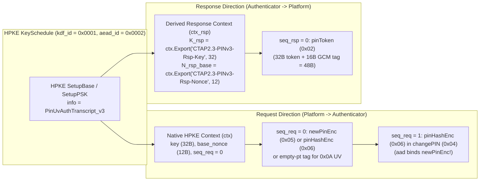
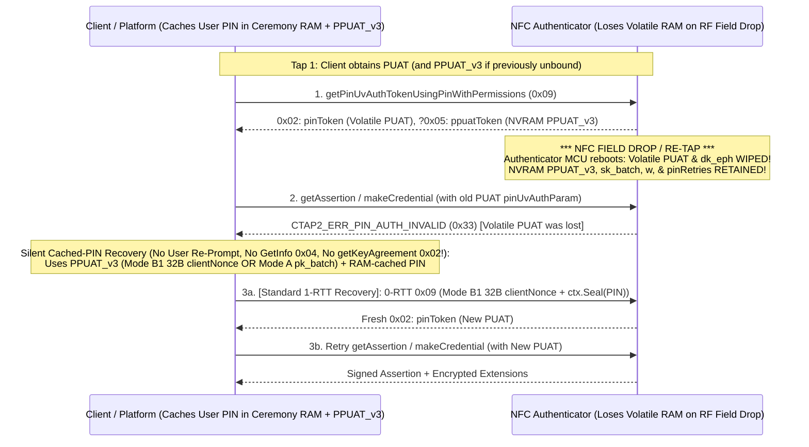

# FIDO2 CTAP 2.3+ Proposal: Post-Quantum PIN/UV Auth Protocol 3 (`pinUvAuthProtocol = 3`) Using RFC 9180 HPKE Stateful AEAD (`AES-256-GCM`)

> [!IMPORTANT]
> **Notice:** This document is a very early draft for discussion only. It has not been adopted by the FIDO CTAP working group.

**Author:** John Bradley (`@ve7jtb`)  
**Date:** October 2026  
**Status:** Early Draft for Discussion Only (Not Adopted by the FIDO CTAP Working Group)  

---

## Abstract & Executive Summary

This document specifies a normative proposal for **PIN/UV Auth Protocol 3 (`pinUvAuthProtocol = 3`)** in **FIDO2 CTAP 2.3+**, built directly on **RFC 9180 Hybrid Public Key Encryption (HPKE)** in **Stateful AEAD Mode (`aead_id = 0x0002`, `AES-256-GCM`)**.

Unlike PIN/UV Auth Protocols 1 and 2—which rely on quantum-vulnerable P-256 ECDH, unauthenticated `getKeyAgreement` handshakes, malleable `AES-256-CBC` response ciphertexts, and separate 16-byte wire IVs—**Protocol 3 with HPKE Stateful AEAD** provides:
1. **Post-Quantum & Hybrid KEM Agility (`0x2A: pinUvAuthKems`):** Supports `X-Wing` (`0x647a`, MTI default), `MLKEM768-P256` (`0x0050`), `ML-KEM-768` (`0x0041`), and `ML-KEM-1024` (`0x0042`).
2. **Bidirectional HPKE Stateful AEAD (`aead_id = 0x0002`, `AES-256-GCM`):** Replaces raw `AES-256-CBC` and standalone `HMAC-SHA-256` tags with sequence-numbered `AES-256-GCM` contexts (`ctx` for Platform $\to$ Authenticator requests and `ctx_rsp` for Authenticator $\to$ Platform responses). Every encrypted field carries a 16-byte authentication tag, **0 bytes of wire IV** (nonces are computed deterministically via `base_nonce XOR seq`), and binds the `PinUvAuthTranscript_v3` as Additional Authenticated Data (`aad`).
3. **Multi-Tier Trust & Mutual Authentication Hierarchy:**
   * **Tier 1 (Enterprise Host Authentication):** Enterprise authenticators with a batch key (`pk_batch`) and `aaguid` can require mutually authenticated key agreement with corporate workstations holding an enterprise certificate/public key (`setEnterpriseHostTrustAnchors` `0x06`, `options.enterpriseHostAuth`, `0x2C: pinUvAuthHostAlgs`), rejecting unauthorized hosts immediately at `getKeyAgreement` (`0x02`).
   * **Tier 2 (Personal Device Batch Key Pinning & Same-Batch Evil-Twin Detection):** Personal platforms pin `(deviceIdentifier, PPUAT_v3, pk_batch)` after initial pairing for **0-RTT MITM-immune sessions**, require mandatory `PPUAT` revocation if `pk_batch` ever rotates, and use `encIdentifier` (`0x19`) to detect and warn the user if an attacker substitutes a different physical authenticator from the **exact same manufacturing batch**.
   * **Tier 3 (Unattested / Open-Source / Privacy Authenticators with `aaguid = 0^16`):** Protects low-entropy user PINs during initial key agreement via **`ML-KEM` $\hat{\mathbf{t}}$-Vector Blinding (`PQ-EKE`)** and a strict **4-rule write-before-verify 8-try `pinRetries` state machine**, and protects initial setup/reset via a **Factory Pairing PIN / Temporary PIN (`forcePINChange = true`)**.
4. **Dual Post-Pairing Channel Modes (`0-RTT`):**
   * **Mode A (Asymmetric with `pk_batch` Pinning):** Uses HPKE `mode_psk` (`0x01`) encapsulating to the pinned `pk_batch` mixed with the 256-bit `PPUAT_v3`.
   * **Mode B (Symmetric with High-Entropy `PPUAT_v3`):** For authenticators without a batch key, uses the 256-bit `PPUAT_v3` directly as a shared post-quantum secret with a 32-byte `clientNonce` (`0-RTT`, 32 B on the wire) to initialize the HPKE Stateful AEAD schedule.
5. **CTAP-Local `authenticatorGetInfo` Integrity & Hierarchical `PPUAT`:** Prevents KEM stripping, `maxMsgSize` squeezing, `uv`-to-`clientPin` downgrades, and protocol-translating relay MITMs via 4-byte vendor root indexing (`0x2B: batchAttestKid`) and `ReconstructedAttestation_v1`, while isolating legacy Protocol 2 hosts from Protocol 3 via a one-way `PPUAT_v3 -> PPUAT_v2` derivation tree.
6. **Unified Stateful AEAD Extension Encryption:** Eliminates the redundant 1.1–1.5 KB PQ `keyAgreement` inside `hmac-secret`, encrypts `largeBlobKey` (`0x07`) at `seq_rsp = 1`, deprecates `credBlob` (§12.5), and secures the WebAuthn `sign` (`previewSign5`) extension both on the CTAP bus (`seq_rsp = 2` + `sigCommitment`) and end-to-end (`RP <-> Authenticator`).

---

## Table of Contents

1. **[Section 1 — Normative Core Protocol: `pinUvAuthProtocol = 3` with HPKE Stateful AEAD (`AES-256-GCM`)](#1-normative-core-protocol-pinuvauthprotocol--3-with-hpke-stateful-aead-aes-256-gcm)**
2. **[Section 2 — Multi-Tier Trust Hierarchy, Pairing PINs, Unattested PQ-PAKE & Dual Channel Modes](#2-multi-tier-trust-hierarchy-pairing-pins-unattested-pq-pake--dual-channel-modes)**
3. **[Section 3 — Downgrade Prevention & `authenticatorGetInfo` Integrity](#3-downgrade-prevention--authenticatorgetinfo-integrity)**
4. **[Section 4 — Hierarchical `PPUAT` Domain Separation Between Protocols 2 and 3](#4-hierarchical-ppuat-domain-separation-between-protocols-2-and-3)**
5. **[Section 5 — Extensions Under HPKE Stateful AEAD (`hmac-secret`, `largeBlobKey`, `credBlob`, and `sign`)](#5-extensions-under-hpke-stateful-aead-hmac-secret-largeblobkey-credblob-and-sign)**
6. **[Section 6 — End-to-End Reference Implementation (Python)](#6-end-to-end-reference-implementation-python)**

---

## 1. Normative Core Protocol: `pinUvAuthProtocol = 3` with HPKE Stateful AEAD (`AES-256-GCM`)

### 1.1 Why HPKE Stateful AEAD (`aead_id = 0x0002`, `AES-256-GCM`) Replaces Protocol 1 & 2 Primitives

In CTAP 2.0–2.3, PIN/UV Auth Protocols 1 and 2 use ephemeral P-256 ECDH (`getKeyAgreement` `0x02`) followed by unauthenticated `AES-256-CBC` with prepended 16-byte random IVs and a separate `HMAC-SHA-256` parameter (`pinUvAuthParam`). Adopting **RFC 9180 HPKE Stateful AEAD (`aead_id = 0x0002`, `AES-256-GCM`)** for `pinUvAuthProtocol = 3` resolves four structural weaknesses simultaneously:

| Vulnerability in Protocols 1 & 2 | How Protocol 3 HPKE Stateful AEAD (`AES-256-GCM`) Solves It |
| :--- | :--- |
| **1. Harvest-Now-Decrypt-Later (HNDL) Quantum Break of P-256** | Replaces P-256 ECDH with Post-Quantum / Hybrid HPKE KEMs (`X-Wing` `0x647a`, `MLKEM768-P256` `0x0050`, `ML-KEM-768` `0x0041`, `ML-KEM-1024` `0x0042`), protecting long-lived secrets (`pinHashEnc`, `newPinEnc`, `PPUAT_v3`, `hmac-secret`, `largeBlobKey`). |
| **2. Unauthenticated `AES-256-CBC` on Responses (`pinToken`, `hmac-secret`)** | Every response ciphertext is sealed with `AES-256-GCM` (`16-byte tag`), providing strict ciphertext integrity and Associated Data (`aad`) binding without increasing wire size (`0-byte wire IV + 16-byte GCM tag = +16 bytes`, identical to `16-byte CBC IV + 0-byte tag`). |
| **3. Multi-Ciphertext Swap & Nonce-Misuse Risks** | HPKE Stateful AEAD automatically increments the internal 96-bit sequence counter (`seq = 0, 1, 2, ...`) on every `ctx.Seal()` / `ctx.Open()` call (`nonce = base_nonce XOR I2OSP(seq, 12)`), cryptographically ordering multiple ciphertexts in the same command (e.g., `newPinEnc` at `seq = 0` and `pinHashEnc` at `seq = 1` in `changePIN`). |
| **4. Unauthenticated `getKeyAgreement` (`0x02`) & Unauthenticated UV (`0x0A`)** | Binds `PinUvAuthTranscript_v3` into both HPKE `info` and AEAD `aad`, and authenticates `0x0A` (`getPinUvAuthTokenUsingUvWithPermissions`) with a 16-byte empty-plaintext AEAD tag (`ctx.Seal(aad, h'')`). |

---

### 1.2 Normative HPKE Ciphersuite & KEM Agility (`0x2A: pinUvAuthKems`)

When `pinUvAuthProtocol = 3` is advertised in `authenticatorGetInfo` (`0x06: pinUvAuthProtocols`), the Authenticator advertises its supported HPKE KEM identifiers in **`0x2A: pinUvAuthKems`** (`[+ uint16]`, ordered most-preferred first). The HPKE KDF and AEAD identifiers are fixed normatively for Protocol 3:

* **HPKE `kdf_id`:** **`0x0001` (`HKDF-SHA256`)**
* **HPKE `aead_id`:** **`0x0002` (`AES-256-GCM`: $N_k = 32\text{ B}$, $N_n = 12\text{ B}$, $N_t = 16\text{ B}$)**

| HPKE `kem_id` (`0x2A`) | KEM Algorithm Name | NIST Category | Encapsulated Key `ek` (`pk`) | Ciphertext `enc` (`ct`) | Role in `pinUvAuthProtocol = 3` |
| :--- | :--- | :--- | :--- | :--- | :--- |
| **`0x647a`** | **`X-Wing`** (`ML-KEM-768` + `X25519`) | **Cat 3 Hybrid** | `1,216 B` | `1,120 B` | **Mandatory-to-Implement (MTI) Default** |
| **`0x0050`** | **`MLKEM768-P256`** (`ML-KEM-768` + `P-256`) | **Cat 3 Hybrid** | `1,249 B` | `1,153 B` | **Recommended Hardware SE Default** (Reuses P-256 hardware) |
| **`0x0041`** | **`DHKEM / ML-KEM-768`** (Pure FIPS 203) | **Cat 3 Pure PQ** | `1,184 B` | `1,088 B` | Pure PQ Cat 3 profile |
| **`0x0042`** | **`ML-KEM-1024`** (Pure FIPS 203) | **Cat 5 / CNSA 2.0** | `1,568 B` | `1,568 B` | High-security CNSA 2.0 profile (requires `maxMsgSize >= 2048`) |

---

### 1.3 Bidirectional HPKE Stateful AEAD Contexts (`ctx` and `ctx_rsp`)

In RFC 9180, an HPKE `Context` (`ctx`) is **unidirectional** (from Sender/Platform to Receiver/Authenticator), maintaining a single sequence counter `seq` initialized to `0` and computing the 12-byte `AES-256-GCM` nonce for message `seq` as:
$$\text{ComputeNonce}(\text{base\_nonce}, \text{seq}) = \text{base\_nonce} \oplus \text{I2OSP}(\text{seq}, 12)$$
If the Authenticator used the same `(key, base_nonce)` at `seq = 0` to encrypt its response (`pinToken` `0x02`), it would **catastrophically reuse the exact same `(key, nonce)` pair** used by the Platform to encrypt `newPinEnc` or `pinHashEnc` at `seq = 0`!

To provide **bidirectional Stateful AEAD** with zero nonce-collision risk, Protocol 3 defines two cryptographically independent stateful contexts from every HPKE handshake:

1. **Request Stateful AEAD Context (`ctx`, Platform $\to$ Authenticator):**
   * Uses the native RFC 9180 HPKE `(key, base_nonce)` and sequence counter `seq_req = 0, 1, ...` directly:
     $$\text{ct}_{\text{req}} = \text{ctx.Seal}(\text{aad}, \text{pt}) \quad \text{(increments } \text{seq}_{\text{req}} \leftarrow \text{seq}_{\text{req}} + 1\text{)}$$
2. **Response Stateful AEAD Context (`ctx_rsp`, Authenticator $\to$ Platform):**
   * Exported from `ctx` via the RFC 9180 `Context.Export` interface, with its own independent sequence counter `seq_rsp = 0, 1, 2, ...`:
     $$K_{\text{rsp}} = \text{ctx.Export}(\text{"CTAP2.3-PINv3-Rsp-Key"}, 32)$$
     $$N_{\text{rsp\_base}} = \text{ctx.Export}(\text{"CTAP2.3-PINv3-Rsp-Nonce"}, 12)$$
     $$\text{ct}_{\text{rsp}} = \text{AES-256-GCM.Seal}\Big(\text{key}=K_{\text{rsp}},\; \text{nonce}=N_{\text{rsp\_base}} \oplus \text{I2OSP}(\text{seq}_{\text{rsp}}, 12),\; \text{aad},\; \text{pt}\Big) \quad (\text{seq}_{\text{rsp}} \leftarrow \text{seq}_{\text{rsp}} + 1)$$



---

### 1.4 Normative Mapping of `authenticatorClientPIN` (`0x06`) Subcommands to HPKE Stateful AEAD

Because every `ctx.Seal(aad, pt)` call in HPKE Stateful AEAD (`AES-256-GCM`) already produces an authenticated 16-byte GCM tag bound to `aad = PinUvAuthTranscript_v3`, **`pinUvAuthParam` (`0x04`) is unified with the Stateful AEAD tag**:
* When a subcommand sends an encrypted payload (`setPIN` `0x03`, `changePIN` `0x04`, or `getPinUvAuthTokenUsingPinWithPermissions` `0x09`), the 16-byte GCM tag is appended directly to `newPinEnc` (`0x05`) and/or `pinHashEnc` (`0x06`). `pinUvAuthParam` (`0x04`) is either omitted or set to the final 16-byte GCM tag.
* When a subcommand sends **no** encrypted payload (`getPinUvAuthTokenUsingUvWithPermissions` `0x0A`), the Platform seals an **empty plaintext (`h''`)** at `seq_req = 0` and places the resulting 16-byte GCM tag in **`0x04: pinUvAuthParam`**.

| `authenticatorClientPIN` Subcommand | Request `seq_req = 0` (`ctx.Seal`) | Request `seq_req = 1` (`ctx.Seal`) | Response `seq_rsp = 0` (`ctx_rsp.Seal`) |
| :--- | :--- | :--- | :--- |
| **`0x03: setPIN`** *(Only if no Pairing PIN; see §2.2)* | **`0x05: newPinEnc`** = `ctx.Seal(aad = Transcript, pt = paddedNewPin_64)` (`80 B` total: `64 B ct + 16 B tag`) | *(None)* | *(Empty response on success)* |
| **`0x04: changePIN`** *(Also used for first-time setup with Pairing PIN)* | **`0x05: newPinEnc`** = `ctx.Seal(aad = Transcript, pt = paddedNewPin_64)` (`80 B` total) | **`0x06: pinHashEnc`** = `ctx.Seal(aad = Transcript \|\| newPinEnc, pt = LEFT(SHA-256(oldPin), 16))` (`32 B` total: `16 B ct + 16 B tag`) | *(Empty response on success)* |
| **`0x09: getPinUvAuthTokenUsingPinWithPermissions`** | **`0x06: pinHashEnc`** = `ctx.Seal(aad = Transcript, pt = LEFT(SHA-256(PIN), 16))` (`32 B` total: `16 B ct + 16 B tag`) | *(None)* | **`0x02: pinToken`** = `ctx_rsp.Seal(aad = Transcript, pt = token_32)` (`48 B` total: `32 B ct + 16 B tag`) |
| **`0x0A: getPinUvAuthTokenUsingUvWithPermissions`** | **`0x04: pinUvAuthParam`** = `ctx.Seal(aad = Transcript, pt = h'')` (`16 B` GCM tag authenticating UV request!) | *(None)* | **`0x02: pinToken`** = `ctx_rsp.Seal(aad = Transcript, pt = token_32)` (`48 B` total: `32 B ct + 16 B tag`) |

> [!IMPORTANT]
> **Why `changePIN` (`0x04`) Uses `seq_req = 0` and `seq_req = 1` with Chained `aad`:**
> In `changePIN` (`0x04`), the Platform encrypts two separate fields under the same HPKE session: `newPinEnc` (`0x05`) and `pinHashEnc` (`0x06`). With HPKE Stateful AEAD, `newPinEnc` is sealed at `seq_req = 0` (`nonce = base_nonce ^ 0`) and `pinHashEnc` is sealed at `seq_req = 1` (`nonce = base_nonce ^ 1`) with `aad = PinUvAuthTranscript_v3 || newPinEnc`. This cryptographically binds the new PIN ciphertext into the old PIN's authentication tag and guarantees distinct nonces with **0 bytes of wire IV overhead**.

---

## 2. Multi-Tier Trust Hierarchy, Pairing PINs, Unattested PQ-PAKE & Dual Channel Modes

To support the full range of FIDO deployments—from locked-down corporate workstations to personal laptops, public kiosks, and batchless open-source authenticators—`pinUvAuthProtocol = 3` defines a **three-tier trust hierarchy**, a **MITM-safe initial setup/reset lifecycle**, an **unattested PQ-PAKE with an 8-try `pinRetries` state machine**, and **two post-pairing channel modes**.

### 2.1 Tier 1: Enterprise Mutually Authenticated Key Agreement (Host Authentication to Authenticator)

In high-security enterprise environments, an organization can configure corporate authenticators to **only perform key agreement with an authorized enterprise host** that possesses a deployed enterprise certificate or public key. This capability is scoped to authenticators that have a batch key (`pk_batch`) and a non-zero `aaguid`.

1. **Provisioning Trusted Host Keys/Certificates (`authenticatorConfig` `0x0D`, subCommand `0x06: setEnterpriseHostTrustAnchors`):**
   Protected by `acfg` (`0x20`) permission, IT provisions one or more Enterprise Host CA Root public keys or direct Host public keys:
   ```cddl
   ; authenticatorConfig (0x0D) subCommand 0x06 parameter map (0x02):
   EnterpriseHostTrustConfig = {
       0x01: bool,                    ; enterpriseHostAuthRequired (true = mandatory, false = optional)
       0x02: [+ COSE_Key / bstr],     ; Trusted Enterprise Host CA Root Public Keys or Host Cert Fingerprints
       ? 0x03: [+ int]                ; Allowed COSE signature / KEM algorithms (e.g., -49 ML-DSA-65, -7 ES256)
   }
   ```
2. **`authenticatorGetInfo` (`0x04`) Advertisement:**
   * **`options.enterpriseHostAuth` (`bool`):** `true` if host authentication is mandatory; `false` if supported but optional.
   * **`0x2C: pinUvAuthHostAlgs` (`[+ int]`):** Array of COSE algorithms supported by the Authenticator for verifying the host's credential (e.g., `-49` `ML-DSA-65`, `-50` `ML-DSA-87`, `-7` `ES256`, or HPKE `mode_auth` KEM IDs `0x0041` / `0x647a`).
3. **Host Authentication Handshake & Early Rejection at `getKeyAgreement` (`0x02`):**
   * The Platform includes **`0x09: hostAuth`** in `getKeyAgreement` (`0x02`) (or in a 0-RTT `0x09` / `0x0A` request):
     ```cddl
     HostAuthPayload = {
         0x01: int,                     ; Selected algorithm from 0x2C: pinUvAuthHostAlgs
         0x02: bstr,                    ; Host X.509 / CWT certificate (chaining to Enterprise CA) or COSE_Key ID
         0x03: bstr .size 32,           ; Fresh 256-bit hostNonce
         0x04: bstr                     ; Signature(sk_host, "CTAP2.3-HostAuth" || SHA-256(GetInfo) || hostNonce)
     }
     ```
   * **Immediate Error at Key Agreement:** If `options.enterpriseHostAuth == true` and `hostAuth` is missing or fails verification against the provisioned trust anchors, the Authenticator **immediately aborts `getKeyAgreement` (`0x02`) with `CTAP2_ERR_HOST_UNAUTHENTICATED` (`0x3E`) / `CTAP2_ERR_NOT_ALLOWED` (`0x27`)** before exposing any key agreement state or allowing PIN/UV entry.
   * When valid, `SHA-256(HostAuthPayload)` is bound into `PinUvAuthTranscript_v3` (`info` and `aad`), locking the HPKE Stateful AEAD session to the verified enterprise host.

---

### 2.2 Tier 2: Authenticated Authenticator + `GetInfo` with Batch Key Pinning & Same-Batch Evil-Twin Detection

On personal (non-kiosk) platforms, `pinUvAuthProtocol = 3` combines factory `authenticatorGetInfo` attestation (`Section 3`) with **Batch Key Pinning (`pk_batch`)** and **Device ID Verification (`encIdentifier` `0x19`)**:

1. **Batch Key Pinning & Mandatory `PPUAT` Revocation on Rotation:**
   * Once a personal Platform completes initial pairing—validating `batchAttestSig` over `authenticatorGetInfo` and obtaining `(PPUAT_v3, deviceIdentifier)`—the Platform pins:
     $$\text{PinnedRecord} = \left(\text{deviceIdentifier}, \text{PPUAT}_{v3}, \text{kemId}, \text{pk}_{\text{batch}}, \text{VerifiedGetInfoProfile}\right)$$
   * Because `pk_batch` is static in factory ROM/flash, an authenticator almost never changes `pk_batch`. **Normative Rule:** If a firmware update ever rotates `pk_batch`, the Authenticator **MUST revoke all `PPUAT`s** (by rotating $K_{\text{ppuat\_master}}$ and $K_{\text{id}}$) to force all paired hosts to re-attest and update their pin.
   * Once paired, the personal Platform is **completely immune to active Man-in-the-Middle attacks** on all subsequent sessions. Stateless/kiosk hosts that do not cache `PPUAT_v3` rely on their cached FIDO MDS / Vendor Root (`batchAttestKid`) trust list.
2. **Defending Against the "Attacker-Supplied Same-Batch Authenticator" (`makeCredential` Evil-Twin Attack):**
   * **Attack Scenario:** An attacker attempts to trick a user on their personal computer into calling `makeCredential` (or logging in) on an **attacker-supplied physical authenticator** from the **exact same manufacturing batch** as the user's legitimate key (so it shares the **identical `aaguid`, identical `pk_batch`, and identical `batchAttestSig`**) and pre-configured with the user's PIN.
   * **Detection via `encIdentifier` (`0x19`):** Every individual authenticator generates a unique random 128-bit `deviceIdentifier` and unique $K_{\text{id}}$ in its Secure Element. When the attacker's same-batch device responds to `authenticatorGetInfo` (`0x04`), its `encIdentifier` (`0x19`) **fails decryption under every pinned `(deviceIdentifier, PPUAT_v3)`** on the user's personal computer.
   * **Mandatory Personal-Platform UI Warning:** On any personal (non-kiosk) Platform with one or more pinned authenticators, if a connected authenticator's `encIdentifier` (`0x19`) does not match any pinned `deviceIdentifier`—even when `aaguid` and `pk_batch` match an already-paired key—the Platform **MUST warn the user ("New / Unrecognized Security Key Detected — This is a different physical device than your paired key")** and require explicit confirmation before permitting `makeCredential` or PIN entry.

---

### 2.3 MITM-Safe Initial Setup & Factory Reset: Temporary / Factory Pairing PIN (`forcePINChange = true`)

To prevent an active MITM from intercepting initial PIN setup (`setPIN` `0x03`) when a brand-new or freshly reset authenticator has no user PIN configured:

1. **Temporary PIN (Enterprise) or Random 6-Digit Factory Pairing PIN (Consumer / Open-Source):**
   * **Enterprise Authenticators:** Provisioned by IT prior to issuance with a unique **Temporary PIN** and `forcePINChange: true` in `authenticatorGetInfo` (`0x04`).
   * **Consumer / Open-Source Authenticators:** Provisioned at manufacturing (or firmware flash) with a **random 6-digit Factory Pairing PIN** (printed on a tamper-evident scratch-off insert inside the box, or displayed once on an on-device screen) with `forcePINChange: true` enabled on first use.
   * **First-Use Ceremony via `changePIN` (`0x04`):** Because `clientPin: true` and `forcePINChange: true` are active from the moment the box is opened, initial setup uses **`changePIN` (`0x04`)** over the **PIN-blinded PQ-PAKE (`Section 2.4`)**. An active MITM who does not know the 6-digit scratch-off Pairing PIN cannot intercept initial PIN setup!
2. **How `authenticatorReset` (`0x07`) Restores the Pairing PIN & Solves Setup `pinRetries` Lockout:**
   * If `pinRetries` (8 tries) is exhausted during initial setup (or later use), executing **`authenticatorReset` (`0x07`)** does **not** wipe the device to an unauthenticated `clientPin: false` state.
   * Instead, `authenticatorReset` (`0x07`) **restores the active PIN verifier $w$ from the factory-immutable Pairing PIN slot**, sets `forcePINChange = true`, regenerates `deviceIdentifier` and `PPUAT_v3`, and resets **`pinRetries = 8`**—allowing clean recovery from setup lockout without ever opening an unauthenticated `setPIN` window.

---

### 2.4 Tier 3: Unattested / Open-Source / Privacy Authenticators (`aaguid = 0^16`), `ML-KEM` PQ-PAKE & the 8-Try `pinRetries` State Machine

Open-source, DIY, small-vendor, and privacy-preserving authenticators intentionally have **no batch certificate (`batchAttestSig` absent)** and an **all-zero `aaguid` (`00000000-0000-0000-0000-000000000000`)**.

> [!CAUTION]
> **Why Naive HPKE `mode_psk` (`psk = pinHash`) with an Unblinded `pk_auth` Is Broken Without Attestation:**
> If an unattested authenticator sends an unblinded `pk_auth` in `getKeyAgreement` (`0x02`), an active MITM or fake authenticator substitutes its own `(pk_mitm, sk_mitm)`. When the user enters their low-entropy PIN once, the Platform encapsulates `enc` to `pk_mitm` and sends `pinHashEnc` / `pinUvAuthParam`. Knowing `sk_mitm`, the MITM decapsulates `K_kem = ML-KEM.Decaps(sk_mitm, enc)` and tests all $10^4\text{–}10^6$ human PINs **offline in < 1 millisecond**—recovering the PIN on the **first try** and **bypassing the 8-try `pinRetries` counter**!

#### 1. Normative Solution: Post-Quantum PAKE via `ML-KEM` $\hat{\mathbf{t}}$-Vector Blinding (`PQ-EKE`) + HPKE Stateful AEAD
To make a low-entropy PIN safe inside key agreement on an unattested authenticator, the Authenticator's ephemeral `ML-KEM` public key in `getKeyAgreement` (`0x02`) **MUST** be blinded by a salted PIN verifier $w$:

1. **Salted PIN Verifier (`setPIN` / `changePIN` / Factory Pairing PIN):**
   The Authenticator stores a random 16-byte `pinSalt` and 32-byte verifier $w$:
   $$w = \text{HKDF-SHA-256}\left(\text{salt}=\text{pinSalt},\; \text{IKM}=\text{LEFT}(\text{SHA-256}(\text{PIN}), 16),\; \text{info}=\text{"CTAP2.3-PINv3-PAKE"},\; L=32\right)$$
2. **Blinded `getKeyAgreement` (`0x02`) on Unbound Hosts:**
   The Authenticator generates a single-use ephemeral `ML-KEM` keypair $(ek_{\text{eph}} = (\hat{\mathbf{t}}_{\text{eph}}, \rho),\; dk_{\text{eph}})$, computes a deterministic polynomial mask in $\mathbb{Z}_q^{k \times 256}$ ($q = 3329$):
   $$\hat{\mathbf{m}}_w = \text{SampleUniform}_{\mathbb{Z}_q^{k \times 256}}\left(\text{SHAKE256}(\text{"CTAP2.3-PINv3-PAKE-MASK"} \parallel w \parallel \rho)\right)$$
   blinds $\hat{\mathbf{t}}_{\text{blinded}} = (\hat{\mathbf{t}}_{\text{eph}} + \hat{\mathbf{m}}_w) \bmod 3329$, and returns `(ek_blinded = ByteEncode_12(t_blinded) || rho, pinSalt)`.
3. **Platform Unblinding & HPKE Stateful AEAD Setup (`0x09` / `0x04`):**
   The Platform computes $w$ and $\hat{\mathbf{m}}_w$, unblinds $\hat{\mathbf{t}} = (\hat{\mathbf{t}}_{\text{blinded}} - \hat{\mathbf{m}}_w) \bmod 3329$, runs $(K_{\text{kem}}, \text{enc}) = \text{ML-KEM.Encap}((\hat{\mathbf{t}}, \rho))$, and initializes the HPKE Stateful AEAD context:
   $$\text{ctx} = \text{HPKE.SetupPSKS}\Big(\text{kem\_output}=K_{\text{kem}},\; \text{info}=\text{PinUvAuthTranscript}_{v3},\; \text{psk}=w,\; \text{psk\_id}=\text{pinSalt}\Big)$$
   In `0x09`, the Platform sends `keyAgreement: enc` and `0x06: pinHashEnc = ctx.Seal(aad = PinUvAuthTranscript_v3, pt = LEFT(SHA-256(PIN), 16))` at `seq_req = 0`.

#### 2. The 4 Mandatory `pinRetries` State Machine Rules (Capping Tries at $\le 8$ Total, $\le 3$ Per Boot)

| Rule | Normative Authenticator State Machine Invariant | Security Guarantee |
| :--- | :--- | :--- |
| **Rule 1: Single-Use `dk_eph` in `0x02`** | `getKeyAgreement` (`0x02`) does **not** decrement `pinRetries` (by **Module-LWE**, $\hat{\mathbf{t}}_{\text{blinded}}$ is indistinguishable from uniform random and leaks 0 bits offline), **but** the Authenticator holds at most **1 armed $dk_{\text{eph}}$** in RAM and **immediately wipes $dk_{\text{eph}}$** on the first `0x09` / `0x04` attempt. | Prevents unauthenticated DoS lockout via `0x02` while ensuring one `getKeyAgreement` can test at most 1 PIN. |
| **Rule 2: Write-Before-Verify NVRAM Decrement (`0x09` / `0x04`)** | Upon receiving `0x09` or `0x04`, the Authenticator MUST: (a) check `pinRetries > 0` (max 8) and `bootFailures < 3`; (b) **commit `pinRetries -= 1` to NVRAM FIRST** before running `ML-KEM.Decaps(dk_eph, enc)`; (c) only restore `pinRetries = 8` after both `ML-KEM.Decaps` and `ctx.Open` succeed. | Defeats USB power-tearing/glitching attacks and strictly caps Platform key-establishment tries to **8 total tries** (3 per boot). |
| **Rule 3: Constant-Time FO Implicit Rejection** | If the Platform used a wrong PIN $w' \neq w$, `enc` was encapsulated to $\hat{\mathbf{t}}_{\text{eph}} + \Delta$, so `ML-KEM.Decaps(dk_eph, enc)` triggers constant-time **Fujisaki-Okamoto implicit rejection** ($K_{\text{kem}}' = J(z \parallel \text{enc})$), causing `ctx.Open` (`AES-256-GCM`) to fail uniformly with `CTAP2_ERR_PIN_INVALID` (`0x31`). | Eliminates timing and error-code side channels between a wrong PAKE unblinding and a bad AEAD tag. |
| **Rule 4: Zero Offline Guesses for Fake Authenticators** | A fake authenticator / active MITM must commit to a **single guess $w_{\text{guess}}$ before sending `0x02`**. If $w_{\text{guess}} \neq w_{\text{user}}$, the Platform encapsulates to $\hat{\mathbf{t}}_{\text{mitm}} + \Delta$; by **Module-SIS / Module-LWE**, the MITM cannot decapsulate `enc` and gets **0 offline guesses**. | Caps active MITM / fake authenticator guessing at $\le 1$ online guess per user PIN entry. |

---

### 2.5 Dual Post-Pairing Channel Modes: Mode A (Asymmetric Pinning) vs. Mode B (Symmetric High-Entropy `PPUAT_v3`)

Once initial pairing succeeds and the Platform holds the **256-bit high-entropy `PPUAT_v3`** ($K_{\text{ppuat}} = \text{HKDF-SHA-256}(0^{32}, \text{PPUAT}_{v3}, \text{"CTAP2.3-PINv3-PSK"}, 32)$), Protocol 3 supports **two post-pairing channel modes**, both driving the **exact same HPKE Stateful AEAD (`AES-256-GCM`) `ctx` and `ctx_rsp` interface**:

| Feature | **Mode A: Asymmetric with `pk_batch` Pinning (`HPKE mode_psk = 0x01`)** | **Mode B: Symmetric with High-Entropy `PPUAT_v3` (`SymPSK` Stateful AEAD)** |
| :--- | :--- | :--- |
| **Target Authenticators** | Authenticators **with a static `pk_batch`** (Consumer & Enterprise keys). | Authenticators **with NO `pk_batch`** (Open-source, DIY, small-vendor, or zero-`aaguid` privacy keys). |
| **Pinned State on Platform** | `(deviceIdentifier, PPUAT_v3, kemId, pk_batch, VerifiedGetInfoProfile)` | `(deviceIdentifier, PPUAT_v3, VerifiedGetInfoProfile)` |
| **Round Trips & Wire `keyAgreement` (`0x01`)** | **`0-RTT`** (skips `0x02`); sends HPKE `enc` encapsulated to pinned `pk_batch` (`1,088–1,568 B`). | **Mode B1 (Pure Symmetric `0-RTT`):** Skips `0x02`; sends a **32-byte `clientNonce`** (`COSE_Key` `{1: 4, -1: clientNonce_32}`)!<br/>**Mode B2 (Ephemeral KEM `1-RTT`):** Calls `0x02` for ephemeral `ek_eph` + `PPUAT_v3` when forward secrecy is desired (e.g., `changePIN`). |
| **Initialization of Stateful AEAD `ctx` (`key`, `base_nonce`) & `ctx_rsp`** | Standard RFC 9180 `HPKE.SetupPSKS(pk_batch, info = PinUvAuthTranscript_v3, psk = K_ppuat, psk_id = encIdentifier)` with `aead_id = 0x0002` (`AES-256-GCM`). | **Mode B1 (`SymPSK` KeySchedule):** Uses RFC 9180 `KeySchedulePSK` with `shared_secret = clientNonce_32 \|\| IV_id_16`, `psk = K_ppuat`, `psk_id = encIdentifier`, `info = PinUvAuthTranscript_v3`, and `aead_id = 0x0002` (`AES-256-GCM`) to derive `ctx` (`key`, `base_nonce`) and `ctx_rsp` (`K_rsp`, `N_rsp_base`)! |
| **PIN Retry Shielding** | Authenticator verifies `ctx.Open` (256-bit `PPUAT_v3` + `sk_batch`) **before** touching `pinRetries`. | Authenticator verifies `ctx.Open` (256-bit `PPUAT_v3`) **before** touching `pinRetries`. |

```mermaid
sequenceDiagram
    participant P as Paired Platform (Holds 256-bit PPUAT_v3)
    participant K as Authenticator (Mode A: Holds sk_batch + PPUAT_v3 | Mode B: Holds PPUAT_v3 Only)

    P->>K: 1. authenticatorGetInfo (0x04)
    K-->>P: GetInfo Response (includes fresh 16B IV_id in 0x19: encIdentifier)

    Note over P: 1. Decrypts 0x19 (encIdentifier) -> matches pinned deviceIdentifier (warns if unrecognized!)<br/>2. Verifies GetInfo fields == VerifiedGetInfoProfile<br/>3a. [Mode A - Has pk_batch]: (K_kem, enc) = KEM.Encap(pinned_pk_batch); keyAgreement = enc<br/>3b. [Mode B1 - No pk_batch]: Samples 32B clientNonce; keyAgreement = {1: 4, -1: clientNonce}<br/>4. Initializes HPKE Stateful AEAD ctx (seq_req=0) & ctx_rsp (seq_rsp=0) with psk = K_ppuat

    P->>K: 2. getPinUvAuthTokenUsingPin / UsingUv (0x09 / 0x0A, keyAgreement, ctx.Seal(seq_req=0, aad=Transcript, pt))
    Note over K: 1. Derives ctx & ctx_rsp using K_ppuat + IV_id + (Decaps(sk_batch, enc) OR clientNonce)<br/>2. Opens request at seq_req = 0 (verifies 256-bit PPUAT_v3 tag BEFORE decrementing pinRetries!)<br/>3. Performs PIN/UV check -> Seals pinToken at seq_rsp = 0: ctx_rsp.Seal(aad=Transcript, pt=token)
    K-->>P: 0x02: pinToken (48B = 32B ciphertext + 16B AES-256-GCM tag, 0B wire IV)
```

---

### 2.6 NFC & Intermittent Transport Recovery: Volatile State Loss (`PUAT` & $dk_{\text{eph}}$), Cached-PIN Silent Recovery, and `getPinUvAuthTokenUsingUv` (`0x0A`) Recovery

Over **NFC (ISO 14443 / CTAP NFC)** or intermittent transports, an authenticator is powered directly by the RF field. If the user briefly pulls the security key out of the RF field between taps (or the field dips between chained APDUs), the Authenticator MCU reboots and **loses all volatile RAM state**:
* **Lost (Volatile RAM Wiped on Field Drop):**
  1. **Ephemeral `pinUvAuthToken` (PUAT):** The 32-byte in-RAM session token issued by `0x09` / `0x0A` for `mc` / `ga` / `cm` / `lbw` / `acfg` permissions.
  2. **Ephemeral Key Agreement Private Key ($dk_{\text{eph}}$):** Any single-use ephemeral key generated during `getKeyAgreement` (`0x02`).
  3. **Volatile `GetInfo` Session Nonce:** Any RAM-cached $\text{IV}_{\text{id}}$ from a prior `authenticatorGetInfo` (`0x04`).
* **Retained (Non-Volatile Memory / NVRAM / ROM):**
  1. Static `pk_batch` / `sk_batch`, `PPUAT_v3` root secret, `deviceIdentifier`, salted PIN verifier $w$, `pinSalt`, and `pinRetries`.

#### 2.6.1 Four Normative Design Features for Fast NFC State-Loss Recovery

1. **Stateless `encIdentifier` (`0x0B` in `0x09` / `0x0A`) — Zero `GetInfo` RAM State Required:**
   * If the Authenticator required `psk_id` (`encIdentifier` `0x19`) in Mode A / Mode B1 to match an $\text{IV}_{\text{id}}$ held in volatile RAM from `authenticatorGetInfo` (`0x04`), then an NFC power drop after `0x04` would cause `0x09` / `0x0A` to fail.
   * **Normative Rule:** In Mode A and Mode B1, the Client sends the 32-byte `encIdentifier` (`IV_id || AES-128-CBC(K_id, IV_id, deviceIdentifier)`) in parameter `0x0B: pskId` of `0x09` / `0x0A`. The Authenticator **statelessly decrypts `0x0B` using $K_{\text{id}}$ (derived from NVRAM `PPUAT_v3`)** and verifies that the plaintext equals its NVRAM `deviceIdentifier`. Because the Client supplies fresh session entropy (`KEM.Encap(pk_batch)` or 32-byte `clientNonce`) and the Authenticator mints a fresh random PUAT in RAM, **an NFC power drop after `authenticatorGetInfo` (`0x04`) requires zero recovery round trips!**
2. **Simultaneous `PUAT` + `PPUAT_v3` Issuance on First `0x09` / `0x0A` (`0x05: ppuatToken`):**
   * On an initially **unbound** host, when the first `0x09` or `0x0A` succeeds on Tap 1, the Authenticator returns **both** the requested ephemeral `0x02: pinToken` (PUAT) **and** a newly provisioned **`0x05: ppuatToken`** (`ctx_rsp.Seal(seq_rsp = 1, aad = Transcript, pt = PPUAT_v3 || encIdentifier)`).
   * Consequently, even if the NFC field drops immediately after `0x09` (wiping the ephemeral PUAT before `makeCredential` / `getAssertion` can execute on Tap 2), **the Client is now already paired with `PPUAT_v3`** and can recover on Tap 2 using **0-RTT Mode A or Mode B1 (32-byte `clientNonce`)** instead of re-running the slow 1-RTT PQ-PAKE!
3. **Protecting `pinRetries` When NFC Drops Between `getKeyAgreement` (`0x02`) and `0x09` (`CTAP2_ERR_KEY_AGREEMENT_EXPIRED` `0x3F`):**
   * Suppose an unbound Client calls `getKeyAgreement` (`0x02`), the NFC field drops (wiping $dk_{\text{eph}}$ in RAM so `ephemeral_state == UNARMED`), and the Client then sends `0x09` (`getPinUvAuthTokenUsingPinWithPermissions`).
   * **Normative Rule:** If `0x09` or `0x04` (`changePIN`) arrives in `channelMode = 3` (PQ-PAKE / ephemeral KEM) when `ephemeral_state == UNARMED`, the Authenticator **MUST NOT decrement `pinRetries`**! Instead, it immediately aborts with **`CTAP2_ERR_KEY_AGREEMENT_EXPIRED` (`0x3F`)**, signaling the Client to re-run `0x02` $\to$ `0x09` using its RAM-cached PIN without burning one of the user's 8 PIN tries.
4. **Optional NFC Inline PUAT Refresh (`0x0F: inlinePinRefresh` / `0x10: inlineUvRefresh` in `makeCredential` / `getAssertion`):**
   * When retrying `makeCredential` (`0x01`) or `getAssertion` (`0x02`) over NFC after a `CTAP2_ERR_PIN_AUTH_INVALID` (`0x33`) error, a paired Client can embed a compact **Mode B1 `SymPSK` Inline Refresh block** directly inside `makeCredential` / `getAssertion`, allowing the Authenticator to re-verify the cached PIN (or UV), derive `(ctx_ext, ctx_ext_rsp)`, and sign the response in **1 single NFC APDU round trip**!

#### 2.6.2 Case A: How Protocol 3 Recovers When the Client Still Has the PIN Cached in RAM (`0x09`)

When the Authenticator loses its volatile `pinUvAuthToken` (PUAT) over NFC before `makeCredential` / `getAssertion` completes, and the Client still holds the user's PIN in its short-lived ceremony RAM buffer, recovery **never re-prompts the user for their PIN** and **never goes back to `authenticatorGetInfo` (`0x04`)**:



* **If the NFC drop occurred *between* `0x02` (`getKeyAgreement`) and `0x09` on an unbound host:**
  1. `0x09` returns `CTAP2_ERR_KEY_AGREEMENT_EXPIRED` (`0x3F`) (**0 `pinRetries` consumed**).
  2. The Client skips `authenticatorGetInfo` (`0x04`, already cached) and silently re-runs `0x02` (`getKeyAgreement`) $\to$ `0x09` using its RAM-cached PIN.
* **If the NFC drop occurred *after* `0x09` (wiping the volatile PUAT before `makeCredential` / `getAssertion`):**
  1. `makeCredential` / `getAssertion` returns `CTAP2_ERR_PIN_AUTH_INVALID` (`0x33`).
  2. Because the Client now holds `PPUAT_v3` (either from prior pairing or from `0x05: ppuatToken` in Tap 1's `0x09` response) and still has the PIN cached in RAM, it **skips both `0x04` (`GetInfo`) and `0x02` (`getKeyAgreement`)**!
  3. It immediately sends a **0-RTT `0x09`** using **Mode B1 (`SymPSK`, only 32 bytes for `clientNonce` + 32 bytes for `pinHashEnc`)** (or Mode A `pk_batch`) and resends `makeCredential` / `getAssertion`—completing recovery in **~64 bytes of auth traffic** without ever asking the user to re-enter their PIN!

---

#### 2.6.3 Case B: How `getPinUvAuthTokenUsingUvWithPermissions` (`0x0A`) Recovers Over NFC — Does It Have to Go Back to the Start?

What happens when the user is authenticating over NFC with **on-device biometrics (`0x0A: getPinUvAuthTokenUsingUvWithPermissions`)** (e.g., an NFC security key or smartcard with an integrated fingerprint sensor) and the NFC field drops after `0x0A`, wiping the volatile PUAT before `makeCredential` / `getAssertion` finishes?

**Short Answer:**
* **Does the hardware biometric match (`0x0A`) have to re-run?** **Yes** (unless the authenticator hardware includes a 2–5 second hold-up capacitor / retention SRAM that preserves the 32-byte PUAT across brief RF dips), because the biometric template and sensor live exclusively inside the Authenticator—the Client has no "cached biometric" it can replay, and the Authenticator lost RAM proof that the finger was verified. *(Fortunately, on an NFC biometric key, the user's thumb is already resting on the fingerprint sensor while they re-tap the key to the reader!)*
* **Does the protocol have to go all the way back to the start (`authenticatorGetInfo` `0x04` + `getKeyAgreement` `0x02`)?** **NO!** In Protocol 3, `0x0A` recovery skips `0x04` (`GetInfo`) and `0x02` (`getKeyAgreement`) and jumps **directly to `0x0A` in 0-RTT**:

| Authenticator & Host State During NFC UV (`0x0A`) Drop | Legacy Protocol 1 & 2 Recovery Steps | **Protocol 3 HPKE Stateful AEAD Recovery Steps** | Does Protocol 3 Go Back to `GetInfo` / `getKeyAgreement`? |
| :--- | :--- | :--- | :--- |
| **1. Paired Host (`PPUAT_v3` Held — Mode A or Mode B1)** *(Includes any host that completed Tap 1 `0x0A` with `0x05: ppuatToken`!)* | `0x02` (`getKeyAgreement`) $\to$ `0x0A` (`UV`) $\to$ `getAssertion` (**3 RTTs** on re-tap; often fails NFC tap window). | **Jumps directly to `0-RTT` `0x0A`** (using 32B `clientNonce` in Mode B1 or `pk_batch` in Mode A) $\to$ `getAssertion` (**2 RTTs**, or **1 RTT** with `0x10: inlineUvRefresh`). | **NO!** Skips `0x04` (`GetInfo`) and `0x02` (`getKeyAgreement`) completely. |
| **2. Unbound Host + Attested Authenticator (Has `pk_batch`, No `PPUAT_v3` Yet)** *(Drop occurred between `0x02` and `0x0A` on Tap 1)* | Must re-run `0x02` (`getKeyAgreement`) $\to$ `0x0A` (`UV`) $\to$ `getAssertion` (**3 RTTs**). | Client already cached static `pk_batch` during Tap 1's `0x02`! **Jumps directly to `0-RTT` `0x0A`** (encapsulating to cached `pk_batch`) $\to$ `getAssertion` (**2 RTTs**). | **NO!** Because `pk_batch` is in Authenticator ROM/NVRAM, the NFC reboot did not invalidate `pk_batch`! |
| **3. Unbound Host + Unattested/Batchless Authenticator (`aaguid = 0^16`, No `pk_batch`, No `PPUAT_v3` Yet)** *(Drop occurred between `0x02` and `0x0A` on Tap 1)* | Must re-run `0x02` $\to$ `0x0A` $\to$ `getAssertion`. | `0x0A` returns `CTAP2_ERR_KEY_AGREEMENT_EXPIRED` (`0x3F`). Client skips `0x04` (`GetInfo`) and re-runs `0x02` (`getKeyAgreement`) $\to$ `0x0A` (`UV`, which issues `PPUAT_v3` so any second drop uses Row 1!). | Skips `0x04` (`GetInfo`); only re-runs `0x02` $\to$ `0x0A` if the very first tap dropped mid-handshake before `PPUAT_v3` was issued. |
| **4. Authenticator with Hold-Up Capacitor / Brief-Retention SRAM (~2–5s)** *(Hardware optimization for NFC biometric cards)* | Wipes PUAT if MCU resets on standard firmware. | Retaining just **48 bytes** (`32B PUAT + 8B rpIdHash_prefix + 8B expiry_ticks`) in low-leakage retention SRAM across a $\le 3\text{ s}$ RF field dip allows `getAssertion` to succeed on Tap 2 in **1 RTT with zero re-authentication**! | **NO!** `getAssertion` succeeds immediately on Tap 2. |

---

## 3. Downgrade Prevention & `authenticatorGetInfo` Integrity

### 3.1 Dual-Layer Downgrade Defense: `PinUvAuthTranscript_v3` (HPKE `info` + AEAD `aad`) & `batchAttestKid` (`0x2B`)

To defeat all four CTAP downgrade vectors—(1) KEM stripping (`0x2A`), (2) `maxMsgSize` squeezing (`0x05`), (3) `uv` $\to$ `clientPin` modality downgrade (`0x04`), and (4) cross-protocol stripping / back-to-back translating relay MITMs—without leaking any device-identifying bits into RP-visible `authenticatorData`, Protocol 3 uses two complementary mechanisms:

#### 1. Normative `PinUvAuthTranscript_v3` Bound into Both HPKE `info` and Stateful AEAD `aad`
Every Protocol 3 command constructs the deterministic CBOR transcript:
```cddl
PinUvAuthTranscript_v3 = [
    version:             "CTAP2.3-PINv3-AEAD",
    subCommand:          uint8,          ; 0x03 (setPIN), 0x04 (changePIN), 0x09 (PinToken), 0x0A (UvToken)
    channelMode:         uint8,          ; 1 = Mode A (Asymmetric), 2 = Mode B1 (SymPSK), 3 = PQ-PAKE
    kemId:               uint16,         ; Selected KEM ID (or 0x0000 in Mode B1 SymPSK)
    pinUvAuthProtocols:  [+ uint],       ; From authenticatorGetInfo (0x06)
    pinUvAuthKems:       [+ uint16],     ; From authenticatorGetInfo (0x2A)
    maxMsgSize:          uint,           ; From authenticatorGetInfo (0x05, default 1024)
    uvCapabilityMask:    uint8,          ; Bitmask of key presence in 0x04 options: bit0=clientPin, bit1=uv, bit2=pinUvAuthToken, bit3=enterpriseHostAuth
    ? hostAuthHash:      bstr .size 32   ; SHA-256(HostAuthPayload) if Tier 1 Enterprise Host Auth is used
]
```
* `SHA-256(CBOR(PinUvAuthTranscript_v3))` is passed as **`info`** into HPKE `KeySchedule` **and** as **`aad`** into every `ctx.Seal(aad, pt)` and `ctx_rsp.Seal(aad, pt)` call. Any wire modification to `authenticatorGetInfo` causes `AES-256-GCM.Open` to fail immediately with `CTAP2_ERR_PIN_AUTH_INVALID` (`0x33`).

#### 2. Vendor Root Indexing (`0x2B: batchAttestKid`) & Client-Reconstructed Attestation (`ReconstructedAttestation_v1`)
For authenticators with a batch key (`pk_batch`), `authenticatorGetInfo` (`0x04`) includes **`0x2B: batchAttestKid`** (`bstr .size 4`, `vendorId_16 || keyRev_16`), indexing a tiny offline cache of ~30 vendor root public keys (`FN-DSA-512` ~27 KB total, or hash-based `LMS_SHA256_M32_H10` **~1.8 KB total**):

```cddl
; Sent on the wire in getKeyAgreement (subCommand = 0x02) response:
GetKeyAgreementResponse = {
    0x01: COSE_Key,                 ; Full pk_batch (or ek_blinded + pinSalt for Tier 3 PQ-PAKE)
    ? 0x02: uint8,                  ; attestationVersion (1)
    ? 0x03: bstr                    ; batchAttestSig (Static factory signature from ROM: FN-DSA or LMS)
}

; Reconstructed in memory by Client to verify batchAttestSig against VendorRootPK[batchAttestKid]:
ReconstructedAttestation_v1 = [
    attestationVersion:  1,
    batchAttestKid:      bstr .size 4,   ; From authenticatorGetInfo (0x2B)
    kemId:               uint16,         ; From getKeyAgreement 0x01 COSE_Key (-1)
    pkBatch:             bstr,           ; From getKeyAgreement 0x01 COSE_Key (-2)
    aaguid:              bstr .size 16,  ; From authenticatorGetInfo (0x03)
    pinUvAuthProtocols:  [+ uint],       ; From authenticatorGetInfo (0x06)
    pinUvAuthKems:       [+ uint16],     ; From authenticatorGetInfo (0x2A)
    maxMsgSize:          uint,           ; From authenticatorGetInfo (0x05)
    uvCapabilityMask:    uint8           ; From authenticatorGetInfo (0x04 key presence)
]
```

---

## 4. Hierarchical `PPUAT` Domain Separation Between Protocols 2 and 3

### 4.1 One-Way Quantum Firewall Between Protocol 3 and Legacy Protocol 2 Hosts

To prevent a quantum adversary who records a legacy **Protocol 2** (P-256 ECDH) session on an older computer from compromising the 256-bit **Protocol 3** `PPUAT_v3` used on modern computers—while still allowing the Authenticator to store **only one 32-byte root secret in NVRAM** and emit a single `encIdentifier` (`0x19`) and `encCredStoreState` (`0x1E`) in `authenticatorGetInfo` (`0x04`)—Protocol 3 mandates a **One-Way Hierarchical PPUAT Derivation Tree**:

$$\text{PPUAT}_{v3} \text{ (32B NVRAM Root)} \xrightarrow[\text{One-Way } (2^{128} \text{ Quantum Preimage})]{\text{HKDF-SHA-256}(0^{32}, \text{PPUAT}_{v3}, \text{"CTAP-PPUAT-v2"}, 32)} \text{PPUAT}_{v2} \xrightarrow{\text{CTAP 2.3 §6.4}} (K_{\text{id}}, K_{\text{css}})$$

* **Over Protocol 3 (`pinUvAuthProtocol = 3`):** When `pcfg` (`0x40`) is requested, the Authenticator seals the root **`PPUAT_v3`** inside `0x02: pinToken` using `ctx_rsp.Seal(seq_rsp = 0, aad = PinUvAuthTranscript_v3, pt = PPUAT_v3)`.
* **Over Protocol 2 (`pinUvAuthProtocol = 2`):** When `pcfg` (`0x40`) is requested, the Authenticator derives and returns only the step-down **`PPUAT_v2`**.
* **Decrypting `encIdentifier` (`0x19`) and `encCredStoreState` (`0x1E`):** Both Protocol 2 and Protocol 3 platforms derive $K_{\text{id}}$ and $K_{\text{css}}$ from $\text{PPUAT}_{v2}$, maintaining 100% single-response wire compatibility in `authenticatorGetInfo` (`0x04`).

---

## 5. Extensions Under HPKE Stateful AEAD (`hmac-secret`, `largeBlobKey`, `credBlob`, and `sign`)

### 5.1 Unified Per-Command Extension Stateful AEAD Context (`ctx_ext` & `ctx_ext_rsp`)

When a Platform invokes `authenticatorMakeCredential` (`0x01`) or `authenticatorGetAssertion` (`0x02`) with a Protocol 3 `pinUvAuthToken` (or `PPUAT_v3`), **there is no need to send a second 1.1–1.5 KB Post-Quantum `keyAgreement` ciphertext inside extension inputs**!

Instead, both the Platform and the Authenticator deterministically derive a **Per-Command Extension Stateful AEAD Pair (`ctx_ext`, `ctx_ext_rsp`)** from the active 32-byte `pinUvAuthToken` and the 32-byte `clientDataHash` (using `HKDF-SHA-256` with `salt = clientDataHash` and `IKM = pinUvAuthToken`):

```
prk_ext       = HKDF-Extract(salt = clientDataHash, IKM = pinUvAuthToken)

# Request Extension Stateful AEAD Context (ctx_ext: Platform -> Authenticator, seq_ext_req = 0, 1, ...)
K_ext_req     = HKDF-Expand(prk_ext, "CTAP2.3-PINv3-Ext-Req-Key", 32)
N_ext_req     = HKDF-Expand(prk_ext, "CTAP2.3-PINv3-Ext-Req-Nonce", 12)

# Response Extension Stateful AEAD Context (ctx_ext_rsp: Authenticator -> Platform, seq_ext_rsp = 0, 1, 2, ...)
K_ext_rsp     = HKDF-Expand(prk_ext, "CTAP2.3-PINv3-Ext-Rsp-Key", 32)
N_ext_rsp     = HKDF-Expand(prk_ext, "CTAP2.3-PINv3-Ext-Rsp-Nonce", 12)
```

Furthermore, in Protocol 3, `pinUvAuthParam` (`0x08` in `makeCredential` / `getAssertion`) **MUST authenticate `extensions` (`0x04`) alongside `clientDataHash`**:
$$\text{pinUvAuthParam} = \text{HMAC-SHA-256}\left(\text{key}=\text{pinUvAuthToken},\; \text{clientDataHash} \parallel \text{CBOR}(\text{extensions})\right)$$

#### Fixed Sequence Numbers Across Extensions in a Single `makeCredential` / `getAssertion` Command

Because `ctx_ext` (Request) and `ctx_ext_rsp` (Response) are stateful `AES-256-GCM` contexts, each extension uses a deterministic sequence slot (`seq_ext_req` / `seq_ext_rsp`), guaranteeing **zero nonce reuse** even when `hmac-secret`, `largeBlobKey`, and `sign` (`previewSign5`) are all requested in the same `getAssertion` call!

| Extension | Request `ctx_ext.Seal` (`seq_ext_req`) | Response `ctx_ext_rsp.Seal` (`seq_ext_rsp`) | Wire Format & Size Gain |
| :--- | :--- | :--- | :--- |
| **`hmac-secret` / `hmac-secret-mc`** | **`seq_ext_req = 0`:**<br/>`2: saltEnc = ctx_ext.Seal(seq=0, aad="hmac-secret", pt=salt1 [\|\| salt2])` (`48 B` or `80 B`).<br/>**`1: keyAgreement` and `3: saltAuth` are OMITTED!** | **`seq_ext_rsp = 0`:**<br/>`output = ctx_ext_rsp.Seal(seq=0, aad="hmac-secret", pt=out1 [\|\| out2])` (`48 B` or `80 B`, exact same length as Protocol 2!). | **Saves 1,152–1,600 B on request wire** (`1: keyAgreement` + `3: saltAuth` elided) and avoids a second `ML-KEM.Decaps()` on MCU! |
| **`largeBlobKey` (`0x07`)** | *(Requested via boolean `largeBlobKey: true`)* | **`seq_ext_rsp = 1`:**<br/>`0x07: largeBlobKey = ctx_ext_rsp.Seal(seq=1, aad="largeBlobKey", pt=rawKey_32)` (`48 B` = `32B ct + 16B tag`). | Closes the CTAP 2.3 plaintext `largeBlobKey` USB/NFC sniffer leak! |
| **`sign` (`previewSign5`)** *(CTAP Bus Layer)* | **`seq_ext_req = 1`:**<br/>`encSignInput = ctx_ext.Seal(seq=1, aad="previewSign5", pt=CBOR(signInputMap))` | **`seq_ext_rsp = 2`:**<br/>`unsignedExtensionOutputs["previewSign5"] = ctx_ext_rsp.Seal(seq=2, aad="previewSign5", pt=CBOR({6: sig, ? 7: att-obj}))` | Hides raw `tbs`, `keyHandle`, `arkgArgs`, `sig`, and `att-obj` on the bus while keeping signed `authenticatorData` compact ($\le 45\text{ B}$ via `8: sigCommitment = SHA-256(tbs \|\| sig)`). |

*(Note: For unauthenticated `getAssertion` with `uv = false` where no `pinUvAuthToken` is present, the Platform initializes `ctx_ext` and `ctx_ext_rsp` in **0-RTT** using Mode A `HPKE.SetupPSKS(pk_batch, psk = K_ppuat)` or Mode B1 `SymPSK(K_ppuat, clientNonce)` passed in `1: keyAgreement`.)*

---

### 5.2 Formal Deprecation of `credBlob` (§12.5)

Protocol 3 formally deprecates the `credBlob` extension (§12.5):
1. **Unreleased Original Use Case:** `credBlob` was originally specified to store a hash of a **Kerberos Key Distribution Center (KDC) certificate** to prevent KDC endpoint spoofing during FIDO2 workstation login—a feature that has **never been released**.
2. **Plaintext Leak & Signed `authenticatorData` Conflict:** `credBlob` sends secret bytes in plaintext during `makeCredential` and returns them without mandatory UV inside signed `authenticatorData` during `getAssertion` (where they cannot be encrypted with a per-session AEAD tag without breaking the RP's signature check).
3. **Clean Migration Path:** Use **`largeBlobs` (`0x0C`) + Stateful AEAD Encrypted `largeBlobKey` (`0x07` at `seq_ext_rsp = 1`)** for on-authenticator data, or **`hmac-secret` (`prf` at `seq_ext_rsp = 0`)** for RP/client-stored encrypted blobs (consuming 0 B of Authenticator NVRAM).

---

### 5.3 WebAuthn `sign` (`previewSign5`) — End-to-End RP $\leftrightarrow$ Authenticator Bidirectional HPKE Stateful AEAD

In addition to CTAP bus encryption (`seq_ext_req = 1` / `seq_ext_rsp = 2`), `previewSign5` supports **End-to-End RP $\leftrightarrow$ Authenticator Bidirectional HPKE Stateful AEAD (`aead_id = 0x0002`, `AES-256-GCM`)** so that an untrusted or compromised Browser / OS relay cannot read or tamper with `tbs`, `keyHandle`, `pk_bl`, `pk_kem`, or `sig`:

1. **Phase 1 — `generateKey` Bootstrap (`rpKemPub` + Stateless `K_e2e`):**
   * The RP generates an ephemeral `ML-KEM-768` keypair $(pk_{\text{rp}}, sk_{\text{rp}})$, passes `8: rpKemPub = pk_rp`, and binds $\text{SHA-256}(pk_{\text{rp}} \parallel \text{flags} \parallel \text{algs})$ into the WebAuthn `challenge`.
   * The Authenticator derives a stateless 256-bit key $K_{\text{e2e}} = \text{HKDF-Expand}(\text{credRandom}, \text{"WebAuthn-Sign-E2E-Sym"} \parallel \text{kid}, 32)$ (**0 B NVRAM**), records $\text{rpKemHash} = \text{SHA-256}(pk_{\text{rp}})$ inside signed `innerAuthData`, runs `ctx_e2e = HPKE.SetupBaseS(pk_rp, info = "WebAuthn-Sign-GenKey" || rpIdHash)`, and seals `{7: att-obj, 9: K_e2e, ? 6: sig}` at `seq = 0` inside `unsignedExtensionOutputs["previewSign5"]`.
2. **Phase 2 — Bidirectional `sign` via Hybrid HPKE Stateful AEAD (`mode_psk = 0x01`, `aead_id = 0x0002`):**
   * On every subsequent `sign` (`getAssertion`) call, the RP establishes an HPKE `mode_psk` Stateful AEAD context combining the ARKG `pk_kem` with `psk = K_e2e`:
     $$(\text{enc}_{\text{arkg}}, \text{ctx}_{\text{e2e}}) = \text{HPKE.SetupPSKS}\Big(pk_{\text{kem}},\; \text{info} = \text{"WebAuthn-Sign-ARKG-PSK"} \parallel \text{rpIdHash},\; \text{psk} = K_{\text{e2e}},\; \text{psk\_id} = \text{kid}\Big)$$
   * **ARKG Blinding Scalar:** Derived via $\text{ikm\_tau} = \text{ctx}_{\text{e2e}}\text{.Export}(\text{"ARKG-Derive-Key-BL"}, L)$.
   * **RP $\to$ Authenticator Request (`seq = 0`):** `ct_req = ctx_e2e.Seal(seq = 0, aad = rpIdHash || credentialId || kid, pt = CBOR({6: tbs, ? 8: arkgCtx}))`.
   * **Authenticator $\to$ RP Response (`seq_rsp = 0`):** Exports $(K_{\text{e2e\_rsp}}, N_{\text{e2e\_rsp}})$ from `ctx_e2e` and seals `{6: sig}` at `seq_rsp = 0`, while committing `8: sigCommitment = SHA-256(tbs || sig)` inside signed `outerAuthData`.
   * **Post-Quantum HNDL Unlinkability even for Classical `ARKG-P256`:** Because $K_{\text{e2e}}$ was bootstrapped over `ML-KEM-768` in Phase 1 and mixed as `psk` in Phase 2, a future quantum computer that breaks P-256 still cannot recover $\tau$ or link historical EUDI Wallet presentations!

---

## 6. End-to-End Reference Implementation (Python)

The following self-contained Python reference implementation demonstrates the complete **`pinUvAuthProtocol = 3` HPKE Stateful AEAD (`AES-256-GCM`)** architecture, including:
1. Bidirectional `HPKEStatefulAEADContext` (`ctx.seal`/`ctx.open` with automatic `seq_req` increment + derived `ctx_rsp.seal_rsp`/`ctx_rsp.open_rsp` with `seq_rsp` increment).
2. `changePIN` (`0x04`) multi-ciphertext sequence numbering (`newPinEnc` at `seq_req = 0`, `pinHashEnc` at `seq_req = 1` with chained `aad`) and `pinToken` (`0x02`) response encryption at `seq_rsp = 0`.
3. Mode A (Asymmetric `pk_batch` Pinning) and Mode B1 (Symmetric High-Entropy `PPUAT_v3` `0-RTT` for batchless authenticators).
4. Unified Extension Stateful AEAD (`ctx_ext` and `ctx_ext_rsp`) encrypting `hmac-secret` (`seq_ext_req = 0`, `seq_ext_rsp = 0`), `largeBlobKey` (`seq_ext_rsp = 1`), and `sign` (`seq_ext_req = 1`, `seq_ext_rsp = 2`) in a single `getAssertion` ceremony with zero nonce reuse.

```python
import hmac
import os
from dataclasses import dataclass
from cryptography.hazmat.primitives import hashes
from cryptography.hazmat.primitives.kdf.hkdf import HKDF, HKDFExpand
from cryptography.hazmat.primitives.ciphers.aead import AESGCM


def hkdf_extract(salt: bytes, ikm: bytes) -> bytes:
    return HKDF.extract(hashes.SHA256(), salt, ikm)


def hkdf_expand(prk: bytes, info: bytes, length: int) -> bytes:
    return HKDFExpand(hashes.SHA256(), length, info).derive(prk)


def hkdf_sha256(ikm: bytes, info: bytes, length: int, salt: bytes = b"\x00" * 32) -> bytes:
    return HKDF(algorithm=hashes.SHA256(), length=length, salt=salt, info=info).derive(ikm)


def xor_nonce(base_nonce: bytes, seq: int) -> bytes:
    """RFC 9180 §5.2 ComputeNonce(base_nonce, seq) for 12-byte AES-256-GCM nonces."""
    if seq >= (1 << 64):
        raise OverflowError("HPKE AEAD sequence number overflow")
    seq_bytes = seq.to_bytes(12, byteorder="big")
    return bytes(b ^ s for b, s in zip(base_nonce, seq_bytes))


@dataclass
class HPKEStatefulAEADContext:
    """
    Bidirectional RFC 9180 HPKE Stateful AEAD Context (aead_id = 0x0002, AES-256-GCM)
    for CTAP 2.3+ pinUvAuthProtocol = 3:
      - Request direction (Platform -> Authenticator): (req_key, req_base_nonce, seq_req)
      - Response direction (Authenticator -> Platform): (rsp_key, rsp_base_nonce, seq_rsp)
    """
    req_key: bytes
    req_base_nonce: bytes
    rsp_key: bytes
    rsp_base_nonce: bytes
    exporter_secret: bytes
    seq_req: int = 0
    seq_rsp: int = 0

    @classmethod
    def from_shared_secret_and_psk(
        cls,
        shared_secret: bytes,
        transcript_info: bytes,
        psk: bytes = b"",
        psk_id: bytes = b"",
    ) -> "HPKEStatefulAEADContext":
        suite_id = b"HPKE\x64\x7a\x00\x01\x00\x02"  # X-Wing (0x647a), HKDF-SHA256 (0x0001), AES-256-GCM (0x0002)
        mode = b"\x01" if psk else b"\x00"
        psk_id_hash = hkdf_extract(b"", suite_id + b"psk_id_hash" + psk_id)
        info_hash = hkdf_extract(b"", suite_id + b"info_hash" + transcript_info)
        ks_context = mode + psk_id_hash + info_hash

        secret = hkdf_extract(shared_secret, suite_id + b"secret" + psk)
        req_key = hkdf_expand(secret, suite_id + b"key" + ks_context, 32)
        req_base_nonce = hkdf_expand(secret, suite_id + b"base_nonce" + ks_context, 12)
        exporter_secret = hkdf_expand(secret, suite_id + b"exp" + ks_context, 32)

        # Derived Response Context (ctx_rsp) via RFC 9180 Context.Export
        rsp_key = hkdf_expand(exporter_secret, suite_id + b"sec" + b"CTAP2.3-PINv3-Rsp-Key", 32)
        rsp_base_nonce = hkdf_expand(exporter_secret, suite_id + b"sec" + b"CTAP2.3-PINv3-Rsp-Nonce", 12)
        return cls(req_key, req_base_nonce, rsp_key, rsp_base_nonce, exporter_secret)

    # --- Request Direction (Platform -> Authenticator) ---
    def seal_req(self, aad: bytes, plaintext: bytes) -> bytes:
        nonce = xor_nonce(self.req_base_nonce, self.seq_req)
        self.seq_req += 1
        return AESGCM(self.req_key).encrypt(nonce, plaintext, aad)

    def open_req(self, aad: bytes, ciphertext: bytes) -> bytes:
        nonce = xor_nonce(self.req_base_nonce, self.seq_req)
        self.seq_req += 1
        return AESGCM(self.req_key).decrypt(nonce, ciphertext, aad)

    # --- Response Direction (Authenticator -> Platform) ---
    def seal_rsp(self, aad: bytes, plaintext: bytes) -> bytes:
        nonce = xor_nonce(self.rsp_base_nonce, self.seq_rsp)
        self.seq_rsp += 1
        return AESGCM(self.rsp_key).encrypt(nonce, plaintext, aad)

    def open_rsp(self, aad: bytes, ciphertext: bytes) -> bytes:
        nonce = xor_nonce(self.rsp_base_nonce, self.seq_rsp)
        self.seq_rsp += 1
        return AESGCM(self.rsp_key).decrypt(nonce, ciphertext, aad)


# --- Demonstration: changePIN (seq_req = 0 & 1), Mode B1 SymPSK (0-RTT), and Multi-Extension AEAD ---
if __name__ == "__main__":
    transcript = b"CTAP2.3-PINv3-AEAD-Transcript-Example"
    ppuat_v3 = os.urandom(32)
    k_ppuat = hkdf_sha256(ppuat_v3, b"CTAP2.3-PINv3-PSK", 32)
    iv_id = os.urandom(16)
    client_nonce = os.urandom(32)

    # 1. Mode B1 (0-RTT Symmetric High-Entropy PPUAT_v3 for Batchless Authenticators)
    plat_ctx = HPKEStatefulAEADContext.from_shared_secret_and_psk(
        shared_secret=client_nonce + iv_id,
        transcript_info=transcript,
        psk=k_ppuat,
        psk_id=iv_id,
    )
    auth_ctx = HPKEStatefulAEADContext.from_shared_secret_and_psk(
        shared_secret=client_nonce + iv_id,
        transcript_info=transcript,
        psk=k_ppuat,
        psk_id=iv_id,
    )

    # 2. changePIN (0x04): seq_req = 0 for newPinEnc (80B), seq_req = 1 for pinHashEnc (32B)
    padded_new_pin = b"MyNewPin1234".ljust(64, b"\x00")
    old_pin_hash = hashes.Hash(hashes.SHA256())
    old_pin_hash.update(b"123456")
    old_pin_16 = old_pin_hash.finalize()[:16]

    new_pin_enc = plat_ctx.seal_req(aad=transcript, plaintext=padded_new_pin)        # seq_req = 0
    pin_hash_enc = plat_ctx.seal_req(aad=transcript + new_pin_enc, plaintext=old_pin_16)  # seq_req = 1

    assert len(new_pin_enc) == 80 and len(pin_hash_enc) == 32
    assert auth_ctx.open_req(aad=transcript, ciphertext=new_pin_enc) == padded_new_pin
    assert auth_ctx.open_req(aad=transcript + new_pin_enc, ciphertext=pin_hash_enc) == old_pin_16

    # 3. Response encryption at seq_rsp = 0: pinToken (48B = 32B token + 16B GCM tag)
    issued_pin_token = os.urandom(32)
    enc_pin_token = auth_ctx.seal_rsp(aad=transcript, plaintext=issued_pin_token)    # seq_rsp = 0
    assert len(enc_pin_token) == 48
    assert plat_ctx.open_rsp(aad=transcript, ciphertext=enc_pin_token) == issued_pin_token
    print("SUCCESS: PIN Protocol 3 HPKE Stateful AEAD verified end-to-end!")
```
