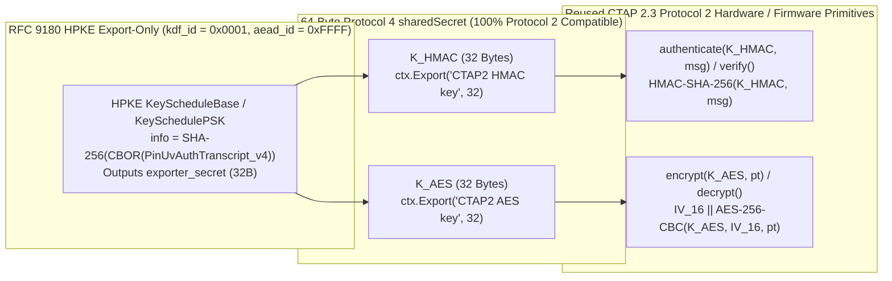

# FIDO2 CTAP 2.3+ Proposal: Post-Quantum PIN/UV Auth Protocol 4 (`pinUvAuthProtocol = 4`) Using RFC 9180 HPKE Export-Only (`aead_id = 0xFFFF`)

> [!IMPORTANT]
> **Notice:** This document is a very early draft for discussion only. It has not been adopted by the FIDO CTAP working group.

**Author:** John Bradley (`@ve7jtb`)  
**Date:** October 2026  
**Status:** Early Draft for Discussion Only (Not Adopted by the FIDO CTAP Working Group)  

---

## Abstract & Executive Summary

This document specifies a normative proposal for **PIN/UV Auth Protocol 4 (`pinUvAuthProtocol = 4`)** in **FIDO2 CTAP 2.3+**, built on **RFC 9180 Hybrid Public Key Encryption (HPKE)** in **Export-Only Mode (`kdf_id = 0x0001` `HKDF-SHA256`, `aead_id = 0xFFFF` `Export-only`)**.

Whereas **Protocol 3 (`pinUvAuthProtocol = 3`)** replaces the CTAP symmetric transport layer with HPKE Stateful AEAD (`aead_id = 0x0002`, `AES-256-GCM`), **Protocol 4 (`pinUvAuthProtocol = 4`)** is designed for **maximum firmware and hardware crypto-accelerator reuse from CTAP 2.1–2.3 Protocol 2**:
1. **100% Reuse of Protocol 2's `encrypt()`, `decrypt()`, `authenticate()`, and `verify()` Primitives:**
   * Many hardware Secure Elements (SEs) have dedicated ROM/hardware accelerators for **`AES-256-CBC`** and **`HMAC-SHA-256`** and already implement Protocol 2's 64-byte `sharedSecret = K_HMAC (32B) || K_AES (32B)` architecture, but lack hardware `AES-256-GCM` or wish to avoid stateful sequence-counter (`seq`) management across CTAP commands.
   * Protocol 4 replaces **only** `kdf(Z)` and P-256 ECDH with **RFC 9180 HPKE Export-Only (`aead_id = 0xFFFF`)**, exporting the exact same 64-byte `sharedSecret`:
     $$K_{\text{HMAC}} = \text{ctx.Export}(\text{"CTAP2 HMAC key"}, 32), \quad K_{\text{AES}} = \text{ctx.Export}(\text{"CTAP2 AES key"}, 32)$$
2. **Post-Quantum & Hybrid KEM Agility (`0x2A: pinUvAuthKems`):** Supports `X-Wing` (`0x647a`, MTI default), `MLKEM768-P256` (`0x0050`), `ML-KEM-768` (`0x0041`), and `ML-KEM-1024` (`0x0042`).
3. **Authenticated `0x0A` UV & Authenticated Responses (`pinToken`, `hmac-secret`, `largeBlobKey`) Using `HMAC-SHA-256`:**
   * Closes Protocol 2's unauthenticated `0x0A` (`getPinUvAuthTokenUsingUvWithPermissions`) and unauthenticated `AES-256-CBC` response gaps using the Authenticator's existing `HMAC-SHA-256(K_HMAC, ...)` engine—requiring **0 bytes of `AES-GCM` code**!
4. **Multi-Tier Trust Hierarchy, Pairing PINs, Unattested `ML-KEM` PQ-PAKE, Dual `0-RTT` Modes & Fast NFC Recovery:**
   * Includes **Tier 1 Enterprise Host Authentication** (`setEnterpriseHostTrustAnchors` `0x06`, early abort at `getKeyAgreement`), **Tier 2 Batch Key Pinning & Same-Batch Evil-Twin Detection** via `encIdentifier` (`0x19`), **MITM-Safe Initial Setup & Factory Reset** via a Temporary / 6-Digit Factory Pairing PIN (`forcePINChange = true`), **Tier 3 Unattested `ML-KEM` $\hat{\mathbf{t}}$-Vector Blinding PQ-PAKE** with the **4-rule write-before-verify 8-try `pinRetries` state machine**, **Dual `0-RTT` Post-Pairing Modes** (Mode A Asymmetric `pk_batch` Pinning vs. Mode B Symmetric 256-bit `PPUAT_v4` `SymPSK`), and **Stateless `0-RTT` NFC Power-Loss Recovery** for both cached PIN (`0x09`) and on-device UV (`0x0A`).
5. **CTAP-Local `authenticatorGetInfo` Integrity, Hierarchical `PPUAT` (`PPUAT_v4 -> PPUAT_v2`), & Extension Security:**
   * Protects `authenticatorGetInfo` via `PinUvAuthTranscript_v4` and `batchAttestKid` (`0x2B`), isolates legacy Protocol 2 hosts via a one-way HKDF firewall, elides the redundant 1.1–1.5 KB `keyAgreement` in `hmac-secret`, encrypts `largeBlobKey` (`0x07`), formally deprecates `credBlob` (§12.5), and secures WebAuthn `sign` (`previewSign5` / ARKG).

---

## Table of Contents

1. **[Section 1 — Normative Core Protocol: `pinUvAuthProtocol = 4` with HPKE Export-Only (`aead_id = 0xFFFF`)](#1-normative-core-protocol-pinuvauthprotocol--4-with-hpke-export-only-aead_id--0xffff)**
2. **[Section 2 — Multi-Tier Trust Hierarchy, Pairing PINs, Unattested PQ-PAKE, Dual Modes & NFC Recovery](#2-multi-tier-trust-hierarchy-pairing-pins-unattested-pq-pake-dual-modes--nfc-recovery)**
3. **[Section 3 — Downgrade Prevention & `authenticatorGetInfo` Integrity](#3-downgrade-prevention--authenticatorgetinfo-integrity)**
4. **[Section 4 — Hierarchical `PPUAT` Domain Separation Between Protocols 2 and 4](#4-hierarchical-ppuat-domain-separation-between-protocols-2-and-4)**
5. **[Section 5 — Extensions Under HPKE Export-Only (`hmac-secret`, `largeBlobKey`, `credBlob`, and `sign`)](#5-extensions-under-hpke-export-only-hmac-secret-largeblobkey-credblob-and-sign)**
6. **[Section 6 — Protocol 3 vs. Protocol 4 Comparison & Reference Python Implementation](#6-protocol-3-vs-protocol-4-comparison--reference-python-implementation)**

---

## 1. Normative Core Protocol: `pinUvAuthProtocol = 4` with HPKE Export-Only (`aead_id = 0xFFFF`)

### 1.1 Why HPKE Export-Only (`aead_id = 0xFFFF`) Maximizes Firmware & Hardware Reuse

In CTAP 2.1–2.3, `pinUvAuthProtocol = 2` derives a 64-byte `sharedSecret` consisting of a 32-byte `HMAC-SHA-256` key ($K_{\text{HMAC}}$) and a 32-byte `AES-256-CBC` key ($K_{\text{AES}}$), and defines four abstract operations (`encrypt`, `decrypt`, `authenticate`, `verify`).

**`pinUvAuthProtocol = 4`** preserves **100% of Protocol 2's symmetric encryption and MAC layer** while upgrading key establishment to **RFC 9180 HPKE Export-Only Mode (`kdf_id = 0x0001`, `aead_id = 0xFFFF`)**:

* **HPKE `kdf_id`:** **`0x0001` (`HKDF-SHA256`)**
* **HPKE `aead_id`:** **`0xFFFF` (`Export-only` — RFC 9180 §5.3)**
* **HPKE `kem_id` (`0x2A: pinUvAuthKems`):**
  * **`0x647a` (`X-Wing`: `ML-KEM-768` + `X25519`)** — Mandatory-to-Implement (MTI) Default (`ek = 1,216 B`, `enc = 1,120 B`).
  * **`0x0050` (`MLKEM768-P256`: `ML-KEM-768` + `P-256`)** — Recommended Hardware SE Default (`ek = 1,249 B`, `enc = 1,153 B`).
  * **`0x0041` (`ML-KEM-768`)** — Pure PQ Cat 3 (`ek = 1,184 B`, `enc = 1,088 B`).
  * **`0x0042` (`ML-KEM-1024`)** — Pure PQ Cat 5 / CNSA 2.0 (`ek = 1,568 B`, `enc = 1,568 B`).

---

### 1.2 Normative HPKE `Context.Export` Key Schedule & CTAP §6.5.4 Abstract Function Mapping

Once the Platform (`SetupBaseS` / `SetupPSKS`) and Authenticator (`SetupBaseR` / `SetupPSKR`) initialize an RFC 9180 HPKE Export-Only context `ctx` with `info = SHA-256(CBOR(PinUvAuthTranscript_v4))`, both sides export the 64-byte `sharedSecret`:

$$K_{\text{HMAC}} = \text{ctx.Export}(\text{"CTAP2 HMAC key"}, 32)$$
$$K_{\text{AES}} = \text{ctx.Export}(\text{"CTAP2 AES key"}, 32)$$
$$\text{sharedSecret} = K_{\text{HMAC}} \parallel K_{\text{AES}} \quad (64\text{ bytes})$$



| CTAP 2.3 §6.5.4 Abstract Function | Normative Definition in `pinUvAuthProtocol = 4` (HPKE Export-Only `0xFFFF`) | Code Change vs. Protocol 2 |
| :--- | :--- | :--- |
| **`kdf(Z)` $\to$ `ctx.Export`** | `K_HMAC = ctx.Export("CTAP2 HMAC key", 32)`<br/>`K_AES = ctx.Export("CTAP2 AES key", 32)`<br/>`return K_HMAC \|\| K_AES` | Replaces P-256 `kdf(Z)` with RFC 9180 `KeySchedule` (`aead_id = 0xFFFF`). |
| **`encrypt(key, demPlaintext)`** | Uses `K_AES = key[32:64]`. Samples fresh 16-byte random `IV_16` and returns:<br/>`IV_16 \|\| AES-256-CBC(K_AES, IV_16, demPlaintext)` | **Zero changes (100% identical to Protocol 2!)** |
| **`decrypt(key, demCiphertext)`** | Uses `K_AES = key[32:64]`. Splits `IV_16 = demCiphertext[0:16]`, `ct = demCiphertext[16:]`, and returns:<br/>`AES-256-CBC-Decrypt(K_AES, IV_16, ct)` | **Zero changes (100% identical to Protocol 2!)** |
| **`authenticate(key, message)`** | Uses `K_HMAC = key[0:32]` (or 32-byte `pinUvAuthToken`). Returns:<br/>`HMAC-SHA-256(K_HMAC, message)` (full 32 bytes during `ClientPIN`, or `LEFT(..., 16)` when using `pinUvAuthToken`). | **Zero changes (100% identical to Protocol 2!)** |

---

### 1.3 Normative Mapping of `authenticatorClientPIN` (`0x06`) Subcommands in Protocol 4

To close Protocol 2's two authentication gaps—(1) unauthenticated `0x0A` (`getPinUvAuthTokenUsingUvWithPermissions`) requests and (2) unauthenticated `0x02: pinToken` responses—using **only `HMAC-SHA-256` and `AES-256-CBC`**, Protocol 4 specifies:

| Subcommand (`0x06`) | Request Ciphertext (`encrypt(K_AES, ...)`) | Request `0x04: pinUvAuthParam` (`HMAC-SHA-256(K_HMAC, ...)`) | Response `0x02: pinToken` & `0x04: pinUvAuthParam` |
| :--- | :--- | :--- | :--- |
| **`0x03: setPIN`** | `0x05: newPinEnc = IV_16 \|\| AES-256-CBC(K_AES, IV_16, paddedNewPin_64)` (`80 B`) | `HMAC-SHA-256(K_HMAC, Transcript \|\| newPinEnc)` (`32 B`) | *(Empty response on success)* |
| **`0x04: changePIN`** *(Also initial setup with Pairing PIN)* | `0x05: newPinEnc` (`80 B` with `IV_new_16`)<br/>`0x06: pinHashEnc` (`32 B` with `IV_old_16`) | `HMAC-SHA-256(K_HMAC, Transcript \|\| newPinEnc \|\| pinHashEnc)` (`32 B`) | *(Empty response on success)* |
| **`0x09: getPinUvAuthTokenUsingPinWithPermissions`** | `0x06: pinHashEnc = IV_16 \|\| AES-256-CBC(K_AES, IV_16, LEFT(SHA256(PIN), 16))` (`32 B`) | `HMAC-SHA-256(K_HMAC, Transcript \|\| pinHashEnc)` (`32 B`) | `0x02: pinToken = IV_16 \|\| AES-256-CBC(K_AES, IV_16, token_32)` (`48 B`)<br/>`0x04: pinUvAuthParam = HMAC-SHA-256(K_HMAC, Transcript \|\| 0x02_pinToken)` (`32 B` authenticating the response!) |
| **`0x0A: getPinUvAuthTokenUsingUvWithPermissions`** | *(None)* | **`HMAC-SHA-256(K_HMAC, Transcript)` (`32 B` authenticating the UV request!)** | `0x02: pinToken = IV_16 \|\| AES-256-CBC(K_AES, IV_16, token_32)` (`48 B`)<br/>`0x04: pinUvAuthParam = HMAC-SHA-256(K_HMAC, Transcript \|\| 0x02_pinToken)` (`32 B`) |

---

## 2. Multi-Tier Trust Hierarchy, Pairing PINs, Unattested PQ-PAKE, Dual Modes & NFC Recovery

### 2.1 Tier 1: Enterprise Mutually Authenticated Key Agreement (Host Authentication to Authenticator)

In high-security enterprise environments, authenticators with a batch key (`pk_batch`) and non-zero `aaguid` can be configured to **only perform key agreement with an authorized enterprise host** that presents a deployed corporate certificate or public key:
1. **Provisioning (`authenticatorConfig` `0x0D`, subCommand `0x06: setEnterpriseHostTrustAnchors`):** Protected by `acfg` (`0x20`). Loads trusted Enterprise Host CA Root public keys or host public keys/fingerprints and sets `enterpriseHostAuthRequired` (`true`/`false`).
2. **`authenticatorGetInfo` (`0x04`) Advertisement:** Advertises `options.enterpriseHostAuth: true | false` and `0x2C: pinUvAuthHostAlgs` (e.g., `-49` `ML-DSA-65`, `-50` `ML-DSA-87`, `-7` `ES256`).
3. **Early Rejection at `getKeyAgreement` (`0x02`):** The host sends `0x09: HostAuthPayload {alg, hostCert, hostNonce, hostSig}` over `"CTAP2.3-HostAuth" || SHA-256(GetInfo) || hostNonce`. If missing or invalid when required, the Authenticator **immediately aborts `getKeyAgreement` (`0x02`) with `CTAP2_ERR_HOST_UNAUTHENTICATED` (`0x3E`) / `CTAP2_ERR_NOT_ALLOWED` (`0x27`)**. When valid, `SHA-256(HostAuthPayload)` is bound into `PinUvAuthTranscript_v4`.

---

### 2.2 Tier 2: Authenticated Authenticator + `GetInfo` with Batch Key Pinning & Same-Batch Evil-Twin Detection

1. **Batch Key Pinning & Mandatory `PPUAT` Revocation on Rotation:**
   * Once a personal Platform completes initial pairing—validating `batchAttestSig` over `authenticatorGetInfo` and obtaining `(PPUAT_v4, deviceIdentifier)`—it pins `(deviceIdentifier, PPUAT_v4, kemId, pk_batch, VerifiedGetInfoProfile)`.
   * **Normative Rule:** If a firmware update ever rotates `pk_batch`, the Authenticator **MUST revoke all `PPUAT`s** (by regenerating its internal master secrets) to force paired Platforms to re-attest and update their pin.
   * Once paired, the personal Platform is **completely immune to active Man-in-the-Middle attacks**. Stateless/kiosk devices rely on their cached FIDO MDS / Vendor Root (`batchAttestKid`) trust list.
2. **Defending Against the "Attacker-Supplied Same-Batch Authenticator" (`makeCredential` Evil-Twin Attack):**
   * If an attacker tricks a user on their personal computer into calling `makeCredential` (or logging in) on an **attacker-supplied physical authenticator** from the **exact same manufacturing batch** (identical `aaguid`, `pk_batch`, and `batchAttestSig`) pre-configured with the user's PIN, its `encIdentifier` (`0x19`) has a **different `deviceIdentifier`** and fails decryption under every pinned `PPUAT_v4` on the user's computer.
   * **Mandatory Personal-Platform UI Policy:** On any personal (non-kiosk) Platform with paired authenticators, if `encIdentifier` (`0x19`) does not match any pinned `deviceIdentifier`, the Platform **MUST display a prominent "New / Unrecognized Security Key Detected" warning ceremony** before permitting `makeCredential` or PIN entry.

---

### 2.3 MITM-Safe Initial Setup & Factory Reset: Temporary / Factory Pairing PIN (`forcePINChange = true`)

1. **Temporary PIN (Enterprise) or Random 6-Digit Factory Pairing PIN (Consumer / Open-Source):**
   * Enterprise authenticators ship with an IT-provisioned **Temporary PIN**; consumer/open-source authenticators ship with a **random 6-digit Factory Pairing PIN** (printed on a tamper-evident scratch-off card in the box) and `forcePINChange: true` enabled on first use.
   * First-time setup uses **`changePIN` (`0x04`)** over the **PIN-blinded PQ-PAKE (`Section 2.4`)**, preventing any active MITM during initial PIN setup.
2. **How `authenticatorReset` (`0x07`) Solves Setup `pinRetries` Lockout:**
   * If the 8-try `pinRetries` counter is exhausted during initial setup (or later use), executing `authenticatorReset` (`0x07`) **restores the active PIN verifier $w$ back to the factory-immutable Pairing PIN**, sets `forcePINChange = true`, and resets **`pinRetries = 8`**—recovering cleanly without ever opening an unauthenticated `setPIN` (`0x03`) window.

---

### 2.4 Tier 3: Unattested / Open-Source Authenticators (`aaguid = 0^16`), `ML-KEM` PQ-PAKE & the 8-Try `pinRetries` State Machine

For open-source, DIY, small-vendor, or privacy authenticators with **no batch certificate (`batchAttestSig` absent)** and **`aaguid = 0^16`**, feeding a low-entropy PIN into an unblinded HPKE `mode_psk` handshake would allow an active MITM / fake authenticator to substitute `(pk_mitm, sk_mitm)`, decapsulate `enc`, and brute-force all $10^4\text{–}10^6$ human PINs **offline in < 1 ms** (bypassing `pinRetries`).

#### Normative Solution in Protocol 4: `ML-KEM` $\hat{\mathbf{t}}$-Vector Blinding (`PQ-EKE`) + HPKE Export-Only (`0xFFFF`)
1. **Salted PIN Verifier (`setPIN` / `changePIN` / Pairing PIN):**
   $$w = \text{HKDF-SHA-256}\left(\text{salt}=\text{pinSalt},\; \text{IKM}=\text{LEFT}(\text{SHA-256}(\text{PIN}), 16),\; \text{info}=\text{"CTAP2.3-PINv4-PAKE"},\; L=32\right)$$
2. **Blinded `getKeyAgreement` (`0x02`) on Unbound Hosts:**
   Generates single-use $(ek_{\text{eph}} = (\hat{\mathbf{t}}_{\text{eph}}, \rho),\; dk_{\text{eph}})$, computes $\hat{\mathbf{m}}_w = \text{SampleUniform}_{\mathbb{Z}_q^{k \times 256}}(\text{SHAKE256}(\text{"CTAP2.3-PINv4-PAKE-MASK"} \parallel w \parallel \rho))$, blinds $\hat{\mathbf{t}}_{\text{blinded}} = (\hat{\mathbf{t}}_{\text{eph}} + \hat{\mathbf{m}}_w) \bmod 3329$, and returns `(ek_blinded, pinSalt)`.
3. **Platform Unblinding & HPKE Export-Only Setup (`0x09` / `0x04`):**
   Unblinds $\hat{\mathbf{t}} = (\hat{\mathbf{t}}_{\text{blinded}} - \hat{\mathbf{m}}_w) \bmod 3329$, runs $(K_{\text{kem}}, \text{enc}) = \text{ML-KEM.Encap}((\hat{\mathbf{t}}, \rho))$, initializes `ctx = HPKE.SetupPSKS(K_kem, info = Transcript, psk = w, psk_id = pinSalt, aead_id = 0xFFFF)`, exports `(K_HMAC, K_AES)`, encrypts `pinHashEnc` with `AES-256-CBC(K_AES, IV_16, ...)`, and authenticates with `HMAC-SHA-256(K_HMAC, ...)`.
4. **The 4 Mandatory `pinRetries` State Machine Rules ($\le 8$ Total Tries, $\le 3$ Per Boot):**
   * **Rule 1 (Single-Use $dk_{\text{eph}}$):** `0x02` leaks 0 bits offline (Module-LWE) and does not decrement `pinRetries`, but holds at most 1 armed $dk_{\text{eph}}$ in RAM that is wiped on the first `0x09` / `0x04` attempt.
   * **Rule 2 (Write-Before-Verify NVRAM Decrement):** On `0x09` / `0x04`, verify `pinRetries > 0` and `bootFailures < 3`, and **commit `pinRetries -= 1` to NVRAM FIRST** before running `ML-KEM.Decaps(dk_eph, enc)`. Only restore `pinRetries = 8` after both `Decaps` and `HMAC-SHA-256` verify.
   * **Rule 3 (Constant-Time FO Implicit Rejection):** Wrong PIN $w' \neq w$ triggers constant-time Fujisaki-Okamoto implicit rejection in `ML-KEM.Decaps`, causing `HMAC-SHA-256(K_HMAC, ...)` to fail uniformly with `CTAP2_ERR_PIN_INVALID` (`0x31`).
   * **Rule 4 (Zero Offline Guesses for Fake Authenticators):** A fake authenticator must commit to 1 guess $w_{\text{guess}}$ before sending `0x02`; if $w_{\text{guess}} \neq w_{\text{user}}$, it gets **0 offline guesses** (Module-SIS / Module-LWE).

---

### 2.5 Dual Post-Pairing Channel Modes: Mode A (Asymmetric Pinning) vs. Mode B (Symmetric High-Entropy `PPUAT_v4`)

Once paired, the Platform holds the **256-bit high-entropy `PPUAT_v4`** ($K_{\text{ppuat}} = \text{HKDF-SHA-256}(0^{32}, \text{PPUAT}_{v4}, \text{"CTAP2.3-PINv4-PSK"}, 32)$). Both Mode A and Mode B use **HPKE Export-Only (`aead_id = 0xFFFF`)** to export the exact same 64-byte `(K_HMAC, K_AES)` pair in **0-RTT**:

| Feature | **Mode A: Asymmetric with `pk_batch` Pinning (`HPKE mode_psk = 0x01`)** | **Mode B: Symmetric with High-Entropy `PPUAT_v4` (`SymPSK` Export-Only)** |
| :--- | :--- | :--- |
| **Target Authenticators** | Authenticators **with a static `pk_batch`** (Consumer & Enterprise keys). | Authenticators **with NO `pk_batch`** (Open-source, DIY, small-vendor, or zero-`aaguid` privacy keys). |
| **Round Trips & Wire `keyAgreement` (`0x01`)** | **`0-RTT`** (skips `0x02`); sends HPKE `enc` encapsulated to pinned `pk_batch` (`1,088–1,568 B`). | **Mode B1 (Pure Symmetric `0-RTT`):** Skips `0x02`; sends a **32-byte `clientNonce`** (`COSE_Key` `{1: 4, -1: clientNonce_32}`)!<br/>**Mode B2 (Ephemeral KEM `1-RTT`):** Calls `0x02` for ephemeral `ek_eph` + `PPUAT_v4` when forward secrecy is desired (e.g., `changePIN`). |
| **HPKE Export-Only (`0xFFFF`) Derivation of `(K_HMAC, K_AES)`** | `ctx = HPKE.SetupPSKS(pk_batch, info = Transcript, psk = K_ppuat, psk_id = encIdentifier, aead_id = 0xFFFF)` $\to$ `K_HMAC = ctx.Export("CTAP2 HMAC key", 32)`, `K_AES = ctx.Export("CTAP2 AES key", 32)`. | **Mode B1 (`SymPSK` KeySchedule):** Runs RFC 9180 `KeySchedulePSK` (`aead_id = 0xFFFF`) with `shared_secret = clientNonce_32 \|\| IV_id_16`, `psk = K_ppuat`, `psk_id = encIdentifier`, `info = Transcript` $\to$ exports `(K_HMAC, K_AES)`! |
| **PIN Retry Shielding** | Authenticator verifies `HMAC-SHA-256(K_HMAC, ...)` **before** decrypting `pinHashEnc` or touching `pinRetries`. | Authenticator verifies `HMAC-SHA-256(K_HMAC, ...)` (256-bit `PPUAT_v4`) **before** decrypting `pinHashEnc` or touching `pinRetries`. |

---

### 2.6 NFC & Intermittent Transport Recovery: Volatile State Loss (`PUAT` & $dk_{\text{eph}}$), Cached-PIN Silent Recovery, and `getPinUvAuthTokenUsingUv` (`0x0A`) Recovery

Over **NFC (ISO 14443 / CTAP NFC)**, when a brief RF field drop reboots the Authenticator MCU and wipes volatile RAM (`pinUvAuthToken` **PUAT**, $dk_{\text{eph}}$, and any RAM-cached `GetInfo` nonce) while retaining NVRAM (`PPUAT_v4`, `sk_batch`, `deviceIdentifier`, $w$, `pinRetries`), Protocol 4 recovers identically to Protocol 3:

1. **Stateless `encIdentifier` (`0x0B` in `0x09` / `0x0A`) — Zero `GetInfo` RAM State Required:**
   * The Client sends `0x0B: encIdentifier` in `0x09` / `0x0A`. The Authenticator statelessly decrypts `0x0B` using NVRAM $K_{\text{id}}$ and verifies `plaintext == deviceIdentifier`, so an NFC power drop after `authenticatorGetInfo` (`0x04`) requires **0 recovery round trips**.
2. **Simultaneous `PUAT` + `PPUAT_v4` Issuance on Tap 1 (`0x05: ppuatToken`):**
   * Even on an initially unbound host, Tap 1's `0x09` / `0x0A` response returns both the volatile `0x02: pinToken` (PUAT) and NVRAM-backed `0x05: ppuatToken` (`IV_16 || AES-256-CBC(K_AES, IV_16, PPUAT_v4 || encIdentifier)`), authenticated by `0x04: pinUvAuthParam = HMAC-SHA-256(K_HMAC, ...)`.
3. **Protecting `pinRetries` on NFC Drops Between `0x02` and `0x09` (`CTAP2_ERR_KEY_AGREEMENT_EXPIRED` `0x3F`):**
   * If an unbound host's NFC drops after `getKeyAgreement` (`0x02`) (wiping $dk_{\text{eph}}$ so `ephemeral_state == UNARMED`), `0x09` immediately returns `CTAP2_ERR_KEY_AGREEMENT_EXPIRED` (`0x3F`) with **0 `pinRetries` decremented**.
4. **Case A — Cached-PIN Silent Recovery (`0x09`):**
   * When Tap 2's `makeCredential` / `getAssertion` gets `CTAP2_ERR_PIN_AUTH_INVALID` (`0x33`) because the volatile PUAT was wiped, the Client **never re-prompts the user** and **never goes back to `GetInfo` (`0x04`) or `getKeyAgreement` (`0x02`)**. Using its RAM-cached PIN and `PPUAT_v4` (Mode B1 32B `clientNonce` or Mode A `pk_batch`), it sends a **0-RTT `0x09`** (`32B clientNonce + 32B pinHashEnc + 32B pinUvAuthParam = 96B`) and immediately retries `makeCredential` / `getAssertion` in the same tap!
5. **Case B — `getPinUvAuthTokenUsingUvWithPermissions` (`0x0A`) Recovery Over NFC (Does Not Go Back to the Start!):**
   * Because the Client never holds the biometric secret, the on-device sensor must re-verify the user's finger (which is already resting on the NFC biometric key during the re-tap, unless a 2–5 s hold-up capacitor retains the 48 B PUAT in SRAM).
   * However, **Protocol 4 does NOT go back to `authenticatorGetInfo` (`0x04`) or `getKeyAgreement` (`0x02`)**: on both paired hosts (`PPUAT_v4` Mode A / Mode B1) and unbound hosts with a cached `pk_batch`, the Client jumps **directly to `0-RTT` `0x0A`** $\to$ `getAssertion` (**2 RTTs** instead of 3–4 RTTs)!

---

## 3. Downgrade Prevention & `authenticatorGetInfo` Integrity

Protocol 4 uses the exact same dual-layer downgrade defense as Protocol 3, substituting version string `"CTAP2.3-PINv4-Export"` in `PinUvAuthTranscript_v4`:

```cddl
PinUvAuthTranscript_v4 = [
    version:             "CTAP2.3-PINv4-Export",
    subCommand:          uint8,          ; 0x03 (setPIN), 0x04 (changePIN), 0x09 (PinToken), 0x0A (UvToken)
    channelMode:         uint8,          ; 1 = Mode A (Asymmetric), 2 = Mode B1 (SymPSK), 3 = PQ-PAKE
    kemId:               uint16,         ; Selected KEM ID (or 0x0000 in Mode B1 SymPSK)
    pinUvAuthProtocols:  [+ uint],       ; From authenticatorGetInfo (0x06)
    pinUvAuthKems:       [+ uint16],     ; From authenticatorGetInfo (0x2A)
    maxMsgSize:          uint,           ; From authenticatorGetInfo (0x05, default 1024)
    uvCapabilityMask:    uint8,          ; Key presence in 0x04 options: bit0=clientPin, bit1=uv, bit2=pinUvAuthToken, bit3=enterpriseHostAuth
    ? hostAuthHash:      bstr .size 32   ; SHA-256(HostAuthPayload) when Tier 1 Enterprise Host Auth is used
]
```
* `SHA-256(CBOR(PinUvAuthTranscript_v4))` is passed as **`info`** into HPKE `KeySchedule` (`aead_id = 0xFFFF`) **and** prepended to the message input of **`HMAC-SHA-256(K_HMAC, ...)`** in every `authenticatorClientPIN` command.
* Vendor root indexing (`0x2B: batchAttestKid`) and `ReconstructedAttestation_v1` (`FN-DSA` or `LMS_SHA256_M32_H10`) are 100% identical to Protocol 3.

---

## 4. Hierarchical `PPUAT` Domain Separation Between Protocols 2 and 4

A single 32-byte NVRAM root secret (**`PPUAT_v4`**) is stored on the Authenticator and separated from legacy Protocol 2 hosts by a one-way SHA-256 PRF firewall ($2^{128}$ quantum preimage resistance):

$$\text{PPUAT}_{v4} \text{ (32B NVRAM Root)} \xrightarrow[\text{One-Way } (2^{128} \text{ Quantum Preimage})]{\text{HKDF-SHA-256}(0^{32}, \text{PPUAT}_{v4}, \text{"CTAP-PPUAT-v2"}, 32)} \text{PPUAT}_{v2} \xrightarrow{\text{CTAP 2.3 §6.4}} (K_{\text{id}}, K_{\text{css}})$$

---

## 5. Extensions Under HPKE Export-Only (`hmac-secret`, `largeBlobKey`, `credBlob`, and `sign`)

### 5.1 Unified Per-Command Extension Key Pair (`K_ext_HMAC` & `K_ext_AES`)

When `makeCredential` (`0x01`) or `getAssertion` (`0x02`) is called with a Protocol 4 `pinUvAuthToken`, **there is no need to send a second 1.1–1.5 KB Post-Quantum `keyAgreement` ciphertext inside extension inputs**!

Instead, both Platform and Authenticator deterministically derive a 64-byte **Per-Command Extension Shared Secret (`K_ext_HMAC || K_ext_AES`)** from `(pinUvAuthToken, clientDataHash)`:

```
prk_ext       = HKDF-Extract(salt = clientDataHash, IKM = pinUvAuthToken)
K_ext_HMAC    = HKDF-Expand(prk_ext, "CTAP2.3-PINv4-Ext-HMAC-Key", 32)
K_ext_AES     = HKDF-Expand(prk_ext, "CTAP2.3-PINv4-Ext-AES-Key", 32)
```
And `pinUvAuthParam` (`0x08` in `makeCredential` / `getAssertion`) authenticates `extensions` (`0x04`) alongside `clientDataHash`:
$$\text{pinUvAuthParam} = \text{HMAC-SHA-256}\left(\text{key}=\text{pinUvAuthToken},\; \text{clientDataHash} \parallel \text{CBOR}(\text{extensions})\right)$$

| Extension | Request Encryption (`K_ext_AES` / `K_ext_HMAC`) | Response Encryption (`K_ext_AES` / `K_ext_HMAC`) | Wire Format & Firmware Reuse Gain |
| :--- | :--- | :--- | :--- |
| **`hmac-secret` / `hmac-secret-mc`** | `2: saltEnc = IV_16 \|\| AES-256-CBC(K_ext_AES, IV_16, salt1 [\|\| salt2])` (`48 B` or `80 B`).<br/>**`1: keyAgreement` and `3: saltAuth` OMITTED!** *(Authenticated by outer `pinUvAuthParam` covering `extensions`)*. | `output = IV_16 \|\| AES-256-CBC(K_ext_AES, IV_16, out1 [\|\| out2])` (`48 B` or `80 B`, **100% identical to Protocol 2!**). | **Saves 1,152–1,600 B on request wire**, avoids a second `ML-KEM.Decaps()`, and **reuses 100% of Protocol 2's `AES-256-CBC` extension code**! |
| **`largeBlobKey` (`0x07`)** | *(Requested via boolean `largeBlobKey: true`)* | `0x07: largeBlobKey = IV_16 \|\| AES-256-CBC(K_ext_AES, IV_16, rawKey_32)` (`48 B` = `16B IV + 32B CBC ct`) + `HMAC-SHA-256(K_ext_HMAC, ...)` in `unsignedExtensionOutputs`. | Closes the CTAP 2.3 plaintext `largeBlobKey` USB/NFC bus leak using existing `AES-256-CBC`! |
| **`credBlob` (§12.5)** | **FORMALLY DEPRECATED IN PROTOCOL 4** (Originally intended for unreleased Kerberos KDC certificate hash pinning; leaks plaintext without UV). | *(Deprecated)* | Replaced by `largeBlobs` (`0x0C`) and `hmac-secret` (`prf`). |
| **`sign` (`previewSign5` & ARKG)** | **CTAP Bus Layer:** `IV_16 \|\| AES-256-CBC(K_ext_AES, IV_16, CBOR(signInput))` (authenticated by outer `pinUvAuthParam`).<br/>**RP $\leftrightarrow$ Auth E2E Layer:** HPKE `mode_psk` (`aead_id = 0xFFFF`, `pk_kem` + `K_e2e`) exporting `(K_e2e_HMAC, K_e2e_AES)`. | **CTAP Bus Layer:** `unsignedExtensionOutputs["previewSign5"]` encrypted with `AES-256-CBC(K_ext_AES)` + `HMAC-SHA-256(K_ext_HMAC)`.<br/>**Signed `authenticatorData`:** `8: sigCommitment = SHA-256(tbs \|\| sig)` (`32 B`). | Secures `previewSign5` on both the CTAP bus and end-to-end (`RP <-> Authenticator`) using only `AES-256-CBC` and `HMAC-SHA-256`! |

---

## 6. Protocol 3 vs. Protocol 4 Comparison & Reference Python Implementation

### 6.1 Side-by-Side Comparison: Protocol 3 (HPKE Stateful AEAD `0x0002`) vs. Protocol 4 (HPKE Export-Only `0xFFFF`)

| Architectural Dimension | **Protocol 3 (`pinUvAuthProtocol = 3`)**<br/>HPKE Stateful AEAD (`aead_id = 0x0002`, `AES-256-GCM`) | **Protocol 4 (`pinUvAuthProtocol = 4`)**<br/>HPKE Export-Only (`aead_id = 0xFFFF`, `AES-256-CBC` + `HMAC-SHA-256`) |
| :--- | :--- | :--- |
| **Symmetric Crypto Primitives Required on MCU** | Requires **`AES-256-GCM`** + `HKDF-SHA-256` + `HMAC-SHA-256`. | Requires **ONLY `AES-256-CBC` + `HMAC-SHA-256` + `HKDF-SHA-256`** (0 bytes of `AES-GCM` code!). |
| **Protocol 2 Symmetric Code Reuse** | Replaces `encrypt()` / `decrypt()` with stateful `ctx.Seal()` / `ctx_rsp.Seal()`. | **100% Drop-In Reuse** of Protocol 2's `encrypt()`, `decrypt()`, `authenticate()`, and `verify()`! |
| **Nonce / IV Management** | Deterministic 12-byte nonce (`base_nonce XOR seq`); **0 bytes of wire IV**, requires tracking `seq_req` / `seq_rsp`. | Stateless per-ciphertext 16-byte random `IV_16` prepended on the wire; **no sequence counters (`seq`) to track**. |
| **`changePIN` (`0x04`) Request Size** | `newPinEnc` (`80 B`) + `pinHashEnc` (`32 B`) = **`112 B`** | `newPinEnc` (`80 B`) + `pinHashEnc` (`32 B`) + `pinUvAuthParam` (`32 B`) = **`144 B`** |
| **`0x09` (`PinToken`) Request / Response Size** | Req: `32 B` (`pinHashEnc`)<br/>Rsp: `48 B` (`pinToken`) | Req: `32 B` (`pinHashEnc`) + `32 B` (`pinUvAuthParam`) = `64 B`<br/>Rsp: `48 B` (`pinToken`) + `32 B` (`pinUvAuthParam`) = `80 B` |
| **`hmac-secret` Request / Response Size (1 Salt)** | Req: `48 B` (`1: keyAgreement` & `3: saltAuth` elided)<br/>Rsp: `48 B` (`32B ct + 16B GCM tag`) | Req: `48 B` (`1: keyAgreement` & `3: saltAuth` elided)<br/>Rsp: `48 B` (`16B IV + 32B CBC ct`, **100% identical to Protocol 2**) |
| **Multi-Tier Trust, Pairing PIN, PQ-PAKE, `SymPSK` & NFC Recovery** | **Supported** (Identical KEM & trust layer). | **Supported** (Identical KEM & trust layer). |

---

### 6.2 End-to-End Reference Implementation of `pinUvAuthProtocol = 4` (Python)

```python
import hmac
import os
from dataclasses import dataclass
from cryptography.hazmat.primitives import hashes
from cryptography.hazmat.primitives.kdf.hkdf import HKDF, HKDFExpand
from cryptography.hazmat.primitives.ciphers import Cipher, algorithms, modes


def hkdf_extract(salt: bytes, ikm: bytes) -> bytes:
    return HKDF.extract(hashes.SHA256(), salt, ikm)


def hkdf_expand(prk: bytes, info: bytes, length: int) -> bytes:
    return HKDFExpand(hashes.SHA256(), length, info).derive(prk)


def hkdf_sha256(ikm: bytes, info: bytes, length: int, salt: bytes = b"\x00" * 32) -> bytes:
    return HKDF(algorithm=hashes.SHA256(), length=length, salt=salt, info=info).derive(ikm)


def hmac_sha256(key: bytes, data: bytes) -> bytes:
    h = hmac.new(key, data, digestmod="sha256")
    return h.digest()


@dataclass
class HPKEExportOnlyProtocol4Context:
    """
    RFC 9180 HPKE Export-Only Context (kdf_id = 0x0001, aead_id = 0xFFFF)
    for CTAP 2.3+ pinUvAuthProtocol = 4:
      Exports 64-byte sharedSecret = K_HMAC (32B) || K_AES (32B) and reuses
      100% of CTAP 2.3 Protocol 2's encrypt(), decrypt(), authenticate(), and verify()!
    """
    k_hmac: bytes
    k_aes: bytes
    exporter_secret: bytes

    @classmethod
    def setup_export_only(
        cls,
        shared_secret: bytes,
        transcript_info: bytes,
        psk: bytes = b"",
        psk_id: bytes = b"",
    ) -> "HPKEExportOnlyProtocol4Context":
        # suite_id = "HPKE" || kem_id (0x647a X-Wing) || kdf_id (0x0001) || aead_id (0xFFFF Export-only)
        suite_id = b"HPKE\x64\x7a\x00\x01\xff\xff"
        mode = b"\x01" if psk else b"\x00"
        psk_id_hash = hkdf_extract(b"", suite_id + b"psk_id_hash" + psk_id)
        info_hash = hkdf_extract(b"", suite_id + b"info_hash" + transcript_info)
        ks_context = mode + psk_id_hash + info_hash

        secret = hkdf_extract(shared_secret, suite_id + b"secret" + psk)
        exporter_secret = hkdf_expand(secret, suite_id + b"exp" + ks_context, 32)

        # Export Protocol 2-compatible K_HMAC (32B) and K_AES (32B)
        k_hmac = hkdf_expand(exporter_secret, suite_id + b"sec" + b"CTAP2 HMAC key", 32)
        k_aes = hkdf_expand(exporter_secret, suite_id + b"sec" + b"CTAP2 AES key", 32)
        return cls(k_hmac=k_hmac, k_aes=k_aes, exporter_secret=exporter_secret)

    # --- 100% Unchanged Protocol 2 Symmetric Primitives ---
    def encrypt(self, plaintext: bytes) -> bytes:
        iv = os.urandom(16)
        ct = Cipher(algorithms.AES(self.k_aes), modes.CBC(iv)).encryptor().update(plaintext)
        return iv + ct

    def decrypt(self, ciphertext: bytes) -> bytes:
        iv, ct = ciphertext[:16], ciphertext[16:]
        return Cipher(algorithms.AES(self.k_aes), modes.CBC(iv)).decryptor().update(ct)

    def authenticate(self, message: bytes) -> bytes:
        return hmac_sha256(self.k_hmac, message)

    def verify(self, message: bytes, signature: bytes) -> bool:
        return hmac.compare_digest(self.authenticate(message), signature)


# --- Demonstration: Mode B1 (0-RTT SymPSK), changePIN (0x04), and Authenticated pinToken (0x02) ---
if __name__ == "__main__":
    transcript = b"CTAP2.3-PINv4-Export-Transcript-Example"
    ppuat_v4 = os.urandom(32)
    k_ppuat = hkdf_sha256(ppuat_v4, b"CTAP2.3-PINv4-PSK", 32)
    iv_id = os.urandom(16)
    client_nonce = os.urandom(32)

    # 1. Mode B1 (0-RTT Symmetric High-Entropy PPUAT_v4 for Batchless Authenticators)
    plat_ctx = HPKEExportOnlyProtocol4Context.setup_export_only(
        shared_secret=client_nonce + iv_id,
        transcript_info=transcript,
        psk=k_ppuat,
        psk_id=iv_id,
    )
    auth_ctx = HPKEExportOnlyProtocol4Context.setup_export_only(
        shared_secret=client_nonce + iv_id,
        transcript_info=transcript,
        psk=k_ppuat,
        psk_id=iv_id,
    )

    # 2. changePIN (0x04): Reuses Protocol 2 encrypt() and authenticate()
    padded_new_pin = b"MyNewPin1234".ljust(64, b"\x00")
    old_pin_hash = hashes.Hash(hashes.SHA256())
    old_pin_hash.update(b"123456")
    old_pin_16 = old_pin_hash.finalize()[:16]

    new_pin_enc = plat_ctx.encrypt(padded_new_pin)  # 16B IV + 64B AES-256-CBC = 80B
    pin_hash_enc = plat_ctx.encrypt(old_pin_16)     # 16B IV + 16B AES-256-CBC = 32B
    req_auth = plat_ctx.authenticate(transcript + new_pin_enc + pin_hash_enc)

    assert auth_ctx.verify(transcript + new_pin_enc + pin_hash_enc, req_auth)
    assert auth_ctx.decrypt(new_pin_enc) == padded_new_pin
    assert auth_ctx.decrypt(pin_hash_enc) == old_pin_16

    # 3. Authenticated Response: 0x02 pinToken (48B) + 0x04 pinUvAuthParam (32B)
    issued_pin_token = os.urandom(32)
    enc_pin_token = auth_ctx.encrypt(issued_pin_token)
    rsp_auth = auth_ctx.authenticate(transcript + enc_pin_token)

    assert plat_ctx.verify(transcript + enc_pin_token, rsp_auth)
    assert plat_ctx.decrypt(enc_pin_token) == issued_pin_token
    print("SUCCESS: PIN Protocol 4 HPKE Export-Only (0xFFFF) verified end-to-end!")
```
