# Post-Quantum Enterprise Attestation: Compact MTC vs. Direct LM-OTS (RFC 8554)

> [!NOTE]
> **Specification Update (Authenticate 2026 CTAP2 TWG Consensus):**
> Based on discussions in the CTAP2 Technical Working Group at Authenticate 2026, the compact MDS/manifest-assisted Merkle Tree Certificate proposal was recognized as the preferred operational format for post-quantum WebAuthn attestation. To optimize wire size across constrained transports (such as USB HID single-frame messaging), the format identifiers have been updated:
> - **`fmt: "mtc"`** (formerly `mtc`): The compact, preferred default format where public keys are omitted from the wire and resolved out-of-band via FIDO MDS3 or manufacturer manifests.
> - **`fmt: "mtcl"`** (formerly `mtc`): Merkle Tree Certificate Large, carrying the inline public key.
> - **`"fido-mtc-ent"`**: Retained as the signed enterprise device serial extension.
### Architectural Evaluation: Transport Wire Sizes, Manifest Distribution, and Relying Party Validation Complexity

> [!IMPORTANT]
> **Executive Overview:**
> When transitioning FIDO2/WebAuthn authenticators to Post-Quantum Cryptography (PQC), **Enterprise Attestation (`0x0A`)** poses unique challenges. Because enterprise authenticators must authenticate their physical hardware identity (device serial number) alongside the user's credential, classical X.509 chains explode ($7.9\text{–}22.9\text{ KB}$), breaking the **$7,609\text{-byte}$ USB CTAPHID single-message limit**.
>
> This report evaluates the two leading post-quantum enterprise attestation candidates:
> 1. **MDS/Manifest-Assisted Merkle Tree Certificates (`fmt: "mtc"`)** based on `draft-ietf-plants-merkle-tree-certs`.
> 2. **Standard RFC 8554 / NIST SP 800-208 Leighton-Micali One-Time Signatures (Direct Enterprise HSS/LMS)** based on single-tree `LMS_SHA256_M32_H25` ($L=1$).

---

## 1. Architectural Anatomy & Extraction of `mtc`

The `mtc` format (`fmt: "mtc"`) eliminates the multi-kilobyte post-quantum attestation public key from the authenticator's wire payload by referencing a pre-distributed public key table.

```cddl
$$attStmtType //= (
    fmt: "mtc",
    attStmt: mtcStmtFormat
)

mtcStmtFormat = {
    alg: COSEAlgorithmIdentifier,
    sig: bytes,
    mtcCert: mtcEntryDesc / mtcKeyRef, ; Public key omitted; fetched by (caId, serial)
}

mtcKeyRef = {                          ; Proof-less reference (§8.6)
    caId: bytes,                       ; 5-byte CA identifier
    serial: uint,                      ; uint64: (log_number << 48) | leaf_index
}
```

### 1.1 Non-Enterprise `mtc` (Public FIDO Metadata Service)

In non-enterprise deployments (batch attestation):
- **Key Discovery**: Public keys are published in the FIDO Alliance Metadata Service (MDS3) BLOB inside `MtcTrustAnchor.batchKeys`.
- **Lookup Key**: The authenticator sends `(mtcCert.caId, mtcCert.serial)`.
- **Anonymity & Privacy**: $\ge 100,000$ authenticators share the exact same attestation keypair. No physical device serial number is emitted or stored.
- **Merkle Proof (`mtcProof`)**: The authenticator transmits an inclusion proof (`mtcEntryDesc`) proving its leaf binds to an active landmark `rootHash` published in MDS.

### 1.2 Enterprise `mtc` (Manifest-Assisted Distribution)

In enterprise deployments (`enterpriseAttestation` `0x0A = 1` or `2`):
- **Key Discovery**: Public keys are distributed **out of band** via a manufacturer manifest file delivered to key purchasers (e.g., enterprise IT administrators).
- **Lookup Key**: Uniformly uses **`(caId, serial)`**—the device serial number is never used as the primary dictionary lookup key.
- **Individual Binding**: The manifest maps each `(caId, serial)` to a physical `deviceSerial`.
- **Proof-Less Optimization (`mtcKeyRef`)**: Because the purchaser's Relying Party (RP) already holds and cryptographically verifies the entire manifest, the $563\text{-byte}$ Merkle inclusion proof is redundant and can be omitted.
- **Wire Serial Extension**: The `36 B` `"fido-mtc-ent"` extension in `authData.extensions` is optional on the wire because the manifest already binds the key to the hardware serial.

### 1.3 Architectural Comparison: Non-Enterprise vs. Enterprise `mtc`

| Architectural Dimension | Non-Enterprise `mtc` | Enterprise `mtc` (Manifest-Assisted) |
| :--- | :--- | :--- |
| **Trust Source / Key Store** | **Public FIDO MDS3 BLOB** (`mtcTrustAnchors[].batchKeys`) | **Private Vendor Manifest** (`MtcTrustAnchor` JSON/CBOR schema) |
| **Key Lookup Identifier** | `(caId, serial)` | **`(caId, serial)`** *(strictly identical for protocol uniformity)* |
| **Device Anonymity / Scope** | **Batch Privacy**: $\ge 100,000$ devices share 1 key | **Individual Auditability**: 1 unique key per physical device |
| **Device Serial Number** | **None** (Strictly omitted to prevent tracking) | Bound in manifest (`deviceSerial`); wire extension is optional |
| **Merkle Proof (`mtcProof`)** | **Required (`mtcEntryDesc`)**: RP checks landmark inclusion | **Optional (`mtcKeyRef`)**: RP holds pre-verified full table |
| **Wire Payload Overhead** | $563\text{ B}$ proof + signature + `authData` | **$\sim 30\text{ B}$ key reference** + signature + `authData` |
| **Target Fleet Size** | $16\text{–}256$ batches per model ($1.6\text{M}–25\text{M}$ devices) | $10,000\text{–}5,000,000$ enterprise keys per customer fleet |

---

## 2. Wire Size Analysis: Enterprise `mtc` vs. Direct LM-OTS

Under CTAP 2.0–2.3, USB HID frames enforce a maximum single-message payload of **$7,609\text{ bytes}$** (1 initialization packet of $57\text{ B}$ + 128 continuation packets of $59\text{ B}$).

### 2.1 Wire Framing Components

For both schemes, the total `MakeCredential` response consists of:
$$\text{Wire Size} = \text{CBOR Overhead} + \text{authData} + \text{attStmt}$$
- **`authData` Baseline**: $70\text{ B}$ (RP ID hash, flags, counter, credential ID, and user public key) + $36\text{ B}$ if carrying the signed `"fido-mtc-ent"` serial number.
- **Enterprise `mtc` `attStmt`**:
  - *With Proof*: Post-Quantum Signature ($2,420\text{–}4,627\text{ B}$) + $563\text{ B}$ `MTCProof`.
  - *Proof-Less*: Post-Quantum Signature ($2,420\text{–}4,627\text{ B}$) + $\sim 30\text{ B}$ `mtcKeyRef`.
- **Direct LM-OTS `attStmt` (Standard RFC 8554 Single Tree `H25`, $L=1$)**:
  - *$W=8$ Profile*: $1,120\text{ B}$ (LM-OTS sig) + $800\text{ B}$ (25-node Merkle path) + $32\text{ B}$ (Tree ID $I$, leaf index $q$) = **$1,952\text{ B}$ constant**.
  - *$W=4$ Profile*: $2,176\text{ B}$ (LM-OTS sig) + $800\text{ B}$ (25-node Merkle path) + $32\text{ B}$ (Tree ID $I$, leaf index $q$) = **$3,008\text{ B}$ constant**.

### 2.2 Comprehensive Wire Size Matrix Across 5 Algorithms

The table below contrasts the end-to-end `MakeCredential` payload sizes across NIST post-quantum credential algorithms, evaluated against the **$7,609\text{-byte}$ USB CTAPHID limit**:

| Credential Algorithm | Inline `"mtcl"` (sig + `pubKey` + `563 B` proof + serial) | Enterprise `"mtc"` (with `563 B` proof + serial) | **Enterprise `"mtc"` Proof-Less** (serial in manifest only) | **LM-OTS Enterprise Direct ($W=4$)** ($3,008\text{ B}$ `attStmt` + serial) | **LM-OTS Enterprise Direct ($W=8$)** ($1,952\text{ B}$ `attStmt` + serial) |
| :--- | :---: | :---: | :---: | :---: | :---: |
| **`ML-DSA-44`** (`-48`) | $5,723\text{ B}$ ✅ | $4,401\text{ B}$ ✅ | **$3,832\text{ B}$** ✅ | $4,441\text{ B}$ ✅ | **$3,385\text{ B}$** ✅ |
| **`ML-DSA-65`** (`-49`) | $7,892\text{ B}$ ⚠️ *(+283 B)* | $5,930\text{ B}$ ✅ | **$5,361\text{ B}$** ✅ | $5,081\text{ B}$ ✅ | **$4,025\text{ B}$** ✅ |
| **`ML-DSA-87`** (`-50`) | $10,490\text{ B}$ ⚠️ *(+2,881 B)* | $7,888\text{ B}$ ⚠️ *(+279 B)* | **$7,319\text{ B}$** ✅ *(290 B margin)* | $5,721\text{ B}$ ✅ *(1,888 B margin)* | **$4,665\text{ B}$** ✅ *(2,944 B margin)* |
| **`FN-DSA-512`** (`-60`) | $4,499\text{ B}$ ✅ | $3,177\text{ B}$ ✅ | **$2,608\text{ B}$** ✅ | $3,990\text{ B}$ ✅ | **$2,934\text{ B}$** ✅ |
| **`FN-DSA-1024`** (`-61`) | $5,861\text{ B}$ ✅ | $4,539\text{ B}$ ✅ | **$3,970\text{ B}$** ✅ | $4,886\text{ B}$ ✅ | **$3,830\text{ B}$** ✅ |

```mermaid
xychart-beta
    title "Total MakeCredential Wire Size vs 7,609 B HID Limit (Bytes)"
    x-axis ["ML-DSA-44", "ML-DSA-65", "ML-DSA-87", "FN-DSA-512", "FN-DSA-1024"]
    y-axis "Wire Size (Bytes)" 2000 --> 11000
    bar [5723, 7892, 10490, 4499, 5861]
    bar [3832, 5361, 7319, 2608, 3970]
    bar [3385, 4025, 4665, 2934, 3830]
```


*(Legend: Bar 1 = Inline `"mtcl"`; Bar 2 = Proof-Less `"mtc"`; Bar 3 = LM-OTS Enterprise Direct $W=8$. Threshold line: $7,609\text{ B}$)*

### 2.3 Key Wire Size Findings
1. **The Category 5 `ML-DSA-87` Bottleneck**:
   - In `mtc`, if the proof is transmitted on the wire, `ML-DSA-87` **fails the USB HID limit ($7,888\text{ B} > 7,609\text{ B}$)**. Proof-less `mtc` barely squeezes under with only **$290\text{ bytes}$ of margin**.
   - In contrast, **LM-OTS ($W=8$)** delivers `ML-DSA-87` in **$4,665\text{ B}$**, leaving **$2,944\text{ bytes}$ of safety margin** without requiring any out-of-band manifest infrastructure.
2. **Fixed vs. Variable Attestation Overhead**:
   - In `mtc`, the attestation statement scales with the post-quantum signature size of the attestation key ($2,420\text{–}4,627\text{ B}$).
   - In LM-OTS, the attestation statement size is completely **independent of the credential algorithm** ($1,952\text{ B}$ constant for $W=8$).

---

## 3. Relying Party Validation Architecture & Complexity

The primary operational difference between `mtc` and LM-OTS lies in **verification state, database dependency, and validation branching**.

```mermaid
flowchart TD
    subgraph MTC["Compact MTC: Multi-Path Stateful Verification"]
        A[Receive MakeCredential] --> B{fmt?}
        B -->|mtc| C{Is mtcCert an mtcKeyRef or mtcEntryDesc?}
        C -->|mtcKeyRef Proof-less| D[Branch 1: Local Manifest Lookup]
        C -->|mtcEntryDesc With-Proof| E[Branch 2: Landmark Subtree Proof]
        
        D --> D1{Held manifest for caId?}
        D1 -->|No| D2[Fail or Request Client Retry with fmt: mtcl]
        D1 -->|Yes| D3[Lookup batchKeys by caId, serial]
        D3 --> D4[Check deviceSerial matches authData ext if present]
        D4 --> D5[Verify ML-DSA Signature over authData]
        
        E --> E1[Reconstruct FidoMtcLogEntry]
        E1 --> E2[Verify RFC 9162 Merkle Path to Landmark rootHash]
        E2 --> E5[Fetch key from MDS BLOB & Verify Sig]
    end

    subgraph LMOTS["LM-OTS: Single-Path Pure Algebraic Verification"]
        X[Receive MakeCredential] --> Y[Verify Standard RFC 8554 Single Tree H25]
        Y --> Y1["1. Evaluate Winternitz chain from sig (34 or 67 hashes)"]
        Y1 --> Y2["2. Hash leaf OTS_PUB with I, q"]
        Y2 --> Y3["3. Ascend 25-level Merkle path with standard internal hashing"]
        Y3 --> Y4["4. Compare calculated root with pre-pinned 60B Enterprise Root PK"]
        Y4 --> Y5["5. Check authData.extensions deviceSerial in company inventory"]
    end
```



### 3.1 The 5 Branching Verification Paths in `mtc`

To verify an `mtc` attestation statement, an Enterprise Relying Party must implement five branching code paths and state management engines:

1. **Branch 1 (Proof-Less Manifest Key Reference — `mtcKeyRef`)**:
   - The RP must query an offline relational or key-value store holding individual public keys ($13.3\text{–}26.1\text{ MB}$ per $100\text{k}$ devices).
   - **Upfront Table Validation**: Before accepting any lookup result, the RP must have verified the manifest table against the manufacturer's Root CA signature or recomputed the Merkle tree over all leaves to verify `subtrees[].rootHash`.
2. **Branch 2 (Landmark Proof Inclusion — `mtcEntryDesc`)**:
   - If the authenticator belongs to a contractor or BYOD scenario where the RP does not hold the manifest, the RP parses `mtcProof`, computes RFC 9162 Merkle interior hashes, and verifies them against the active landmark in the FIDO MDS3 BLOB.
3. **Branch 3 (Serial Extension Discrepancy Resolution)**:
   - In proof-less `mtc`, the serial is bound in the manifest, making `"fido-mtc-ent"` on the wire optional. The RP must handle three states: (a) serial in manifest only, (b) serial in extension only, or (c) serial in both (requiring strict equality validation).
4. **Branch 4 (Manifest Drift & Reseller Fallback)**:
   - If an enterprise key was purchased through a secondary distributor and is missing from the local manifest database, `mtc` fails. The RP/client must initiate a fallback to inline `fmt: "mtcl"` or `fmt: "packed"`, forcing the RP to also maintain a classical/PQ X.509 ASN.1 certificate path validation engine.
5. **Branch 5 (Revocation & Key Life-Cycle Management)**:
   - Revocation requires tracking delta arrays of `revokedSerials` inside every manifest update.

### 3.2 Single Pure-Algebraic Path in RFC 8554 LM-OTS ($80\,\mu\text{s}$)

In contrast, Direct Enterprise LM-OTS eliminates databases, manifests, and branching paths entirely:
1. **Zero Out-of-Band Database Lookups**:
   - The RP requires only the manufacturer's **60-byte Enterprise Batch Root Public Key** (`u32 lms_type`, `u32 lmots_type`, `16 B I`, `32 B K`).
2. **Pure Algorithmic Execution**:
   - Every registration follows the **exact same RFC 8554 §5 verification routine**:
     $$\text{Candidate Leaf} \leftarrow \text{Winternitz}(\text{sig}, \text{msgHash})$$
     $$\text{Calculated Root} \leftarrow \text{MerkleAscend}(\text{Candidate Leaf}, \text{path}_{0..24}, I, q)$$
     $$\text{Assert}(\text{Calculated Root} == K)$$
3. **No Revocation Lists / Key Lifecycle Ingestion**:
   - The monotonic leaf index $q$ ($0 \le q < 2^{25}$) guarantees one-time signature freshness. Monotonic counters on the authenticator prevent state reuse.
4. **Blazing Fast Performance**:
   - Entire RP validation completes in **$\sim 80\,\mu\text{s}$ ($0.08\text{ ms}$)** on commodity server hardware, compared to several milliseconds of database lookups, CBOR parsing, and lattice verification in `mtc`.

---

## 4. Comprehensive Evaluation & Decision Matrix

| Evaluation Dimension | **Enterprise `mtc` (Manifest-Assisted)** | **Enterprise LM-OTS (RFC 8554 Single Tree)** |
| :--- | :--- | :--- |
| **Wire Footprint (`ML-DSA-87`)** | **$7,319\text{ B}$** *(dangerously tight, $290\text{ B}$ margin)* | **$4,665\text{ B}$ ($W=8$)** *(comfortable $2,944\text{ B}$ margin)* |
| **RP Pre-Requisite Knowledge** | **Large Out-of-Band Manifest** ($13\text{–}260\text{ MB}$ database) | **Single 60-byte Root Public Key** |
| **RP Validation Architecture** | **Multi-path branching**: manifest lookup, landmark verification, fallback X.509 engine | **Single, uniform algebraic path**: RFC 8554 standard tree traversal |
| **RP Compute Latency** | $1.2\text{–}3.5\text{ ms}$ (DB fetch + lattice signature verification) | **$0.08\text{ ms}$ ($80\,\mu\text{s}$)** (pure SHA-256 tree hashing) |
| **Fragility to Out-of-Band Desync** | **High**: Missing manifest entries cause hard authentication failures | **Zero**: Completely self-contained within the wire `MakeCredential` response |
| **Standardization Baseline** | Draft IETF (`draft-ietf-plants-merkle-tree-certs`) | Approved **RFC 8554** & NIST SP 800-208 |

---

## 5. Conclusions & Strategic Recommendation

1. **For General Non-Enterprise Attestation (`fmt: "none"` / `fmt: "mtc"` / `fmt: "mtcl"`)**:
   - **`mtc` via FIDO MDS3 is the optimal path.** It protects batch user privacy ($\ge 100\text{k}$ devices), integrates directly into the global FIDO MDS BLOB distribution model, and avoids high authenticator flash storage wear.

2. **For High-Assurance Enterprise Direct Attestation (`0x0A`)**:
   - **RFC 8554 LM-OTS Direct Attestation is the superior architectural choice.** It is completely immune to out-of-band manifest desynchronization, provides comfortable wire safety margins for all NIST Level 5 algorithms (`ML-DSA-87`), and reduces RP verification to a deterministic, $80\text{-microsecond}$ stateless hash calculation.

---

## 6. Normative References

- [RFC 8554: Leighton-Micali Hash-Based Signatures](https://www.rfc-editor.org/rfc/rfc8554.html)
- [NIST SP 800-208: Recommendation for Stateful Hash-Based Signature Schemes](https://csrc.nist.gov/pubs/sp/800/208/final)
- [draft-ietf-plants-merkle-tree-certs: Merkle Tree Certificates](https://datatracker.ietf.org/doc/draft-ietf-plants-merkle-tree-certs/)
- [W3C Web Authentication (WebAuthn) Level 3](https://www.w3.org/TR/webauthn-3/)
- [FIDO Client to Authenticator Protocol (CTAP) v2.3](https://fidoalliance.org/specs/fido-v2.3-ps-20260226/fido-client-to-authenticator-protocol-v2.3-ps-20260226.html)
- [FIDO Metadata Statement (MDS3)](https://fidoalliance.org/specs/mds/fido-metadata-statement-v3.0-ps-20210518.html)
