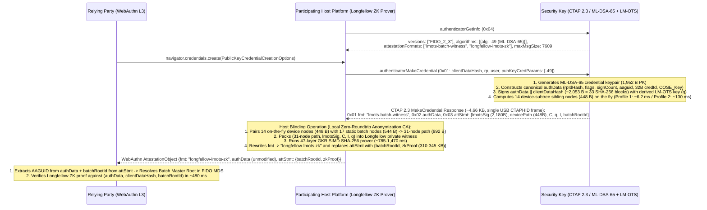
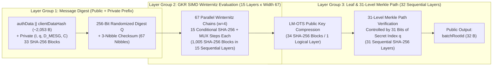

# Multi-Batch Post-Quantum FIDO Attestation via LM-OTS & Google Longfellow (`longfellow-lmots-zk` and Direct Enterprise LMS)

> [!IMPORTANT]
> **Notice:** This document is an early architectural proposal for discussion only. It is aligned with the **FIDO Client to Authenticator Protocol (CTAP) v2.3 Proposed Standard (`2026-02-26`)** and **W3C Web Authentication (WebAuthn) Level 3**, and has not yet been adopted by the FIDO Alliance or W3C WebAuthn Working Group.

This specification defines a post-quantum, multi-batch FIDO2/WebAuthn attestation architecture combining **RFC 8554 LM-OTS (Leighton-Micali One-Time Signatures)** on resource-constrained hardware security keys with **Google Longfellow** (a zero-knowledge prover using GKR layered sumcheck + Ligero over binary extension fields $\text{GF}(2^k)$) on participating host platforms, alongside a **zero-ZK Direct Enterprise Attestation profile**:

1. **[Section 1 — Hardware Layer: 128-Byte Core State & Black-Box Manufacturer Profiles](#1-hardware-layer-128-byte-core-state--black-box-manufacturer-profiles)**
2. **[Section 2 — Component Pipeline, `authenticatorGetInfo` Signaling & Witness Sourcing (CTAP 2.3 & WebAuthn Level 3)](#2-component-pipeline-authenticatorgetinfo-signaling--witness-sourcing-ctap-23--webauthn-level-3)**
3. **[Section 3 — Multi-Batch AAGUID Routing & WebAuthn Level 3 Public Input Structure](#3-multi-batch-aaguid-routing--webauthn-level-3-public-input-structure)**
4. **[Section 4 — Circuit Optimization for Google Longfellow (GKR SIMD + $\text{GF}(2^k)$)](#4-circuit-optimization-for-google-longfellow-gkr-simd--gf2k)**
5. **[Section 5 — Overhead & Performance Summary (Consumer Anonymous ZK Profile — 31-Level Tree)](#5-overhead--performance-summary-consumer-anonymous-zk-profile--31-level-tree)**
6. **[Section 6 — Enterprise Direct Attestation Profile (No Host ZK — 25-Level Self-Contained Tree)](#6-enterprise-direct-attestation-profile-no-host-zk--25-level-self-contained-tree)**

---

## 1. Hardware Layer: 128-Byte Core State & Black-Box Manufacturer Profiles

To enable seamless post-quantum attestation on resource-constrained Secure Element microcontrollers without storing multi-megabyte hash trees or executing heavy post-quantum group signature schemes on-chip, the authenticator maintains a **128-byte core persistent state** in Non-Volatile Memory (NVM) and derives its one-time signing keys and local subtree path nodes on the fly.

### 1.1 Core Persistent State Layout (128 Bytes Total: 112 B Read-Only + 16 B Mutable)

| Component Group | Field Name | Size | NVM Type | Architectural Role |
| :--- | :--- | :---: | :---: | :--- |
| **Master Secret Core (96 B)** | `Master Seed` | 32 B | Read-Only (Provisioned) | High-entropy random root for dynamic, on-the-fly LM-OTS private key derivation via `HMAC-SHA-256` / `HKDF`. |
| | `Key Identifier (I)` | 32 B | Read-Only (Provisioned) | Internal RFC 8554 tree/leaf domain-separation binding string. |
| | `Batch Root ID` | 32 B | Read-Only (Provisioned) | SHA-256 hash of the Batch Master Root Public Key; emitted in CTAP 2.3 responses to anchor the token to its manufacturing batch root. |
| **Stateful Monotonic Bounds (32 B)** | `Global Leaf Index Counter (q)` | 8 B | **Mutable (Monotonic)** | Monotonic counter tracking the next available unique, non-reusable registration (`makeCredential`) index. |
| | `Subtree Offset ID` | 8 B | Read-Only (Provisioned) | Identifies the $2^{14}$ ($16,384$-leaf) block boundary assigned to this specific device within the $2^{17}$ ($131,072$-device) batch. |
| | `Subtree Range Limit` | 8 B | Read-Only (Provisioned) | Upper bound parameter enforcing the $16,384$ `makeCredential` registration limit per key. |
| | `Reservation Milestone Guard` | 8 B | **Mutable (Every $\Delta$ signs)** | Manages state reservation blocks of size $\Delta$ in NVM to minimize flash write wear. On power-up or reset, the active RAM counter initializes directly to the Milestone Guard and advances NVM by $+\Delta$ before signing, guaranteeing **zero index reuse** across unexpected USB unplugging or power loss. |
| **Total Core State** | **Core Allocation** | **128 B** | **112 B RO + 16 B Mutable** | *(Or **112 B** if using 32-bit `uint32` counters; budgeted under 250 B for core applet headers.)* |

---

### 1.2 Black-Box Manufacturer Implementation Choices for the 14-Level Device Subtree

In the **31-level Consumer Anonymous configuration** ($17\text{ batch levels} + 14\text{ device levels} = 31\text{ levels}$), each authenticator is assigned a **14-level ($2^{14} = 16,384$-leaf) device subtree**.

Because the authenticator outputs the **exact same 14 sibling hashes (448 bytes)** of its $16,384$-leaf subtree regardless of how they are computed internally, **the on-key traversal mechanism is a complete black box** to the CTAP 2.3 wire protocol, the Host Longfellow Prover, and the Relying Party Verifier. Authenticator manufacturers can select between two implementation profiles based on their Secure Element's NVM/flash characteristics:

| Manufacturer Profile | Persistent NVM / Flash Footprint | Peak Volatile RAM | On-Key Path Compute (`makeCredential`) | Operational Mechanism |
| :--- | :--- | :---: | :---: | :--- |
| **Profile 1: Latency-Optimized**<br/>*(Incremental BDS State in NVM)* | **~1,568 B Total**<br/>*(128 B core + 1,440 B mutable 45-node BDS buffer)* | **~512 B** | **~6.2 ms**<br/>*(6 leaf evaluations = 6,234 SHA-256 blocks worst-case)* | Maintains a rolling 45-node Buchmann–Dahmen–Szydlo (BDS) fractal traversal state in NVM so incremental state persists across power cycles. |
| **Profile 2: Flash-Wear-Optimized**<br/>*(Read-Only Top-7 Subtree Cache)* | **4,224 B Total**<br/>*(128 B core [only 16 B mutable!] + 4,096 B Read-Only factory flash)* | **~320 B**<br/>*(8-node stack)* | **~130 ms**<br/>*(127 leaves = 131,953 SHA-256 blocks statelessly in RAM)* | Splits the 14 device levels into **Top 7 levels** ($2^7 = 128$ roots cached in read-only factory flash = $4,096\text{ B}$) + **Bottom 7 levels** ($2^7 = 128$ leaves per sub-subtree). Computes the active 128-leaf sub-subtree 100% statelessly in volatile RAM and folds the 128 read-only roots in `<0.1 ms`—achieving **zero flash wear** from tree updates. |
| **Optional: Self-Contained On-Key Batch Path** | **+544 B Read-Only Flash**<br/>*(17 $\times$ 32 B static batch ancestor hashes)* | **+0 B** | **+0 ms** | Stores the 17 static batch ancestor hashes in read-only flash on the key and returns all 31 Merkle path nodes (992 B) over CTAP 2.3, eliminating the host Subtree Token entirely for 100% self-contained roaming across any host PC/phone. |

---

## 2. Component Pipeline, `authenticatorGetInfo` Signaling & Witness Sourcing (CTAP 2.3 & WebAuthn Level 3)

Before credential registration, an authenticator supporting this scheme advertises its capability in the **CTAP 2.3 `authenticatorGetInfo` (`0x04`)** response (via `attestationFormats` `0x16` / `extensions`), signaling to a participating host platform that it can emit a structured LM-OTS witness for host-side Longfellow proof generation.



### 2.1 The Edge Operation (Security Key — On-the-Fly Signing & Subtree Path Derivation)

1. **Post-Quantum Credential Generation:** The key generates a new post-quantum credential key pair (**`ML-DSA-65`**, COSE `alg: -49`, raw public key footprint of `1,952 bytes`) and constructs the canonical CTAP 2.3 `authData` byte string (`rpIdHash` 32 B, `flags` 1 B, `signCount` 4 B, `aaguid` 16 B, fixed 32-byte `credentialId`, and canonical `COSE_Key` map).
2. **CTAP 2.3 Compliant LM-OTS Signing:** Per CTAP 2.3 Section 6.1 and WebAuthn Level 3, the key reads its internal leaf index $q$, derives the corresponding one-time LM-OTS private key ($w = 4, p = 67$ chains) from its 32-byte `Master Seed`, and signs the constant-length concatenation:
   $$\text{SignedPayload} = \texttt{authData} \parallel \texttt{clientDataHash} \quad (\sim 2,053\text{ bytes} = 33\text{ SHA-256 blocks})$$
   using native hardware SHA-256 in `<8 ms`.
3. **On-the-Fly Device Subtree Path Generation:** Using either **Manufacturer Profile 1** (incremental BDS traversal in `~6.2 ms`) or **Manufacturer Profile 2** (stateless bottom-7 RAM derivation + read-only top-7 flash cache in `~130 ms`), the key produces the **14 dynamic sibling nodes (`448 bytes`)** of its $16,384$-leaf ($2^{14}$) device subtree on the fly for leaf $q$.
4. **CTAP 2.3 Response Framing:** The key returns a standard CTAP 2.3 response (**`~4.66 KB` total**, or **`~5.20 KB`** if the 544-byte static batch path is also stored on-key—both fitting comfortably inside a single `7,609-byte` USB CTAPHID frame, or fragmented over BLE/NFC):
   * `0x01` (`fmt`): Initial authenticator attestation format (e.g., `"batch"` / `"lmots-batch-witness"`).
   * `0x02` (`authData`): Canonical Authenticator Data containing the `ML-DSA-65` public key.
   * `0x03` (`attStmt`) / `0x06` (`unsignedExtensionOutputs`): Carries the `2,180-byte` LM-OTS signature ($4\text{ B type} + 32\text{ B } C + 67 \times 32\text{ B chains}$), the 14 on-the-fly device-subtree path nodes (`448 bytes`), leaf index $q$, Key Identifier $I$, and `batchRootId`.

---

### 2.2 The Blinding Operation (Host Client Prover — Platform Format Rewriting)

1. **Witness Extraction (Zero Host Database Required):** Having detected the authenticator's capability via `authenticatorGetInfo`, a participating host platform intercepts the `makeCredential` response, parses the LM-OTS signature and the 14 on-the-fly dynamic path nodes from the authenticator's raw/batch attestation statement, and keeps `authData` untouched. Because the security key generates its 14 device-subtree path nodes on the fly, **the host requires no local SQLite/RocksDB leaf database**.
2. **Full 31-Node Path Assembly:** The host pairs the **14 dynamic path nodes (`448 bytes`)** received from the key with the **17 static batch ancestor hashes (`544 bytes`)** (either from its cached Subtree Token or emitted directly by the key), forming a complete **31-node (`992-byte`) Merkle authentication path** to the Batch Master Root.
3. **Longfellow Private Witness Packing:** The 31-node Merkle path, the raw LM-OTS signature ($67 \times 32\text{ B}$ chain values + 32-byte randomizer $C$), Key Identifier $I$, and 31-bit leaf index $q$ (whose binary bits control left/right child ordering at each of the 31 Merkle levels) are packed into the private witness of the Google Longfellow circuit.
4. **Platform Format Transition (`fmt` Rewriting):** Acting as a **local, zero-roundtrip WebAuthn Level 3 Anonymization CA** (for `"indirect"` and `"direct"` `AttestationConveyancePreference`), the participating platform rewrites the attestation format (`fmt`) in the `makeCredential` output from the authenticator's native batch format to the new ZK attestation format string (**`"longfellow-lmots-zk"`**) and replaces `attStmt` with the generated proof and `batchRootId`.

---

## 3. Multi-Batch AAGUID Routing & WebAuthn Level 3 Public Input Structure

To support production models where a single 16-byte `AAGUID` spans multiple distinct manufacturing batches—each tied to an isolated Master Root—the attestation output provides a dynamic routing anchor without compromising user anonymity or mutating `authData`:

```cddl
; WebAuthn Level 3 AttestationObject emitted by a Participating Platform
LongfellowZkAttestationObject = {
    "fmt": "longfellow-lmots-zk",
    "authData": bstr,                  ; Unmodified from Authenticator (includes AAGUID & ML-DSA-65 COSE_Key)
    "attStmt": {
        "batchRootId": bstr .size 32,  ; SHA-256 hash of the Batch Master Root Public Key
        "zkProof": bstr                ; 310-345 KB Google Longfellow GKR+Ligero ZK Proof
    }
}
```

* **Standard WebAuthn Level 3 Encapsulation:** Because WebAuthn Level 3 forbids host modification of `authData` while explicitly permitting platform replacement of `fmt` and `attStmt`, encapsulating `batchRootId` and `zkProof` inside `attStmt` ensures **100% compatibility with existing WebAuthn Level 3 browser APIs** (`getAuthenticatorData()`, `getPublicKey()`, `getPublicKeyAlgorithm()`) with zero Web IDL changes.
* **Relying Party Resolution (WebAuthn Level 3 Section 7.1):** During credential registration verification (`Verify(attStmt, authData, clientDataHash)`), the RP extracts the 16-byte `aaguid` from `authData.attestedCredentialData.aaguid` and pairs it with `attStmt.batchRootId` to query its FIDO Metadata Service (MDS) catalog, resolving the exact public Master Root anchor for the target manufacturing batch (e.g., *"Titan Batch 2026-B"*).
* **Privacy Isolation ($>100,000$ Keys / $>2.14\text{B}$ Signatures per Batch):** Because each Master Root encompasses an entire production batch of up to **$131,072$ ($2^{17}$) authenticators**—each supporting **$16,384$ ($2^{14}$) `makeCredential` registrations** for over **$2.14\text{ billion}$ ($2^{31}$) total leaf signatures per batch**—revealing `batchRootId` identifies only the manufacturing batch while eliminating individual token tracking or cross-site correlation.

---

## 4. Circuit Optimization for Google Longfellow (GKR SIMD + $\text{GF}(2^k)$)

Google Longfellow (combining a **GKR layered sumcheck** with **Ligero** over binary extension fields $\text{GF}(2^k)$) is uniquely suited to LM-OTS + Merkle attestation by exploiting fixed-bound structural constraints and **SIMD data-parallelism** across Winternitz chains:



1. **Fixed-Bound SHA-256 Pre-Padding:**
   Because the `credentialId` (fixed 32 bytes), canonical COSE-encoded `ML-DSA-65` public key (`1,952 bytes` + fixed CBOR header), `authData` header, and `clientDataHash` (32 bytes) have a known compile-time constant length (**`~2,053 bytes = 33 SHA-256 blocks`**), all SHA-256 bit-padding logic and message block boundaries are hardcoded into Longfellow's circuit configuration, eliminating dynamic length-validation overhead.
2. **Bit-Sliced Winternitz Multiplexing & Checksum in $\text{GF}(2^k)$:**
   Longfellow extracts the $w = 4$ Winternitz nibbles ($a_0, \dots, a_{63}$) directly from bit-sliced SHA-256 output wires, computes the 3-nibble Winternitz checksum $C_{\text{sum}} = \sum_{i=0}^{63}(15 - a_i)$ ($a_{64}, a_{65}, a_{66}$), and evaluates conditional step-count multiplexers (selecting between applying SHA-256 for steps $j \ge a_i$ and bypassing for steps $j < a_i$ across all 15 steps) natively in $\text{GF}(2^k)$ without the bit-decomposition/re-packing overhead required by prime-field provers.
3. **GKR SIMD Data-Parallelism & Trace Uniformity (1,100 Blocks in 47 Sequential Layers):**
   Full in-circuit verification evaluates **`~1,100 SHA-256 compression blocks`**:
   * `33 blocks` for `I || q || D_MESG || C || authData || clientDataHash`
   * `67 × 15 = 1,005 blocks` for the 67 Winternitz chains ($w = 4$)
   * `34 blocks` to compress the 67 chain endpoints ($2,144\text{ B} + \text{prefix}$) into the LM-OTS leaf hash
   * `31–62 blocks` for the 31-level Merkle authentication path
   Crucially, because all **67 Winternitz chains execute identical 15-step SHA-256 subcircuits in parallel**, Longfellow's GKR sumcheck evaluates all 67 chains simultaneously as a **single SIMD-batched subcircuit of depth 15** (adding only $\lceil\log_2(67)\rceil = 7$ sumcheck variables per layer), compressing the entire execution trace into just **47 sequential SHA-256 circuit layers**.

---

## 5. Overhead & Performance Summary (Consumer Anonymous ZK Profile — 31-Level Tree)

| Metric | Consumer Anonymous ZK Profile (`longfellow-lmots-zk`) |
| :--- | :--- |
| **Tree Topology & Capacity** | **31-Level Merkle Tree:** 17 Batch Levels ($2^{17} = \mathbf{131,072\text{ keys/batch}}$) + 14 Device Levels ($2^{14} = \mathbf{16,384\text{ registrations/key}}$; $2.14\text{B}$ total batch leaves) |
| **On-Key Persistent Storage** | **128 B Core State** + Black-Box Choice: **Profile 1:** `1,440 B` mutable BDS state (`~1.57 KB` total) **OR Profile 2:** `4,096 B` Read-Only Top-7 flash cache (`0 B` mutable tree state!) *(Optional `+544 B` RO flash for self-contained batch path)* |
| **On-Key `makeCredential` Latency** | **~15 ms** (Profile 1: LM-OTS sign + 6 BDS leaves) **OR ~138 ms** (Profile 2: LM-OTS sign + 127 stateless RAM leaves) |
| **CTAP 2.3 Hardware Wire Payload** | **~4.66 KB** (`~5.20 KB` with on-key batch path) — fits in a **single 7,609 B USB CTAPHID frame** |
| **Circuit Depth & Total SHA-256 Work** | **`~1,100 SHA-256 blocks`** compressed via GKR SIMD batching into **47 sequential SHA-256 layers** (15 SIMD Winternitz layers of width 67 + 1 leaf compression layer + 31 Merkle layers) |
| **Host Longfellow Prover Latency** | **~785–1,470 ms** on a standard consumer CPU (with **zero local SQLite/RocksDB database**) |
| **WebAuthn Public Inputs** | `(authData, clientDataHash, attStmt.batchRootId)` |
| **WebAuthn Network Payload (`zkProof`)** | **310–345 KB** inside `attStmt.zkProof` (pure symmetric/hash-based post-quantum security) |
| **Relying Party Verification Time** | **~480 ms** |

---

## 6. Enterprise Direct Attestation Profile (No Host ZK — 25-Level Self-Contained Tree)

When deployed for **Enterprise Attestation (`AttestationConveyancePreference: "enterprise"`)** where zero-knowledge blinding is not required, where **$\ge 1,000$ `makeCredential` registrations per device** ($2^{10} = 1,024, h_{\text{device}} = 10$) is sufficient, and where manufacturing batches are up to **$\ge 20,000$ keys** ($2^{15} = 32,768, h_{\text{batch}} = 15$), the architecture simplifies into a **25-level hierarchical LMS/LM-OTS Merkle tree** that operates **100% self-contained on the security key** with zero host software or storage.

### 6.1 Self-Contained On-Authenticator Storage (~1.6 KB Total Persistent Storage)

Because the 15 static batch ancestor hashes occupy only **$15 \times 32\text{ B} = \mathbf{480\text{ bytes}}$**, they are stored directly in read-only flash on the authenticator, eliminating the host Subtree Token completely. Splitting the 10-level ($1,024$-leaf) device subtree into **Top 5 levels ($2^5 = 32$ roots)** cached in read-only factory flash + **Bottom 5 levels ($2^5 = 32$ leaves)** computed statelessly in RAM yields:

| On-Key Storage Component | Size | Memory Type | Purpose |
| :--- | :---: | :---: | :--- |
| **Core Secret & Bounds** | **112 B** | Read-Only Flash | 32 B `Master Seed` + 32 B `Key ID (I)` + 32 B `Batch Root ID` + 16 B subtree bounds |
| **Monotonic Counter State** | **16 B** | **Mutable NVM** | 8 B `Global Leaf Index (q)` + 8 B `Reservation Milestone Guard` *(only mutable bytes written)* |
| **15 Batch Ancestor Hashes** | **480 B** | Read-Only Flash | Static upper Merkle path for the $2^{15}$ ($32,768$-key) manufacturing batch |
| **Top-5 Device Subtree Cache** | **1,024 B** | Read-Only Flash | The 32 roots ($32 \times 32\text{ B}$) of the bottom 5-level ($32$-leaf) sub-subtrees |
| **Total Persistent Storage** | **1,632 B (~1.6 KB)** | **1,616 B RO + 16 B Mutable** | **100% self-contained on-key; zero flash wear from tree state updates** |
| **Peak Volatile RAM** | **~192 B** | Volatile SRAM | 6-node stack during stateless 32-leaf bottom sub-subtree evaluation |

*(Note: If a manufacturer omits the 1,024 B Read-Only Top-5 cache, total persistent storage drops to just **608 bytes**—128 B core + 480 B batch path—and computing all $1,023$ sibling leaves statelessly from scratch takes `~1.0 s` on a hardware SHA-256 engine.)*

---

### 6.2 End-to-End Comparison: Consumer Anonymous ZK Mode vs. Enterprise Direct Mode

| Metric | Consumer Anonymous Mode (With Longfellow ZK)<br/>*(17-Batch + 14-Device = 31 Levels)* | Enterprise Direct Mode (No Host ZK)<br/>*(15-Batch + 10-Device = 25 Levels)* |
| :--- | :--- | :--- |
| **Batch Capacity / Registrations per Key** | **131,072 keys** ($2^{17}$) / **16,384 registrations** ($2^{14}$) | **32,768 keys** ($2^{15}$) / **1,024 registrations** ($2^{10}$) |
| **Authenticator Total Flash / NVM** | `128 B` core + `1.44 KB` BDS *(or `4.1 KB` RO cache; `+544 B` batch path)* | **`16 B` mutable + `1,616 B` Read-Only (`~1.6 KB` total, 100% self-contained)** |
| **Authenticator Peak Volatile RAM** | `~320–512 B` | **`~192 B`** |
| **Authenticator `makeCredential` Latency** | `~15 ms` (Profile 1 BDS) or `~138 ms` (Profile 2 RO Cache) | **`~40 ms`** (`~8 ms` sign + `~32 ms` for 31 stateless leaves / `32,209` SHA-256 blocks) |
| **Host Storage & Prover Latency** | `544 B` Subtree Token (if not on-key) + **`~785–1,470 ms` Longfellow ZK prover** | **`0 Bytes` + `0 ms` (pure CTAP 2.3 passthrough)** |
| **WebAuthn `attStmt` Payload Size** | **310–345 KB** (`zkProof` + `batchRootId`) | **`3,048 B (~2.98 KB)`** (`2,180 B` LM-OTS sig + `800 B` 25-node path + `68 B` IDs — **$>100\times$ smaller**) |
| **Total CTAP 2.3 / WebAuthn Frame Size** | `~4.66–5.20 KB` on USB bus $\to$ `~312–347 KB` to RP | **`~5,070 B (~4.95 KB)` end-to-end** (fits in a single `7,609 B` USB CTAPHID frame) |
| **Relying Party Verification Time** | **`~480 ms`** (Longfellow GKR+Ligero verifier) | **`~0.08 ms (80 µs)`** (`~600–1,120` SHA-256 blocks — **`~6,000×` faster**) |
| **Hardware Auditability & Trust Anchor** | **Zero-Knowledge Anonymity:** Unlinkable across RPs; RP trusts single 32 B `Batch Root ID` in FIDO MDS | **Built-In Subtree Auditability:** Upper 15 bits of $q$ ($\lfloor q / 1024 \rfloor$) = exact Device ID; lower 10 bits ($q \bmod 1024$) = exact registration count; RP trusts single 32 B `Batch Root ID` with zero X.509 `x5c` chains |
| **Dual-Mode Hardware Compatibility** | Native `"longfellow-lmots-zk"` (with optional `"enterprise"` passthrough) | **Dual-Mode Ready:** The exact same `1.6 KB` key can pass the `3.0 KB` `attStmt` directly for `"enterprise"` RPs **or** let a participating platform wrap the 25-node witness in a 41-layer Longfellow ZK proof for `"indirect"` / `"direct"` consumer anonymity |
