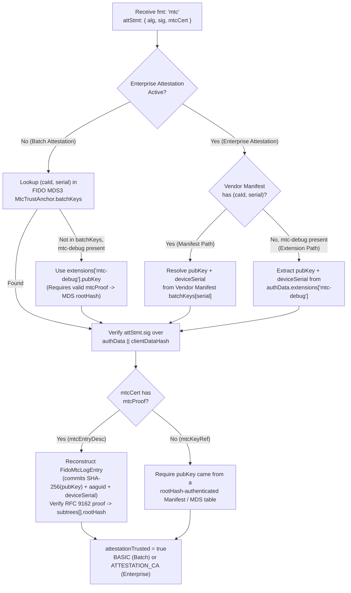

# Proposal: Consolidated `fmt: "mtc"` & `mtc-debug` Support in `java-webauthn-server`

Sources: [webauthn_level4_mtc_proposal.html](./webauthn_level4_mtc_proposal.html), [pq_mtc_attestation_proposal.html](./pq_mtc_attestation_proposal.html), [fido_ctap23_conformance_report.html (Run 22)](./fido_ctap23_conformance_report.html#section-0-0000).
Target Codebase: [Yubico/java-webauthn-server](https://github.com/Yubico/java-webauthn-server) (includes `ML-DSA-44` `-48`, `ML-DSA-65` `-49`, and `ML-DSA-87` `-50` credential support).

> [!IMPORTANT]
> **Target Design — Consolidated `fmt: "mtc"` (No Inline Public Key in `attStmt`):**
> - **Single format (`fmt: "mtc"`):** `attStmt` carries only `{ alg, sig, mtcCert }` where `mtcCert` is either `mtcEntryDesc` (with `mtcProof`) or proof-less `mtcKeyRef` (`{ caId, serial }`). `pubKey` is never sent inside `attStmt`.
> - **Batch (Non-Enterprise) Key Resolution:** The attestation public key is resolved by `(caId, serial)` from FIDO MDS3 (`MtcTrustAnchor.batchKeys`), or via `mtc-debug` in standalone conformance testing.
> - **Enterprise Key & Serial Resolution:** Resolved by `(caId, serial)` from a **vendor manifest** (`MtcTrustAnchor` with per-device `batchKeys` + `deviceSerial`), **or** in-band from the **`mtc-debug` (`mtcDebug`) extension** (`authenticatorData.extensions["mtc-debug"] = { pubKey, deviceSerial }`) authenticated by verifying `mtcCert.mtcProof` against the MDS `MtcTrustAnchor.subtrees[].rootHash`.

---

## 1. Key & Trust Resolution Architecture for `fmt: "mtc"`



### Why `mtc-debug` + `mtcProof` is Cryptographically Trusted in Enterprise Mode

In public FIDO MDS3, the Enterprise `MtcTrustAnchor` (e.g., `caId: "g5k_AQI"`) publishes the Root-CA-signed `subtrees[].rootHash` with `"batchKeys": []` (since individual device keys are not published in public MDS).
- When the RP has the **vendor manifest**, it resolves `(pubKey, deviceSerial)` by `(caId, serial)` from the manifest (supporting both `mtcEntryDesc` and proof-less `mtcKeyRef`).
- When the RP does **not** have the vendor manifest (or is running conformance tests) and requests **`mtcDebug: true`**, the authenticator returns `{ pubKey, deviceSerial }` in `authenticatorData.extensions["mtc-debug"]` and `mtcEntryDesc` (with `mtcProof`) in `attStmt.mtcCert`.
- The RP hashes `SHA-256(pubKey)` and `deviceSerial` into `FidoMtcLogEntry`, walks `mtcProof`, and verifies that the resulting root matches the Root-CA-signed `subtrees[].rootHash` from MDS. Neither `pubKey` nor `deviceSerial` can be forged because both are committed inside the Merkle leaf authenticated by the CA's `rootHash`.

---

## 2. Proposed Changes: `webauthn-server-core`

### 2.1 Requesting MTC Attestation & `mtcDebug`

1. **`attestationFormats` preference list** (WebAuthn L3/L4 §5.4, CTAP 2.3 `0x0B`):
   - Add `Optional<List<String>> attestationFormats` to [`PublicKeyCredentialCreationOptions`](https://github.com/Yubico/java-webauthn-server/blob/main/webauthn-server-core/src/main/java/com/yubico/webauthn/data/PublicKeyCredentialCreationOptions.java) (serialized as JSON `"attestationFormats"` when non-empty).
   - Add `.attestationFormats(List<String>)` to [`StartRegistrationOptions`](https://github.com/Yubico/java-webauthn-server/blob/main/webauthn-server-core/src/main/java/com/yubico/webauthn/StartRegistrationOptions.java) and a Relying Party default on [`RelyingParty`](https://github.com/Yubico/java-webauthn-server/blob/main/webauthn-server-core/src/main/java/com/yubico/webauthn/RelyingParty.java) / [`RelyingPartyV2`](https://github.com/Yubico/java-webauthn-server/blob/main/webauthn-server-core/src/main/java/com/yubico/webauthn/RelyingPartyV2.java) (e.g., `List.of("mtc", "packed")`).
   - Omit `attestationFormats` when `attestation == NONE`.

2. **`mtcDebug` (`mtc-debug`) registration extension** (WebAuthn Level 4 §10.2.1):
   - [`RegistrationExtensionInputs`](https://github.com/Yubico/java-webauthn-server/blob/main/webauthn-server-core/src/main/java/com/yubico/webauthn/data/RegistrationExtensionInputs.java): add `@JsonProperty("mtcDebug") Boolean mtcDebug`, builder method `.mtcDebug(boolean)` / `.mtcDebug()`, and include `"mtcDebug"` in `getExtensionIds()`.
   - [`Extensions`](https://github.com/Yubico/java-webauthn-server/blob/main/webauthn-server-core/src/main/java/com/yubico/webauthn/data/Extensions.java): add `Extensions.MtcDebug`:
     - **7-Field Registration Output (`authData.extensions["mtc-debug"]` & `clientExtensionResults.mtcDebug`):**
       ```java
       @Value
       @Builder(toBuilder = true)
       public static class MtcDebugRegistrationOutput {
         ByteArray pubKey;               // Canonical CBOR COSE_Key (Base64URL in toJSON())
         Optional<String> deviceSerial;  // Decoded from tstr/uint; strictly gated on EP 1/2
         Optional<Long> notBefore;       // Unix epoch seconds (for proof-less mtcKeyRef)
         Optional<Long> notAfter;        // Unix epoch seconds (for proof-less mtcKeyRef)
         Optional<Long> firmwareVersion; // CTAP 2.3 parameter 0x0E (uint32)
         Optional<ByteArray> mtcProof;   // RFC 9162 binary inclusion proof
         Optional<ByteArray> rootHash;   // 32-byte Landmark / Trust Anchor root hash
       }
       ```
     - **Client output (`clientExtensionResults.mtcDebug`):** wired into [`AuthenticatorRegistrationExtensionOutputs`](https://github.com/Yubico/java-webauthn-server/blob/main/webauthn-server-core/src/main/java/com/yubico/webauthn/data/AuthenticatorRegistrationExtensionOutputs.java) and [`ClientRegistrationExtensionOutputs`](https://github.com/Yubico/java-webauthn-server/blob/main/webauthn-server-core/src/main/java/com/yubico/webauthn/data/ClientRegistrationExtensionOutputs.java).
     - **Dual-layer privacy gate validation (`FinishRegistrationSteps.Step17`):** if either `authData.extensions["mtc-debug"]` or `clientExtensionResults.mtcDebug` contains `deviceSerial` when the RP did not request `AttestationConveyancePreference.ENTERPRISE`, fail validation immediately.

### 2.2 New Package `com.yubico.webauthn.attestation.mtc`

```java
public interface MtcTrustSource {
  /** Find the MtcTrustAnchor for (caId, aaguid). */
  Optional<MtcTrustAnchor> findTrustAnchor(ByteArray caId, Optional<ByteArray> aaguid);
}

@Value @Builder
public class MtcTrustAnchor {
  ByteArray caId;
  String hashAlg;                               // "sha-256"
  long maxBatchWindow;
  List<MtcSubtree> subtrees;                    // Checkpoint-verified subtrees
  Set<Long> revokedSerials;
  Map<Long, MtcBatchKeyEntry> batchKeys;        // Keyed by uint64 serial
  boolean keyTableAuthenticated;                // True if batchKeys table was verified against rootHash
}

@Value @Builder
public class MtcSubtree {
  int logNumber;
  long start;
  long end;
  ByteArray rootHash;                           // 32-byte SHA-256 root
  Optional<COSEAlgorithmIdentifier> alg;
  Optional<ByteArray> signature;
}

@Value @Builder
public class MtcBatchKeyEntry {
  long serial;
  COSEAlgorithmIdentifier alg;
  ByteArray coseKey;
  Optional<Long> notBefore;
  Optional<Long> notAfter;
  Optional<String> deviceSerial;                // Present in vendor enterprise manifests
}

@Value @Builder
public class MtcAttestationInfo {
  ByteArray caId;
  long serial;
  int logNumber;
  long leafIndex;
  KeySource keySource;                          // MDS_BATCH_KEYS | VENDOR_MANIFEST | MTC_DEBUG_EXTENSION
  ProofMode proofMode;                          // INCLUSION_PROOF | AUTHENTICATED_KEY_TABLE
  COSEAlgorithmIdentifier alg;
  ByteArray attestationPublicKeyCose;
  Optional<String> deviceSerial;
  Optional<Instant> notBefore;
  Optional<Instant> notAfter;
  Optional<Long> firmwareVersion;
}
```

- Expose `Optional<MtcAttestationInfo> getMtcAttestation()` on [`RegistrationResult`](https://github.com/Yubico/java-webauthn-server/blob/main/webauthn-server-core/src/main/java/com/yubico/webauthn/RegistrationResult.java).
- Add `.mtcTrustSource(MtcTrustSource)` on `RelyingParty.RelyingPartyBuilder` and `RelyingPartyV2.RelyingPartyV2Builder`.

### 2.3 Wire Codecs & Verifier (`MtcAttestationStatementVerifier`)

1. **`MtcStatementCodec`**:
   - Parses CBOR `attStmt` for `fmt: "mtc"`:
     - `alg`: `COSEAlgorithmIdentifier` (`-48` `ML-DSA-44`, `-49` `ML-DSA-65`, `-50` `ML-DSA-87`, `-7` `ES256`, etc.)
     - `sig`: `ByteArray`
     - `mtcCert`:
       - `mtcEntryDesc`: `{ caId, serial, notBefore, notAfter, ?firmwareVersion, ?mtcProof }`
       - `mtcKeyRef`: `{ caId, serial }` (proof-less)
   - Rejects `attStmt` if an inline `pubKey` field is present (enforcing consolidated `fmt: "mtc"`).

2. **`MtcProof` & `FidoMtcLogEntry` & `MerkleInclusion`**:
   - `MtcProof`: parses TLS-serialized `extensions<0..2^16-1>`, `uint48 start`, `uint48 end`, `inclusion_proof<0..2^16-1>`, `signatures<0..2^24-1>`.
   - `FidoMtcLogEntry`: deterministic serializer binding `(ca_id, serial, not_before, not_after, aaguid[16], firmware_version, SHA-256(pubKey)[32], extensions)`. Note: Because `firmware_version` is committed into the leaf entry, deploying a new firmware version requires issuing a new attestation batch key and leaf entry even if the AAGUID remains stable.
   - `MerkleInclusion`: RFC 9162 §2.1.3.2 inclusion proof evaluator (`H(0x00 || leaf)` and `H(0x01 || left || right)`) over `(leafIndex - start, end - start)` against `MtcSubtree.rootHash`.
   - `MtcCheckpoint`: constructs the 85-byte `FidoMtcSubtreeCheckpoint` (`"FIDO-MTC-SUBTREE-CHECKPOINT-V1\0\0" || u16 len(caId) || caId || u16 logNumber || u48 start || u48 end || rootHash[32]`) and verifies `subtrees[].signature` against `attestationRootCertificates` (supporting `ML-DSA`, `ES256`/`ES384`, and `HSS-LMS` `alg: -46` OID `1.2.840.113549.1.9.16.3.17` via BouncyCastle).

3. **`MtcAttestationStatementVerifier` Execution Steps** (wired into [`FinishRegistrationSteps`](https://github.com/Yubico/java-webauthn-server/blob/main/webauthn-server-core/src/main/java/com/yubico/webauthn/FinishRegistrationSteps.java) Steps 18–21):
   1. Parse `attStmt` via `MtcStatementCodec`.
   2. Look up `MtcTrustAnchor` from `mtcTrustSource` by `(mtcCert.caId, authData.aaguid)`.
   3. **Resolve `pubKey` (and optional `deviceSerial`):**
      - Check `anchor.batchKeys.get(mtcCert.serial)`:
        - In Batch mode (`attestation != ENTERPRISE`), this yields the MDS batch `pubKey` (`KeySource.MDS_BATCH_KEYS`).
        - In Enterprise mode (`attestation == ENTERPRISE`), if a vendor manifest is loaded, this yields the device `pubKey` and `deviceSerial` (`KeySource.VENDOR_MANIFEST`).
      - Otherwise, inspect `authData.extensions["mtc-debug"]`:
        - Extract `pubKey` (and `deviceSerial` if Enterprise) (`KeySource.MTC_DEBUG_EXTENSION`).
      - Fail if no `pubKey` can be resolved.
   4. Parse `pubKey` via `WebAuthnCodecs.importCosePublicKey(pubKey)`, verify `coseKey.alg == attStmt.alg`, and verify `attStmt.sig` over `authenticatorData || clientDataJsonHash` using `Crypto.verifySignature`.
   5. Check validity window `[notBefore, notAfter]` against `clock.instant()`, verify `!anchor.revokedSerials.contains(serial)`, and verify `logNumber` matches.
   6. **Verify Merkle Commitment:**
      - **If `mtcProof` is present (in `mtcCert` `mtcEntryDesc` or in `mtc-debug` alongside proof-less `mtcKeyRef`):** reconstruct `FidoMtcLogEntry` with `SHA-256(pubKey)`, `authData.aaguid`, optional `firmwareVersion`, and `mtcProof.extensions` (verifying that `mtcProof.extensions` matches `deviceSerial` when in Enterprise `mtc-debug` mode), compute the RFC 9162 root hash, and verify it equals `subtree.rootHash` (or `mtcDebug.rootHash` in standalone offline conformance mode) (`ProofMode.INCLUSION_PROOF`).
      - **If `mtcProof` is absent (`mtcKeyRef` without `mtcDebug.mtcProof`):** require `keySource != MTC_DEBUG_EXTENSION` and `anchor.isKeyTableAuthenticated() == true` (`ProofMode.AUTHENTICATED_KEY_TABLE`).
   7. Set `attestationTrusted = true`, `attestationType = (deviceSerial.isPresent() ? AttestationType.ATTESTATION_CA : AttestationType.BASIC)`, and attach `MtcAttestationInfo` to `RegistrationResult`.

---

## 3. Proposed Changes: `webauthn-server-attestation` (MDS3 & Manifests)

1. **[`MetadataStatement.java`](https://github.com/Yubico/java-webauthn-server/blob/main/webauthn-server-attestation/src/main/java/com/yubico/fido/metadata/MetadataStatement.java)**:
   - Add `List<MtcTrustAnchor> mtcTrustAnchors` deserialized by Jackson from MDS3 JSON blobs or standalone metadata files (such as `fido-mds3.json`).
2. **[`FidoMetadataService.java`](https://github.com/Yubico/java-webauthn-server/blob/main/webauthn-server-attestation/src/main/java/com/yubico/fido/metadata/FidoMetadataService.java)**:
   - Implement `MtcTrustSource`.
   - When loading metadata statements with `mtcTrustAnchors`, verify each `MtcSubtree.signature` (if present) over `FidoMtcSubtreeCheckpoint` against the entry's `attestationRootCertificates` (including BouncyCastle `LMS` / `ML-DSA` / `ECDSA` root certs).
3. **`MtcManifestTrustSource` & `CompositeMtcTrustSource`**:
   - Loads vendor enterprise manifests (JSON `MtcTrustAnchor` files with per-device `batchKeys` + `deviceSerial`), verifies the checkpoint signature and optionally verifies that the full `batchKeys` list hashes to `subtrees[].rootHash` (`keyTableAuthenticated = true`).
   - `CompositeMtcTrustSource` combines `FidoMetadataService` (for batch MDS keys and enterprise `rootHash` checkpoints) with any loaded vendor manifests.

---

## 4. Proposed Changes: `webauthn-server-demo` (Request & Test on Localhost)

1. **[`WebAuthnServer.java`](https://github.com/Yubico/java-webauthn-server/blob/main/webauthn-server-demo/src/main/java/demo/webauthn/WebAuthnServer.java) & [`WebAuthnRestResource.java`](https://github.com/Yubico/java-webauthn-server/blob/main/webauthn-server-demo/src/main/java/demo/webauthn/WebAuthnRestResource.java)**:
   - Enable `ML_DSA_44`, `ML_DSA_65`, `ML_DSA_87` alongside `ES256`/`EdDSA`/`RS256` in `RelyingParty`.
   - Add query/form parameters on `/api/v1/register` to control:
     - `attestation`: `direct` | `enterprise` | `none`
     - `attestationFormats`: e.g., `["mtc", "packed"]` or `["mtc"]`
     - `mtcDebug`: `true` | `false` (requests `"mtcDebug": true` in `extensions`)
   - Load `YUBICO_WEBAUTHN_MTC_METADATA` (MDS3 JSON with `mtcTrustAnchors`, e.g., `g5k_AQE` batch + `g5k_AQI` enterprise) and optional `YUBICO_WEBAUTHN_MTC_MANIFEST` (vendor manifest JSON).
   - Return `mtcAttestation` details (`caId`, `serial`, `logNumber`, `leafIndex`, `keySource`, `proofMode`, `alg`, `deviceSerial`) in the registration response JSON.

2. **Demo UI ([`index.html`](https://github.com/Yubico/java-webauthn-server/blob/main/webauthn-server-demo/src/main/webapp/index.html))**:
   - Add checkboxes/selectors in the registration panel:
     - **Attestation Conveyance:** `direct` / `enterprise` / `none`
     - **Attestation Formats:** `mtc, packed` / `mtc only` / `packed only`
     - **Request `mtcDebug` extension** checkbox
   - Pass `attestationFormats` and `extensions: { mtcDebug: true }` through to `navigator.credentials.create()` and display the verified `MtcAttestationInfo` (including `keySource` and `deviceSerial`) in the UI.
   - Include a built-in **"Test Simulated MTC Registration"** button in the demo UI (backed by a test endpoint or client-side generator) so you can immediately exercise Batch MDS, Enterprise Manifest, and Enterprise `mtc-debug` flows in the browser even without a physical token plugged in, as well as with a physical Fidont token over WebAuthn.

---

## 5. Test Suite (`webauthn-server-core` & `webauthn-server-attestation`)

Extend [`TestAuthenticator.scala`](https://github.com/Yubico/java-webauthn-server/blob/main/webauthn-server-core/src/test/scala/com/yubico/webauthn/TestAuthenticator.scala) with an `MtcTestLog` helper (building real RFC 9162 Merkle trees, `FidoMtcLogEntry` leaves, `MTCProof` blobs, and signed `FidoMtcSubtreeCheckpoint`s across `ML-DSA-44`, `ML-DSA-65`, `ML-DSA-87`, and `ES256`) and add `MtcAttestationStatementVerifierSpec.scala`:

1. **Batch `fmt: "mtc"` via MDS `batchKeys`:**
   - With `mtcProof` (`mtcEntryDesc`): resolves key from MDS `batchKeys`, verifies signature + Merkle inclusion proof $\rightarrow$ `BASIC`, `trusted = true`, `keySource = MDS_BATCH_KEYS`, `proofMode = INCLUSION_PROOF`.
   - Proof-less (`mtcKeyRef`) with authenticated MDS `batchKeys` table $\rightarrow$ `BASIC`, `trusted = true`, `proofMode = AUTHENTICATED_KEY_TABLE`.
2. **Enterprise `fmt: "mtc"` via Vendor Manifest:**
   - Proof-less `mtcKeyRef` and proof-carrying `mtcEntryDesc` resolved by `(caId, serial)` from the vendor manifest $\rightarrow$ `ATTESTATION_CA`, `trusted = true`, `keySource = VENDOR_MANIFEST`, `deviceSerial = Some("123456")`.
3. **Enterprise `fmt: "mtc"` via `mtc-debug` Extension (No Vendor Manifest):**
   - MDS has `caId: "g5k_AQI"` with signed `subtrees[].rootHash` and `batchKeys: []`.
   - Authenticator returns `pubKey` + `deviceSerial: "123456"` in `authData.extensions["mtc-debug"]` and `mtcProof` in `attStmt.mtcCert`.
   - Verifier authenticates `pubKey` and `deviceSerial` via `mtcProof` against `subtrees[].rootHash` $\rightarrow$ `ATTESTATION_CA`, `trusted = true`, `keySource = MTC_DEBUG_EXTENSION`, `deviceSerial = Some("123456")`.
4. **Negative & Security Tests:**
   - Tampered `pubKey` or `deviceSerial` in `mtc-debug` fails Merkle root verification against `subtrees[].rootHash`.
   - `mtc-debug` with proof-less `mtcKeyRef` (no `mtcProof` and key not in manifest/MDS) fails trust verification.
   - `mtc-debug` emitting `deviceSerial` when `attestation != ENTERPRISE` fails the privacy gate.
   - Revoked `serial`, expired `notAfter`, wrong `aaguid`, or invalid Root CA checkpoint signature fails verification.
