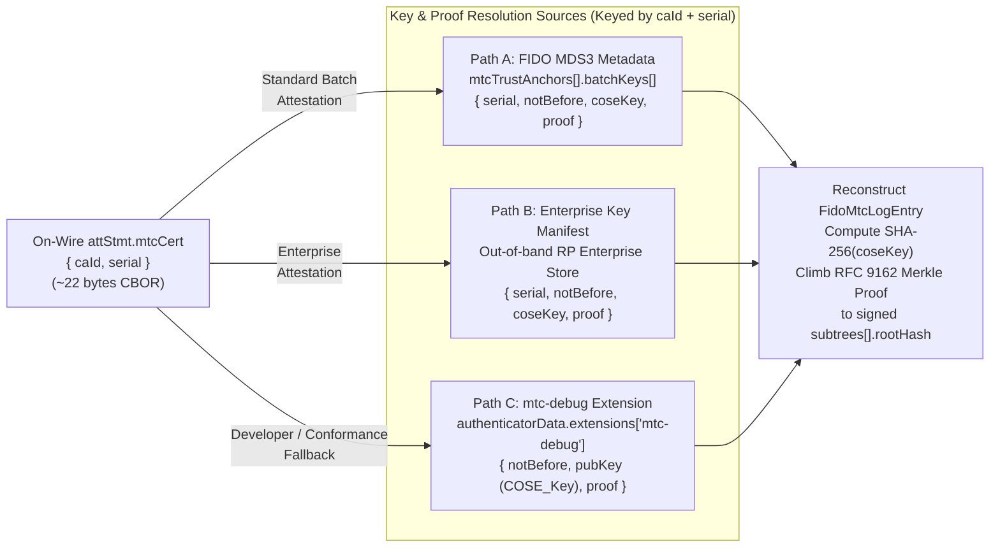

# FIDO MDS3 & WebAuthn Level 4 MTC Cryptographic Trust Chain Architecture

**Complete Signature & Hash Preimage Reference — From the Vendor X.509 Attestation Root CA in FIDO MDS3 Down to the Batch/Enterprise `COSE_Key` and Attested User Credential**

---

## 1. End-to-End Cryptographic Trust Chain Overview

In WebAuthn Level 4 (`fmt: "mtc"`), attestation separates **heavy post-quantum CA root signatures** (delivered out-of-band in FIDO MDS3 metadata) from **ultra-compact authenticator registration ceremonies** (which carry only a 2-field `mtcKeyRef` `{ caId, serial }` and a single registration signature `attStmt.sig` on the wire).

The complete trust chain spans **six cryptographic levels**, combining two digital signatures (`Level 0` FIDO MDS3 JWS and `Level 2` Vendor X.509 Root CA Subtree Checkpoint signature), one **RFC 9162 SHA-256 Merkle inclusion tree** (`Level 3`), one **SHA-256 `COSE_Key` commitment** (`Level 4`), and one **authenticator registration signature** (`Level 5`).

```mermaid
flowchart TD
    subgraph L0["Level 0: FIDO Alliance Metadata Service (MDS3 TOC / BLOB)"]
        MDS_ROOT["FIDO MDS3 Root CA (X.509)\nVerifies JWS Header x5c Chain"]
        MDS_JWS["MDS3 BLOB JWS Signature\nSigned over: Base64URL(JWS Header) || '.' || Base64URL(MDS3 Payload)"]
        MDS_ROOT --> MDS_JWS
    end

    subgraph L1["Level 1: Vendor X.509 Attestation Root CA (MDS3 Entry)"]
        VENDOR_X509["metadata.attestationRootCertificates[]\nSelf-Signed Vendor X.509v3 Root CA (BasicConstraints CA:TRUE)\nPublic Key: SPKI (e.g., ML-DSA-87, HSS-LMS, SLH-DSA, or ES384)"]
        MDS_JWS -->|"Authenticates MetadataStatement\nfor Authenticator AAGUID"| VENDOR_X509
    end

    subgraph L2["Level 2: Signed MTC Subtree Checkpoint (mtcTrustAnchors[].subtrees[])"]
        CKPT_PREIMAGE["FidoMtcSubtreeCheckpoint (80 + len(caId) bytes; 85B for 5B caId)\n'FIDO-MTC-SUBTREE-CHECKPOINT-V1\\0\\0' (32B)\n|| uint16_be(len(caId)) (2B) || caId (NB) || uint16_be(logNumber) (2B)\n|| uint48_be(start) (6B) || uint48_be(end) (6B) || rootHash (32B)"]
        CKPT_SIG["subtrees[].signature (alg = subtrees[].alg, e.g., -50 ML-DSA-87)\nSigned by Vendor X.509 Attestation Root CA Private Key"]
        VENDOR_X509 -->|"Verifies subtrees[].signature\nusing Root CA SPKI"| CKPT_SIG
        CKPT_SIG -->|"Authenticates 32-byte\nsubtrees[].rootHash"| CKPT_PREIMAGE
    end

    subgraph L3["Level 3: RFC 9162 SHA-256 Merkle Hash Tree (Subtree [start, end))"]
        ROOT_HASH["Subtree Merkle Root: subtrees[].rootHash (32 bytes)"]
        INT_NODE["Interior Merkle Nodes (RFC 9162 §2.1.1)\nParent = SHA-256(0x01 || LeftChild[32] || RightChild[32])\nComputed using sibling hashes in batchKeys[].proof (or mtc-debug.proof)"]
        LEAF_HASH["Merkle Leaf Hash at index = (serial & 0xFFFFFFFFFFFF)\nLeafHash = SHA-256(0x00 || FidoMtcLogEntry)"]
        LOG_ENTRY["FidoMtcLogEntry (Binary Preimage — 83B + len(caId) + fw + ext)\nuint16_be(len(caId)) || caId || uint64_be(serial)\n|| uint64_be(notBefore) || uint64_be(notAfter = 253402300799)\n|| aaguid (16B) || fwBytes (0x00 or 0x01||uint64_be(fwVersion))\n|| SHA-256(coseKey) (32B) || uint16_be(len(ext)) || ext"]
        CKPT_PREIMAGE --> ROOT_HASH
        ROOT_HASH ---|"Verified Equal"| INT_NODE
        INT_NODE ---|"Merkle Path Climb"| LEAF_HASH
        LEAF_HASH ---|"SHA-256(0x00 || ...)"| LOG_ENTRY
    end

    subgraph L4["Level 4: Batch or Enterprise Attestation Key (COSE_Key)"]
        KEY_REF["Wire Lookup Key: 2-Field mtcKeyRef\nattStmt.mtcCert = { caId, serial } (22 bytes CBOR)"]
        COSE_KEY["Canonical CBOR COSE_Key (batchKeys[].coseKey or mtc-debug.pubKey)\n{ 1: kty, 3: alg (e.g., -48..-50 / -70..-71 / -7), -1: pub }\nalg in COSE_Key (label 3) is authoritative (no redundant alg on batchKeys[])"]
        LOG_ENTRY -->|"Commits 32-byte\nSHA-256(coseKey)"| COSE_KEY
        KEY_REF -.->|"Resolves entry by\n(caId, serial)"| COSE_KEY
    end

    subgraph L5["Level 5: Authenticator WebAuthn Registration Signature (On the Wire)"]
        VERIF_DATA["verificationData = authenticatorData || clientDataHash\nauthenticatorData (rpIdHash || flags || signCount || attestedCredentialData || extensions)\n|| SHA-256(clientDataJSON) (32 bytes)"]
        ATT_SIG["attStmt.sig (alg = attStmt.alg, matching COSE_Key label 3)\nSigned by Authenticator Batch/Enterprise Private Key over raw verificationData"]
        CRED_KEY["Attested User Credential Public Key\n(authenticatorData.attestedCredentialData.credentialPublicKey)"]
        COSE_KEY -->|"Verifies attStmt.sig"| ATT_SIG
        ATT_SIG -->|"Signs raw bytes of"| VERIF_DATA
        VERIF_DATA -->|"Binds & Authenticates"| CRED_KEY
    end
```



### Master Summary Table: What Gets Signed or Hashed at Each Level

| Level | Artifact / Structure | Where It Lives | Cryptographic Operation | Signer / Key Used | Exact Signed or Hashed Preimage |
| :--- | :--- | :--- | :--- | :--- | :--- |
| **0** | **FIDO MDS3 BLOB (`JWS`)** | FIDO MDS3 TOC/BLOB endpoint | Digital Signature (`RS256` / `ES256` / `ES384`) | FIDO Alliance MDS3 Root CA (`x5c` chain) | ASCII `Base64URL(JWS Header) \|\| "." \|\| Base64URL(MDS3 Payload)` containing `MetadataStatement` |
| **1** | **Vendor X.509 Root CA** | `metadata.attestationRootCertificates[]` | Self-Signed X.509v3 Certificate | Vendor Attestation Root CA (`BasicConstraints CA:TRUE`) | ASN.1 DER `TBSCertificate` containing the Vendor Root CA Subject Public Key Info (`SPKI`, e.g., `ML-DSA-87`) |
| **2** | **Subtree Checkpoint Signature** | `mtcTrustAnchors[].subtrees[].signature` | Digital Signature (`subtrees[].alg`, e.g., `-50` `ML-DSA-87`) | Vendor X.509 Root CA (`attestationRootCertificates[]`) | **`FidoMtcSubtreeCheckpoint`** (`80 + len(caId)` bytes; `85 bytes` for 5B `caId`) committing `(caId, logNumber, start, end, rootHash)` |
| **3a** | **Merkle Interior Nodes** | Computed during verification from `proof` | `SHA-256` (`RFC 9162 §2.1.1`) | Keyless hash (`SHA-256` with `0x01` domain separator) | `0x01 \|\| LeftChildHash (32B) \|\| RightChildHash (32B)` (`65 bytes` total per interior step) |
| **3b** | **Merkle Leaf Node** | Computed at `index = serial & 0xFFFFFFFFFFFF` | `SHA-256` (`RFC 9162 §2.1.1`) | Keyless hash (`SHA-256` with `0x00` domain separator) | `0x00 \|\| FidoMtcLogEntry` (`84 + len(caId) + fw + ext` bytes; `89 bytes` typical) |
| **4** | **Batch / Enterprise Key Commitment** | Inside `FidoMtcLogEntry` (`pkHash` field) | `SHA-256` over raw CBOR `COSE_Key` | Keyless hash (`SHA-256`) | Exact canonical CBOR bytes of `coseKey` (`batchKeys[].coseKey` or `mtc-debug.pubKey`), which carries `alg` at COSE label `3` |
| **5** | **WebAuthn Attestation Signature** | `attStmt.sig` (on the wire in `attestationObject`) | Digital Signature (`attStmt.alg`, matching `coseKey[3]`) | Authenticator Batch or Enterprise Private Key | **`verificationData = authenticatorData \|\| clientDataHash`** (raw concatenation; no outer SHA-256 pre-hash) |

---

## 2. Levels 1 & 2: Vendor X.509 Root CA & Signed Subtree Checkpoint (`FidoMtcSubtreeCheckpoint`)

### 2.1 Why the Vendor X.509 Root CA Signs the Subtree Checkpoint

In FIDO MDS3, every authenticator model already anchors its hardware identity in `metadata.attestationRootCertificates[]` — an array of base64-encoded DER X.509v3 Root CA certificates (`BasicConstraints CA:TRUE`). Rather than introducing a separate PKI for Merkle Tree Certificates, the Vendor X.509 Attestation Root CA directly signs each **MTC Subtree Checkpoint** (`mtcTrustAnchors[].subtrees[].signature`).

> [!IMPORTANT]
> **Amortizing Heavy Post-Quantum Root Signatures Out-of-Band:** A single `ML-DSA-87` (`4,627 B`), `HSS-LMS`, or `SLH-DSA` signature from the Vendor X.509 Attestation Root CA over an `85-byte` `FidoMtcSubtreeCheckpoint` authenticates the 32-byte `rootHash` of a subtree covering up to $2^{48}$ batch or enterprise keys. Relying Parties verify this heavy root signature once when refreshing MDS3 metadata (or on cache miss), removing all CA certificates and root signatures from the WebAuthn registration ceremony.

### 2.2 Exact Binary Layout of `FidoMtcSubtreeCheckpoint` (Level 2 Signed Preimage)

For each subtree object in `metadata.mtcTrustAnchors[].subtrees[]`, the Vendor X.509 Attestation Root CA signs the exact byte sequence `FidoMtcSubtreeCheckpoint` (`80 + len(caId)` bytes total; **85 bytes** for a standard 5-byte ASN.1 OBJECT IDENTIFIER `caId`):

```text
+-----------------------------------------------------------------------+
| Offset | Length | Field       | Encoding / Value                      |
+--------+--------+-------------+---------------------------------------+
| 0      | 32     | domainSep   | ASCII "FIDO-MTC-SUBTREE-CHECKPOINT-V1"|
|        |        |             | padded with two trailing 0x00 bytes   |
|        |        |             | (30 ASCII chars + 0x00 0x00 = 32 B)   |
+--------+--------+-------------+---------------------------------------+
| 32     | 2      | caIdLen     | uint16_be(len(caId))                  |
|        |        |             | e.g., 0x0005 for a 5-byte OID         |
+--------+--------+-------------+---------------------------------------+
| 34     | N      | caId        | Raw bytes of the CA Identifier        |
|        | (5)    |             | (from parent mtcTrustAnchors[].caId)  |
+--------+--------+-------------+---------------------------------------+
| 34+N   | 2      | logNumber   | uint16_be(subtrees[].logNumber)       |
| (39)   |        |             | Matches upper 16 bits of serial       |
+--------+--------+-------------+---------------------------------------+
| 36+N   | 6      | start       | uint48_be(subtrees[].start)           |
| (41)   |        |             | Inclusive start leaf index [0..2^48)  |
+--------+--------+-------------+---------------------------------------+
| 42+N   | 6      | end         | uint48_be(subtrees[].end)             |
| (47)   |        |             | Exclusive end leaf index (end > start)|
+--------+--------+-------------+---------------------------------------+
| 48+N   | 32     | rootHash    | Raw 32-byte SHA-256 Merkle subtree    |
| (53)   |        |             | root hash (subtrees[].rootHash)       |
+-----------------------------------------------------------------------+
Total Size = 80 + N bytes (85 bytes when N = 5)
```

### 2.3 Level 2 Verification Rules

1. **Key & Algorithm Selection:** The verifier extracts the `SubjectPublicKeyInfo` (`SPKI`) from a valid X.509v3 Root CA certificate (`BasicConstraints CA:TRUE`) in `metadata.attestationRootCertificates[]` matching the COSE algorithm `subtrees[].alg` (e.g., `-50` for `ML-DSA-87`, `-49` for `ML-DSA-65`, `-48` for `ML-DSA-44`, `-46` for `HSS-LMS`).
2. **Range & Log Matching:** Given a 64-bit `serial` from `attStmt.mtcCert`, the verifier splits:
   $$\text{logNumber} = (\text{serial} \gg 48) \ \& \ \text{0xFFFF}, \qquad \text{leafIndex} = \text{serial} \ \& \ \text{0xFFFFFFFFFFFF}$$
   and selects the subtree entry where `subtrees[].logNumber == logNumber` and `subtrees[].start <= leafIndex < subtrees[].end`.
3. **Cryptographic Verification:** The verifier reconstructs `FidoMtcSubtreeCheckpoint` and verifies `subtrees[].signature` using the Vendor X.509 Root CA public key and `subtrees[].alg`.

---

## 3. Level 3: RFC 9162 SHA-256 Merkle Hash Tree & `FidoMtcLogEntry` Leaf Preimage

Once the 32-byte `subtrees[].rootHash` is authenticated by the Vendor X.509 Root CA signature in Level 2, the verifier proves that a specific authenticator batch or enterprise key is an authentic leaf in that subtree at `leafIndex = serial & 0xFFFFFFFFFFFF`.

### 3.1 Reconstructing `FidoMtcLogEntry` (Level 3b Leaf Preimage)

The verifier constructs the canonical binary `FidoMtcLogEntry` byte string from the resolved key metadata (`notBefore`, `coseKey`, optional `fwVersion`, optional `extensions`), the authenticator's `aaguid` (from `authenticatorData.attestedCredentialData.aaguid`), and `(caId, serial)` from `attStmt.mtcCert`:

```text
+-----------------------------------------------------------------------+
| Field        | Size      | Encoding / Value                           |
+--------------+-----------+--------------------------------------------+
| caIdLen      | 2 bytes   | uint16_be(len(caId))                       |
| caId         | N bytes   | Raw bytes of attStmt.mtcCert.caId          |
| serial       | 8 bytes   | uint64_be(attStmt.mtcCert.serial)          |
| notBefore    | 8 bytes   | uint64_be(notBefore) (Unix epoch seconds)  |
| notAfter     | 8 bytes   | uint64_be(253402300799)                    |
|              |           | Fixed sentinel: 9999-12-31T23:59:59Z       |
|              |           | (0x0000003afff4417f) per FIDO Tech Note    |
| aaguid       | 16 bytes  | Raw 16-byte AAGUID from authenticatorData  |
| fwBytes      | 1 or 9 B  | 0x00 if fwVersion is omitted/null;         |
|              |           | otherwise 0x01 || uint64_be(fwVersion)     |
| pkHash       | 32 bytes  | SHA-256(coseKey) — raw 32-byte SHA-256     |
|              |           | digest of the canonical CBOR COSE_Key      |
| extLen       | 2 bytes   | uint16_be(len(extensions)) (0x0000 default)|
| extensions   | M bytes   | Raw extension bytes (empty by default)     |
+-----------------------------------------------------------------------+
Total Size = 77 + N + (1 or 9) + M bytes (83 + N bytes when fw=null, ext=empty; 88B for N=5)
```

> [!NOTE]
> **Why `aaguid` and `SHA-256(coseKey)` Are Inside `FidoMtcLogEntry`:** Nothing in the leaf is trusted on faith. Because `aaguid` is read directly from the signed `authenticatorData` on the wire and `pkHash = SHA-256(coseKey)` is computed over the exact `COSE_Key` used to verify `attStmt.sig`, any tampering with the AAGUID, serial number, issuance timestamp, firmware version, or public key changes `FidoMtcLogEntry`, producing a different leaf hash that fails to match the signed `subtrees[].rootHash`.

### 3.2 Computing the Leaf Hash and Climbing the RFC 9162 Merkle Inclusion Proof

Following **RFC 9162 §2.1.1 (Certificate Transparency v2.0)** domain separation rules:

1. **Leaf Hash (`0x00` prefix):**
   $$\text{LeafHash} = \text{SHA-256}(\texttt{0x00} \parallel \text{FidoMtcLogEntry})$$
   The `0x00` byte prevents second-preimage attacks between leaf nodes and interior nodes.
2. **Relative Subtree Coordinates:**
   $$\text{relIndex} = \text{leafIndex} - \text{subtrees[].start}, \qquad \text{subtreeSize} = \text{subtrees[].end} - \text{subtrees[].start}$$
3. **Interior Node Hashing (`0x01` prefix):**
   Walking the array of 32-byte sibling hashes $p_0, p_1, \dots, p_{k-1}$ in `proof` (`batchKeys[].proof` or `mtc-debug.proof`) from bottom to top according to the binary decomposition of $(\text{relIndex}, \text{subtreeSize})$:
   $$\text{NodeHash} = \begin{cases} \text{SHA-256}(\texttt{0x01} \parallel p_i \parallel \text{NodeHash}) & \text{if current node is a right child } (\text{relIndex is odd}) \\ \text{SHA-256}(\texttt{0x01} \parallel \text{NodeHash} \parallel p_i) & \text{if current node is a left child } (\text{relIndex is even}) \end{cases}$$
4. **Root Equality Check:**
   Verification succeeds only if the final computed 32-byte `NodeHash` is byte-for-byte identical to the authenticated `subtrees[].rootHash` from Level 2.

---

## 4. Level 4: 2-Field `mtcKeyRef` (`{ caId, serial }`) Resolution & Self-Describing `COSE_Key`

### 4.1 Ultra-Compact 2-Field `mtcKeyRef` on the Wire

In WebAuthn Level 4, `attStmt.mtcCert` on the wire is **always** the 2-field `mtcKeyRef` map (~22 bytes in CBOR):

```cddl
mtcAttStmtFormat = {
    alg: COSEAlgorithmIdentifier,
    sig: bstr,
    mtcCert: mtcKeyRef
}

mtcKeyRef = {
    caId: bstr,   ; Binary CA Identifier (e.g., 5-byte OID)
    serial: uint  ; 64-bit integer: (logNumber << 48) | leafIndex
}
```

### 4.2 Why `alg` Is Inside `COSE_Key` (and Not Duplicated on `batchKeys[]`)

Both `mtcTrustAnchors[].batchKeys[].coseKey` (in FIDO MDS3 metadata) and `authenticatorData.extensions["mtc-debug"].pubKey` (in the self-contained diagnostic extension) encode the public key as a canonical CBOR `COSE_Key` map (RFC 9052 §7):

```cddl
COSE_Key = {
    1 => int,   ; kty: Key Type (e.g., 8 for AKP / ML-DSA / FN-DSA, 2 for EC2)
    3 => int,   ; alg: COSEAlgorithmIdentifier (e.g., -48, -49, -50, -70, -71, -7)
   -1 => bstr,  ; pub: Raw public key bytes (or -2/-3 for EC2 x/y coordinates)
}
```

- **Single Authoritative Algorithm (`coseKey[3]`):** Because label `3` (`alg`) is mandatory inside the `COSE_Key` map and the entire `COSE_Key` byte string is cryptographically bound into `FidoMtcLogEntry` via `SHA-256(coseKey)`, a separate top-level `alg` field on `batchKeys[]` is redundant and has been omitted.
- **Cross-Check Against `attStmt.alg`:** During Level 5 verification, the verifier checks that `attStmt.alg` equals the `alg` parameter (label `3`) inside the resolved `COSE_Key`.



---

## 5. Level 5: Authenticator Registration Signature (`attStmt.sig`)

### 5.1 Exact Signed Preimage (`verificationData`)

At registration time (`navigator.credentials.create()`), the authenticator signs the exact concatenation of `authenticatorData` and `clientDataHash` (`32 bytes`):

```text
+-----------------------------------------------------------------------------------+
|                        verificationData (Signed by attStmt.sig)                   |
+---------------------------------------------------------+-------------------------+
|                    authenticatorData                    |     clientDataHash      |
|                  (Variable Length >= 55B)               |       (32 Bytes)        |
+------------+-------+-----------+------------------------+-------------------------+
| rpIdHash   | flags | signCount | attestedCredentialData | SHA-256(clientDataJSON) |
| (32 Bytes) | (1 B) | (4 Bytes) | + optional extensions  | (32 Bytes)              |
+------------+-------+-----------+------------------------+-------------------------+
                                 |
                                 +--> aaguid (16 Bytes)
                                 +--> credentialIdLength (2 Bytes)
                                 +--> credentialId (L Bytes)
                                 +--> credentialPublicKey (COSE_Key)
                                 +--> extensions (optional CBOR map, e.g., "mtc-debug")
```

> [!WARNING]
> **No Outer Pre-Hash Before Signing `verificationData`:** Just like WebAuthn `"packed"` attestation, the authenticator passes the raw `verificationData = authenticatorData || clientDataHash` byte string directly to the signing algorithm (`ML-DSA.Sign(sk, verificationData, ctx="")`, `FN-DSA.Sign(sk, verificationData)`, or `ECDSA_Sign(sk, verificationData)`). The verifier must pass the raw `verificationData` bytes (not `SHA-256(verificationData)`) to the signature verification function, which performs its own internal hashing (`SHAKE256` for ML-DSA/FN-DSA, `SHA-256` for ES256).

### 5.2 Complete Step-by-Step Verification Checklist (Relying Party)

1. **Client Data Hash:** Compute `clientDataHash = SHA-256(clientDataJSON)` (`32 bytes`) and concatenate `verificationData = authenticatorData || clientDataHash`.
2. **Extract `mtcKeyRef`:** Parse `attStmt.mtcCert` and verify it is a 2-field map containing `caId` (`bstr`) and `serial` (`uint`). Compute `logNumber = (serial >> 48) & 0xFFFF` and `leafIndex = serial & 0xFFFFFFFFFFFF`.
3. **Resolve Key Entry (`coseKey`, `notBefore`, `proof`):**
   - Look up `caId` in `metadata.mtcTrustAnchors[]` (for the authenticator's `aaguid`) or in a configured Enterprise manifest.
   - Locate the entry with matching `serial` in `batchKeys[]` (or fall back to `authenticatorData.extensions["mtc-debug"]` if policy permits).
4. **Verify `attStmt.sig` (Level 5):**
   - Decode the `COSE_Key` (`batchKeys[].coseKey` or `mtc-debug.pubKey`).
   - Verify that `attStmt.alg` matches the `alg` field (COSE label `3`) in `COSE_Key`.
   - Verify `attStmt.sig` over `verificationData` using the public key in `COSE_Key`.
5. **Verify Merkle Inclusion Proof (Levels 3 & 4):**
   - Check that the current timestamp (or attestation check time) is $\ge \text{notBefore}$ and $\le 253402300799$.
   - Reconstruct `FidoMtcLogEntry` using `caId`, `serial`, `notBefore`, `notAfter = 253402300799`, `authenticatorData.attestedCredentialData.aaguid`, `fwVersion`, `SHA-256(coseKey)`, and `extensions`.
   - Compute `LeafHash = SHA-256(0x00 || FidoMtcLogEntry)` and walk `proof` using `SHA-256(0x01 || Left || Right)` to obtain `computedRootHash` for the covering subtree `[start, end)`.
   - Verify `computedRootHash == subtrees[].rootHash`.
6. **Verify Subtree Checkpoint Signature (Levels 1 & 2):**
   - Construct the 85-byte `FidoMtcSubtreeCheckpoint` for `(caId, logNumber, start, end, subtrees[].rootHash)`.
   - Verify `subtrees[].signature` (`subtrees[].alg`) using the Vendor X.509 Attestation Root CA public key in `metadata.attestationRootCertificates[]` (authenticated by the FIDO MDS3 BLOB JWS at Level 0).
