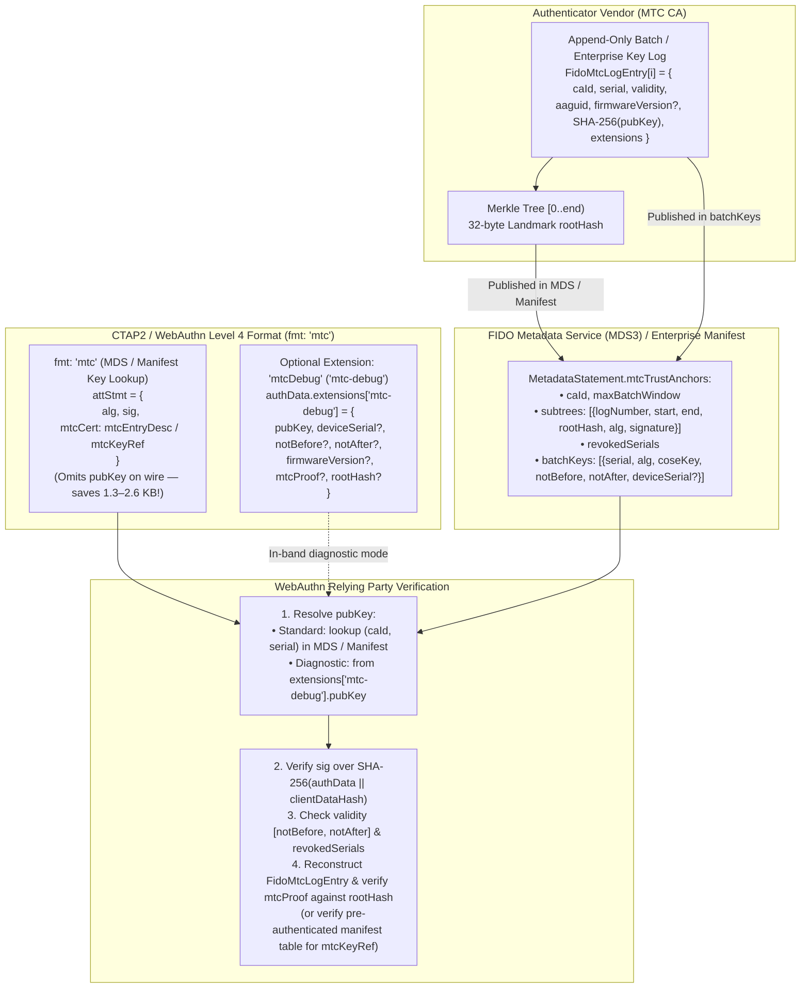
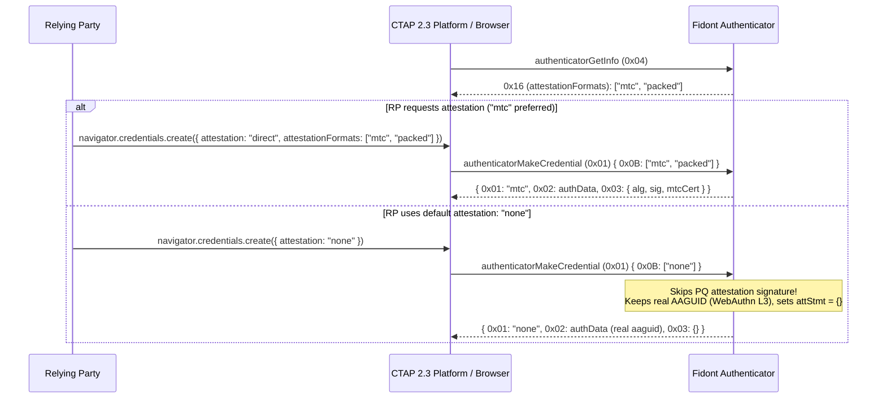
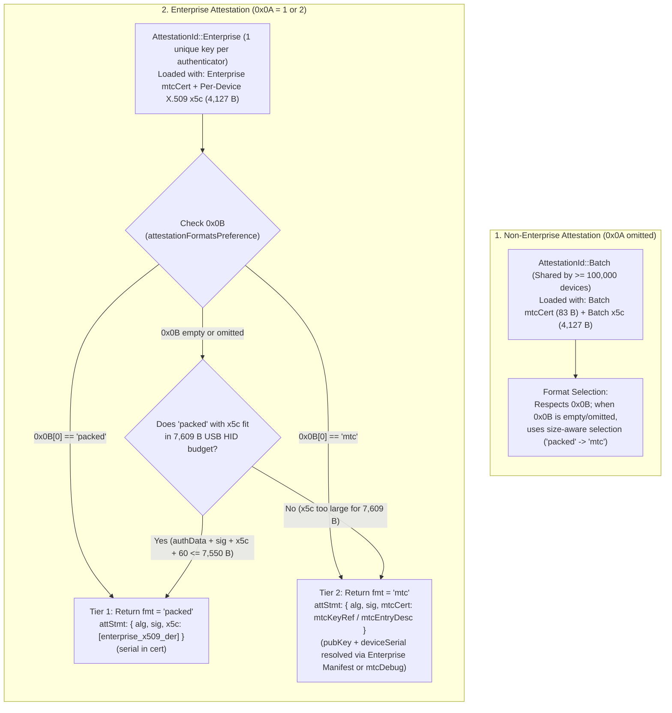
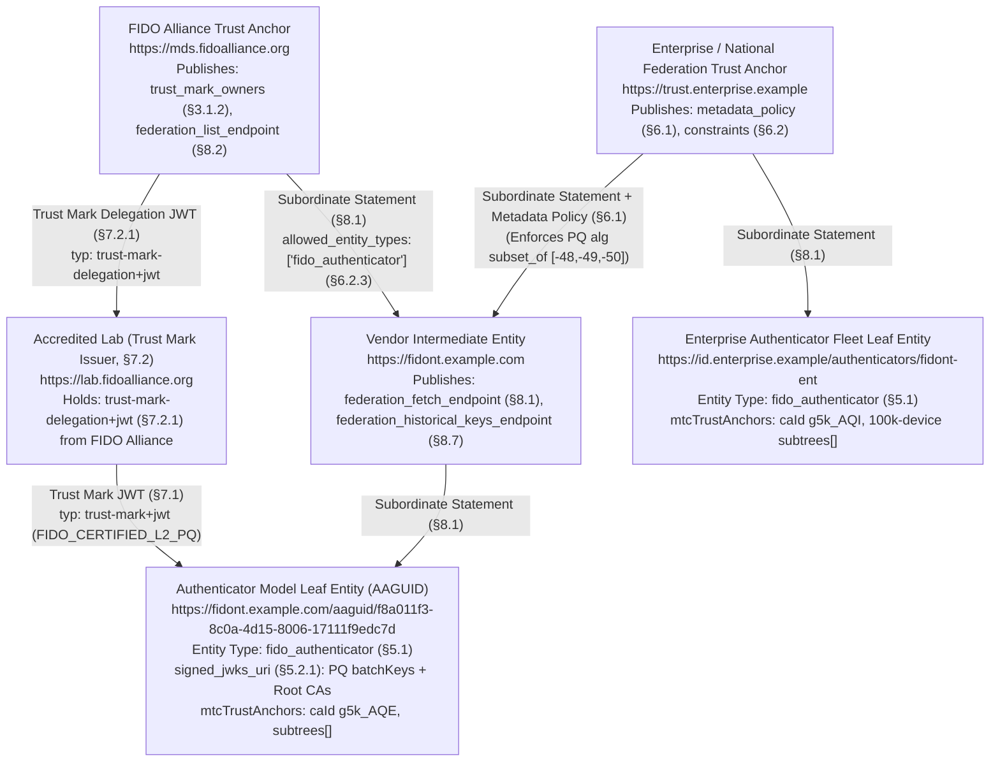

# Proposal: Post-Quantum WebAuthn Attestation Using Merkle Tree Certificates (`mtc`) and the `mtcDebug` Extension

Based on [`draft-ietf-plants-merkle-tree-certs`](https://datatracker.ietf.org/doc/draft-ietf-plants-merkle-tree-certs/), [W3C WebAuthn Level 3 / Level 4 §8](https://www.w3.org/TR/webauthn-3/#sctn-defined-attestation-formats), [FIDO CTAP 2.3](https://fidoalliance.org/specs/fido-v2.3-ps-20260226/fido-client-to-authenticator-protocol-v2.3-ps-20260226.html), and [FIDO Metadata Statement (MDS3)](https://fidoalliance.org/specs/mds/fido-metadata-statement-v3.0-ps-20210518.html).

> [!NOTE]
> **Specification Update (Authenticate 2026 CTAP2 TWG Consensus):**
> Based on discussions in the CTAP2 Technical Working Group at Authenticate 2026, the compact MDS/manifest-assisted Merkle Tree Certificate proposal was established as the single operational format for post-quantum WebAuthn attestation. To optimize wire size across constrained transports (such as USB HID single-frame messaging) and avoid redundant transmission of multi-kilobyte public keys on the wire, `mtcl` (MTC Large with inline public key) has been removed and the specification standardizes:
> - **`fmt: "mtc"`** *(formerly `mtc-mds`)*: The compact Merkle Tree Certificate attestation statement format. The multi-kilobyte post-quantum public key is omitted from the wire payload and resolved out-of-band via FIDO MDS3 (`MtcTrustAnchor.batchKeys`) or the manufacturer's manifest.
> - **`mtcDebug` (`mtc-debug`)**: The WebAuthn Level 4 diagnostic registration extension (§8.7) enabling test fixtures, conformance suites, and offline verifiers to retrieve the active attestation public key, inclusion proof, root hash, validity timestamps, firmware version, and (when Enterprise Attestation is granted) device serial number in-band.

> [!IMPORTANT]
> **Attribution & Scope of Fidont:**
> **Fidont** is an authenticator simulator designed for prototyping new specifications and testing authenticator conformance tools. It is based on the [Google OpenSK](https://github.com/google/OpenSK) Rust codebase. However, **Fidont is not suitable for production security use outside of certification, conformance testing, and prototyping new features.**

---

## 1. Problem Statement: Why Classical `packed` X.509 Attestation Breaks for Post-Quantum

In WebAuthn [`packed` attestation](https://www.w3.org/TR/webauthn-3/#sctn-packed-attestation), a `MakeCredential` response carries:
1. **`authData.attestedCredentialData.credentialPublicKey`**: The newly generated user credential public key (`COSE_Key`).
2. **`attStmt.sig`**: The authenticator's attestation signature over `authenticatorData || clientDataHash`.
3. **`attStmt.x5c`**: `[attestnCert, ...caCerts]`, where `attestnCert` is a DER-encoded X.509v3 certificate containing:
   - The batch or enterprise **attestation public key** (`subjectPublicKeyInfo`), and
   - The **Attestation CA's signature** (`signatureValue`), plus
   - Any intermediate CA certificates (`caCert`s), each adding another PQ public key + PQ signature.

With classical `ES256` (65 B public key, ~71 B signature), a single-cert `packed` attestation response is **~713 bytes**. With post-quantum `ML-DSA` (FIPS 204) or PQ/T hybrid composites, the wire and NVRAM footprint explodes:

| Component in `MakeCredential` Response | Classical (`ES256`) | `ML-DSA-44` (`-48`) | `ML-DSA-65` (`-49`) | `ML-DSA-87` (`-50`) | `ML-DSA-87-Ed448` (`-56`) |
| :--- | ---: | ---: | ---: | ---: | ---: |
| `authData` base + `credentialPublicKey` | ~220 B | ~1,470 B | ~2,110 B | ~2,750 B | ~2,810 B |
| `attStmt.sig` (Attestation Key sig) | ~71 B | 2,420 B | 3,309 B | 4,627 B | 4,741 B |
| `attestnCert` `subjectPublicKeyInfo` | ~91 B | 1,334 B | 1,974 B | 2,614 B | 2,675 B |
| `attestnCert` CA `signatureValue` | ~71 B | 2,420 B | 3,309 B | 4,627 B | 4,741 B |
| `attestnCert` X.509v3 TBS + ASN.1 overhead | ~260 B | ~280 B | ~280 B | ~280 B | ~280 B |
| **Total (1-cert `x5c`, no intermediate)** | **~713 B** | **~7,924 B** | **~10,982 B** | **~14,898 B** | **~15,247 B** |
| **Total (2-cert `x5c` w/ Intermediate CA)** | **~1,150 B** | **~11,960 B** | **~16,545 B** | **~22,419 B** | **~22,943 B** |

> [!WARNING]
> **Hardware & Transport Bottlenecks:**
> 1. **CTAP2 `maxMsgSize` & USB HID Frames:** Standard USB HID CTAP2 authenticators advertise `maxMsgSize` between `1024` and `7680` bytes (the maximum single CTAPHID message payload is **`7,609` bytes**: 1 init packet of 57 B + 128 continuation packets of 59 B). Even a 1-cert `ML-DSA-44` `packed` attestation (**7,924 B**) exceeds the **7,609-byte USB HID protocol hard limit**!
> 2. **Authenticator Flash/NVRAM Budget:** Constrained MCUs (such as the nRF52840 in Fidont) store attestation material in flash pages (`persist.rs`). Storing multi-kilobyte X.509 certificates consumes scarce non-volatile storage.

---

## 2. WebAuthn Attestation Format `mtc` and Diagnostic Extension `mtcDebug`

Based on [`draft-ietf-plants-merkle-tree-certs`](https://datatracker.ietf.org/doc/draft-ietf-plants-merkle-tree-certs/), we define **one compact WebAuthn Attestation Statement Format (`fmt: "mtc"`)** and **one diagnostic registration extension (`mtcDebug` / `mtc-debug`)**:

1. **`mtc` (`fmt: "mtc"`) — Compact MDS/Manifest-Assisted MTC Attestation (Public Key Omitted on Wire):**
   - Omits `pubKey` from `attStmt` on the wire. The Relying Party resolves the attestation public key indexed by `(mtcCert.caId, mtcCert.serial)` from the FIDO Metadata Service (`mtcTrustAnchors[].batchKeys`) in non-enterprise mode, or from the manufacturer's signed Enterprise Manifest in enterprise mode (`0x0A = 1` or `2`).
   - Supports two `mtcCert` encodings:
     - **With inclusion proof (`mtcEntryDesc`):** carries `{ caId, serial, notBefore, notAfter, ?firmwareVersion, ?mtcProof }` so the RP can verify Merkle inclusion against a 32-byte landmark `rootHash`.
     - **Proof-less key reference (`mtcKeyRef`):** carries only `{ caId, serial }` (`~20–30 B`) when the RP has pre-authenticated the complete MDS `batchKeys` table or manufacturer Enterprise Manifest against the Root CA signature.
   - **Flash Savings on Authenticator:** Because Fidont derives `pubKey` on the fly from the 32-byte attestation private key seed (`attestation_key.get_pub_key()`) and omits `pubKey` on the wire, the authenticator only stores the 32-byte seed and compact `mtcCert` descriptor, while guaranteeing that **all `ML-DSA` parameter sets (`ML-DSA-44`, `ML-DSA-65`, and `ML-DSA-87`) fit inside a single 7,609-byte USB HID CTAP2 message**.

2. **`mtcDebug` (`mtc-debug`) — WebAuthn Level 4 Diagnostic Registration Extension (§8.7):**
   - Provides in-band access to `pubKey`, optional `deviceSerial` (strictly gated on Enterprise Attestation `0x0A = 1` or `2`), and optional offline verification fields (`notBefore`, `notAfter`, `firmwareVersion`, `mtcProof`, `rootHash`) for automated test harnesses and FIDO conformance tools when an external MDS3 or manifest database is unavailable.

### Wire-Size Comparison Across Formats (`2^8 = 256` Batch Log Entries, Landmark Proof = 256 B)

| Format | `ML-DSA-44` (`-48`) | `ML-DSA-65` (`-49`) | `ML-DSA-87` (`-50`) | `ML-DSA-87-Ed448` (`-56`) | Fits USB HID (`7,609 B` limit)? |
| :--- | ---: | ---: | ---: | ---: | :---: |
| Classical X.509 `packed` (1-cert PQ CA) | ~7,924 B | ~10,982 B | ~14,898 B | ~15,247 B | ❌ None fit |
| **`fmt: "mtc"` with `mtcEntryDesc` proof** (RP resolves `pubKey` via MDS/Manifest) | **~4,165 B** | **~5,635 B** | **~7,595 B** | **~7,769 B** | ✅ **`ML-DSA-44`, `ML-DSA-65`, & `ML-DSA-87` fit!** |
| **`fmt: "mtc"` proof-less (`mtcKeyRef`)** (Pre-authenticated MDS/Manifest table) | **~3,832 B** | **~5,361 B** | **~7,319 B** | **~7,493 B** | ✅ **All parameter sets fit!** |

*(With $2^4 = 16$ batches per model, the Landmark `MTCProof` inclusion path is only $4 \times 32 = 128\text{ B}$, reducing `mtc` with proof for `ML-DSA-87` to **~7,467 B** and proof-less `mtcKeyRef` to **~7,319 B**!)*



---

## 3. Normative Specification: `mtc` Attestation Statement Format (`fmt: "mtc"`)

- **Attestation statement format identifier:** `"mtc"`
- **Attestation types supported:** `[=Basic=]`, `[=AttCA=]`
- **Syntax (CDDL):**

```cddl
$$attStmtType //= (
    fmt: "mtc",
    attStmt: mtcStmtFormat
)

mtcStmtFormat = {
    alg: COSEAlgorithmIdentifier,
    sig: bytes,
    mtcCert: mtcEntryDesc / mtcKeyRef   ; Attestation public key is omitted on the wire; RP resolves pubKey by (caId, serial) from MDS/manifest
}

mtcEntryDesc = {
    caId: bytes,                        ; 1-4 byte compact CA Log Identifier (ASN.1 DER Binary TrustAnchorID)
    serial: uint,                       ; uint64: (logNumber << 48) | index
    notBefore: uint,                    ; uint64 Unix epoch seconds
    notAfter: uint,                     ; uint64 Unix epoch seconds; 253402300799 (9999-12-31T23:59:59Z per RFC 5280 §4.1.2.5) if non-expiring
    ? firmwareVersion: uint,            ; Optional authenticator firmware version (CTAP 2.3 parameter 0x0E)
    ? mtcProof: bytes                   ; Binary RFC 9162 / draft-ietf-plants-merkle-tree-certs §4.2 inclusion proof
}

mtcKeyRef = {                           ; Proof-less key reference (§8.6): used when the RP holds the complete,
    caId: bytes,                        ; authenticated key table (MDS batchKeys or Enterprise manifest) for this caId
    serial: uint                        ; uint64: (logNumber << 48) | index — the lookup key
}
```

> [!NOTE]
> **Manufacturer Considerations for `firmwareVersion` in the MTC Manifest:**  
> Manufacturers should weigh operational simplicity against cryptographic assurance when deciding whether to include `firmwareVersion` in the MTC leaf entry (`FidoMtcLogEntry`) and manifest:
> - **Omitting `firmwareVersion` (`fw_version = 0`):** Allows a single Merkle tree root (`rootHash`) and batch key to be used across multiple firmware releases without generating a new subtree checkpoint or `caId` when minor firmware updates are released under a stable AAGUID.
> - **Including `firmwareVersion` *(Recommended)*:** Because `firmwareVersion` is cryptographically committed as an immutable field in `FidoMtcLogEntry`, each new firmware version requires a new attestation batch key and leaf `serial`, which in turn requires generating a new signed subtree checkpoint (`rootHash`) or `caId` in FIDO MDS / the manufacturer manifest. However, binding `firmwareVersion` to the batch key is **more secure**: it cryptographically binds the exact firmware revision to the attestation signature and allows Relying Parties to selectively revoke a vulnerable firmware build via `revokedSerials` without invalidating patched authenticators that share the same AAGUID.

Key identification in `"mtc"` always uses **`(caId, serial)`**, for both Non-Enterprise and Enterprise attestation. The device serial number is never used as a lookup key (§8.6.1). The Merkle proof is **optional** in `"mtc"`:
- **With proof (`mtcEntryDesc`):** the RP trusts only a 32-byte landmark `rootHash`, plus the key it resolves.
- **Without proof (`mtcKeyRef`):** the RP holds the complete key table, signed by the vendor or CA, so the proof would be redundant.

---

## 4. Deterministic `MTCLogEntry` Leaf Structure & `MTCProof` Encoding

The `"mtc"` attestation format uses the Merkle Tree issuance log structure and `MTCProof` binary format from [`draft-ietf-plants-merkle-tree-certs`](https://datatracker.ietf.org/doc/draft-ietf-plants-merkle-tree-certs/):

### 4.1 Leaf Entry Serialization (`FidoMtcLogEntry`)

For each batch or enterprise attestation key at index `index` in log `log_number`, the serial number is:
$$\text{serial} = (\text{log\_number} \ll 48) \mid \text{index}$$

The Merkle tree leaf input (hashed with RFC 9162 `0x00` leaf prefix: $H(\texttt{0x00} \parallel \text{entry})$) binds:
1. `ca_id`: Variable-length prefix + `caId` bytes (ASN.1 DER relative OID / `TrustAnchorID`).
2. `serial`: 8-byte big-endian `uint64` (`(log_number << 48) | index`).
3. `not_before`: 8-byte big-endian `uint64`.
4. `not_after`: 8-byte big-endian `uint64` (set to `253402300799` / `0x0000003AFF44417F`, corresponding to `9999-12-31T23:59:59Z` per RFC 5280 §4.1.2.5, when the attestation on the device never expires).
5. `aaguid`: 16-byte `authenticatorData.attestedCredentialData.aaguid` (taken directly from `authData[37..53]`, avoiding duplicate transmission in `attStmt`).
6. `fw_version`: Optional 8-byte big-endian `uint64` (`0` if absent).
7. `pub_key_hash`: 32-byte `SHA-256(pubKey)` (where `pubKey` is the canonical CBOR-encoded `COSE_Key` of the attestation public key).
8. `extensions`: Length-prefixed `MTCLogEntryExtension` list from `MTCProof`.

### 4.2 `MTCProof` Wire Structure (`draft-ietf-plants-merkle-tree-certs` §4.2)

```tls-presentation
struct {
    MTCLogEntryExtension extensions<0..2^16-1>;
    uint48 start;
    uint48 end;
    opaque inclusion_proof<0..2^16-1>;
    Cosignature signatures<0..2^24-1>;
} MTCProof;
```

- In **Landmark-Relative Mode** (standard for FIDO MDS batch & enterprise CAs):
  - `extensions` is empty (`2` bytes: `0x0000`).
  - `start` is `6` bytes (`uint48`, typically `0`).
  - `end` is `6` bytes (`uint48`, the landmark tree size).
  - `inclusion_proof` is `2` bytes length + $k \times 32$ bytes of sibling hashes.
  - `signatures` is empty (`3` bytes: `0x000000`).
  - **Total `mtcProof` overhead for a 1-entry or 16-entry batch log:** **$19\text{ bytes}$** (for 1 entry) to **$147\text{ bytes}$** (for 16 entries)!

---

## 5. Relying Party Verification Procedure for `fmt: "mtc"`

Given `(attStmt, authenticatorData, clientDataHash)`:

1. **Decode CBOR:**
   - Verify that `attStmt` conforms to the CDDL syntax of `mtcStmtFormat` (`{ alg, sig, mtcCert }`).
2. **Resolve Trust Anchor & Attestation Public Key (`pubKey`):**
   - Extract `caId` and `serial` from `attStmt.mtcCert`.
   - Lookup the `MtcTrustAnchor` matching `caId` for `authenticatorData.attestedCredentialData.aaguid` in FIDO MDS (non-enterprise mode) or the manufacturer's Enterprise Manifest (enterprise mode).
   - Lookup `serial` in `mtcTrustAnchor.batchKeys` (or query the synced MTC log for `(caId, serial)`) to obtain the canonical CBOR-encoded `COSE_Key` bytes `pubKey` (and `deviceSerial` if present in Enterprise mode).
   - *(Diagnostic Alternative)*: If conveyed via the WebAuthn Level 4 `mtcDebug` (`mtc-debug`) extension (§8.7), the RP or test harness MAY decode `pubKey` (and optional `notBefore`, `notAfter`, `firmwareVersion`, `mtcProof`, `rootHash`, and `deviceSerial`) from `authenticatorData.extensions["mtc-debug"]`.
   - Fail verification if no `pubKey` can be resolved.
3. **Verify Attestation Signature:**
   - Verify that `pubKey.alg == attStmt.alg`.
   - Concatenate `authenticatorData` and `clientDataHash` to form `nonceToHash`, compute `nonce = SHA-256(nonceToHash)`, and verify that `attStmt.sig` is a valid signature over `nonce` using `pubKey`.
4. **Check Validity Period & Serial Revocation (`draft-ietf-plants-merkle-tree-certs` §6.2 Steps 2–3):**
   - Verify that current time is within `[notBefore, notAfter]` (taken from `mtcEntryDesc`, the matched `MtcBatchKeyEntry` in MDS/manifest when `mtcKeyRef` is used, or `mtc-debug` in offline diagnostic mode). Note: `notAfter = 253402300799` (`9999-12-31T23:59:59Z` per RFC 5280 §4.1.2.5) indicates a non-expiring device attestation key.
   - Check that `serial >> 48 == mtcTrustAnchor.subtrees[].logNumber`.
   - Check that `serial` is not within any revoked serial range in `mtcTrustAnchor.revokedSerials`.
5. **Reconstruct Leaf & Verify Merkle Inclusion Proof (`draft-ietf-plants-merkle-tree-certs` §6.2 Steps 4–6):**
   - **If `mtcProof` is present (in `mtcEntryDesc` or in `mtc-debug` alongside `mtcKeyRef`):**
     - Compute `pubKeyHash = SHA-256(pubKey)`.
     - Reconstruct `FidoMtcLogEntry` from `(caId, serial, notBefore, notAfter, authenticatorData.aaguid, firmwareVersion, pubKeyHash, mtcProof.extensions)`.
     - Compute `expectedSubtreeHash` using RFC 9162 §2.1.3.2 over `(index = serial & 0xFFFFFFFFFFFF, mtcProof.start, mtcProof.end, FidoMtcLogEntry, mtcProof.inclusion_proof)`.
     - Verify that `(mtcProof.start, mtcProof.end, expectedSubtreeHash)` matches an active landmark entry in `mtcTrustAnchor.subtrees` (or `mtc-debug.rootHash` in offline diagnostic mode).
   - **If `mtcCert` conforms to proof-less `mtcKeyRef` (and no `mtcProof` is used):**
     - Verify that the RP has previously authenticated the complete `mtcTrustAnchor.batchKeys` table (MDS or Enterprise Manifest) against the Root CA signature or published trust anchor `rootHash`.
6. **Enterprise Device Serial Check:**
   - If Enterprise Attestation was requested and active, verify that the resolved `deviceSerial` (from the manufacturer manifest entry or committed in `mtcProof.extensions`) matches an authorized device in the RP's inventory.
7. **Return Result:**
   - Return Attestation Type `Basic` (or `AttCA` in enterprise mode) and the matched `mtcTrustAnchor`.

---

## 6. FIDO Metadata Statement (`fido-metadata-statement.bs`) Extensions

To support `fmt: "mtc"`, we extend `MetadataStatement` with `mtcTrustAnchors`:

```idl
dictionary MtcSubtree {
    required unsigned short     logNumber; // uint16
    required unsigned long long start;
    required unsigned long long end;
    required DOMString          rootHash;  // base64url 32-byte Merkle subtree root hash
    long                        alg;       // Optional COSEAlgorithmIdentifier of signing Root CA (e.g., -50 for ML-DSA-87)
    DOMString                   signature; // Optional base64url Root CA signature over FidoMtcSubtreeCheckpoint
};

dictionary MtcBatchKeyEntry {
    required unsigned long long serial;    // uint64: (logNumber << 48) | index
    required long               alg;       // COSEAlgorithmIdentifier (-48, -49, -50, ...)
    required DOMString          coseKey;   // base64url canonical CBOR-encoded COSE_Key (used by "mtc")
    unsigned long long          notBefore;    // Optional; REQUIRED when proof-less mtcKeyRef is used (§8.6)
    unsigned long long          notAfter;     // Optional; REQUIRED when proof-less mtcKeyRef is used (§8.6)
    DOMString                   deviceSerial; // Enterprise manifest only (§8.6); MUST be absent in public FIDO MDS
};

dictionary MtcCosigner {
    required DOMString verifierId; // base64url binary relative OID
    required long      coseAlg;    // COSEAlgorithmIdentifier
    required DOMString publicKey;  // base64url public key bytes
};

dictionary MtcTrustAnchor {
    required DOMString               caId;            // base64url DER TrustAnchorID (unique per MtcTrustAnchor entry)
    required DOMString               hashAlg;         // "sha-256"
    required unsigned long           maxBatchWindow;  // uint32 (seconds)
    required MtcSubtree[]            subtrees;        // Landmark subtrees
    required unsigned long long[]    revokedSerials;  // Revoked uint64 serial numbers
    MtcBatchKeyEntry[]               batchKeys;       // Public key lookup table for "mtc"
    MtcCosigner[]                    cosigners;       // Optional standalone cosigners
    DOMString                        quorum;          // Optional standalone quorum rule
};

partial dictionary MetadataStatement {
    MtcTrustAnchor[] mtcTrustAnchors;
};
```

### 6.1 Multi-Key Deployment Models: Shared `caId` (Recommended) vs. Separate `caId`s

When an authenticator model (sharing one `aaguid`) is provisioned across multiple manufacturing batches or multiple post-quantum batch key algorithms (e.g., `ML-DSA-44` `-48`, `ML-DSA-65` `-49`, and `ML-DSA-87` `-50`), there are two ways to represent those batch keys in `mtcTrustAnchors`:

> [!TIP]
> **Recommendation — Option A (Single Shared `caId` / Single `MtcTrustAnchor`):**
> Vendors SHOULD issue all batch keys for an authenticator family as distinct leaves (`index = 0, 1, 2, ...`, giving distinct `serial = (logNumber << 48) | index`) within a **single MTC Log (`caId`)**. This is the core architectural advantage of Merkle Tree Certificates: whether a manufacturer has 3 batch keys or 10,000 batch keys over a 10-year product lifecycle, `mtcTrustAnchors` requires only **one `MtcTrustAnchor` entry** and **one 32-byte `rootHash`** in `subtrees`. Use **Option B (Separate `caId`s)** only when batch keys are issued by physically independent CA logs or when generating isolated single-key test trees on the fly.

| Dimension | **Option A (Recommended): Shared `caId` (Single `MtcTrustAnchor`)** | **Option B: Separate `caId`s (Multiple `MtcTrustAnchor` Entries)** |
| :--- | :--- | :--- |
| **`mtcTrustAnchors` array length** | **`1` entry** (e.g. `caId: "g5k_AQE"`) | **`N` entries** (each entry MUST have a distinct `caId`, e.g. `"g5k_AQE"`, `"g5k_AQI"`, `"g5k_AQM"`) |
| **How batch keys are distinguished** | By **leaf index (`serial`)** inside the same Merkle tree:<br/>• `-48`: `index = 0` (`serial = 1970324836974592`)<br/>• `-49`: `index = 1` (`serial = 1970324836974593`)<br/>• `-50`: `index = 2` (`serial = 1970324836974594`) | By **`caId`** first, then `serial` (each tree is independent, so every tree can reuse `index = 5` / `serial = 1970324836974597`) |
| **Number of Merkle `rootHash`es** | **`1` shared 32-byte `rootHash`** covering all batch keys in `[start, end)` | **`N` independent 32-byte `rootHash`es** (one per `caId`) |
| **Key generation & log management** | Append-only transparency log: new batch keys are appended as new leaves (`index = k`) and authenticated by a single updated landmark `rootHash`. | Uncoupled: each batch key's Merkle tree and `mtcProof` can be generated in isolation without knowledge of other batch keys. |
| **Wire size on authenticator (`mtcCert`)** | Identical (`156 B` for a 4-leaf tree, `188 B` for an 8-leaf tree) | Identical (`188 B` for an 8-leaf tree) |

#### Option A (Recommended): Single Shared `caId` (`"g5k_AQE"`)

```json
// Option A (Recommended): All 3 batch keys under a single shared caId ("g5k_AQE")
"mtcTrustAnchors": [
  {
    "caId": "g5k_AQE",
    "hashAlg": "sha-256",
    "maxBatchWindow": 315360000,
    "subtrees": [
      {
        "logNumber": 7,
        "start": 0,
        "end": 8,
        "rootHash": "tDE90jiRf8rgpv3frcGifWOs-FH1Oh62UCK0nGjS_zI"
      }
    ],
    "revokedSerials": [],
    "batchKeys": [
      {
        "serial": 1970324836974592,
        "alg": -48,
        "coseKey": "owEHAzgvIFkFIG0boEVMxS-4GEgM3UoEfZyiNjZ7PSx_hLHevzHHuq7Bn5EmyP1L..."
      },
      {
        "serial": 1970324836974593,
        "alg": -49,
        "coseKey": "owEHAzgwIFkHoD83NmYr_UsEUUsPI_XL_RZ-AAlZXCvUXQ9UcVYE4mMJBBGZgwHg..."
      },
      {
        "serial": 1970324836974594,
        "alg": -50,
        "coseKey": "owEHAzgxIFkKIEvfssw0ww0hNiwEDBUfXM6CqT2HBWCbO1OL7VgtUxU1oP9bh023..."
      }
    ]
  }
]
```

#### Option B: 3 Separate `caId`s (Independent Single-Key Trees)

```json
// Option B: 3 separate caIds (used when each tree is generated independently)
"mtcTrustAnchors": [
  {
    "caId": "g5k_AQE",
    "hashAlg": "sha-256",
    "maxBatchWindow": 315360000,
    "subtrees": [
      {
        "logNumber": 7,
        "start": 0,
        "end": 8,
        "rootHash": "WePVfMT4Y1AX9uK4BW_qJkxfl1etqOOnhhRbc9L5zKY"
      }
    ],
    "revokedSerials": [],
    "batchKeys": [
      {
        "serial": 1970324836974597,
        "alg": -48,
        "coseKey": "owEHAzgvIFkFIG0boEVMxS-4GEgM3UoEfZyiNjZ7PSx_hLHevzHHuq7Bn5EmyP1L..."
      }
    ]
  },
  {
    "caId": "g5k_AQI",
    "hashAlg": "sha-256",
    "maxBatchWindow": 315360000,
    "subtrees": [
      {
        "logNumber": 7,
        "start": 0,
        "end": 8,
        "rootHash": "of6RgYqR4wCmuIIEjXsX6MUT3qt7oOX9TMJXVRkpvt0"
      }
    ],
    "revokedSerials": [],
    "batchKeys": [
      {
        "serial": 1970324836974597,
        "alg": -49,
        "coseKey": "owEHAzgwIFkHoD83NmYr_UsEUUsPI_XL_RZ-AAlZXCvUXQ9UcVYE4mMJBBGZgwHg..."
      }
    ]
  },
  {
    "caId": "g5k_AQM",
    "hashAlg": "sha-256",
    "maxBatchWindow": 315360000,
    "subtrees": [
      {
        "logNumber": 7,
        "start": 0,
        "end": 8,
        "rootHash": "sJwH01wHYxmsAqPXh_DmP0TdQPig4fRUopKdzChkgkQ"
      }
    ],
    "revokedSerials": [],
    "batchKeys": [
      {
        "serial": 1970324836974597,
        "alg": -50,
        "coseKey": "owEHAzgxIFkKIEvfssw0ww0hNiwEDBUfXM6CqT2HBWCbO1OL7VgtUxU1oP9bh023..."
      }
    ]
  }
]
```

---

## 7. CTAP 2.3 `authenticatorGetInfo` `attestationFormats` (`0x16`) & `"none"` Attestation

In CTAP 2.3 §6.4 (`authenticatorGetInfo` `(0x04)`), response member **`0x16` (`attestationFormats`)** advertises the sequence of WebAuthn attestation statement format identifiers (`[+ tstr]`) supported by the authenticator, ordered from **most preferred to least preferred**.

### 7.1 Why `attestationFormats` (`0x16`) and `"none"` are Critical for Post-Quantum CTAP2

1. **Client & Platform Filtering before `MakeCredential`**:
   Per CTAP 2.3 §6.1.1, a platform (browser/OS) intersects the Relying Party's `PublicKeyCredentialCreationOptions.attestationFormats` with `authenticatorGetInfo.attestationFormats` (`0x16`) before sending `attestationFormatsPreference` (`0x0B`) in `authenticatorMakeCredential`.
2. **Zero-Overhead `"none"` Attestation (`attestation: "none"`)**:
   In WebAuthn, the default `attestation` conveyance preference is `"none"`. When a CTAP 2.3 platform requests `attestationFormatsPreference: ["none"]` (`0x0B`):
    - The authenticator sets `fmt: "none"` and `attStmt: {}` (`0xA0`, 1 byte), and **keeps its real `aaguid`** in `attestedCredentialData`. That holds for both roaming and platform authenticators.
    - It **completely skips computing the post-quantum attestation signature**, saving **2,420–4,699 bytes** of signature and **1,322–2,602 bytes** of attestation public key on the wire, while cutting `authenticatorMakeCredential` latency roughly in half on Cortex-M4 hardware.

    > [!NOTE]
    > **AAGUID under `"none"` (WebAuthn Level 3 §5.1.3):** For `"none"`, the client's only action is to set `fmt` to `"none"` and `attStmt` to an empty map. A self attestation (all-zero `aaguid` + `fmt: "packed"` + no `x5c`) is left unchanged. The Level 3 change log says: *"aaguid in attested credential data is no longer zeroed when attestation preference is none."* (Level 2 replaced it with 16 zero bytes.)
    >
    > The rule is the same for roaming and platform authenticators, so the RP receives the real AAGUID. It can be used for display, such as the authenticator name or icon from MDS. It is **not provably authentic without attestation** (§6), so it must not be used for policy decisions. Only `"indirect"` lets the client replace the `aaguid` (for example via an Anonymization CA). `"direct"` and `"enterprise"` convey it unaltered.
3. **Dynamic Capability Advertising from Persisted Material**:
   Because `"none"` attestation support is implied in CTAP / WebAuthn, `process_get_info` omits `"none"` from `0x16` (`attestationFormats`) while still supporting `"none"` when requested via `0x0B` (`attestationFormatsPreference`):
   - **When an MTC descriptor is provisioned (`ProvisionedMtcAttestation::from_bytes` succeeds)**:
     - `["mtc", "packed"]`
   - **When a traditional X.509 DER certificate is provisioned or no batch certificate is present**:
     - `["packed"]`

### 7.2 End-to-End Negotiation Flow



### 7.3 Size-Aware Default Attestation Selection (`"packed"` $\to$ `"mtc"`)

When provisioned via `tools/configure.py --mtc`, `ProvisionedMtcAttestation` (`libraries/opensk/src/ctap/mtc.rs`) stores **both** the batch X.509 DER certificate (`x5c`) and the compact `MtcCertDescriptor` (`mtcCert`) in Fidont's persistent certificate store (`11,253 B` capacity across `ATTESTATION_CERTIFICATE` and `ATTESTATION_CERTIFICATE_EXTRA_SHARDS`).

When the client omits `attestationFormatsPreference` (`0x0B`), `process_make_credential` (`libraries/opensk/src/ctap/mod.rs`) evaluates a **size-aware selection** so every registration returns a format that fits inside a single `7,609 B` USB HID CTAP2 message (`<= 7,550 B` threshold):

1. **Tier 1 — `"packed"` (with batch `x5c`)**: For classical credential algorithms (`ES256`, `Ed25519`, etc.) or when `auth_data.len() + sig.len() + x5c.len() + 60 <= 7550`, Fidont returns standard WebAuthn **`fmt: "packed"`** with `x5c: [batch_cert_der]`.
2. **Tier 2 — `"mtc"` (`mtcCert` only, `pubKey` omitted)**: When including `x5c` would exceed the `7,609 B` single-message budget (as is the case for post-quantum `ML-DSA` and `FN-DSA` credentials with post-quantum CAs), Fidont returns **`fmt: "mtc"`**, omitting `pubKey` so the response always fits under `7,609 B`.

> [!NOTE]
> This selection applies only to **modern clients** (CTAP 2.2 / 2.3). When the authenticator detects a **legacy client** that negotiates only `pinUvAuthProtocol` 1, such as Windows 10, it uses the backward-compatible default in [§7.5](#75-legacy-client-detection-pinuvauthprotocol-1-and-backward-compatible-attestation-defaults).

| Credential Signing Algorithm | Batch Key = `-48` (`ML-DSA-44`, `x5c`=`4,127 B`) | Batch Key = `-49` (`ML-DSA-65`, `x5c`=`5,656 B`) | Batch Key = `-50` (`ML-DSA-87`, `x5c`=`7,614 B`) |
| :--- | :---: | :---: | :---: |
| **Classical (`-7`, `-8`, `-19`, `-35`, `-36`, `-47`, `-257`)** | **`"packed"` (`x5c`)** (`6,704–7,008 B`) | **`"mtc"`** (`3,680–3,984 B`) | **`"mtc"`** (`4,898–5,202 B`) |
| **`ML-DSA-44` (`-48`, `-54`, `-57`)** | **`"mtc"`** (`4,073–4,351 B`) | **`"mtc"`** (`4,972–5,250 B`) | **`"mtc"`** (`6,190–6,468 B`) |
| **`ML-DSA-65` (`-49`, `-55`, `-58`)** | **`"mtc"`** (`4,713–4,991 B`) | **`"mtc"`** (`5,586–5,864 B`) | **`"mtc"`** (`6,830–7,108 B`) |
| **`ML-DSA-87` (`-50`, `-56`, `-59`)** | **`"mtc"`** (`5,353–5,667 B`) | **`"mtc"`** (`6,226–6,540 B`) | **`"mtc"`** (`7,470–7,535 B`) |

### 7.4 Fidont Implementation Details

1. **`libraries/opensk/src/ctap/mtc.rs`**:
   - Add `pub x5c: Option<Vec<u8>>` to `ProvisionedMtcAttestation`, serialized as `{ "fmt": ..., "x5c"?: bstr, "mtcCert": ... }`.
2. **`src/env/vendor.rs`**:
   - Add `0x03 => cert_append: Option<Vec<u8>>` to `VendorConfigureParameters` so `> 6,000 B` PQ `x5c + mtcCert` bundles (such as `-50` `ML-DSA-87` at `7,820 B`) can be uploaded across two `OPENSK_VENDOR_CONFIGURE` (`0x40`) commands without exceeding `7,609 B`.
3. **`libraries/opensk/src/ctap/mod.rs`**:
   - Populate `attestation_formats` (`0x16`) in `process_get_info` (`["mtc", "packed"]`).
   - Implement the size-aware `"packed"` (`x5c`) $\to$ `"mtc"` selection and `"none"` support in `process_make_credential`.
4. **`tools/configure.py`**:
   - Bundle `"x5c": cert_der` inside `provisioned_mtc` and automatically split `cert_or_mtc_bytes` into a `6,000 B` initial chunk (`0x02`) + continuation chunk (`0x03`) when needed.

### 7.5 Legacy Client Detection (`pinUvAuthProtocol` 1) and Backward-Compatible Attestation Defaults

Older CTAP 2.0 / 2.1 platform clients, such as **Windows 10's built-in WebAuthn stack (`webauthn.dll`)**, negotiate **only PIN/UV Auth Protocol 1**. Browsers on Windows 10 delegate to that stack. These clients:
- never send `pinUvAuthProtocol = 2`, even when the authenticator lists `[2, 1]` in `authenticatorGetInfo.pinUvAuthProtocols` (`0x06`);
- never send `attestationFormatsPreference` (`0x0B`, added in CTAP 2.2), so they cannot request `"mtc"` or `"none"`;
- are hard-limited to the `7,609 B` CTAPHID single-message ceiling, and pass the attestation object through to RPs that predate PQ and MTC attestation formats.

> [!NOTE]
> PIN/UV Auth Protocol 2 was **defined in CTAP 2.1**, so the precise signal is "the client only uses protocol 1", not "the client is CTAP 2.1". In practice, clients limited to protocol 1 are the older Windows 10-era (CTAP 2.0 / early 2.1) stacks. Modern CTAP 2.2 / 2.3 clients pick protocol 2 when the authenticator lists it first.

#### 7.5.1 Detection Signals

The authenticator records a per-session `ClientProfile`. It is reset on power-up, or per CTAPHID channel (`CID`) for USB.

| Signal Observed by Authenticator | Inferred `ClientProfile` | Notes |
| :--- | :--- | :--- |
| `authenticatorMakeCredential` contains `attestationFormatsPreference` (`0x0B`) | **Modern** (CTAP 2.2+) | Strongest signal. Always honour `0x0B` as specified in §7.1–§7.3 |
| `authenticatorClientPin` (`getPinUvAuthTokenUsing…` / `getPinToken`) or `pinUvAuthParam` uses **`pinUvAuthProtocol = 2`** | **Modern** | Protocol 2 is preferred by every current client when listed first in `0x06` |
| PIN/UV token obtained with **`pinUvAuthProtocol = 1`**, and no `0x0B` in `makeCredential` | **Legacy** (Windows 10-class) | Advertise `pinUvAuthProtocols: [2, 1]` so that choosing `1` is meaningful |
| No PIN/UV used and no `0x0B` | **Unknown → treated as Legacy** | Fail safe. A client that wants PQ attestation can always opt in by sending `0x0B` |

> [!WARNING]
> **Heuristic, not a security boundary.** A client can always choose protocol 1, and protocol 1 is still valid in CTAP 2.3. The profile only selects the **default** when `0x0B` is absent. An explicit `0x0B` always wins, so a modern client is never downgraded. A legacy client is never sent a format it cannot carry or that its RP cannot parse.

#### 7.5.2 Attestation Defaults by Client Profile

| `ClientProfile` | Default When `0x0B` Is Absent | Rationale |
| :--- | :--- | :--- |
| **Modern** (CTAP 2.2 / 2.3) | 3-tier size-aware cascade (§7.3): `"packed"` (PQ `x5c`) $\to$ `"mtc"` $\to$ `"mtc"` | The client can carry, and the RP can request, PQ / MTC formats |
| **Legacy, Option A — `"none"`** | `fmt: "none"`, `attStmt: {}`, real `aaguid` (§7.1) | Smallest response (no attestation signature or certificate). Zero risk of exceeding `7,609 B` or confusing a legacy RP parser. The RP still sees the AAGUID for display |
| **Legacy, Option B (Recommended for Compatibility) — classical `ES256` batch** | `fmt: "packed"` signed by the **Non-Enterprise classical `ES256` batch key** (`cKey`) with its `512 B` `cX5c` certificate (§8.5, signed by the `ES384` Root CA) | Gives existing RPs a verifiable, standard `packed` attestation that every WebAuthn library already supports. The batch shares one key across ≥ 100,000 devices, as FIDO requires |

Wire sizes for the Legacy Option B default (`ES256` attestation signature `~71 B` + `512 B` `cX5c` + `~60 B` CBOR):

| Credential Algorithm | `authData` | Legacy Option B: `packed` + `ES256` `cX5c` | Legacy Option A: `"none"` | PQ `packed` (`ML-DSA-44` batch `x5c`, §7.3) |
| :--- | ---: | ---: | ---: | ---: |
| Classical `ES256` (`-7`) | `~220 B` | **`~736 B`** ✅ | `~225 B` ✅ | `~6,704 B` ✅ |
| `ML-DSA-44` (`-48`) | `~1,470 B` | **`~2,113 B`** ✅ | `~1,475 B` ✅ | `~8,077 B` ❌ (over `7,609 B`) |
| `ML-DSA-65` (`-49`) | `~2,110 B` | **`~2,753 B`** ✅ | `~2,115 B` ✅ | `~8,717 B` ❌ |
| `ML-DSA-87` (`-50`) | `~2,750 B` | **`~3,393 B`** ✅ | `~2,755 B` ✅ | `~9,357 B` ❌ |

> [!IMPORTANT]
> **Security tradeoff of Legacy Option B:** a classical `ES256` attestation is **not post-quantum secure**. It proves the authenticator model to today's RPs, but a future quantum adversary could forge it. This is acceptable as a compatibility default because a legacy client cannot deliver a PQ attestation anyway. RPs that need PQ attestation must use a modern client that sends `0x0B` (e.g. `["mtc", "packed"]`). **Enterprise Attestation (`0x0A`)** is unaffected: it is only reachable through clients that implement CTAP 2.1 enterprise attestation, and follows §8.1.1.

#### 7.5.3 Fidont Implementation Notes

1. **`libraries/opensk/src/ctap/mod.rs`**:
   - Add `client_profile: ClientProfile { Unknown, Legacy, Modern }` to the volatile CTAP state, reset on power-up and on `CTAPHID_INIT` for a new `CID`.
   - Set `Modern` when `process_make_credential` sees `attestation_formats_preference`, or when `process_client_pin` / `pin_uv_auth_param` uses `PinUvAuthProtocol::V2`.
   - Set `Legacy` when a PIN/UV token is obtained with `PinUvAuthProtocol::V1` and the state is not already `Modern`.
   - In `process_make_credential`, when `0x0B` is absent and the profile is `Legacy` or `Unknown`, select the configured legacy default (`LegacyAttestationDefault::None` or `LegacyAttestationDefault::ClassicalPacked`). Otherwise run the §7.3 cascade.
2. **`tools/configure.py`**: add `--legacy-attestation {none,es256}` (default `es256` when a `cKey`/`cX5c` bundle is provisioned, otherwise `none`).
3. **`process_get_info`**: keep advertising `pinUvAuthProtocols: [2, 1]` (protocol 2 first) so that modern clients identify themselves by choosing protocol 2.

---

## 8. Enterprise Attestation (`0x0A`) with Dual Provisioned MTC Keys & Signed Per-Credential Serial

Under WebAuthn Level 3 (§6.5.5) and CTAP 2.3 (`enterpriseAttestation` `0x0A` in `authenticatorMakeCredential`), authenticators must reconcile two opposing requirements:

1. **Non-Enterprise Attestation (Privacy / Anonymity Set Requirement)**:
   Standard batch attestation (`enterpriseAttestation` absent or false) **must** share the same batch attestation keypair across a minimum batch of **$B \ge 100,000$ authenticators** (FIDO Authenticator Security Requirements) so Relying Parties cannot track individual hardware tokens across accounts or origins.
2. **Enterprise Attestation (Uniquely Identifying / Inventory Requirement)**:
   When an authorized Relying Party or platform requests `enterpriseAttestation = 1` (RP-facilitated) or `2` (platform-managed), the authenticator returns **uniquely identifying attestation** tied to the specific device and/or credential so the enterprise IdP can verify hardware inventory, serial number, and per-credential issuance.

### 8.1 Dual-Key Provisioning Model per Authenticator (`AttestationId::Batch` vs. `AttestationId::Enterprise`)

To cleanly satisfy both requirements without sacrificing privacy on standard registrations or breaking compatibility with legacy X.509 Enterprise Relying Parties, **each physical authenticator is provisioned at manufacturing time with TWO distinct attestation keys** (mapping directly to Fidont's `AttestationId::Batch` and `AttestationId::Enterprise` in `libraries/opensk/src/api/persist.rs`).

When **Enterprise Attestation is enabled** on the authenticator (`AttestationId::Enterprise`), **both** the single-device Enterprise `mtcCert` and the per-enterprise-batch-key **X.509 DER certificate (`x5c`)** are loaded into the Enterprise `ProvisionedMtcAttestation` bundle (`{ "fmt": "mtc", "x5c": enterprise_x509_der, "mtcCert": enterprise_mtc_cert }`):

| Property | Key 1: Non-Enterprise Batch Key (`AttestationId::Batch`) | Key 2: Enterprise Single-Device Key (`AttestationId::Enterprise`) |
| :--- | :--- | :--- |
| **When Selected** | Default (`enterpriseAttestation` `0x0A` omitted) | `enterpriseAttestation` (`0x0A`) $= 1$ or $2$ |
| **Batch Size ($B$)** | **$\ge 100,000$ devices** share the **same** keypair & leaf `serial` | **$1$ device per keypair** ("single-device batch key", unique leaf `serial` per device) |
| **Provisioned Certificates** | Batch `mtcCert` ($d = 2$ hashes, `83 B`) + Batch X.509 `x5c` (`4,127 B`) | Single-Device Enterprise `mtcCert` (`mtcKeyRef` `~20 B` or `mtcEntryDesc` `563 B`) **+ Per-Enterprise-Batch-Key X.509 `x5c` (`4,127 B`)** |
| **Merkle Tree Structure** | Small Batch MTC Tree (e.g., $N = 4$ leaves covering 400,000 devices across 4 batches; $d = 2$ sibling hashes = `64 B`) | Per-Device Enterprise MTC Tree (e.g., $N = 100,000$ leaves for 100,000 devices; $d = \lceil \log_2(100,000) \rceil = 17$ sibling hashes = `544 B`) |
| **Public Key Distribution** | Pre-distributed in FIDO MDS3 `MtcTrustAnchor.batchKeys` (only 1 entry per 100,000 devices) | Resolved via the manufacturer's signed **Enterprise Manifest** (`MtcTrustAnchor.batchKeys`), or conveyed inside `x5c` (`fmt: "packed"`), or in-band via `mtcDebug` (`mtc-debug`) for test harnesses |
| **Format Selection Rule** | Respects `0x0B`; defaults to size-aware selection (`"packed"` $\to$ `"mtc"`) when `0x0B` is empty/omitted | - **`fmt: "packed"` (with Enterprise `x5c`)** if `"packed"` is the **first** format in `0x0B` and `x5c` fits within the `7,609 B` response budget<br/>- **`fmt: "mtc"` (with `mtcKeyRef` or `mtcEntryDesc`)** if `"mtc"` is first in `0x0B`, **or** if `0x0B` is empty/omitted and `x5c` exceeds the `7,609 B` response budget |
| **On-Device Flash Cost** | `32 B` ML-DSA seed + `83 B` `mtcCert` + `4,127 B` batch `x5c` ($\approx 4,257\text{ B}$) | `32 B` ML-DSA seed + `563 B` `mtcCert` + `4,127 B` per-device `x5c` = **`4,737 B` total** (both bundles fit inside Fidont's `11,253 B` certificate store!) |
| **CA / IdP Trust Anchor Size** | Single `32 B` `rootHash` + 1 `batchKeys` entry per 100k devices in FIDO MDS3 | Signed Enterprise Manifest (`MtcTrustAnchor` with `rootHash` + per-device `batchKeys`) in Enterprise IdP trust store |

#### 8.1.1 Enterprise Attestation Format Selection (`"packed"` vs. `"mtc"`)

Loading **both** the Enterprise `mtcCert` and the per-enterprise-batch-key X.509 `x5c` certificate onto the authenticator enables seamless interoperability across both legacy X.509-only Enterprise Relying Parties and modern MTC-aware Enterprise IdPs:

1. **Case A — `"packed"` First in `0x0B`, OR `0x0B` Empty/Omitted and Certificate Fits (`<= 7,609 B`)**:
   - When `enterpriseAttestation` (`0x0A = 1` or `2`) is requested and:
     - `attestationFormatsPreference[0] == "packed"`, **or**
     - `attestationFormatsPreference` (`0x0B`) is **empty or omitted** and the total response with `enterprise_x509_der` fits within the single-frame `7,609 B` USB HID budget (`authData.len() + sig.len() + x5c.len() + 60 <= 7,550 B`),
   - The authenticator selects **`fmt: "packed"`** and returns the provisioned per-enterprise-batch-key X.509 certificate in **`attStmt.x5c = [enterprise_x509_der]`**, signed by `AttestationId::Enterprise` (with the hardware serial number in the X.509 certificate extension OID `1.3.6.1.4.1.45724.1.1.2`).
   - This gives existing Enterprise Relying Parties (which often omit `0x0B` or pass `0x0B: ["packed"]`) a standard per-device X.509 certificate chain (`x5c`) automatically whenever certificate and credential sizes allow (e.g., classical ES256/EdDSA credentials).

2. **Case B — `"mtc"` via the Enterprise Manifest (§8.6)**:
   - Applies when `"mtc"` is first in `0x0B`, **or** when `0x0B` is empty/omitted and including the post-quantum `x5c` certificate would exceed the `7,609 B` USB HID frame limit, in **either** mode: vendor-facilitated (`0x0A = 1`) or platform-managed (`0x0A = 2`). Manufacturers provide the signed manifest to every key purchaser, and the RP receiving Enterprise Attestation is normally that purchaser.
   - The authenticator returns **`fmt: "mtc"`** with a proof-less `mtcKeyRef` (`{caId, serial}`, `~20–30 B`) or `mtcEntryDesc` (`563 B`). The RP resolves the device `pubKey` and `deviceSerial` by `(caId, serial)` from its manifest, exactly as a Non-Enterprise RP resolves a batch key from MDS. No wire serial extension in `authenticatorData.extensions` is needed.
   - For automated test fixtures or offline verification without a pre-loaded manifest, the RP or test runner requests the WebAuthn Level 4 **`mtcDebug` (`mtc-debug`)** extension (§8.7), which delivers `pubKey`, `deviceSerial`, `notBefore`, `notAfter`, `firmwareVersion`, `mtcProof`, and `rootHash` in-band.



### 8.2 Enterprise `MtcTrustAnchor` Configuration & Root CA Subtree Checkpoint Signature

To cryptographically bind `"caId": "g5k_AQI"`, its `subtrees`, and the manufacturer's Enterprise Manifest to the **Enterprise Root CA certificate** in `attestationRootCertificates` (e.g., an **ML-DSA-87** Enterprise Root CA that also signs the per-device `x5c` certificate), each subtree entry in `mtcTrustAnchors` carries `"alg"` (e.g., `-50` for `ML-DSA-87`) and `"signature"` over the canonical 85-byte `FidoMtcSubtreeCheckpoint`:

```c
struct {
    opaque context[32];        // "FIDO-MTC-SUBTREE-CHECKPOINT-V1\0\0" (32-byte domain separator)
    opaque ca_id<1..255>;      // 2-byte big-endian length prefix + raw caId bytes (0x0005 || 83993f0102)
    uint16 log_number;         // 2-byte big-endian logNumber (e.g., 7)
    uint48 start;              // 6-byte big-endian start index (e.g., 0)
    uint48 end;                // 6-byte big-endian end index (e.g., 8)
    opaque root_hash[32];      // 32-byte Merkle subtree rootHash
} FidoMtcSubtreeCheckpoint;
```

```json
{
  "caId": "g5k_AQI",
  "hashAlg": "sha-256",
  "maxBatchWindow": 315360000,
  "subtrees": [
    {
      "logNumber": 7,
      "start": 0,
      "end": 8,
      "rootHash": "lrYcEjQc8PxtR8uQs80rCVyagfpo8Uq-hFooo57I_U0",
      "alg": -50,
      "signature": "<base64url-encoded 4,627-byte ML-DSA-87 signature by Enterprise Root CA>"
    }
  ],
  "revokedSerials": [],
  "batchKeys": []
}
```

- Because the `4,627 B` ML-DSA-87 checkpoint signature resides in the MDS `mtcTrustAnchors` metadata (not on the USB wire), it adds **zero bytes** to the CTAP2 response while allowing the Relying Party to cryptographically verify that the Enterprise Root CA in `attestationRootCertificates` authorized `"caId": "g5k_AQI"` and its Merkle `rootHash`.
- When an authenticator with device index $k$ responds to an Enterprise `MakeCredential` request:
  - Its `mtcCert.serial` is `(logNumber << 48) | k`.
  - The Relying Party verifies `subtrees[0].signature` against the Enterprise Root CA in `attestationRootCertificates`, extracts `leafIndex = serial & 0xFFFFFFFFFFFF`, hashes `FidoMtcLogEntry` (including `extensions = deviceSerial`), walks the sibling hashes in `mtcProof`, and verifies it equals `rootHash`.

---

### 8.3 Enterprise Device Serial Number Binding (Leaf Hash & Manifest)

In standard X.509 Enterprise Attestation (`fmt: "packed"`), the authenticator's hardware serial number (e.g., `"123456"`) is carried in the FIDO Enterprise Serial Number X.509 extension (**`OID 1.3.6.1.4.1.45724.1.1.2`**, `id-fido-gen-ce-sernum`, encoded as an ASN.1 `OCTET STRING`).

For Enterprise MTC Attestation (`fmt: "mtc"`), a separate wire serial extension in `authenticatorData.extensions` is **omitted**. Instead, the device serial number is bound and authenticated through two native mechanisms:
1. **Committed in the Merkle Tree Leaf (`FidoMtcLogEntry.extensions`)**:
   Inside the device's Merkle Tree Certificate (`mtcCert`), the hardware serial number is committed directly into the leaf hash ($H(\text{pubKey} \parallel \text{aaguid} \parallel \dots \parallel \text{deviceSerial})$). When `fmt: "mtc"` is verified with an inclusion proof, the Relying Party verifies that this leaf hash ascends to the Root CA-signed `rootHash`.
2. **Delivered in the Manufacturer Manifest (`MtcBatchKeyEntry.deviceSerial`)**:
   In compact manifest-assisted mode (`fmt: "mtc"`), the enterprise IdP resolves `deviceSerial` directly from the manufacturer's pre-loaded signed manifest keyed by `(caId, serial)`. The device's attestation signature proves possession of the private key matching that manifest entry.

#### Advantages of Omitting a Wire Serial Extension

1. **Zero Extra Wire Overhead (`0 B`)**:
   No CBOR map overhead is added to `authenticatorData.extensions`, keeping `authData` at its minimal 70-byte baseline and leaving the `ED` (Extension Data, bit 7) flag clear.
2. **Direct Parity with X.509 Certificate Extensions**:
   Just as standard X.509 attestation binds the serial inside the certificate (`id-fido-gen-ce-sernum`) rather than in `authenticatorData`, MTC binds the serial inside the Merkle Tree Certificate leaf and manifest.
3. **No Redundant or Conflicting Fields**:
   Eliminating a wire extension removes the risk of discrepancy between wire data and the verified CA leaf or manifest.
4. **Zero Privacy Leakage on Non-Enterprise Registrations**:
   When `enterpriseAttestation` (`0x0A`) is omitted, the authenticator uses **`AttestationId::Batch`** (shared across $\ge 100,000$ devices) where leaf entries omit `deviceSerial`, preserving the full 100,000-device anonymity set.

---

### 8.4 Scaling Fleet Size (`100k` to `5M+` Keys), Growing Over Time, and Factory Provisioning

When deploying Merkle Tree Certificates for hardware authenticators, manufacturers must account for three practical questions:
1. How do `rootHash` and `mtcProof` sizes scale from **100,000** to **5,000,000** keys?
2. Does the CA need to know the **ultimate fleet size upfront**, or can the tree grow over time without touching already-shipped authenticators?
3. Do all **100,000 physical devices** in a subtree need to be manufactured at the same time?

#### 8.4.1 Size Impact from `100,000` to `5,000,000` Keys (in `100k` Increments)

In `MtcTrustAnchor`, each `rootHash` is a single SHA-256 digest (**`32 bytes` raw / `43 characters` Base64URL**). Every time the leaf count crosses a power of two ($2^d$), the Merkle tree depth $d = \lceil \log_2(N) \rceil$ increases by **1 hash (`+32 B` in `mtcProof`)**:

| Total Keys ($N$) (in 100k increments) | Next Power of 2 ($2^d$ capacity) | Tree Depth $d = \lceil \log_2(N) \rceil$ | **Single-Tree `rootHash`** (Raw / Base64URL) | **On-Wire `mtcProof`** ($d \times 32\text{ B}$) | **Total `mtcCert` CBOR** (`19 B` hdr + `mtcProof`) | **Rolling 100k Subtrees** (# of `rootHash`es / Raw B) |
| :--- | :---: | :---: | :---: | :---: | :---: | :---: |
| **100,000** | $2^{17} = 131,072$ | **17** | **`32 B`** (`43 chars`) | **`544 B`** | **`563 B`** | 1 (`32 B`) |
| **200,000** | $2^{18} = 262,144$ | **18** | **`32 B`** (`43 chars`) | **`576 B`** (`+32 B`) | **`595 B`** | 2 (`64 B`) |
| **300,000 – 500,000** *(3 increments: 300k .. 500k)* | $2^{19} = 524,288$ | **19** | **`32 B`** (`43 chars`) | **`608 B`** (`+32 B`) | **`627 B`** | 3 – 5 (`96 – 160 B`) |
| **600,000 – 1,000,000** *(5 increments: 600k .. 1.0M)* | $2^{20} = 1,048,576$ | **20** | **`32 B`** (`43 chars`) | **`640 B`** (`+32 B`) | **`659 B`** | 6 – 10 (`192 – 320 B`) |
| **1,100,000 – 2,000,000** *(10 increments: 1.1M .. 2.0M)* | $2^{21} = 2,097,152$ | **21** | **`32 B`** (`43 chars`) | **`672 B`** (`+32 B`) | **`691 B`** | 11 – 20 (`352 – 640 B`) |
| **2,100,000 – 4,000,000** *(20 increments: 2.1M .. 4.0M)* | $2^{22} = 4,194,304$ | **22** | **`32 B`** (`43 chars`) | **`704 B`** (`+32 B`) | **`723 B`** | 21 – 40 (`672 – 1,280 B`) |
| **4,100,000 – 5,000,000** *(10 increments: 4.1M .. 5.0M)* | $2^{23} = 8,388,608$ | **23** | **`32 B`** (`43 chars`) | **`736 B`** (`+32 B`) | **`755 B`** | 41 – 50 (`1,312 – 1,600 B`) |

- **$50\times$ More Keys = $+0\text{ B}$ on `rootHash` and only $+192\text{ B}$ on the wire**: Scaling a single tree from 100,000 keys to 5,000,000 keys keeps `rootHash` at **32 bytes** and increases `mtcProof` by only **6 sibling hashes (`192 B`)**, from `544 B` to `736 B`—still fitting inside a single `7,609 B` USB HID frame even with `ML-DSA-87` credential keys (`7,403 B` total).
- **Note on `serial` Bit Packing Above 4.19M Keys (`2^22`)**: In `libraries/opensk/src/ctap/mtc.rs`, `MtcCertDescriptor::leaf_index()` masks the lower **22 bits** (`self.serial & 0x3F_FFFF`, up to $4,194,304$ leaves per window). For single-window trees above $4.19\text{M}$ leaves, widen the leaf index mask to **23 or 24 bits** (`serial = (validity_window << 24) | index`).

---

#### 8.4.2 Growing the Tree Over Time Without Knowing Ultimate Fleet Size Upfront

Because hardware authenticators are offline after leaving the factory (meaning the `mtcProof` flashed onto Batch 1 devices cannot be modified when Batch 2 is produced six months later), **`MtcTrustAnchor.subtrees` (`startIndex`, `endIndex`, `rootHash`)** is designed so the tree can **grow over time without knowing the ultimate tree size upfront**:

1. **Approach 1 — Append-Only `subtrees[]` as Fleet Grows (No Upfront Size Needed — Recommended)**:
   - **Initial Subtree (`0 .. 131,072`)**: The CA builds a $2^{17} = 131,072$ subtree (`depth = 17`, `mtcProof = 544 B`), flashes devices $k \in [0, 99999]$ with their 17-hash `mtcProof` pinned to `rootHash_0`, and publishes `subtrees: [{ startIndex: 0, endIndex: 131072, rootHash: rootHash_0 }]`.
   - **Subsequent Subtrees (`131,072 .. 262,144`, etc.)**: When demand grows months or years later, the CA mints a new subtree starting at `startIndex = 131072` with `rootHash_1` and appends it to `MtcTrustAnchor.subtrees` under the **same `caId`**.
   - **Verification**: The Relying Party extracts `leafIndex` from `mtcCert.serial`, selects the unique subtree entry where $\text{startIndex} \le \text{leafIndex} < \text{endIndex}$, computes $\text{relativeIndex} = \text{leafIndex} - \text{startIndex}$, and walks `mtcProof` to that subtree's `rootHash`.
   - **Benefits**: Existing authenticators never change; subtrees can even vary in size over time (e.g., $2^{17}$ for Batch 1, $2^{20}$ for Batch 2); and every 100k subtree keeps `mtcProof` at just `544 B`.

2. **Approach 2 — Single `32 B` `rootHash` Forever via HSM Deterministic Pre-Derivation**:
   - If an enterprise requires **only one `32 B` `rootHash` ever** in its IdP trust store across a multi-year contract (e.g., up to 5,000,000 devices), the factory HSM derives leaf $i$'s `ML-DSA` seed deterministically from a 256-bit master seed:
     $$\text{seed}_i = \text{HMAC-SHA256}(S_{\text{master}}, \text{"FIDO-MTC-ENT"} \parallel i), \quad i \in [0, 2^{23}-1]$$
   - The HSM computes the 23-level Merkle tree once on Day 0, publishes the single `32 B` `rootHash`, and caches intermediate hashes (`~320 MB`). Physical devices are then provisioned from that precomputed tree over the next several years.

---

#### 8.4.3 Do All 100,000 Physical Devices Need to Be Manufactured at the Same Time?

**No — physical hardware authenticators do not need to be manufactured at the same time.** It is important to distinguish between **generating keys in the factory HSM** (~10 seconds in software) and **manufacturing physical hardware tokens** (which happens gradually over months or years):

1. **For the Non-Enterprise Key (`AttestationId::Batch` — 1 Key Shared by 100,000 Devices)**:
   - Because all 100,000 devices in a batch **share the exact same keypair**, the CA only generates **1 keypair** per 100,000-device batch (e.g., 4 keypairs total for 400,000 devices across 4 models/algorithms), computes the `rootHash` in under a millisecond, and manufactures physical tokens on any schedule.

2. **For the Enterprise Single-Device Key (`AttestationId::Enterprise` — 100,000 Unique Keys, 1 per Device)**:
   - Because Device `#0`'s 17-hash `mtcProof` mathematically depends on the public keys of leaves `#1 .. #131,071` in that same subtree, the 100,000 keypairs in that subtree must exist before Device `#0` is flashed. How this works depends on the factory's key-generation policy:

| Factory Provisioning Model | Must 100k Physical Devices Be Built Together? | Operational Workflow |
| :--- | :---: | :--- |
| **Model A: HSM Key Injection** *(Standard Fidont `tools/configure.py` workflow)* | **No** | 1. **Precompute Subtree (~10 sec in HSM)**: Before building Device `#0`, the factory HSM pre-generates 100,000 `32 B` `ML-DSA` seeds (`3.2 MB`, or `0 B` via deterministic `HMAC`), builds the 17-level Merkle tree (`rootHash_0`), and caches the hashes.<br/>2. **Manufacture Hardware Gradually**: Whether the factory builds 500 devices in Week 1 and 10,000 devices in Month 6, the provisioning station simply pulls leaf $k$'s `(seed_k, mtcProof_k)` from the precomputed subtree and flashes each token as it comes off the line. |
| **Model B: On-Chip Key Generation** *(Each token's TRNG generates its own `AttestationId::Enterprise` key)* | **No** *(Size subtrees to factory lot size)* | The FIDO 100,000-device minimum batch requirement only applies to **non-enterprise privacy batches** (`AttestationId::Batch`), **not** to Enterprise Attestation (`AttestationId::Enterprise`).<br/>If keys must be generated on-chip by each physical token, size each Enterprise subtree in `MtcTrustAnchor.subtrees` to match the **actual factory tray/lot size** (e.g., $1,024$ devices = $2^{10}$, `mtcProof = 320 B`). Once a tray of 1,024 tokens generates its keys and exports its public keys, the factory CA computes that tray's 10-level `rootHash`, writes back the `320 B` `mtcProof` to each token on the tray, and appends the lot's `rootHash` to `subtrees[]`. |

---

### 8.5 Dual Root CAs (`ML-DSA-87` + `ES384`), Subtree Checkpoint Signing, and Second Non-Enterprise Classical Batch X.509 Certificate

To ensure backward compatibility with classical WebAuthn Relying Parties while providing full Post-Quantum attestation for `ML-DSA` credentials, the authenticator and FIDO MDS metadata use **two Root CA certificates** in `attestationRootCertificates` and provision a **second Non-Enterprise classical batch key + X.509 certificate** (`cKey` + `cX5c`) alongside the primary PQ batch key:

| Root CA / Batch Key | Algorithm | File Paths | Signed By | When Used in `authenticatorMakeCredential` |
| :--- | :---: | :--- | :--- | :--- |
| **PQ Enterprise Root CA** | `ML-DSA-87` (`-50`) | `crypto_data_enterprise/enterprise_root_ca.key`<br/>`crypto_data_enterprise/enterprise_root_ca.pem` | Self-signed Root CA (`CA:TRUE`, in `attestationRootCertificates[0]`) | Signs all 4 PQ leaf X.509 certificates (`ML-DSA-44`, `ML-DSA-65`, `ML-DSA-87`, and Enterprise) **and** signs the 85-byte `FidoMtcSubtreeCheckpoint` (`alg: -50`, `signature`) in `MtcTrustAnchor.subtrees` for both `"caId": "g5k_AQE"` and `"caId": "g5k_AQI"`. |
| **Classical Enterprise Root CA** | `ES384` (`P-384`, `-35`) | `crypto_data_enterprise/enterprise_root_ca_es384.key`<br/>`crypto_data_enterprise/enterprise_root_ca_es384.pem` | Self-signed Root CA (`CA:TRUE`, in `attestationRootCertificates[1]`) | Signs the second Non-Enterprise classical `ES256` batch X.509 certificate (`crypto_data/fidont_cert.pem`). |
| **Primary Non-Enterprise PQ Batch Key** | `ML-DSA-44` (`-48`), `ML-DSA-65` (`-49`), or `ML-DSA-87` (`-50`) | `crypto_data_mldsa44/fidont.key`<br/>`crypto_data_mldsa44/fidont_cert.pem` | `ML-DSA-87` Root CA (`enterprise_root_ca.pem`) + MTC tree `"g5k_AQE"` | Used on **ML-DSA / PQ composite `MakeCredential` operations** (`!ep_att`), or when `"mtc"` is explicitly requested in `0x0B`. |
| **Second Non-Enterprise Classical Batch Key (`cKey` + `cX5c`)** | `ES256` (`P-256`, `-7`) | `crypto_data/fidont.key`<br/>`crypto_data/fidont_cert.pem` | `ES384` Root CA (`enterprise_root_ca_es384.pem`) | Used on **non-ML-DSA `MakeCredential` operations** (`ES256`, `ES384`, `ES512`, `Ed25519`, `Ed448`, `RS256` when `!ep_att` and no explicit MTC preference is set in `0x0B`), returning `fmt: "packed"` with the `512 B` `ES256` X.509 certificate (`x5c`). |
| **Enterprise Single-Device Batch Key** | `ML-DSA-44` (`-48`) | `crypto_data_enterprise/fidont.key`<br/>`crypto_data_enterprise/fidont_cert.pem` | `ML-DSA-87` Root CA (`enterprise_root_ca.pem`) + MTC tree `"g5k_AQI"` | Used whenever **Enterprise Attestation (`ep_att = true`, `0x0A = 1` or `2`)** is requested. |

---

### 8.6 Unified `(caId, serial)` Key Lookup: Enterprise Manifest and Non-Enterprise MDS (Proof-Optional `"mtc"`)

For Enterprise Attestation, the manufacturer delivers a file out of band to the purchasing enterprise. It lists the **device serial number and attestation public key for every authenticator** sold to that enterprise. An RP holding that file already has every key the authenticator could send, and it can check the whole file once against the manufacturer's signature. On the wire, both an inline `pubKey` and the Merkle `mtcProof` are then redundant.

#### 8.6.1 Lookup Key: Send `(caId, serial)`, Not the Device Serial

| Criterion | **Send `(caId, serial)` and look up `pubKey` (+ `deviceSerial`)** ✅ | Send device serial and look up `(caId, serial)` + `pubKey` |
| :--- | :--- | :--- |
| **Non-Enterprise compatible** | ✅ Identical to today's `"mtc"` MDS `batchKeys` lookup | ❌ A Non-Enterprise batch key is shared by ≥ 100,000 devices, so a device serial **must not** be sent. A second identifier and code path would be needed |
| **One format** | ✅ One `mtcCert` structure. The proof is optional (`mtcEntryDesc` / `mtcKeyRef`) | ❌ Separate Enterprise-only format |
| **Unambiguous key** | ✅ `serial` = (log number, leaf index) maps to exactly one key | ❌ A device may hold several keys (PQ + classical `cKey`, key rotation, re-provisioning) |
| **Revocation** | ✅ Reuses `revokedSerials` | ❌ Needs a separate device-level revocation list |
| **Lookup** | Fixed-size `uint64` index | Vendor-specific string, scoped by AAGUID |
| **Wire size** | `~20–30 B` | `~10–36 B` (negligible difference) |

**Rule:** `"mtc"` always identifies the attestation key by `(caId, serial)`. The **device serial** is never a lookup key. In Enterprise mode:
1. The device serial is **delivered by the manifest entry** (`MtcBatchKeyEntry.deviceSerial`). This is the authoritative source. The device signature verified with that entry's key proves the response came from the device holding that `(caId, serial)` key, and therefore from that serial.
2. In Enterprise mode, the device serial is delivered by the manifest entry (and committed inside the Merkle tree leaf `FidoMtcLogEntry.extensions`). No separate wire serial extension in `authenticatorData.extensions` is needed.

#### 8.6.2 One Schema, Two Trust Sources

The Enterprise manifest **is** an `MtcTrustAnchor` (§6), with the same JSON layout as the public MDS entry. Its `batchKeys` are populated per device and include the optional `deviceSerial`, `notBefore`, and `notAfter` fields:

| Mode | Trust Source | `caId` | `batchKeys` Entries | Lookup | RP Obtains |
| :--- | :--- | :---: | :--- | :--- | :--- |
| **Non-Enterprise `"mtc"`** | Public FIDO MDS `mtcTrustAnchors` | `g5k_AQE` | 1 per batch (≥ 100k devices), no `deviceSerial` | `(caId, serial)` | Batch `pubKey` |
| **Enterprise `"mtc"`** | Manufacturer manifest, delivered privately to the buyer | `g5k_AQI` | 1 per device, **with `deviceSerial`** | `(caId, serial)` | Device `pubKey` + `deviceSerial` |

```json
// Enterprise manifest (delivered out-of-band to the purchasing enterprise; never published in public MDS)
{
  "caId": "g5k_AQI",
  "hashAlg": "sha-256",
  "maxBatchWindow": 315360000,
  "subtrees": [{ "logNumber": 7, "start": 0, "end": 131072,
                 "rootHash": "lrYcEjQc8PxtR8uQs80rCVyagfpo8Uq-hFooo57I_U0",
                 "alg": -50, "signature": "<ML-DSA-87 Enterprise Root CA signature over FidoMtcSubtreeCheckpoint>" }],
  "revokedSerials": [],
  "batchKeys": [
    { "serial": 1970324836974592, "alg": -48, "coseKey": "owEHAzgvIFkFIG0b...",
      "notBefore": 1767225600, "notAfter": 253402300799, "deviceSerial": "123456" },
    { "serial": 1970324836974593, "alg": -48, "coseKey": "owEHAzgvIFkFIKx9...",
      "notBefore": 1767225600, "notAfter": 253402300799, "deviceSerial": "123457" }
  ]
}
```

**Authenticating the manifest without a new signature:** each `batchKeys` entry carries every field of `FidoMtcLogEntry` (§4.1). The `aaguid` is taken from the metadata entry, and `deviceSerial` is committed as the entry's `extensions`. When the RP loads the manifest, it can rebuild the Merkle tree from all entries and compare the result with the signed `subtrees[].rootHash`. This is a **one-time check**. After it passes, every per-registration proof is redundant.

#### 8.6.3 Wire Size: `"mtc"` With Proof (`mtcEntryDesc`) vs. Proof-Less `"mtc"` (`mtcKeyRef`)

These figures use the same `authData` baseline as `lmots_longfellow_attestation_proposal.md` §6.3: `PK_len + 70 B` with zero wire serial extension overhead. The Enterprise key is level-matched to the credential algorithm.

| Credential = Enterprise Key | `"mtc"` with 17-hash proof (`mtcEntryDesc`, `563 B` proof) | `"mtc"` proof-less with wire serial ext | **`"mtc"` proof-less (`mtcKeyRef`, manifest-resolved)** |
| :--- | ---: | ---: | ---: |
| `ML-DSA-44` (`-48`) | `4,401 B` ✅ | `3,868 B` ✅ | **`3,832 B`** ✅ |
| `ML-DSA-65` (`-49`) | `5,930 B` ✅ | `5,397 B` ✅ | **`5,361 B`** ✅ |
| `ML-DSA-87` (`-50`) | `7,888 B` ⚠️ **OVER HID LIMIT (`+279 B`)** | `7,355 B` ✅ *(`254 B` margin)* | **`7,319 B`** ✅ *(`290 B` margin)* |

Dropping the 17-hash proof via `mtcKeyRef` is what gets a **level-matched `ML-DSA-87` Enterprise attestation** under the `7,609 B` CTAPHID limit. Omitting the optional serial extension saves another `36 B`.

#### 8.6.4 Format Selection by Enterprise Attestation Mode

Manufacturers are expected to provide the manifest to **every key purchaser**, whether Enterprise Attestation is vendor-facilitated or platform-managed (browser/platform-facilitated). In both modes, the RP that receives Enterprise Attestation is normally the purchasing enterprise (or its IdP).

| Scenario | RP Holds Manifest? | Default Format (when `0x0B` is absent) |
| :--- | :---: | :--- |
| **Vendor-facilitated EA** (`0x0A = 1`): RP ID on the authenticator's preconfigured list | ✅ (purchaser) | **`"mtc"` proof-less** (`mtcKeyRef`). §8.1.1 Case B |
| **Platform-managed EA** (`0x0A = 2`): enterprise policy on the browser/platform permits EA for the RP | ✅ (purchaser) | **`"mtc"` proof-less** (`mtcKeyRef`). §8.1.1 Case B |
| Exception: an RP or test harness without the manifest | ❌ | Requests `0x0B: ["packed"]` (for classical `x5c`) or enables the **`mtcDebug` (`mtc-debug`)** extension (§8.7) to receive `pubKey`, `deviceSerial`, `mtcProof`, and `rootHash` in-band |
| **Non-Enterprise** | Public MDS | §7.3 selection. `"mtc"` sends `mtcEntryDesc` or `mtcKeyRef` resolved via FIDO MDS `batchKeys` |

> [!WARNING]
> **Operational costs of the manifest:**
> - **Size:** one public key per device, about `133 MB` / `197 MB` / `261 MB` per 100,000 devices for `ML-DSA-44` / `-65` / `-87`. A 10,000-device enterprise needs `13–26 MB`.
> - **Distribution:** every verifying RP needs the manifest, or a central enterprise IdP does all verification. Each new purchase requires a manifest update, and revocations are delivered as `revokedSerials` updates.
> - **Diagnostic / Offline Mode:** when testing without a pre-loaded manifest, the client can request `extensions: { mtcDebug: true }` (§8.7), which carries `pubKey`, `deviceSerial` (when EP 1/2 is active), `notBefore`, `notAfter`, `firmwareVersion`, `mtcProof`, and `rootHash` in-band.

---

### 8.7 WebAuthn Level 4 Diagnostic Extension: `mtcDebug` (`mtc-debug`)

Targeting **[W3C WebAuthn Level 4 (§10.2.1 Defined Authenticator Extensions)](https://github.com/w3c/webauthn/)** and CTAP 2.3+, the **`mtcDebug`** (`mtc-debug`) extension provides a diagnostic mechanism for automated test harnesses, FIDO conformance tools, device driver certification, and offline developer sandbox environments.

Because **`fmt: "mtc"`** omits the multi-kilobyte post-quantum attestation public key (and, in `mtcKeyRef` mode, the inclusion proof and validity dates) from the wire payload to stay within USB HID framing limits, offline test fixtures without a live FIDO MDS3 BLOB or manufacturer manifest connection use `mtcDebug` to retrieve the active attestation public key and leaf verification parameters in-band.

#### 8.7.1 WebIDL Definitions (WebAuthn Level 4)

```webidl
// WebAuthn Level 4 Partial Dictionary for Client Extension Inputs
partial dictionary AuthenticationExtensionsClientInputs {
    boolean mtcDebug;
};
partial dictionary AuthenticationExtensionsClientInputsJSON {
    boolean mtcDebug;
};

// WebAuthn Level 4 Partial Dictionary for Client Extension Outputs
partial dictionary AuthenticationExtensionsClientOutputs {
    MtcDebugExtensionOutput mtcDebug;
};
partial dictionary AuthenticationExtensionsClientOutputsJSON {
    MtcDebugExtensionOutputJSON mtcDebug;
};

// WebAuthn Level 4 Extension Output Structures
dictionary MtcDebugExtensionOutput {
    required ArrayBuffer pubKey;          // Canonical CBOR-encoded COSE_Key
    DOMString            deviceSerial;    // Present ONLY if Enterprise Attestation (EP) is active
    unsigned long long   notBefore;       // Unix timestamp (seconds)
    unsigned long long   notAfter;        // Unix timestamp (seconds); 253402300799 if non-expiring
    unsigned long        firmwareVersion; // CTAP 2.3 parameter 0x0E
    ArrayBuffer          mtcProof;        // Binary RFC 9162 Merkle inclusion proof
    ArrayBuffer          rootHash;        // 32-byte Landmark / Trust Anchor root hash
};

dictionary MtcDebugExtensionOutputJSON {
    required Base64URLString pubKey;          // Base64url-encoded COSE_Key
    DOMString                deviceSerial;    // Present ONLY if Enterprise Attestation (EP) is active
    unsigned long long       notBefore;       // Unix timestamp (seconds)
    unsigned long long       notAfter;        // Unix timestamp (seconds); 253402300799 if non-expiring
    unsigned long            firmwareVersion; // CTAP 2.3 parameter 0x0E
    Base64URLString          mtcProof;        // Base64url-encoded RFC 9162 inclusion proof
    Base64URLString          rootHash;        // Base64url-encoded 32-byte root hash
};
```

#### 8.7.2 CTAP2 Protocol Definitions (CDDL)

```cddl
; CTAP2 authenticatorMakeCredential (0x01) parameter 0x04 (extensions map)
$$extension-input //= (
    mtc-debug: bool
)

; authenticatorData.extensions map entry
$$extension-output //= (
    mtc-debug: MtcDebugAuthOutput
)

MtcDebugAuthOutput = {
    pubKey: bytes,                    ; REQUIRED: Canonical CBOR-encoded COSE_Key of the active attestation key
    ? deviceSerial: text,             ; OPTIONAL: Device serial number (MUST be present ONLY if EP 1 or 2 is active)
    ? notBefore: uint,                ; OPTIONAL: Earliest Unix timestamp at which key is valid
    ? notAfter: uint,                 ; OPTIONAL: Key expiration Unix timestamp (253402300799 if non-expiring)
    ? firmwareVersion: uint,          ; OPTIONAL: Authenticator firmware version (CTAP 2.3 parameter 0x0E)
    ? mtcProof: bytes,                ; OPTIONAL: Binary RFC 9162 Merkle inclusion proof
    ? rootHash: bytes                 ; OPTIONAL: 32-byte expected Landmark/Trust Anchor root hash
}
```

#### 8.7.3 Processing Rules

1. **Client Processing (`navigator.credentials.create()`)**:
   - If `options.publicKey.extensions?.mtcDebug === true`, the browser/platform client sets `mtc-debug: true` in the CTAP2 `authenticatorMakeCredential` extensions parameter.
   - Upon receiving the response, the client validates that `deviceSerial` is present only if Enterprise Attestation (`ep = 1` or `2`) was requested (cancelling the ceremony with an error otherwise) and populates `clientExtensionResults.mtcDebug` (and base64url-encoded `MtcDebugExtensionOutputJSON` when `cred.toJSON()` is called).
2. **Authenticator Processing**:
   - If `mtc-debug` is requested and enabled in firmware:
     - Set bit 7 (`ED`, `0x80`) in `authenticatorData.flags`.
     - Extract the canonical CBOR `COSE_Key` of the active attestation key: the shared batch key (`AttestationId::Batch`) if `!ep_att`, or the single-device key (`AttestationId::Enterprise`) if `ep_att`.
     - **Conditional `deviceSerial`**: If Enterprise Attestation was negotiated and granted (`0x0A = 1` or `2`), populate `deviceSerial` with the hardware serial number. If Enterprise Attestation is **not** active, the authenticator **MUST NOT** include `deviceSerial`.
     - **Offline Manifest & Inclusion Proof Fields**: If configured to support autonomous offline verification in proof-less `mtcKeyRef` environments, include `notBefore`, `notAfter` (`253402300799` if non-expiring), `firmwareVersion`, `mtcProof`, and `rootHash`.
3. **Relying Party / Test Harness Validation**:
   - The RP decodes `pubKey` directly from `extensions["mtc-debug"]` and immediately verifies `attStmt.sig` over `SHA-256(authenticatorData || clientDataHash)` without requiring an out-of-band MDS or manifest lookup.
   - If `mtcProof` and `rootHash` are present, the verifier reconstructs `FidoMtcLogEntry` using `notBefore`, `notAfter`, `firmwareVersion`, and `SHA-256(pubKey)` and verifies Merkle inclusion against `rootHash`.

#### 8.7.4 Privacy & Wire Framing Considerations

- **Strict Anonymity Preservation**: When Enterprise Attestation is not granted, `deviceSerial` is omitted and `pubKey` is identical across all $\ge 100,000$ authenticators in the batch, guaranteeing zero tracking leakage on consumer registrations.
- **Wire Overhead**: Returning `pubKey` adds $1,322\text{ B}$ (`ML-DSA-44`), $1,962\text{ B}$ (`ML-DSA-65`), or $2,602\text{ B}$ (`ML-DSA-87`). On USB HID with `ML-DSA-87`, this pushes total message size over $7,609\text{ B}$. Therefore, `mtc-debug` is intended exclusively for diagnostic test suites, laboratory evaluation, or transports supporting reassembly (NFC, BLE, framed channels).

---

## 9. Evaluation of CBOR-Encoded X.509 Certificates (`C509`, `draft-ietf-cose-cbor-encoded-cert-21`)

[`draft-ietf-cose-cbor-encoded-cert-21`](https://datatracker.ietf.org/doc/html/draft-ietf-cose-cbor-encoded-cert-21) (*CBOR Encoded X.509 Certificates / C509 Certificates*) defines a compact CBOR encoding of X.509v3 certificates (`C509Certificate = [TBSCertificate, issuerSignatureValue]`), along with COSE header parameters `c5b` (`24`, C509 bag), `c5c` (`25`, C509 chain), `c5t` (`22`, C509 thumbprint), and `c5u` (`23`, C509 URI). It defines two primary certificate types (`§8.2`):
- **Type 2 (`c509CertificateType = 2`, Natively Signed C509 Certificate)**: The CA signs the CBOR sequence `TBSCertificate` directly, eliminating ASN.1/DER parsing on constrained authenticators.
- **Type 3 (`c509CertificateType = 3`, CBOR Re-encoded X.509v3 Certificate)**: An invertible CBOR compression of a standard ASN.1 DER X.509v3 certificate where `issuerSignatureValue` remains the CA's signature over the original DER `TBSCertificate`, allowing a gateway, platform, or Relying Party to losslessly reconstruct the exact DER X.509 certificate.

### 9.1 Why C509 Alone Cannot Solve the Post-Quantum `7,609 B` USB HID Limit

C509 achieves strong compression on **classical ECDSA/Ed25519 certificates** by compressing ASN.1 DER tags/lengths, OIDs, `Name` attributes, validity timestamps, and X.509 extensions (saving **`~175–315 bytes` per certificate**, or **38%–55%** on classical ECDSA certs).

However, **C509 does not compress the subject public key (`subjectPublicKey`) or the CA signature (`issuerSignatureValue`)**. As `draft-ietf-cose-cbor-encoded-cert-21` explicitly notes in **Section 6.2 (Page 33, Figures 4 & 5)**:

> *"In the examples using FN-DSA and ML-DSA certificate chains, the largest portion of the certificate size consists of the public keys and signatures, which are essentially random. As a result, both Brotli and C509 achieve only very limited size reduction."*

In `draft-ietf-cose-cbor-encoded-cert-21` Figure 4, a 2-certificate `ML-DSA-65` chain drops from `11,862 B` (`COSE_X509`) to `11,320 B` (`COSE_C509`)—only a **`4.6%` (`542 B`) reduction**.

For Fidont's single-leaf batch certificates signed by our `ML-DSA-87` Enterprise Root CA (`4,627 B` root signature), the byte breakdown is:

| Certificate Component | Classical `ES256` Batch Cert (signed by `ES384` Root) | `ML-DSA-44` (`-48`) Batch Cert (signed by `ML-DSA-87` Root) | `ML-DSA-65` (`-49`) Batch Cert (signed by `ML-DSA-87` Root) | `ML-DSA-87` (`-50`) Batch Cert (signed by `ML-DSA-87` Root) |
| :--- | :---: | :---: | :---: | :---: |
| **`subjectPublicKey` (Uncompressible)** | `65 B` | **`1,312 B`** | **`1,952 B`** | **`2,592 B`** |
| **`issuerSignatureValue` (Uncompressible)** | `96 B` (`ES384`) | **`4,627 B`** (`ML-DSA-87`) | **`4,627 B`** (`ML-DSA-87`) | **`4,627 B`** (`ML-DSA-87`) |
| **ASN.1 DER Boilerplate + FIDO Extensions** | `351 B` | `407 B` | `403 B` | `409 B` |
| **1. Standard X.509 DER (`x5c` in `"packed"`)** | **`512 B`** | **`6,346 B`** *(or `4,127 B` w/ `-48` root)* | **`6,982 B`** *(or `5,656 B` w/ `-49` root)* | **`7,628 B`** |
| **2. C509 (`c5c` in `draft-ietf-cose-cbor-encoded-cert-21`)** | **`~215 B`** (`-58%`) | **`~6,050 B`** (`-4.7%`) *(or `~3,840 B` w/ `-48` root)* | **`~6,690 B`** (`-4.2%`) *(or `~5,365 B` w/ `-49` root)* | **`~7,335 B`** (`-3.8%`) |
| **3. Compact MTC (`fmt: "mtc"`, `mtcCert` with proof)** | **`83 B`** (`-84%`) | **`83 B`** (`-98.7%`) | **`83 B`** (`-98.8%`) | **`83 B`** (`-98.9%`) |
| **4. Proof-Less MTC (`fmt: "mtc"`, `mtcKeyRef` only)** | **`~20 B`** (`-96%`) | **`~20 B`** (`-99.7%`) | **`~20 B`** (`-99.7%`) | **`~20 B`** (`-99.7%`) |

### 9.2 Total CTAP2 `MakeCredential` Wire Size: C509 vs. MTC (`7,609 B` USB HID Limit)

When we add the credential creation payload (`authData` with the new credential's PQ public key + `attStmt.sig` from the batch key), a C509 certificate still exceeds the `7,609 B` USB HID frame limit across post-quantum configurations because it still carries the multi-kilobyte CA signature (`issuerSignatureValue`) on the wire:

| Credential Algorithm + Batch Key | `"packed"` with DER `x5c` | `"packed"` / `"c509"` with C509 `c5c` | **`"mtc"` with proof (`mtcEntryDesc`)** | **`"mtc"` proof-less (`mtcKeyRef`)** |
| :--- | :---: | :---: | :---: | :---: |
| **`ML-DSA-44` cred + `ML-DSA-44` batch** *(signed by `ML-DSA-87` root)* | `10,295 B` ❌ | `~10,000 B` ❌ *(or `~7,790 B` ❌ w/ `-48` root)* | **`4,073 B`** ✅ | **`3,832 B`** ✅ |
| **`ML-DSA-65` cred + `ML-DSA-65` batch** *(signed by `ML-DSA-87` root)* | `12,461 B` ❌ | `~12,165 B` ❌ *(or `~10,840 B` ❌ w/ `-49` root)* | **`5,586 B`** ✅ | **`5,361 B`** ✅ |
| **`ML-DSA-87` cred + `ML-DSA-87` batch** *(signed by `ML-DSA-87` root)* | `15,065 B` ❌ | `~14,770 B` ❌ | **`7,470 B`** ✅ | **`7,319 B`** ✅ |
| **Classical `ES256` cred + Classical `ES256` batch (`cKey`/`cX5c`)** | **`736 B`** ✅ | **`~440 B`** ✅ (`-296 B`) | **`307 B`** ✅ | **`~244 B`** ✅ |

### 9.3 Where C509 Complements Fidont & Post-Quantum WebAuthn

While C509 cannot replace MTC (`"mtc"`) for post-quantum attestation over USB HID, `draft-ietf-cose-cbor-encoded-cert-21` provides three valuable complementary capabilities:

1. **Lossless On-Device Flash Compression via Type 3 C509 (`c509CertificateType = 3`)**:
   - Because Fidont provisions up to three X.509 certificates in NVRAM alongside `mtcCert` (the PQ batch `x5c`, the classical `ES256` batch `cX5c`, and the Enterprise `x5c`), storing those certificates in **C509 Type 3 (CBOR re-encoded X.509v3)** saves **`~300 bytes` per certificate** (`~900 B` total across all three certificates in flash).
   - At runtime (or in the CTAP2 platform/client), a Type 3 C509 certificate can be deterministically expanded back into the exact byte-for-byte ASN.1 DER `x5c` expected by existing WebAuthn Relying Parties without invalidating the CA's signature.
2. **58% Compression for Classical `ES256` Batch Certificates (`cX5c`)**:
   - For Fidont's second Non-Enterprise `ES256` batch certificate (`crypto_data/fidont_cert.pem`, `512 B` DER), C509 compresses the certificate to **`~215 B`** (`-58%`).
3. **Eliminating ASN.1/DER Parsing on Constrained Authenticators & Verifiers (`c509CertificateType = 2`)**:
   - Authenticators and Relying Parties already include a CBOR parser for CTAP2/COSE. Natively signed C509 (`Type 2`) allows certificate generation and verification using pure CBOR without an ASN.1 DER parser.
   - **IANA Registration Gap to Note for FIDO + PQ C509**: Currently, `draft-ietf-cose-cbor-encoded-cert-21` (`§§8.8, 8.14, 8.15`) assigns compact integer IDs only to classical algorithms (RSA, ECDSA, Ed25519/Ed448, X25519/X448, SM2) and standard PKIX extensions. Without IANA C509 registry allocations for **`ML-DSA-44`/`-65`/`-87`** (`2.16.840.1.101.3.4.3.17..19`) and FIDO extensions (**`id-fido-gen-ce-aaguid` `1.3.6.1.4.1.45724.1.1.4`**, **`id-fido-gen-ce-sernum` `1.3.6.1.4.1.45724.1.1.2`**, and **`id-fido-u2f-ce-transports` `1.3.6.1.4.1.45724.2.1.1`**), C509 encoders must fall back to unwrapped CBOR OID byte strings (`~oid`).

---

## 10. Synergies with OpenID Federation 1.1

[OpenID Federation 1.1](https://openid.net/specs/openid-federation-1_0.html) (Final Specification, May 2026) factors out the **protocol-independent** multilateral trust infrastructure from OpenID Federation 1.0 (moving OIDC/OAuth-specific bindings to `OpenID Federation for OpenID Connect 1.1`). It defines:
- **Entity Statements (`§3`, `typ: "entity-statement+jwt"`)**: Self-signed **Entity Configurations** (`iss == sub`, published at `/.well-known/openid-federation`, `§9`) and Superior-signed **Subordinate Statements** (`iss != sub`, fetched from `federation_fetch_endpoint`, `§8.1`).
- **Self-Managed JWK Trust (`§2.1`)**: Explicitly eschews Web PKI / TLS X.509 certificates in favor of JSON Web Keys (`jwks`, `§3.1.1`) with SHA-256 `JWK Thumbprint` (`RFC 7638`) `kid` values.
- **Extensible Entity Type Metadata (`§5.1`) & Metadata Policy (`§6.1`)**: Allows any protocol to define an Entity Type Identifier under `metadata` and merge/enforce top-down policy operators (`value`, `add`, `default`, `one_of`, `subset_of`, `superset_of`, `essential`) and path/naming/type `constraints` (`§6.2`).
- **Trust Marks (`§7`, `typ: "trust-mark+jwt"`) & Delegated Accreditation (`§7.2`, `typ: "trust-mark-delegation+jwt"`)**: Cryptographic statements of certification/conformance with live status (`§8.4`) and entity listing (`§8.5`) endpoints.
- **Historical Keys (`§8.7`, `typ: "jwk-set+jwt"`)**: Signed JWK Sets of expired/revoked Federation Entity Keys (`reason`: `compromised`, `superseded`, `unspecified`) enabling verification of long-lived attestations across key rollovers (`§8.3.2`, `§11`).

Evaluating OpenID Federation 1.1 alongside Fidont's Post-Quantum MTC Attestation architecture reveals **two major architectural synergies**:
1. **Using OpenID Federation 1.1 as the Decentralized, Privacy-Preserving Trust & Metadata Plane for FIDO Authenticators (`fido_authenticator`)** (solving FIDO MDS3 BLOB bloat, Enterprise `g5k_AQI` distribution, and live `subtrees[]` growth).
2. **Applying Merkle Tree Certificates (`MTC`) to Post-Quantum OpenID Federation 1.1 Trust Chains (`trust_chain`)** (where `trust_chain` is `REQUIRED` in Resolve Responses per `§8.3.2` and can otherwise reach `33–44 KB` with `ML-DSA`).

---

### 10.1 Federating FIDO Authenticator Metadata, `MtcTrustAnchor`s, and Certifications via OpenID Federation 1.1

Because OpenID Federation 1.1 (`§2.6`, `§5.1`) is explicitly protocol-independent, FIDO2 / WebAuthn Authenticator Metadata maps directly onto OpenID Federation 1.1 without modifying the core specification:



#### Concrete Mapping of FIDO2 + MTC Concepts to OpenID Federation 1.1 Sections

| FIDO2 / Fidont MTC Requirement | OpenID Federation 1.1 Mechanism | Why It Fits Better Than Monolithic FIDO MDS3 `blob.jwt` |
| :--- | :--- | :--- |
| **Authenticator Model Metadata (`aaguid`, `mtcTrustAnchors`, `subtrees[]`)** | **Custom Entity Type Identifier (`§5.1`)**: `"fido_authenticator"` inside `metadata` (`§3.1.1`).<br/>By `§3.1.1` & `§9`, a hardware authenticator model does not need its own web server: the Vendor hosts `https://fidont.example.com/aaguid/<aaguid>/.well-known/openid-federation` **or** supplies the metadata directly in the Vendor's **Subordinate Statement (`§3.1.1`)**. | Eliminates downloading a `50+ MB` post-quantum MDS3 BLOB containing thousands of unused authenticators. Relying Parties resolve only the `AAGUID` / `caId` they need. |
| **Separating Federation Signing Keys from Authenticator `batchKeys` / Root CAs** | **Top-level `jwks` (`§3.1.1`)** vs. **`metadata.fido_authenticator.signed_jwks_uri` (`§5.2.1`, `typ: "jwk-set+jwt"`)** | Section `5.2.1` explicitly separates **Federation Entity Keys** (top-level `jwks`) from protocol keys (`metadata.<entity_type>.signed_jwks_uri`). Placing large PQ `batchKeys` (`ML-DSA-44`/`-65`/`-87`) and Root CA keys (`ML-DSA-87` + `ES384`) at `signed_jwks_uri` keeps the Entity Configuration tiny while serving authenticated PQ batch keys (`application/jwk-set+jwt`) on demand for `"mtc"`. |
| **Growing `subtrees[]` Over Time as New 100k Lots Ship (`§8.4.2`)** | Vendor updates `metadata.fido_authenticator.mtcTrustAnchors.subtrees` in its Entity Configuration (`§9.2`) or Subordinate Statement (`§8.1.2`), controlled by `exp` (`§10.4`, `§11`). | When Factory Lot #2 (`startIndex: 131072..262144`) ships, its `32 B` `rootHash` is immediately live via `source_endpoint` (`§3.1.3`) refresh without waiting for a monthly FIDO Alliance BLOB release. |
| **FIDO Security Certification Labs & Revocation (`statusReports`)** | **Trust Marks (`§7`) + Trust Mark Delegation (`§7.2`) + Status (`§8.4`)**:<br/>- FIDO Alliance is the **Trust Mark Owner** (`trust_mark_owners` in TA Entity Configuration, `§3.1.2`) and issues a `trust-mark-delegation+jwt` (`§7.2.1`) to accredited labs (`Trust Mark Issuers`).<br/>- Labs issue `trust-mark+jwt` (`FIDO_CERTIFIED_L2`) to the Authenticator Entity. | Provides cryptographic delegation from FIDO Alliance to testing labs (`§7.2`) and real-time revocation checking (`status: "active" | "revoked" | "expired"`, `§8.4.2`). |
| **Enterprise Attestation (`"caId": "g5k_AQI"`) & Fleet Policy** | **Multilateral Coexisting Federations (`§1`, Figure 1) + Metadata Policy (`§6.1.3`) + Constraints (`§6.2`)**:<br/>An Enterprise runs its own Trust Anchor (`https://trust.enterprise.example`) that issues Subordinate Statements for both its internal Enterprise fleet (`g5k_AQI`) and approved external vendors (`https://fidont.example.com`). | Using `metadata_policy` operators (`subset_of`, `one_of`, `value`, `essential`, `§6.1.3.1`) and `constraints` (`naming_constraints`, `allowed_entity_types: ["fido_authenticator"]`, `§6.2`), an Enterprise Trust Anchor can enforce across all internal RPs that only PQ `ML-DSA` authenticators with active `FIDO_CERTIFIED_L2` Trust Marks are accepted. |
| **Verifying Long-Lived Attestations After Root/Batch Key Rollover** | **Federation Historical Keys Endpoint (`§8.7`, `application/jwk-set+jwt`)** with `iat`, `exp`, and `revoked: { revoked_at, reason: "compromised" | "superseded" }` (`§8.7.2–8.7.4`). | Hardware security keys remain in service for 5–10+ years. Section `8.7.4` ("Rationale for the Federation Historical Keys Endpoint") and Section `8.3.2` enable an RP to verify historical attestations and distinguish routine key rollover (`superseded`) from key compromise (`compromised`). |
| **RP Privacy When Fetching Authenticator Metadata / Checking Status (`§§19.2–19.3`)** | **Top-Down Discovery (`§17.2.2` via `federation_list_endpoint` `§8.2`)** & **Trust Marked Entities Listing (`§8.5` with `trust_mark_type` only, omitting `sub`)** | Sections `19.2` and `19.3` warn that real-time unauthenticated `fetch` (`§8.1`) or `trust_mark_status` (`§8.4`) queries for a specific `sub` can leak to the issuer which entity an RP is currently interacting with. For WebAuthn, RPs can avoid leaking which AAGUID a user is registering in real time by either:<br/>1. Using **`federation_trust_mark_list_endpoint` (`§8.5`)** with only `trust_mark_type` (omitting `sub`, as recommended in `§19.2`), or<br/>2. Periodically syncing via **Top-Down Discovery (`§17.2.2`)** or a trusted in-house **Resolver (`§8.3`, `§17.2.3`)**. |

---

### 10.2 Post-Quantum Impact on OpenID Federation 1.1 (`trust_chain`) & How MTC Helps OpenID Federation

Reading Sections `4.3`, `4.4`, and `8.3.2` of OpenID Federation 1.1 also highlights a critical Post-Quantum scaling challenge **inside OpenID Federation 1.1 itself**:

#### 1. Why Post-Quantum `trust_chain` Arrays Become `25–90 KB` in OpenID Federation 1.1
- **Every Entity Statement in `trust_chain` carries both a `jwks` public key and a JWS signature (`§4`)**:
  - In Base64URL encoding ($+33\%$ over raw binary), a single `ML-DSA-65` Entity Statement carries `2,604 B` (`jwks` public key) + `4,412 B` (JWS signature) = **`~7.6 KB`** (or **`~10.2 KB`** for `ML-DSA-87`).
  - A 4-statement Trust Chain (`[Leaf EC, Intermediate SubStmt, TA SubStmt, TA EC]` as in Figure 4, `§4.3`) plus 2 delegated `Trust Marks` (`§7.5`, each carrying both a `trust-mark+jwt` signature and an embedded `delegation` `trust-mark-delegation+jwt` signature!) requires **8 post-quantum JWS signatures and 5 post-quantum JWK public keys**, totaling **`~45 KB` (`ML-DSA-65`) to `~62 KB` (`ML-DSA-87`)**.
- **Inline `trust_chain` (`§4.3`) and `peer_trust_chain` (`§4.4`) JWS Header Parameters**:
  - Section `4.3` defines the `trust_chain` JWS header parameter, and Section `4.4` defines the `peer_trust_chain` JWS header parameter (where a single JWS header carries **both** the sender's Trust Chain and the peer's Trust Chain to achieve Federation and Metadata Integrity!). Carrying both `trust_chain` and `peer_trust_chain` with `ML-DSA-65`/`-87` balloons the JWS header alone to **`~70–100 KB`**.
- **`trust_chain` is `REQUIRED` in Resolve Responses (`§8.3.2`)**:
  - Notably, Section `8.3.2` specifies:
    > *"The resolve response JWT MUST return the Trust Chain from the subject to the Trust Anchor in its `trust_chain` parameter."*
    And optionally *also* returns the resolver's own Trust Chain in the `trust_chain` JWS header (`§8.3.2`).
  - Therefore, while a Resolver (`§8.3`, `§17.2.3`) offloads *signature verification and policy evaluation* from lightweight clients, the wire size of `application/resolve-response+jwt` still includes the full `trust_chain` array unless the Trust Chain statements themselves are made post-quantum compact.

#### 2. How Merkle Tree Certificates (`MTC`) Solve Post-Quantum Scaling in OpenID Federation 1.1

The exact MTC primitives developed in this proposal (`draft-ietf-plants-merkle-tree-certs` + signed subtree checkpoints in **Section 8.2 / 8.4**) can be applied directly to OpenID Federation 1.1:

1. **MTC-Backed Subordinate Statements (`application/entity-statement+jwt` with Merkle Inclusion Proof)**:
   - When a Trust Anchor or Intermediate Entity (such as a National Federation Operator, an EUDI Wallet Provider with millions of mobile wallet instances, or a FIDO Authenticator Vendor) has a large set of Immediate Subordinates:
     - Instead of signing an individual `7.6–10.2 KB` `ML-DSA` Subordinate Statement JWT for every subordinate and serving `jwks` by value in both the Leaf's Entity Configuration (`ES[0]["jwks"]`) and the Superior's Subordinate Statement (`ES[1]["jwks"]`),
     - The Superior Entity publishes an `mtc_subtrees` checkpoint (`caId`, `startIndex`, `endIndex`, `rootHash`) inside its own signed `Entity Configuration` (`/.well-known/openid-federation`).
     - Each Subordinate Statement replaces the Superior's `4,412–6,172 B` Base64URL `ML-DSA` signature with a **`~400–700 B` Merkle inclusion proof (`mtcProof`)** over `(sub, jwk_thumbprint, metadata_hash, metadata_policy_hash, constraints_hash)`, and binds the subordinate's key via its **`32 B` `RFC 7638` JWK Thumbprint (`kid`)** rather than duplicating the `1,750–3,456 B` Base64URL `ML-DSA` public key inside both `ES[0]` and `ES[1]`!
   - **Wire Savings per Hop**: Eliminating the duplicated PQ public key (`-2.6 to -3.5 KB`) and replacing the Superior's PQ JWS signature with a Merkle proof (`-3.8 to -5.5 KB`) reduces each Subordinate Statement in `trust_chain` from **`7.6–10.2 KB` down to `~1.1 KB`** (**an 85%–89% reduction per hop**).
2. **MTC-Backed Trust Marks (`§7`) & Delegations (`§7.2`)**:
   - A Trust Mark Issuer (`§7`) or Trust Mark Owner (`§7.2`) issuing thousands of Trust Marks of a given `trust_mark_type` can commit active `(sub, trust_mark_type, iat, exp)` entries into a Merkle tree published in the Trust Mark Issuer's Entity Configuration, shrinking each Trust Mark from `5–10 KB` (with delegation) down to a `< 600 B` inclusion proof.


