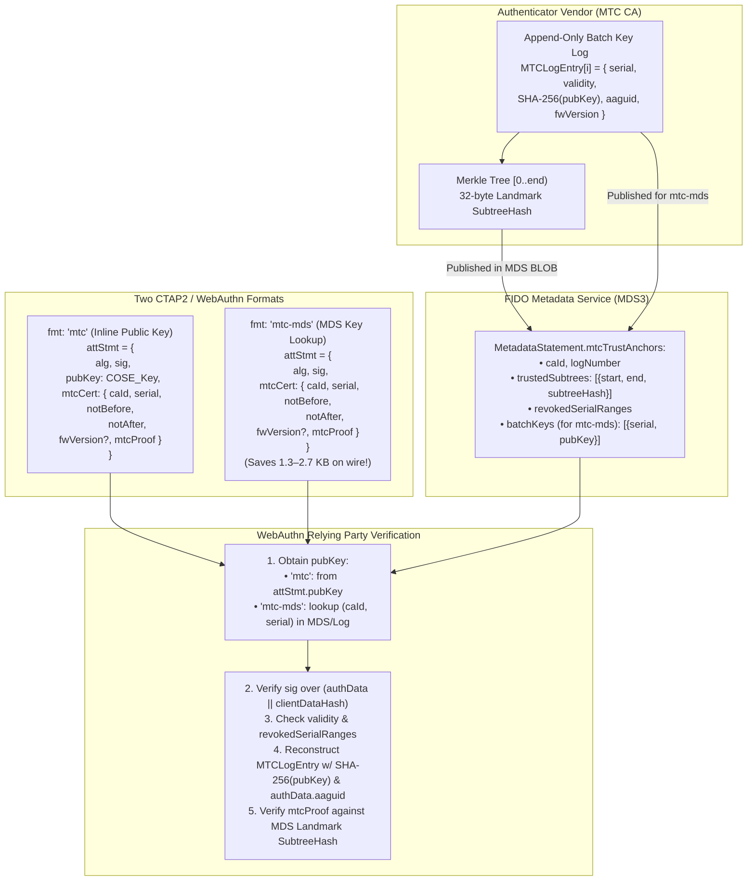
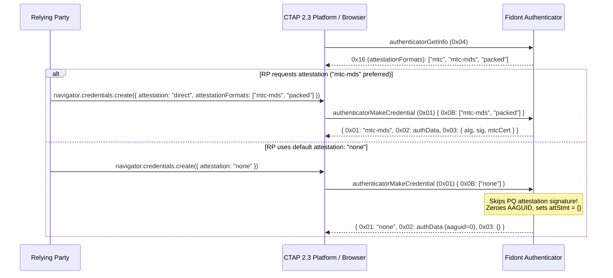
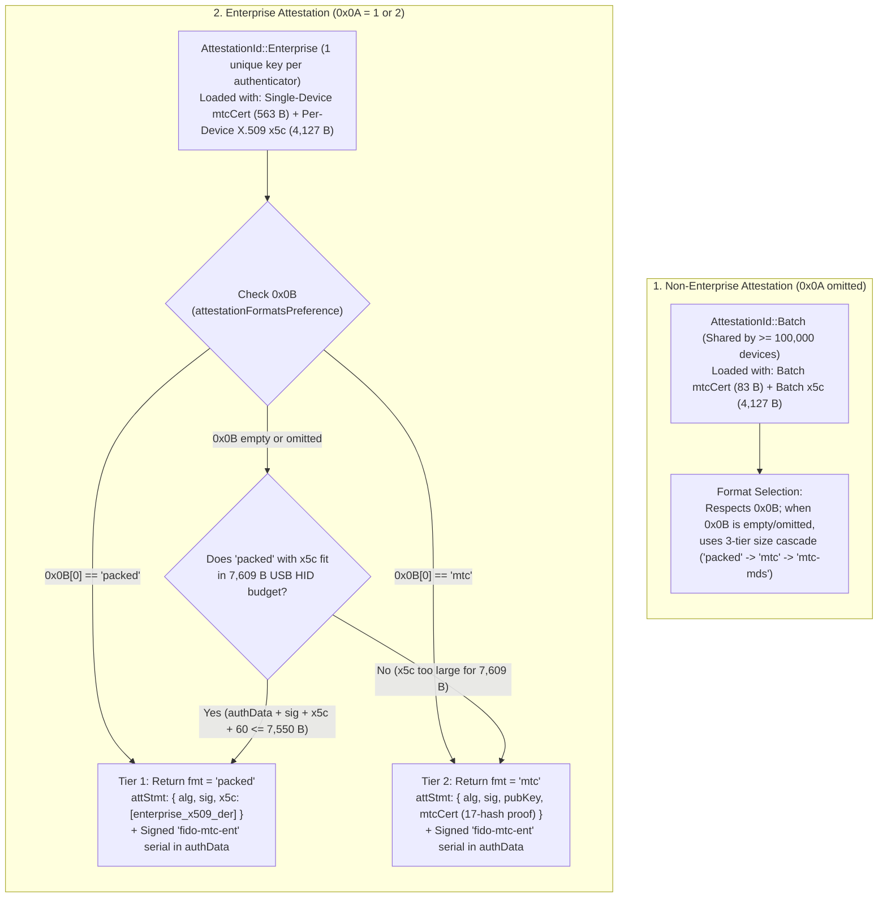
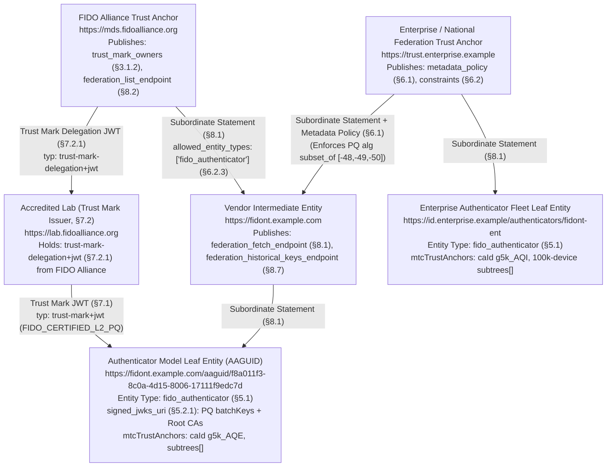

# Proposal: Post-Quantum WebAuthn Attestation Using Merkle Tree Certificates (`mtc` and `mtc-mds`)

Based on [`draft-ietf-plants-merkle-tree-certs`](https://datatracker.ietf.org/doc/draft-ietf-plants-merkle-tree-certs/), [W3C WebAuthn Level 3 / Level 4 §8](https://www.w3.org/TR/webauthn-3/#sctn-defined-attestation-formats), [FIDO CTAP 2.3](https://fidoalliance.org/specs/fido-v2.3-ps-20260226/fido-client-to-authenticator-protocol-v2.3-ps-20260226.html), and [FIDO Metadata Statement (MDS3)](https://fidoalliance.org/specs/mds/fido-metadata-statement-v3.0-ps-20210518.html).

> [!IMPORTANT]
> **Attribution & Scope of Fidont:**
> **Fidont** is an authenticator simulator designed for prototyping new specifications and testing authenticator conformance tools. It is based on the [Google OpenSK](https://github.com/google/OpenSK) Rust codebase. However, **Fidont is not suitable for production security use outside of certification, conformance testing, and prototyping new features.**

---

## 1. Problem Statement: Why Classical `packed` X.509 Attestation Breaks for Post-Quantum

In WebAuthn [`packed` attestation](https://www.w3.org/TR/webauthn-3/#sctn-packed-attestation), a `MakeCredential` response carries:
1. **`authData.attestedCredentialData.credentialPublicKey`**: The newly generated user credential public key (`COSE_Key`).
2. **`attStmt.sig`**: The authenticator's attestation signature over `authenticatorData || clientDataHash`.
3. **`attStmt.x5c`**: `[attestnCert, ...caCerts]`, where `attestnCert` is a DER-encoded X.509v3 certificate containing:
   - The batch or enterprise **attestation public key** (`subjectPublicKeyInfo`), and
   - The **Attestation CA's signature** (`signatureValue`), plus
   - Any intermediate CA certificates (`caCert`s), each adding another PQ public key + PQ signature.

With classical `ES256` (65 B public key, ~71 B signature), a single-cert `packed` attestation response is **~713 bytes**. With post-quantum `ML-DSA` (FIPS 204) or PQ/T hybrid composites, the wire and NVRAM footprint explodes:

| Component in `MakeCredential` Response | Classical (`ES256`) | `ML-DSA-44` (`-48`) | `ML-DSA-65` (`-49`) | `ML-DSA-87` (`-50`) | `ML-DSA-87-Ed448` (`-56`) |
| :--- | ---: | ---: | ---: | ---: | ---: |
| `authData` base + `credentialPublicKey` | ~220 B | ~1,470 B | ~2,110 B | ~2,750 B | ~2,810 B |
| `attStmt.sig` (Attestation Key sig) | ~71 B | 2,420 B | 3,309 B | 4,627 B | 4,741 B |
| `attestnCert` `subjectPublicKeyInfo` | ~91 B | 1,334 B | 1,974 B | 2,614 B | 2,675 B |
| `attestnCert` CA `signatureValue` | ~71 B | 2,420 B | 3,309 B | 4,627 B | 4,741 B |
| `attestnCert` X.509v3 TBS + ASN.1 overhead | ~260 B | ~280 B | ~280 B | ~280 B | ~280 B |
| **Total (1-cert `x5c`, no intermediate)** | **~713 B** | **~7,924 B** | **~10,982 B** | **~14,898 B** | **~15,247 B** |
| **Total (2-cert `x5c` w/ Intermediate CA)** | **~1,150 B** | **~11,960 B** | **~16,545 B** | **~22,419 B** | **~22,943 B** |

> [!WARNING]
> **Hardware & Transport Bottlenecks:**
> 1. **CTAP2 `maxMsgSize` & USB HID Frames:** Standard USB HID CTAP2 authenticators advertise `maxMsgSize` between `1024` and `7680` bytes (the maximum single CTAPHID message payload is **`7,609` bytes**: 1 init packet of 57 B + 128 continuation packets of 59 B). Even a 1-cert `ML-DSA-44` `packed` attestation (**7,924 B**) exceeds the **7,609-byte USB HID protocol hard limit**!
> 2. **Authenticator Flash/NVRAM Budget:** Constrained MCUs (such as the nRF52840 in Fidont) store attestation material in flash pages (`persist.rs`). Storing multi-kilobyte X.509 certificates consumes scarce non-volatile storage.

---

## 2. Two New WebAuthn Attestation Formats: `mtc` and `mtc-mds`

Based on [`draft-ietf-plants-merkle-tree-certs`](https://datatracker.ietf.org/doc/draft-ietf-plants-merkle-tree-certs/), we define **two complementary WebAuthn Attestation Statement Formats**:

1. **`mtc` (`fmt: "mtc"`) — MTC Attestation with Inline Public Key:**
   - Carries the attestation public key (`pubKey` as a CBOR-encoded `COSE_Key`) inline alongside `alg`, `sig`, and `mtcCert`.
   - **Use Case:** Enterprise Attestation (`AttCA`), standalone MTCs, or large vendor batch logs where the Relying Party only caches the **32-byte Landmark `SubtreeHash` `[start, end)`** (or cosigner public keys) from MDS and does not store every individual batch public key.
   - **Flash Savings on Authenticator:** Because Fidont derives `pubKey` on the fly from the 32-byte attestation private key seed (`attestation_key.get_pub_key()`), the authenticator **never needs to store the 1.3–2.6 KB public key in flash**—only the 32-byte seed and the ~150–280 B `mtcCert`!

2. **`mtc-mds` (`fmt: "mtc-mds"`) — MDS/Log-Assisted MTC Attestation (Public Key Omitted on Wire):**
   - Omits `pubKey` from `attStmt` on the wire. The Relying Party fetches the batch attestation public key indexed by `(mtcCert.caId, mtcCert.serial)` from the FIDO Metadata Service (`mtcTrustAnchors[].batchKeys`) or the vendor's MTC issuance log.
   - **Use Case:** Basic Batch Attestation (`Basic`) for hardware security keys where a vendor has a small number of manufacturing batches per model, and maximum wire compression is required so that **even `ML-DSA-87` (`-50`) and `ML-DSA-87-Ed448` (`-56`) fit inside a single 7,609-byte USB HID CTAP2 frame**.

### Wire-Size Comparison Across Formats (`2^8 = 256` Batch Log Entries, Landmark Proof = 256 B)

| Format | `ML-DSA-44` (`-48`) | `ML-DSA-65` (`-49`) | `ML-DSA-87` (`-50`) | `ML-DSA-87-Ed448` (`-56`) | Fits USB HID (`7,609 B` limit)? |
| :--- | ---: | ---: | ---: | ---: | :---: |
| Classical X.509 `packed` (1-cert PQ CA) | ~7,924 B | ~10,982 B | ~14,898 B | ~15,247 B | ❌ None fit |
| **`fmt: "mtc"`** (Inline `pubKey` + Landmark `MTCProof`) | **~5,490 B** | **~7,600 B** | **~10,200 B** | **~10,435 B** | ✅ `ML-DSA-44` & `ML-DSA-65` fit! |
| **`fmt: "mtc-mds"`** (RP fetches `pubKey` via MDS/Log) | **~4,165 B** | **~5,635 B** | **~7,595 B** | **~7,769 B** | ✅ **`ML-DSA-44`, `ML-DSA-65`, & `ML-DSA-87` fit!** |

*(With $2^4 = 16$ batches per model, the Landmark `MTCProof` inclusion path is only $4 \times 32 = 128\text{ B}$, reducing `mtc-mds` for `ML-DSA-87` to **~7,467 B** and `ML-DSA-87-Ed448` to **~7,641 B**—or **~7,577 B** for a 4-batch log!)*



---

## 3. Normative Specification: `mtc` and `mtc-mds` Attestation Statement Formats

### 3.1 Format 1: MTC Attestation Statement Format (`fmt: "mtc"`)

- **Attestation statement format identifier:** `"mtc"`
- **Attestation types supported:** `[=Basic=]`, `[=AttCA=]`, `[=Self=]`
- **Syntax (CDDL):**

```cddl
$$attStmtType //= (
    fmt: "mtc",
    attStmt: mtcStmtFormat
)

mtcStmtFormat = {
    alg: COSEAlgorithmIdentifier,
    sig: bytes,
    pubKey: bytes,            ; Canonical CBOR-encoded COSE_Key of the attestation public key
    mtcCert: mtcEntryDesc,
} // {
    alg: COSEAlgorithmIdentifier,
    sig: bytes,               ; Self attestation (when pubKey and mtcCert are omitted)
}

mtcEntryDesc = {
    caId: bytes,              ; ASN.1 DER Binary TrustAnchorID (RFC 9879 / draft-ietf-plants-merkle-tree-certs §4)
    serial: uint,             ; uint64: (log_number << 48) | index
    notBefore: uint,          ; uint64 Unix epoch seconds
    notAfter: uint,           ; uint64 Unix epoch seconds
    ? fwVersion: uint,        ; Optional firmware version (replaces id-fido-gen-ce-fw-version)
    mtcProof: bytes,          ; TLS-serialized MTCProof (draft-ietf-plants-merkle-tree-certs §4.2)
}
```

### 3.2 Format 2: MDS-Assisted MTC Attestation Statement Format (`fmt: "mtc-mds"`)

- **Attestation statement format identifier:** `"mtc-mds"`
- **Attestation types supported:** `[=Basic=]`, `[=AttCA=]`
- **Syntax (CDDL):**

```cddl
$$attStmtType //= (
    fmt: "mtc-mds",
    attStmt: mtcMdsStmtFormat
)

mtcMdsStmtFormat = {
    alg: COSEAlgorithmIdentifier,
    sig: bytes,
    mtcCert: mtcEntryDesc,    ; Attestation public key is omitted; RP fetches pubKey by (caId, serial) from MDS/log
}
```

---

## 4. Deterministic `MTCLogEntry` Leaf Structure & `MTCProof` Encoding

Both `mtc` and `mtc-mds` share the exact same Merkle Tree issuance log structure and `MTCProof` binary format from [`draft-ietf-plants-merkle-tree-certs`](https://datatracker.ietf.org/doc/draft-ietf-plants-merkle-tree-certs/):

### 4.1 Leaf Entry Serialization (`FidoMtcLogEntry`)

For each batch or enterprise attestation key at index `index` in log `log_number`, the serial number is:
$$\text{serial} = (\text{log\_number} \ll 48) \mid \text{index}$$

The Merkle tree leaf input (hashed with RFC 9162 `0x00` leaf prefix: $H(\texttt{0x00} \parallel \text{entry})$) binds:
1. `ca_id`: Variable-length prefix + `caId` bytes (ASN.1 DER relative OID / `TrustAnchorID`).
2. `serial`: 8-byte big-endian `uint64` (`(log_number << 48) | index`).
3. `not_before`: 8-byte big-endian `uint64`.
4. `not_after`: 8-byte big-endian `uint64`.
5. `aaguid`: 16-byte `authenticatorData.attestedCredentialData.aaguid` (taken directly from `authData[37..53]`, avoiding duplicate transmission in `attStmt`).
6. `fw_version`: Optional 8-byte big-endian `uint64` (`0` if absent).
7. `pub_key_hash`: 32-byte `SHA-256(pubKey)` (where `pubKey` is the canonical CBOR-encoded `COSE_Key` of the attestation public key).
8. `extensions`: Length-prefixed `MTCLogEntryExtension` list from `MTCProof`.

### 4.2 `MTCProof` Wire Structure (`draft-ietf-plants-merkle-tree-certs` §4.2)

```tls-presentation
struct {
    MTCLogEntryExtension extensions<0..2^16-1>;
    uint48 start;
    uint48 end;
    opaque inclusion_proof<0..2^16-1>;
    Cosignature signatures<0..2^24-1>;
} MTCProof;
```

- In **Landmark-Relative Mode** (standard for FIDO MDS batch & enterprise CAs):
  - `extensions` is empty (`2` bytes: `0x0000`).
  - `start` is `6` bytes (`uint48`, typically `0`).
  - `end` is `6` bytes (`uint48`, the landmark tree size).
  - `inclusion_proof` is `2` bytes length + $k \times 32$ bytes of sibling hashes.
  - `signatures` is empty (`3` bytes: `0x000000`).
  - **Total `mtcProof` overhead for a 1-entry or 16-entry batch log:** **$19\text{ bytes}$** (for 1 entry) to **$147\text{ bytes}$** (for 16 entries)!

---

## 5. Relying Party Verification Procedure (Unified for `mtc` and `mtc-mds`)

Given `(fmt, attStmt, authenticatorData, clientDataHash)`:

1. **Decode CBOR:**
   - Parse `attStmt` according to `mtcStmtFormat` (if `fmt == "mtc"`) or `mtcMdsStmtFormat` (if `fmt == "mtc-mds"`).
2. **Handle `Self` Attestation (only applicable when `fmt == "mtc"` and `mtcCert` is absent):**
   - Validate `alg == authenticatorData.attestedCredentialData.credentialPublicKey.alg`.
   - Verify `sig` over `authenticatorData || clientDataHash` using `credentialPublicKey`.
   - Return Attestation Type `Self`.
3. **Resolve Trust Anchor & Attestation Public Key (`pubKey`):**
   - Lookup the `MtcTrustAnchor` matching `mtcCert.caId` for `authenticatorData.attestedCredentialData.aaguid` in FIDO MDS (or Enterprise AttCA configuration).
   - **If `fmt == "mtc"`:**
     - Extract `pubKey = attStmt.pubKey` and decode it as a `COSE_Key`.
   - **If `fmt == "mtc-mds"`:**
     - Lookup `mtcCert.serial` in `mtcTrustAnchor.batchKeys` (or query the synced MTC log for `(mtcCert.caId, mtcCert.serial)`) to obtain the canonical CBOR-encoded `COSE_Key` bytes `pubKey`. Fail verification if `(caId, serial)` is unknown.
4. **Verify Attestation Signature:**
   - Verify that `pubKey.alg == attStmt.alg`.
   - Verify that `attStmt.sig` is a valid signature over `authenticatorData || clientDataHash` using `pubKey`.
5. **Check Validity Period & Serial Revocation (`draft-ietf-plants-merkle-tree-certs` §6.2 Steps 2–3):**
   - Verify current time is within `[mtcCert.notBefore, mtcCert.notAfter]`.
   - Check that `mtcCert.serial >> 48 == mtcTrustAnchor.logNumber`.
   - Check that `mtcCert.serial` is not within any `[minSerial, maxSerial]` range in `mtcTrustAnchor.revokedSerialRanges`.
6. **Reconstruct Leaf & Verify Merkle Inclusion Proof (`draft-ietf-plants-merkle-tree-certs` §6.2 Steps 4–6):**
   - Compute `pubKeyHash = SHA-256(pubKey)`.
   - Reconstruct `FidoMtcLogEntry` from `(mtcCert.caId, mtcCert.serial, mtcCert.notBefore, mtcCert.notAfter, authenticatorData.aaguid, mtcCert.fwVersion, pubKeyHash, mtcProof.extensions)`.
   - Compute `expectedSubtreeHash` using RFC 9162 §2.1.3.2 over `(index = mtcCert.serial & 0xFFFFFFFFFFFF, mtcProof.start, mtcProof.end, FidoMtcLogEntry, mtcProof.inclusion_proof)`.
   - Verify that `(mtcProof.start, mtcProof.end, expectedSubtreeHash)` matches an active landmark entry in `mtcTrustAnchor.trustedSubtrees` (or, if `mtcProof.signatures` is non-empty, satisfies `mtcTrustAnchor.quorum` over `mtcTrustAnchor.cosigners`).
7. **Return Result:**
   - Return Attestation Type `Basic` (or `AttCA`) and the matched `mtcTrustAnchor`.

---

## 6. FIDO Metadata Statement (`fido-metadata-statement.bs`) Extensions

To support both `mtc` and `mtc-mds`, we extend `MetadataStatement` with `mtcTrustAnchors`:

```idl
dictionary MtcSubtree {
    required unsigned short     logNumber; // uint16
    required unsigned long long start;
    required unsigned long long end;
    required DOMString          rootHash;  // base64url 32-byte Merkle subtree root hash
    long                        alg;       // Optional COSEAlgorithmIdentifier of signing Root CA (e.g., -50 for ML-DSA-87)
    DOMString                   signature; // Optional base64url Root CA signature over FidoMtcSubtreeCheckpoint
};

dictionary MtcBatchKeyEntry {
    required unsigned long long serial;    // uint64: (logNumber << 48) | index
    required long               alg;       // COSEAlgorithmIdentifier (-48, -49, -50, ...)
    required DOMString          coseKey;   // base64url canonical CBOR-encoded COSE_Key (used by "mtc-mds")
};

dictionary MtcCosigner {
    required DOMString verifierId; // base64url binary relative OID
    required long      coseAlg;    // COSEAlgorithmIdentifier
    required DOMString publicKey;  // base64url public key bytes
};

dictionary MtcTrustAnchor {
    required DOMString               caId;            // base64url DER TrustAnchorID (unique per MtcTrustAnchor entry)
    required DOMString               hashAlg;         // "sha-256"
    required unsigned long           maxBatchWindow;  // uint32 (seconds)
    required MtcSubtree[]            subtrees;        // Landmark subtrees
    required unsigned long long[]    revokedSerials;  // Revoked uint64 serial numbers
    MtcBatchKeyEntry[]               batchKeys;       // Public key lookup table for "mtc-mds"
    MtcCosigner[]                    cosigners;       // Optional standalone cosigners
    DOMString                        quorum;          // Optional standalone quorum rule
};

partial dictionary MetadataStatement {
    MtcTrustAnchor[] mtcTrustAnchors;
};
```

### 6.1 Multi-Key Deployment Models: Shared `caId` (Recommended) vs. Separate `caId`s

When an authenticator model (sharing one `aaguid`) is provisioned across multiple manufacturing batches or multiple post-quantum batch key algorithms (e.g., `ML-DSA-44` `-48`, `ML-DSA-65` `-49`, and `ML-DSA-87` `-50`), there are two ways to represent those batch keys in `mtcTrustAnchors`:

> [!TIP]
> **Recommendation — Option A (Single Shared `caId` / Single `MtcTrustAnchor`):**
> Vendors SHOULD issue all batch keys for an authenticator family as distinct leaves (`index = 0, 1, 2, ...`, giving distinct `serial = (logNumber << 48) | index`) within a **single MTC Log (`caId`)**. This is the core architectural advantage of Merkle Tree Certificates: whether a manufacturer has 3 batch keys or 10,000 batch keys over a 10-year product lifecycle, `mtcTrustAnchors` requires only **one `MtcTrustAnchor` entry** and **one 32-byte `rootHash`** in `subtrees`. Use **Option B (Separate `caId`s)** only when batch keys are issued by physically independent CA logs or when generating isolated single-key test trees on the fly.

| Dimension | **Option A (Recommended): Shared `caId` (Single `MtcTrustAnchor`)** | **Option B: Separate `caId`s (Multiple `MtcTrustAnchor` Entries)** |
| :--- | :--- | :--- |
| **`mtcTrustAnchors` array length** | **`1` entry** (e.g. `caId: "g5k_AQE"`) | **`N` entries** (each entry MUST have a distinct `caId`, e.g. `"g5k_AQE"`, `"g5k_AQI"`, `"g5k_AQM"`) |
| **How batch keys are distinguished** | By **leaf index (`serial`)** inside the same Merkle tree:<br/>• `-48`: `index = 0` (`serial = 1970324836974592`)<br/>• `-49`: `index = 1` (`serial = 1970324836974593`)<br/>• `-50`: `index = 2` (`serial = 1970324836974594`) | By **`caId`** first, then `serial` (each tree is independent, so every tree can reuse `index = 5` / `serial = 1970324836974597`) |
| **Number of Merkle `rootHash`es** | **`1` shared 32-byte `rootHash`** covering all batch keys in `[start, end)` | **`N` independent 32-byte `rootHash`es** (one per `caId`) |
| **Key generation & log management** | Append-only transparency log: new batch keys are appended as new leaves (`index = k`) and authenticated by a single updated landmark `rootHash`. | Uncoupled: each batch key's Merkle tree and `mtcProof` can be generated in isolation without knowledge of other batch keys. |
| **Wire size on authenticator (`mtcCert`)** | Identical (`156 B` for a 4-leaf tree, `188 B` for an 8-leaf tree) | Identical (`188 B` for an 8-leaf tree) |

#### Option A (Recommended): Single Shared `caId` (`"g5k_AQE"`)

```json
// Option A (Recommended): All 3 batch keys under a single shared caId ("g5k_AQE")
"mtcTrustAnchors": [
  {
    "caId": "g5k_AQE",
    "hashAlg": "sha-256",
    "maxBatchWindow": 315360000,
    "subtrees": [
      {
        "logNumber": 7,
        "start": 0,
        "end": 8,
        "rootHash": "tDE90jiRf8rgpv3frcGifWOs-FH1Oh62UCK0nGjS_zI"
      }
    ],
    "revokedSerials": [],
    "batchKeys": [
      {
        "serial": 1970324836974592,
        "alg": -48,
        "coseKey": "owEHAzgvIFkFIG0boEVMxS-4GEgM3UoEfZyiNjZ7PSx_hLHevzHHuq7Bn5EmyP1L..."
      },
      {
        "serial": 1970324836974593,
        "alg": -49,
        "coseKey": "owEHAzgwIFkHoD83NmYr_UsEUUsPI_XL_RZ-AAlZXCvUXQ9UcVYE4mMJBBGZgwHg..."
      },
      {
        "serial": 1970324836974594,
        "alg": -50,
        "coseKey": "owEHAzgxIFkKIEvfssw0ww0hNiwEDBUfXM6CqT2HBWCbO1OL7VgtUxU1oP9bh023..."
      }
    ]
  }
]
```

#### Option B: 3 Separate `caId`s (Independent Single-Key Trees)

```json
// Option B: 3 separate caIds (used when each tree is generated independently)
"mtcTrustAnchors": [
  {
    "caId": "g5k_AQE",
    "hashAlg": "sha-256",
    "maxBatchWindow": 315360000,
    "subtrees": [
      {
        "logNumber": 7,
        "start": 0,
        "end": 8,
        "rootHash": "WePVfMT4Y1AX9uK4BW_qJkxfl1etqOOnhhRbc9L5zKY"
      }
    ],
    "revokedSerials": [],
    "batchKeys": [
      {
        "serial": 1970324836974597,
        "alg": -48,
        "coseKey": "owEHAzgvIFkFIG0boEVMxS-4GEgM3UoEfZyiNjZ7PSx_hLHevzHHuq7Bn5EmyP1L..."
      }
    ]
  },
  {
    "caId": "g5k_AQI",
    "hashAlg": "sha-256",
    "maxBatchWindow": 315360000,
    "subtrees": [
      {
        "logNumber": 7,
        "start": 0,
        "end": 8,
        "rootHash": "of6RgYqR4wCmuIIEjXsX6MUT3qt7oOX9TMJXVRkpvt0"
      }
    ],
    "revokedSerials": [],
    "batchKeys": [
      {
        "serial": 1970324836974597,
        "alg": -49,
        "coseKey": "owEHAzgwIFkHoD83NmYr_UsEUUsPI_XL_RZ-AAlZXCvUXQ9UcVYE4mMJBBGZgwHg..."
      }
    ]
  },
  {
    "caId": "g5k_AQM",
    "hashAlg": "sha-256",
    "maxBatchWindow": 315360000,
    "subtrees": [
      {
        "logNumber": 7,
        "start": 0,
        "end": 8,
        "rootHash": "sJwH01wHYxmsAqPXh_DmP0TdQPig4fRUopKdzChkgkQ"
      }
    ],
    "revokedSerials": [],
    "batchKeys": [
      {
        "serial": 1970324836974597,
        "alg": -50,
        "coseKey": "owEHAzgxIFkKIEvfssw0ww0hNiwEDBUfXM6CqT2HBWCbO1OL7VgtUxU1oP9bh023..."
      }
    ]
  }
]
```

---

## 7. CTAP 2.3 `authenticatorGetInfo` `attestationFormats` (`0x16`) & `"none"` Attestation

In CTAP 2.3 §6.4 (`authenticatorGetInfo` `(0x04)`), response member **`0x16` (`attestationFormats`)** advertises the sequence of WebAuthn attestation statement format identifiers (`[+ tstr]`) supported by the authenticator, ordered from **most preferred to least preferred**.

### 7.1 Why `attestationFormats` (`0x16`) and `"none"` are Critical for Post-Quantum CTAP2

1. **Client & Platform Filtering before `MakeCredential`**:
   Per CTAP 2.3 §6.1.1, a platform (browser/OS) intersects the Relying Party's `PublicKeyCredentialCreationOptions.attestationFormats` with `authenticatorGetInfo.attestationFormats` (`0x16`) before sending `attestationFormatsPreference` (`0x0B`) in `authenticatorMakeCredential`.
2. **Zero-Overhead `"none"` Attestation (`attestation: "none"`)**:
   In WebAuthn, the default `attestation` conveyance preference is `"none"`. When a CTAP 2.3 platform requests `attestationFormatsPreference: ["none"]` (`0x0B`):
   - The authenticator sets `fmt: "none"`, `attStmt: {}` (`0xA0`, 1 byte), and zeros `aaguid` (`[0u8; 16]`) in `attestedCredentialData`.
   - It **completely skips computing the post-quantum attestation signature**, saving **2,420–4,699 bytes** of signature and **1,322–2,602 bytes** of attestation public key on the wire, while cutting `authenticatorMakeCredential` latency roughly in half on Cortex-M4 hardware.
3. **Dynamic Capability Advertising from Persisted Material**:
   Because `"none"` attestation support is implied in CTAP / WebAuthn, `process_get_info` omits `"none"` from `0x16` (`attestationFormats`) while still supporting `"none"` when requested via `0x0B` (`attestationFormatsPreference`):
   - **When an MTC descriptor is provisioned (`ProvisionedMtcAttestation::from_bytes` succeeds)**:
     - If provisioned default format is `MtcMds`: `["mtc-mds", "mtc", "packed"]`
     - If provisioned default format is `Mtc`: `["mtc", "mtc-mds", "packed"]`
   - **When a traditional X.509 DER certificate is provisioned or no batch certificate is present**:
     - `["packed"]`

### 7.2 End-to-End Negotiation Flow



### 7.3 3-Tier Size-Aware Default Attestation Cascade (`"packed"` $\to$ `"mtc"` $\to$ `"mtc-mds"`)

When provisioned via `tools/configure.py --mtc`, `ProvisionedMtcAttestation` (`libraries/opensk/src/ctap/mtc.rs`) stores **both** the batch X.509 DER certificate (`x5c`) and the compact `MtcCertDescriptor` (`mtcCert`) in Fidont's persistent certificate store (`11,253 B` capacity across `ATTESTATION_CERTIFICATE` and `ATTESTATION_CERTIFICATE_EXTRA_SHARDS`).

When the client omits `attestationFormatsPreference` (`0x0B`), `process_make_credential` (`libraries/opensk/src/ctap/mod.rs`) evaluates a **3-tier size-aware cascade** so every registration returns the richest self-contained attestation format that fits inside a single `7,609 B` USB HID CTAP2 message (`<= 7,550 B` threshold):

1. **Tier 1 — `"packed"` (with batch `x5c`)**: If `auth_data.len() + sig.len() + x5c.len() + 60 <= 7550`, Fidont returns standard WebAuthn **`fmt: "packed"`** with `x5c: [batch_cert_der]` signed by the batch key.
2. **Tier 2 — `"mtc"` (with inline `pubKey` + `mtcCert`)**: Otherwise, if `auth_data.len() + sig.len() + pk_bytes.len() + 260 <= 7550`, Fidont returns **`fmt: "mtc"`** with inline `pubKey` and `mtcCert`.
3. **Tier 3 — `"mtc-mds"` (`mtcCert` only, `pubKey` omitted)**: Otherwise, Fidont returns **`fmt: "mtc-mds"`**, omitting `pubKey` so the response always fits under `7,609 B`.

| Credential Signing Algorithm | Batch Key = `-48` (`ML-DSA-44`, `x5c`=`4,127 B`) | Batch Key = `-49` (`ML-DSA-65`, `x5c`=`5,656 B`) | Batch Key = `-50` (`ML-DSA-87`, `x5c`=`7,614 B`) |
| :--- | :---: | :---: | :---: |
| **Classical (`-7`, `-8`, `-19`, `-35`, `-36`, `-47`, `-257`)** | **`"packed"` (`x5c`)** (`6,704–7,008 B`) | **`"mtc"` (`pubKey`)** (`5,632–5,936 B`) | **`"mtc-mds"`** (`4,898–5,202 B`) |
| **`ML-DSA-44` (`-48`, `-54`, `-57`)** | **`"mtc"` (`pubKey`)** (`5,395–5,673 B`) | **`"mtc"` (`pubKey`)** (`6,924–7,202 B`) | **`"mtc-mds"`** (`6,190–6,468 B`) |
| **`ML-DSA-65` (`-49`, `-55`, `-58`)** | **`"mtc"` (`pubKey`)** (`6,035–6,313 B`) | **`"mtc-mds"`** (`5,586–5,864 B`) | **`"mtc-mds"`** (`6,830–7,108 B`) |
| **`ML-DSA-87` (`-50`, `-56`, `-59`)** | **`"mtc"` (`pubKey`)** (`6,675–6,989 B`) | **`"mtc-mds"`** (`6,226–6,540 B`) | **`"mtc-mds"`** (`7,470–7,535 B`) |

### 7.4 Fidont Implementation Details

1. **`libraries/opensk/src/ctap/mtc.rs`**:
   - Add `pub x5c: Option<Vec<u8>>` to `ProvisionedMtcAttestation`, serialized as `{ "fmt": ..., "x5c"?: bstr, "mtcCert": ... }`.
2. **`src/env/vendor.rs`**:
   - Add `0x03 => cert_append: Option<Vec<u8>>` to `VendorConfigureParameters` so `> 6,000 B` PQ `x5c + mtcCert` bundles (such as `-50` `ML-DSA-87` at `7,820 B`) can be uploaded across two `OPENSK_VENDOR_CONFIGURE` (`0x40`) commands without exceeding `7,609 B`.
3. **`libraries/opensk/src/ctap/mod.rs`**:
   - Populate `attestation_formats` (`0x16`) in `process_get_info`.
   - Implement the 3-tier `"packed"` (`x5c`) $\to$ `"mtc"` (`pubKey`) $\to$ `"mtc-mds"` cascade and `"none"` support in `process_make_credential`.
4. **`tools/configure.py`**:
   - Bundle `"x5c": cert_der` inside `provisioned_mtc` and automatically split `cert_or_mtc_bytes` into a `6,000 B` initial chunk (`0x02`) + continuation chunk (`0x03`) when needed.

---

## 8. Enterprise Attestation (`0x0A`) with Dual Provisioned MTC Keys & Signed Per-Credential Serial

Under WebAuthn Level 3 (§6.5.5) and CTAP 2.3 (`enterpriseAttestation` `0x0A` in `authenticatorMakeCredential`), authenticators must reconcile two opposing requirements:

1. **Non-Enterprise Attestation (Privacy / Anonymity Set Requirement)**:
   Standard batch attestation (`enterpriseAttestation` absent or false) **must** share the same batch attestation keypair across a minimum batch of **$B \ge 100,000$ authenticators** (FIDO Authenticator Security Requirements) so Relying Parties cannot track individual hardware tokens across accounts or origins.
2. **Enterprise Attestation (Uniquely Identifying / Inventory Requirement)**:
   When an authorized Relying Party or platform requests `enterpriseAttestation = 1` (RP-facilitated) or `2` (platform-managed), the authenticator returns **uniquely identifying attestation** tied to the specific device and/or credential so the enterprise IdP can verify hardware inventory, serial number, and per-credential issuance.

### 8.1 Dual-Key Provisioning Model per Authenticator (`AttestationId::Batch` vs. `AttestationId::Enterprise`)

To cleanly satisfy both requirements without sacrificing privacy on standard registrations or breaking compatibility with legacy X.509 Enterprise Relying Parties, **each physical authenticator is provisioned at manufacturing time with TWO distinct attestation keys** (mapping directly to Fidont's `AttestationId::Batch` and `AttestationId::Enterprise` in `libraries/opensk/src/api/persist.rs`).

When **Enterprise Attestation is enabled** on the authenticator (`AttestationId::Enterprise`), **both** the single-device Enterprise `mtcCert` and the per-enterprise-batch-key **X.509 DER certificate (`x5c`)** are loaded into the Enterprise `ProvisionedMtcAttestation` bundle (`{ "fmt": "mtc", "x5c": enterprise_x509_der, "mtcCert": enterprise_mtc_cert }`):

| Property | Key 1: Non-Enterprise Batch Key (`AttestationId::Batch`) | Key 2: Enterprise Single-Device Key (`AttestationId::Enterprise`) |
| :--- | :--- | :--- |
| **When Selected** | Default (`enterpriseAttestation` `0x0A` omitted) | `enterpriseAttestation` (`0x0A`) $= 1$ or $2$ |
| **Batch Size ($B$)** | **$\ge 100,000$ devices** share the **same** keypair & leaf `serial` | **$1$ device per keypair** ("single-device batch key", unique leaf `serial` per device) |
| **Provisioned Certificates** | Batch `mtcCert` ($d = 2$ hashes, `83 B`) + Batch X.509 `x5c` (`4,127 B`) | Single-Device Enterprise `mtcCert` ($d = 17$ hashes, `563 B`) **+ Per-Enterprise-Batch-Key X.509 `x5c` (`4,127 B`)** |
| **Merkle Tree Structure** | Small Batch MTC Tree (e.g., $N = 4$ leaves covering 400,000 devices across 4 batches; $d = 2$ sibling hashes = `64 B`) | Per-Device Enterprise MTC Tree (e.g., $N = 100,000$ leaves for 100,000 devices; $d = \lceil \log_2(100,000) \rceil = 17$ sibling hashes = `544 B`) |
| **Public Key Distribution** | Pre-distributed in FIDO MDS3 `MtcTrustAnchor.batchKeys` (only 1 entry per 100,000 devices) | Sent **inline on the wire** inside **`x5c`** (`fmt: "packed"`) or via **`fmt: "mtc"`** (`pubKey` + `mtcCert`); **not** listed in MDS (`batchKeys: []`) |
| **Format Selection Rule** | Respects `0x0B`; defaults to 3-tier size cascade (`"packed"` $\to$ `"mtc"` $\to$ `"mtc-mds"`) when `0x0B` is empty/omitted | - **`fmt: "packed"` (with Enterprise `x5c`)** if `"packed"` is the **first** format in `0x0B`, **or** if `0x0B` is empty/omitted and `x5c` fits within the `7,609 B` response budget (same Tier 1 size logic as Non-Enterprise)<br/>- **`fmt: "mtc"` (with inline `pubKey` + `mtcCert`)** if `"mtc"` is first in `0x0B`, **or** if `0x0B` is empty/omitted and `x5c` exceeds the `7,609 B` response budget |
| **On-Device Flash Cost** | `32 B` ML-DSA seed + `83 B` `mtcCert` + `4,127 B` batch `x5c` ($\approx 4,257\text{ B}$) | `32 B` ML-DSA seed + `563 B` `mtcCert` + `4,127 B` per-device `x5c` = **`4,737 B` total** (both bundles fit inside Fidont's `11,253 B` certificate store!) |
| **CA / IdP Trust Anchor Size** | Single `32 B` `rootHash` + 1 `batchKeys` entry per 100k devices in FIDO MDS3 | Single **`32 B` `rootHash`** in Enterprise IdP trust store (plus standard Enterprise X.509 Root CA for `"packed"` RPs) |

#### 8.1.1 Enterprise Attestation Format Selection (`"packed"` First / Size-Aware Default vs. `"mtc"`)

Loading **both** the Enterprise `mtcCert` and the per-enterprise-batch-key X.509 `x5c` certificate onto the authenticator enables seamless interoperability across both legacy X.509-only Enterprise Relying Parties and modern MTC-aware Enterprise IdPs using the **exact same Tier 1 $\to$ Tier 2 size-aware logic as Non-Enterprise**:

1. **Case A — `"packed"` First in `0x0B`, OR `0x0B` Empty/Omitted and Certificate Fits (`<= 7,609 B`)**:
   - When `enterpriseAttestation` (`0x0A = 1` or `2`) is requested and:
     - `attestationFormatsPreference[0] == "packed"`, **or**
     - `attestationFormatsPreference` (`0x0B`) is **empty or omitted** and the total response with `enterprise_x509_der` fits within the single-frame `7,609 B` USB HID budget (`authData.len() + sig.len() + x5c.len() + 60 <= 7,550 B`),
   - The authenticator selects **`fmt: "packed"`** and returns the provisioned per-enterprise-batch-key X.509 certificate in **`attStmt.x5c = [enterprise_x509_der]`**, signed by `AttestationId::Enterprise` (with `"fido-mtc-ent"` also signed inside `authenticatorData.extensions`).
   - This gives existing Enterprise Relying Parties (which often omit `0x0B` or pass `0x0B: ["packed"]`) a standard per-device X.509 certificate chain (`x5c`) automatically whenever certificate and credential sizes allow (e.g., classical ES256/EdDSA credentials, or `ML-DSA` credentials with compact/classical Enterprise X.509 certificates).

2. **Case B — `"mtc"` First in `0x0B`, OR `0x0B` Empty/Omitted and `x5c` Exceeds `7,609 B` Budget**:
   - When `"mtc"` precedes `"packed"` in `0x0B` (`0x0B: ["mtc", ...]`), **or** when `0x0B` is empty/omitted and including the post-quantum `x5c` certificate would exceed the `7,609 B` USB HID frame limit, the authenticator returns **`fmt: "mtc"`** with its unique inline `pubKey` (`1,322 B` for `ML-DSA-44`), its 17-hash `mtcCert` (`563 B`), and the signed `"fido-mtc-ent"` extension in `authenticatorData`.
   - Unlike Non-Enterprise attestation (which has a Tier 3 `"mtc-mds"` fallback using MDS `batchKeys`), Enterprise attestation stops at Tier 2 (`"mtc"`) because single-device Enterprise public keys are never published in MDS (`batchKeys: []`), and `"mtc"` with an `ML-DSA-44` Enterprise key fits inside `7,609 B` for all credential algorithms (`5,931 B` for `ML-DSA-44`, `6,571 B` for `ML-DSA-65`, and `7,211 B` for `ML-DSA-87`).



### 8.2 Enterprise `MtcTrustAnchor` Configuration (Zero `batchKeys` Overhead & Root CA Subtree Signature)

Because the Enterprise single-device key uses **`fmt: "mtc"`** (sending `subjectKey` inline in `attStmt.mtcCert`), the Enterprise `MtcTrustAnchor` in the enterprise IdP or MDS entry requires **zero `batchKeys` entries** (`"batchKeys": []`)—only the 32-byte `rootHash` of the Enterprise Merkle tree.

Furthermore, to cryptographically bind `"caId": "g5k_AQI"` and its `subtrees` to the **Enterprise Root CA certificate** in `attestationRootCertificates` (e.g., an **ML-DSA-87** Enterprise Root CA that also signs the per-device `x5c` certificate), each subtree entry in `mtcTrustAnchors` carries `"alg"` (e.g., `-50` for `ML-DSA-87`) and `"signature"` over the canonical 85-byte `FidoMtcSubtreeCheckpoint`:

```c
struct {
    opaque context[32];        // "FIDO-MTC-SUBTREE-CHECKPOINT-V1\0\0" (32-byte domain separator)
    opaque ca_id<1..255>;      // 2-byte big-endian length prefix + raw caId bytes (0x0005 || 83993f0102)
    uint16 log_number;         // 2-byte big-endian logNumber (e.g., 7)
    uint48 start;              // 6-byte big-endian start index (e.g., 0)
    uint48 end;                // 6-byte big-endian end index (e.g., 8)
    opaque root_hash[32];      // 32-byte Merkle subtree rootHash
} FidoMtcSubtreeCheckpoint;
```

```json
{
  "caId": "g5k_AQI",
  "hashAlg": "sha-256",
  "maxBatchWindow": 315360000,
  "subtrees": [
    {
      "logNumber": 7,
      "start": 0,
      "end": 8,
      "rootHash": "lrYcEjQc8PxtR8uQs80rCVyagfpo8Uq-hFooo57I_U0",
      "alg": -50,
      "signature": "<base64url-encoded 4,627-byte ML-DSA-87 signature by Enterprise Root CA>"
    }
  ],
  "revokedSerials": [],
  "batchKeys": []
}
```

- Because the `4,627 B` ML-DSA-87 checkpoint signature resides in the MDS `mtcTrustAnchors` metadata (not on the USB wire), it adds **zero bytes** to the CTAP2 response while allowing the Relying Party to cryptographically verify that the Enterprise Root CA in `attestationRootCertificates` authorized `"caId": "g5k_AQI"` and its Merkle `rootHash`.
- When an authenticator with device index $k$ responds to an Enterprise `MakeCredential` request:
  - Its `mtcCert.serial` is `(logNumber << 48) | k`.
  - The Relying Party verifies `subtrees[0].signature` against the Enterprise Root CA in `attestationRootCertificates`, extracts `leafIndex = serial & 0xFFFFFFFFFFFF`, hashes `FidoMtcLogEntry` (including `extensions = deviceSerial`), walks the sibling hashes in `mtcProof`, and verifies it equals `rootHash`.

---

### 8.3 Including the Device Serial Number in the Signed Data (`"fido-mtc-ent"`)

In standard X.509 Enterprise Attestation (`fmt: "packed"`), the authenticator's hardware serial number (e.g., `"123456"`) is carried in the FIDO Enterprise Serial Number X.509 extension (**`OID 1.3.6.1.4.1.45724.1.1.2`**, `id-fido-gen-ce-sernum`, encoded as an ASN.1 `OCTET STRING`).

For Enterprise MTC Attestation (`fmt: "mtc"`), because each authenticator has its own **single-device Enterprise batch key (`AttestationId::Enterprise`)**, the device serial number is committed in two ways:
1. Inside `MtcProof.extensions` (`FidoMtcLogEntry.extensions`, committed into the Enterprise Merkle tree leaf hash), and
2. Inside the signed `authenticatorData.extensions` map under **`"fido-mtc-ent"`**, containing **only the device serial number** (`"deviceSerial"`), since `signCount` and `attestedCredentialData.credentialId` are already natively present and signed in `authenticatorData`.

#### Signed Extension in `authenticatorData.extensions`: `"fido-mtc-ent"`

When `enterpriseAttestation` (`0x0A`) is requested and accepted by the authenticator:
1. The authenticator sets the **`ED` (Extension Data included, bit 7 = `0x80`)** flag in `authenticatorData.flags`.
2. It constructs the `"fido-mtc-ent"` CBOR map inside `authenticatorData.extensions` containing only `"deviceSerial"`:

```cddl
; Included in authenticatorData.extensions ONLY during Enterprise Attestation (0x0A = 1 or 2)
$$extension-output //= (
    "fido-mtc-ent": MtcEnterpriseExtension
)

MtcEnterpriseExtension = {
    "deviceSerial" : tstr / uint   ; Device serial number (e.g., "123456" from MtcProof.extensions, or mtcCert.serial)
}
```

#### Concrete Wire Layout (`authenticatorData` Signed by `AttestationId::Enterprise`)

```text
+---------------------------------------------------------------------------------------------------+
|                                   authenticatorData (Signed!)                                     |
+-------------------+---------+----------+--------------------------+-------------------------------+
| rpIdHash (32 B)   | flags   | signCnt  | attestedCredentialData   | extensions (CBOR Map, ~36 B)  |
| SHA-256(rp.id)    | 0xC1    | (4 B)    | aaguid + credId + pubKey | { "fido-mtc-ent": {           |
|                   | (UP|AT  |          |                          |     "deviceSerial": "123456"  |
|                   |  |ED)   |          |                          | } }                           |
+-------------------+---------+----------+--------------------------+-------------------------------+
                                                  |
                                                  +---> Concatenated with clientDataHash (32 B)
                                                  |
                                                  v
                         attStmt.sig = ML-DSA.Sign(sk_enterprise_device,
                                                   authenticatorData || clientDataHash)
```

#### Why This Design Satisfies Every FIDO2 & Enterprise Requirement

1. **Direct Parity with X.509 `id-fido-gen-ce-sernum` (`1.3.6.1.4.1.45724.1.1.2`)**:
   - Whether the authenticator returns `fmt: "packed"` (X.509 `x5c` with `OID 1.3.6.1.4.1.45724.1.1.2 = "123456"`) or `fmt: "mtc"` (`mtcCert` with `MtcProof.extensions = "123456"` and `"fido-mtc-ent": { "deviceSerial": "123456" }`), the Relying Party receives the exact same device serial number (`"123456"`).
2. **No Redundant Fields**:
   - Per-credential uniqueness (`attestedCredentialData.credentialId`) and monotonic signature counting (`signCount`) are already native fields of `authenticatorData` covered by `attStmt.sig`, so `"fido-mtc-ent"` carries only `"deviceSerial"`.
3. **Zero Privacy Leakage on Non-Enterprise Registrations**:
   - When `enterpriseAttestation` (`0x0A`) is omitted, the authenticator uses **`AttestationId::Batch`** (shared across $\ge 100,000$ devices) and **omits `"fido-mtc-ent"`**, preserving a full $100,000$-device anonymity set.

---

### 8.4 Scaling Fleet Size (`100k` to `5M+` Keys), Growing Over Time, and Factory Provisioning

When deploying Merkle Tree Certificates for hardware authenticators, manufacturers must account for three practical questions:
1. How do `rootHash` and `mtcProof` sizes scale from **100,000** to **5,000,000** keys?
2. Does the CA need to know the **ultimate fleet size upfront**, or can the tree grow over time without touching already-shipped authenticators?
3. Do all **100,000 physical devices** in a subtree need to be manufactured at the same time?

#### 8.4.1 Size Impact from `100,000` to `5,000,000` Keys (in `100k` Increments)

In `MtcTrustAnchor`, each `rootHash` is a single SHA-256 digest (**`32 bytes` raw / `43 characters` Base64URL**). Every time the leaf count crosses a power of two ($2^d$), the Merkle tree depth $d = \lceil \log_2(N) \rceil$ increases by **1 hash (`+32 B` in `mtcProof`)**:

| Total Keys ($N$) (in 100k increments) | Next Power of 2 ($2^d$ capacity) | Tree Depth $d = \lceil \log_2(N) \rceil$ | **Single-Tree `rootHash`** (Raw / Base64URL) | **On-Wire `mtcProof`** ($d \times 32\text{ B}$) | **Total `mtcCert` CBOR** (`19 B` hdr + `mtcProof`) | **Rolling 100k Subtrees** (# of `rootHash`es / Raw B) |
| :--- | :---: | :---: | :---: | :---: | :---: | :---: |
| **100,000** | $2^{17} = 131,072$ | **17** | **`32 B`** (`43 chars`) | **`544 B`** | **`563 B`** | 1 (`32 B`) |
| **200,000** | $2^{18} = 262,144$ | **18** | **`32 B`** (`43 chars`) | **`576 B`** (`+32 B`) | **`595 B`** | 2 (`64 B`) |
| **300,000 – 500,000** *(3 increments: 300k .. 500k)* | $2^{19} = 524,288$ | **19** | **`32 B`** (`43 chars`) | **`608 B`** (`+32 B`) | **`627 B`** | 3 – 5 (`96 – 160 B`) |
| **600,000 – 1,000,000** *(5 increments: 600k .. 1.0M)* | $2^{20} = 1,048,576$ | **20** | **`32 B`** (`43 chars`) | **`640 B`** (`+32 B`) | **`659 B`** | 6 – 10 (`192 – 320 B`) |
| **1,100,000 – 2,000,000** *(10 increments: 1.1M .. 2.0M)* | $2^{21} = 2,097,152$ | **21** | **`32 B`** (`43 chars`) | **`672 B`** (`+32 B`) | **`691 B`** | 11 – 20 (`352 – 640 B`) |
| **2,100,000 – 4,000,000** *(20 increments: 2.1M .. 4.0M)* | $2^{22} = 4,194,304$ | **22** | **`32 B`** (`43 chars`) | **`704 B`** (`+32 B`) | **`723 B`** | 21 – 40 (`672 – 1,280 B`) |
| **4,100,000 – 5,000,000** *(10 increments: 4.1M .. 5.0M)* | $2^{23} = 8,388,608$ | **23** | **`32 B`** (`43 chars`) | **`736 B`** (`+32 B`) | **`755 B`** | 41 – 50 (`1,312 – 1,600 B`) |

- **$50\times$ More Keys = $+0\text{ B}$ on `rootHash` and only $+192\text{ B}$ on the wire**: Scaling a single tree from 100,000 keys to 5,000,000 keys keeps `rootHash` at **32 bytes** and increases `mtcProof` by only **6 sibling hashes (`192 B`)**, from `544 B` to `736 B`—still fitting inside a single `7,609 B` USB HID frame even with `ML-DSA-87` credential keys (`7,403 B` total).
- **Note on `serial` Bit Packing Above 4.19M Keys (`2^22`)**: In `libraries/opensk/src/ctap/mtc.rs`, `MtcCertDescriptor::leaf_index()` masks the lower **22 bits** (`self.serial & 0x3F_FFFF`, up to $4,194,304$ leaves per window). For single-window trees above $4.19\text{M}$ leaves, widen the leaf index mask to **23 or 24 bits** (`serial = (validity_window << 24) | index`).

---

#### 8.4.2 Growing the Tree Over Time Without Knowing Ultimate Fleet Size Upfront

Because hardware authenticators are offline after leaving the factory (meaning the `mtcProof` flashed onto Batch 1 devices cannot be modified when Batch 2 is produced six months later), **`MtcTrustAnchor.subtrees` (`startIndex`, `endIndex`, `rootHash`)** is designed so the tree can **grow over time without knowing the ultimate tree size upfront**:

1. **Approach 1 — Append-Only `subtrees[]` as Fleet Grows (No Upfront Size Needed — Recommended)**:
   - **Initial Subtree (`0 .. 131,072`)**: The CA builds a $2^{17} = 131,072$ subtree (`depth = 17`, `mtcProof = 544 B`), flashes devices $k \in [0, 99999]$ with their 17-hash `mtcProof` pinned to `rootHash_0`, and publishes `subtrees: [{ startIndex: 0, endIndex: 131072, rootHash: rootHash_0 }]`.
   - **Subsequent Subtrees (`131,072 .. 262,144`, etc.)**: When demand grows months or years later, the CA mints a new subtree starting at `startIndex = 131072` with `rootHash_1` and appends it to `MtcTrustAnchor.subtrees` under the **same `caId`**.
   - **Verification**: The Relying Party extracts `leafIndex` from `mtcCert.serial`, selects the unique subtree entry where $\text{startIndex} \le \text{leafIndex} < \text{endIndex}$, computes $\text{relativeIndex} = \text{leafIndex} - \text{startIndex}$, and walks `mtcProof` to that subtree's `rootHash`.
   - **Benefits**: Existing authenticators never change; subtrees can even vary in size over time (e.g., $2^{17}$ for Batch 1, $2^{20}$ for Batch 2); and every 100k subtree keeps `mtcProof` at just `544 B`.

2. **Approach 2 — Single `32 B` `rootHash` Forever via HSM Deterministic Pre-Derivation**:
   - If an enterprise requires **only one `32 B` `rootHash` ever** in its IdP trust store across a multi-year contract (e.g., up to 5,000,000 devices), the factory HSM derives leaf $i$'s `ML-DSA` seed deterministically from a 256-bit master seed:
     $$\text{seed}_i = \text{HMAC-SHA256}(S_{\text{master}}, \text{"FIDO-MTC-ENT"} \parallel i), \quad i \in [0, 2^{23}-1]$$
   - The HSM computes the 23-level Merkle tree once on Day 0, publishes the single `32 B` `rootHash`, and caches intermediate hashes (`~320 MB`). Physical devices are then provisioned from that precomputed tree over the next several years.

---

#### 8.4.3 Do All 100,000 Physical Devices Need to Be Manufactured at the Same Time?

**No — physical hardware authenticators do not need to be manufactured at the same time.** It is important to distinguish between **generating keys in the factory HSM** (~10 seconds in software) and **manufacturing physical hardware tokens** (which happens gradually over months or years):

1. **For the Non-Enterprise Key (`AttestationId::Batch` — 1 Key Shared by 100,000 Devices)**:
   - Because all 100,000 devices in a batch **share the exact same keypair**, the CA only generates **1 keypair** per 100,000-device batch (e.g., 4 keypairs total for 400,000 devices across 4 models/algorithms), computes the `rootHash` in under a millisecond, and manufactures physical tokens on any schedule.

2. **For the Enterprise Single-Device Key (`AttestationId::Enterprise` — 100,000 Unique Keys, 1 per Device)**:
   - Because Device `#0`'s 17-hash `mtcProof` mathematically depends on the public keys of leaves `#1 .. #131,071` in that same subtree, the 100,000 keypairs in that subtree must exist before Device `#0` is flashed. How this works depends on the factory's key-generation policy:

| Factory Provisioning Model | Must 100k Physical Devices Be Built Together? | Operational Workflow |
| :--- | :---: | :--- |
| **Model A: HSM Key Injection** *(Standard Fidont `tools/configure.py` workflow)* | **No** | 1. **Precompute Subtree (~10 sec in HSM)**: Before building Device `#0`, the factory HSM pre-generates 100,000 `32 B` `ML-DSA` seeds (`3.2 MB`, or `0 B` via deterministic `HMAC`), builds the 17-level Merkle tree (`rootHash_0`), and caches the hashes.<br/>2. **Manufacture Hardware Gradually**: Whether the factory builds 500 devices in Week 1 and 10,000 devices in Month 6, the provisioning station simply pulls leaf $k$'s `(seed_k, mtcProof_k)` from the precomputed subtree and flashes each token as it comes off the line. |
| **Model B: On-Chip Key Generation** *(Each token's TRNG generates its own `AttestationId::Enterprise` key)* | **No** *(Size subtrees to factory lot size)* | The FIDO 100,000-device minimum batch requirement only applies to **non-enterprise privacy batches** (`AttestationId::Batch`), **not** to Enterprise Attestation (`AttestationId::Enterprise`).<br/>If keys must be generated on-chip by each physical token, size each Enterprise subtree in `MtcTrustAnchor.subtrees` to match the **actual factory tray/lot size** (e.g., $1,024$ devices = $2^{10}$, `mtcProof = 320 B`). Once a tray of 1,024 tokens generates its keys and exports its public keys, the factory CA computes that tray's 10-level `rootHash`, writes back the `320 B` `mtcProof` to each token on the tray, and appends the lot's `rootHash` to `subtrees[]`. |

---

### 8.5 Dual Root CAs (`ML-DSA-87` + `ES384`), Subtree Checkpoint Signing, and Second Non-Enterprise Classical Batch X.509 Certificate

To ensure backward compatibility with classical WebAuthn Relying Parties while providing full Post-Quantum attestation for `ML-DSA` credentials, the authenticator and FIDO MDS metadata use **two Root CA certificates** in `attestationRootCertificates` and provision a **second Non-Enterprise classical batch key + X.509 certificate** (`cKey` + `cX5c`) alongside the primary PQ batch key:

| Root CA / Batch Key | Algorithm | File Paths | Signed By | When Used in `authenticatorMakeCredential` |
| :--- | :---: | :--- | :--- | :--- |
| **PQ Enterprise Root CA** | `ML-DSA-87` (`-50`) | `crypto_data_enterprise/enterprise_root_ca.key`<br/>`crypto_data_enterprise/enterprise_root_ca.pem` | Self-signed Root CA (`CA:TRUE`, in `attestationRootCertificates[0]`) | Signs all 4 PQ leaf X.509 certificates (`ML-DSA-44`, `ML-DSA-65`, `ML-DSA-87`, and Enterprise) **and** signs the 85-byte `FidoMtcSubtreeCheckpoint` (`alg: -50`, `signature`) in `MtcTrustAnchor.subtrees` for both `"caId": "g5k_AQE"` and `"caId": "g5k_AQI"`. |
| **Classical Enterprise Root CA** | `ES384` (`P-384`, `-35`) | `crypto_data_enterprise/enterprise_root_ca_es384.key`<br/>`crypto_data_enterprise/enterprise_root_ca_es384.pem` | Self-signed Root CA (`CA:TRUE`, in `attestationRootCertificates[1]`) | Signs the second Non-Enterprise classical `ES256` batch X.509 certificate (`crypto_data/fidont_cert.pem`). |
| **Primary Non-Enterprise PQ Batch Key** | `ML-DSA-44` (`-48`), `ML-DSA-65` (`-49`), or `ML-DSA-87` (`-50`) | `crypto_data_mldsa44/fidont.key`<br/>`crypto_data_mldsa44/fidont_cert.pem` | `ML-DSA-87` Root CA (`enterprise_root_ca.pem`) + MTC tree `"g5k_AQE"` | Used on **ML-DSA / PQ composite `MakeCredential` operations** (`!ep_att`), or when `"mtc"` / `"mtc-mds"` is explicitly requested in `0x0B`. |
| **Second Non-Enterprise Classical Batch Key (`cKey` + `cX5c`)** | `ES256` (`P-256`, `-7`) | `crypto_data/fidont.key`<br/>`crypto_data/fidont_cert.pem` | `ES384` Root CA (`enterprise_root_ca_es384.pem`) | Used on **non-ML-DSA `MakeCredential` operations** (`ES256`, `ES384`, `ES512`, `Ed25519`, `Ed448`, `RS256` when `!ep_att` and no explicit MTC preference is set in `0x0B`), returning `fmt: "packed"` with the `512 B` `ES256` X.509 certificate (`x5c`). |
| **Enterprise Single-Device Batch Key** | `ML-DSA-44` (`-48`) | `crypto_data_enterprise/fidont.key`<br/>`crypto_data_enterprise/fidont_cert.pem` | `ML-DSA-87` Root CA (`enterprise_root_ca.pem`) + MTC tree `"g5k_AQI"` | Used whenever **Enterprise Attestation (`ep_att = true`, `0x0A = 1` or `2`)** is requested. |

---

## 9. Evaluation of CBOR-Encoded X.509 Certificates (`C509`, `draft-ietf-cose-cbor-encoded-cert-21`)

[`draft-ietf-cose-cbor-encoded-cert-21`](https://datatracker.ietf.org/doc/html/draft-ietf-cose-cbor-encoded-cert-21) (*CBOR Encoded X.509 Certificates / C509 Certificates*) defines a compact CBOR encoding of X.509v3 certificates (`C509Certificate = [TBSCertificate, issuerSignatureValue]`), along with COSE header parameters `c5b` (`24`, C509 bag), `c5c` (`25`, C509 chain), `c5t` (`22`, C509 thumbprint), and `c5u` (`23`, C509 URI). It defines two primary certificate types (`§8.2`):
- **Type 2 (`c509CertificateType = 2`, Natively Signed C509 Certificate)**: The CA signs the CBOR sequence `TBSCertificate` directly, eliminating ASN.1/DER parsing on constrained authenticators.
- **Type 3 (`c509CertificateType = 3`, CBOR Re-encoded X.509v3 Certificate)**: An invertible CBOR compression of a standard ASN.1 DER X.509v3 certificate where `issuerSignatureValue` remains the CA's signature over the original DER `TBSCertificate`, allowing a gateway, platform, or Relying Party to losslessly reconstruct the exact DER X.509 certificate.

### 9.1 Why C509 Alone Cannot Solve the Post-Quantum `7,609 B` USB HID Limit

C509 achieves strong compression on **classical ECDSA/Ed25519 certificates** by compressing ASN.1 DER tags/lengths, OIDs, `Name` attributes, validity timestamps, and X.509 extensions (saving **`~175–315 bytes` per certificate**, or **38%–55%** on classical ECDSA certs).

However, **C509 does not compress the subject public key (`subjectPublicKey`) or the CA signature (`issuerSignatureValue`)**. As `draft-ietf-cose-cbor-encoded-cert-21` explicitly notes in **Section 6.2 (Page 33, Figures 4 & 5)**:

> *"In the examples using FN-DSA and ML-DSA certificate chains, the largest portion of the certificate size consists of the public keys and signatures, which are essentially random. As a result, both Brotli and C509 achieve only very limited size reduction."*

In `draft-ietf-cose-cbor-encoded-cert-21` Figure 4, a 2-certificate `ML-DSA-65` chain drops from `11,862 B` (`COSE_X509`) to `11,320 B` (`COSE_C509`)—only a **`4.6%` (`542 B`) reduction**.

For Fidont's single-leaf batch certificates signed by our `ML-DSA-87` Enterprise Root CA (`4,627 B` root signature), the byte breakdown is:

| Certificate Component | Classical `ES256` Batch Cert (signed by `ES384` Root) | `ML-DSA-44` (`-48`) Batch Cert (signed by `ML-DSA-87` Root) | `ML-DSA-65` (`-49`) Batch Cert (signed by `ML-DSA-87` Root) | `ML-DSA-87` (`-50`) Batch Cert (signed by `ML-DSA-87` Root) |
| :--- | :---: | :---: | :---: | :---: |
| **`subjectPublicKey` (Uncompressible)** | `65 B` | **`1,312 B`** | **`1,952 B`** | **`2,592 B`** |
| **`issuerSignatureValue` (Uncompressible)** | `96 B` (`ES384`) | **`4,627 B`** (`ML-DSA-87`) | **`4,627 B`** (`ML-DSA-87`) | **`4,627 B`** (`ML-DSA-87`) |
| **ASN.1 DER Boilerplate + FIDO Extensions** | `351 B` | `407 B` | `403 B` | `409 B` |
| **1. Standard X.509 DER (`x5c` in `"packed"`)** | **`512 B`** | **`6,346 B`** *(or `4,127 B` w/ `-48` root)* | **`6,982 B`** *(or `5,656 B` w/ `-49` root)* | **`7,628 B`** |
| **2. C509 (`c5c` in `draft-ietf-cose-cbor-encoded-cert-21`)** | **`~215 B`** (`-58%`) | **`~6,050 B`** (`-4.7%`) *(or `~3,840 B` w/ `-48` root)* | **`~6,690 B`** (`-4.2%`) *(or `~5,365 B` w/ `-49` root)* | **`~7,335 B`** (`-3.8%`) |
| **3. MTC (`fmt: "mtc"`, inline `pubKey` + `mtcCert`)** | **`158 B`** (`-69%`) | **`1,405 B`** (`-77.9%`) *(or `1,885 B` Enterprise 17-hash)* | **`2,045 B`** (`-70.7%`) | **`2,685 B`** (`-64.8%`) |
| **4. MTC-MDS (`fmt: "mtc-mds"`, `mtcCert` only)** | **`83 B`** (`-84%`) | **`83 B`** (`-98.7%`) | **`83 B`** (`-98.8%`) | **`83 B`** (`-98.9%`) |

### 9.2 Total CTAP2 `MakeCredential` Wire Size: C509 vs. MTC (`7,609 B` USB HID Limit)

When we add the credential creation payload (`authData` with the new credential's PQ public key + `attStmt.sig` from the batch key), a C509 certificate still exceeds the `7,609 B` USB HID frame limit across post-quantum configurations because it still carries the multi-kilobyte CA signature (`issuerSignatureValue`) on the wire:

| Credential Algorithm + Batch Key | `"packed"` with DER `x5c` | `"packed"` / `"c509"` with C509 `c5c` | **`"mtc"` (inline `pubKey` + `mtcCert`)** | **`"mtc-mds"` (`mtcCert` only)** |
| :--- | :---: | :---: | :---: | :---: |
| **`ML-DSA-44` cred + `ML-DSA-44` batch** *(signed by `ML-DSA-87` root)* | `10,295 B` ❌ | `~10,000 B` ❌ *(or `~7,790 B` ❌ w/ `-48` root)* | **`5,395 B`** ✅ | **`4,073 B`** ✅ |
| **`ML-DSA-65` cred + `ML-DSA-65` batch** *(signed by `ML-DSA-87` root)* | `12,461 B` ❌ | `~12,165 B` ❌ *(or `~10,840 B` ❌ w/ `-49` root)* | **`7,565 B`** ✅ | **`5,586 B`** ✅ |
| **`ML-DSA-87` cred + `ML-DSA-87` batch** *(signed by `ML-DSA-87` root)* | `15,065 B` ❌ | `~14,770 B` ❌ | `10,165 B` ❌ | **`7,470 B`** ✅ |
| **Classical `ES256` cred + Classical `ES256` batch (`cKey`/`cX5c`)** | **`736 B`** ✅ | **`~440 B`** ✅ (`-296 B`) | **`382 B`** ✅ | **`307 B`** ✅ |

### 9.3 Where C509 Complements Fidont & Post-Quantum WebAuthn

While C509 cannot replace MTC (`"mtc"` / `"mtc-mds"`) for post-quantum attestation over USB HID, `draft-ietf-cose-cbor-encoded-cert-21` provides three valuable complementary capabilities:

1. **Lossless On-Device Flash Compression via Type 3 C509 (`c509CertificateType = 3`)**:
   - Because Fidont provisions up to three X.509 certificates in NVRAM alongside `mtcCert` (the PQ batch `x5c`, the classical `ES256` batch `cX5c`, and the Enterprise `x5c`), storing those certificates in **C509 Type 3 (CBOR re-encoded X.509v3)** saves **`~300 bytes` per certificate** (`~900 B` total across all three certificates in flash).
   - At runtime (or in the CTAP2 platform/client), a Type 3 C509 certificate can be deterministically expanded back into the exact byte-for-byte ASN.1 DER `x5c` expected by existing WebAuthn Relying Parties without invalidating the CA's signature.
2. **58% Compression for Classical `ES256` Batch Certificates (`cX5c`)**:
   - For Fidont's second Non-Enterprise `ES256` batch certificate (`crypto_data/fidont_cert.pem`, `512 B` DER), C509 compresses the certificate to **`~215 B`** (`-58%`).
3. **Eliminating ASN.1/DER Parsing on Constrained Authenticators & Verifiers (`c509CertificateType = 2`)**:
   - Authenticators and Relying Parties already include a CBOR parser for CTAP2/COSE. Natively signed C509 (`Type 2`) allows certificate generation and verification using pure CBOR without an ASN.1 DER parser.
   - **IANA Registration Gap to Note for FIDO + PQ C509**: Currently, `draft-ietf-cose-cbor-encoded-cert-21` (`§§8.8, 8.14, 8.15`) assigns compact integer IDs only to classical algorithms (RSA, ECDSA, Ed25519/Ed448, X25519/X448, SM2) and standard PKIX extensions. Without IANA C509 registry allocations for **`ML-DSA-44`/`-65`/`-87`** (`2.16.840.1.101.3.4.3.17..19`) and FIDO extensions (**`id-fido-gen-ce-aaguid` `1.3.6.1.4.1.45724.1.1.4`**, **`id-fido-gen-ce-sernum` `1.3.6.1.4.1.45724.1.1.2`**, and **`id-fido-u2f-ce-transports` `1.3.6.1.4.1.45724.2.1.1`**), C509 encoders must fall back to unwrapped CBOR OID byte strings (`~oid`).

---

## 10. Synergies with OpenID Federation 1.1

[OpenID Federation 1.1](https://openid.net/specs/openid-federation-1_0.html) (Final Specification, May 2026) factors out the **protocol-independent** multilateral trust infrastructure from OpenID Federation 1.0 (moving OIDC/OAuth-specific bindings to `OpenID Federation for OpenID Connect 1.1`). It defines:
- **Entity Statements (`§3`, `typ: "entity-statement+jwt"`)**: Self-signed **Entity Configurations** (`iss == sub`, published at `/.well-known/openid-federation`, `§9`) and Superior-signed **Subordinate Statements** (`iss != sub`, fetched from `federation_fetch_endpoint`, `§8.1`).
- **Self-Managed JWK Trust (`§2.1`)**: Explicitly eschews Web PKI / TLS X.509 certificates in favor of JSON Web Keys (`jwks`, `§3.1.1`) with SHA-256 `JWK Thumbprint` (`RFC 7638`) `kid` values.
- **Extensible Entity Type Metadata (`§5.1`) & Metadata Policy (`§6.1`)**: Allows any protocol to define an Entity Type Identifier under `metadata` and merge/enforce top-down policy operators (`value`, `add`, `default`, `one_of`, `subset_of`, `superset_of`, `essential`) and path/naming/type `constraints` (`§6.2`).
- **Trust Marks (`§7`, `typ: "trust-mark+jwt"`) & Delegated Accreditation (`§7.2`, `typ: "trust-mark-delegation+jwt"`)**: Cryptographic statements of certification/conformance with live status (`§8.4`) and entity listing (`§8.5`) endpoints.
- **Historical Keys (`§8.7`, `typ: "jwk-set+jwt"`)**: Signed JWK Sets of expired/revoked Federation Entity Keys (`reason`: `compromised`, `superseded`, `unspecified`) enabling verification of long-lived attestations across key rollovers (`§8.3.2`, `§11`).

Evaluating OpenID Federation 1.1 alongside Fidont's Post-Quantum MTC Attestation architecture reveals **two major architectural synergies**:
1. **Using OpenID Federation 1.1 as the Decentralized, Privacy-Preserving Trust & Metadata Plane for FIDO Authenticators (`fido_authenticator`)** (solving FIDO MDS3 BLOB bloat, Enterprise `g5k_AQI` distribution, and live `subtrees[]` growth).
2. **Applying Merkle Tree Certificates (`MTC`) to Post-Quantum OpenID Federation 1.1 Trust Chains (`trust_chain`)** (where `trust_chain` is `REQUIRED` in Resolve Responses per `§8.3.2` and can otherwise reach `33–44 KB` with `ML-DSA`).

---

### 10.1 Federating FIDO Authenticator Metadata, `MtcTrustAnchor`s, and Certifications via OpenID Federation 1.1

Because OpenID Federation 1.1 (`§2.6`, `§5.1`) is explicitly protocol-independent, FIDO2 / WebAuthn Authenticator Metadata maps directly onto OpenID Federation 1.1 without modifying the core specification:



#### Concrete Mapping of FIDO2 + MTC Concepts to OpenID Federation 1.1 Sections

| FIDO2 / Fidont MTC Requirement | OpenID Federation 1.1 Mechanism | Why It Fits Better Than Monolithic FIDO MDS3 `blob.jwt` |
| :--- | :--- | :--- |
| **Authenticator Model Metadata (`aaguid`, `mtcTrustAnchors`, `subtrees[]`)** | **Custom Entity Type Identifier (`§5.1`)**: `"fido_authenticator"` inside `metadata` (`§3.1.1`).<br/>By `§3.1.1` & `§9`, a hardware authenticator model does not need its own web server: the Vendor hosts `https://fidont.example.com/aaguid/<aaguid>/.well-known/openid-federation` **or** supplies the metadata directly in the Vendor's **Subordinate Statement (`§3.1.1`)**. | Eliminates downloading a `50+ MB` post-quantum MDS3 BLOB containing thousands of unused authenticators. Relying Parties resolve only the `AAGUID` / `caId` they need. |
| **Separating Federation Signing Keys from Authenticator `batchKeys` / Root CAs** | **Top-level `jwks` (`§3.1.1`)** vs. **`metadata.fido_authenticator.signed_jwks_uri` (`§5.2.1`, `typ: "jwk-set+jwt"`)** | Section `5.2.1` explicitly separates **Federation Entity Keys** (top-level `jwks`) from protocol keys (`metadata.<entity_type>.signed_jwks_uri`). Placing large PQ `batchKeys` (`ML-DSA-44`/`-65`/`-87`) and Root CA keys (`ML-DSA-87` + `ES384`) at `signed_jwks_uri` keeps the Entity Configuration tiny while serving authenticated PQ batch keys (`application/jwk-set+jwt`) on demand for `"mtc-mds"`. |
| **Growing `subtrees[]` Over Time as New 100k Lots Ship (`§8.4.2`)** | Vendor updates `metadata.fido_authenticator.mtcTrustAnchors.subtrees` in its Entity Configuration (`§9.2`) or Subordinate Statement (`§8.1.2`), controlled by `exp` (`§10.4`, `§11`). | When Factory Lot #2 (`startIndex: 131072..262144`) ships, its `32 B` `rootHash` is immediately live via `source_endpoint` (`§3.1.3`) refresh without waiting for a monthly FIDO Alliance BLOB release. |
| **FIDO Security Certification Labs & Revocation (`statusReports`)** | **Trust Marks (`§7`) + Trust Mark Delegation (`§7.2`) + Status (`§8.4`)**:<br/>- FIDO Alliance is the **Trust Mark Owner** (`trust_mark_owners` in TA Entity Configuration, `§3.1.2`) and issues a `trust-mark-delegation+jwt` (`§7.2.1`) to accredited labs (`Trust Mark Issuers`).<br/>- Labs issue `trust-mark+jwt` (`FIDO_CERTIFIED_L2`) to the Authenticator Entity. | Provides cryptographic delegation from FIDO Alliance to testing labs (`§7.2`) and real-time revocation checking (`status: "active" | "revoked" | "expired"`, `§8.4.2`). |
| **Enterprise Attestation (`"caId": "g5k_AQI"`) & Fleet Policy** | **Multilateral Coexisting Federations (`§1`, Figure 1) + Metadata Policy (`§6.1.3`) + Constraints (`§6.2`)**:<br/>An Enterprise runs its own Trust Anchor (`https://trust.enterprise.example`) that issues Subordinate Statements for both its internal Enterprise fleet (`g5k_AQI`) and approved external vendors (`https://fidont.example.com`). | Using `metadata_policy` operators (`subset_of`, `one_of`, `value`, `essential`, `§6.1.3.1`) and `constraints` (`naming_constraints`, `allowed_entity_types: ["fido_authenticator"]`, `§6.2`), an Enterprise Trust Anchor can enforce across all internal RPs that only PQ `ML-DSA` authenticators with active `FIDO_CERTIFIED_L2` Trust Marks are accepted. |
| **Verifying Long-Lived Attestations After Root/Batch Key Rollover** | **Federation Historical Keys Endpoint (`§8.7`, `application/jwk-set+jwt`)** with `iat`, `exp`, and `revoked: { revoked_at, reason: "compromised" | "superseded" }` (`§8.7.2–8.7.4`). | Hardware security keys remain in service for 5–10+ years. Section `8.7.4` ("Rationale for the Federation Historical Keys Endpoint") and Section `8.3.2` enable an RP to verify historical attestations and distinguish routine key rollover (`superseded`) from key compromise (`compromised`). |
| **RP Privacy When Fetching Authenticator Metadata / Checking Status (`§§19.2–19.3`)** | **Top-Down Discovery (`§17.2.2` via `federation_list_endpoint` `§8.2`)** & **Trust Marked Entities Listing (`§8.5` with `trust_mark_type` only, omitting `sub`)** | Sections `19.2` and `19.3` warn that real-time unauthenticated `fetch` (`§8.1`) or `trust_mark_status` (`§8.4`) queries for a specific `sub` can leak to the issuer which entity an RP is currently interacting with. For WebAuthn, RPs can avoid leaking which AAGUID a user is registering in real time by either:<br/>1. Using **`federation_trust_mark_list_endpoint` (`§8.5`)** with only `trust_mark_type` (omitting `sub`, as recommended in `§19.2`), or<br/>2. Periodically syncing via **Top-Down Discovery (`§17.2.2`)** or a trusted in-house **Resolver (`§8.3`, `§17.2.3`)**. |

---

### 10.2 Post-Quantum Impact on OpenID Federation 1.1 (`trust_chain`) & How MTC Helps OpenID Federation

Reading Sections `4.3`, `4.4`, and `8.3.2` of OpenID Federation 1.1 also highlights a critical Post-Quantum scaling challenge **inside OpenID Federation 1.1 itself**:

#### 1. Why Post-Quantum `trust_chain` Arrays Become `25–90 KB` in OpenID Federation 1.1
- **Every Entity Statement in `trust_chain` carries both a `jwks` public key and a JWS signature (`§4`)**:
  - In Base64URL encoding ($+33\%$ over raw binary), a single `ML-DSA-65` Entity Statement carries `2,604 B` (`jwks` public key) + `4,412 B` (JWS signature) = **`~7.6 KB`** (or **`~10.2 KB`** for `ML-DSA-87`).
  - A 4-statement Trust Chain (`[Leaf EC, Intermediate SubStmt, TA SubStmt, TA EC]` as in Figure 4, `§4.3`) plus 2 delegated `Trust Marks` (`§7.5`, each carrying both a `trust-mark+jwt` signature and an embedded `delegation` `trust-mark-delegation+jwt` signature!) requires **8 post-quantum JWS signatures and 5 post-quantum JWK public keys**, totaling **`~45 KB` (`ML-DSA-65`) to `~62 KB` (`ML-DSA-87`)**.
- **Inline `trust_chain` (`§4.3`) and `peer_trust_chain` (`§4.4`) JWS Header Parameters**:
  - Section `4.3` defines the `trust_chain` JWS header parameter, and Section `4.4` defines the `peer_trust_chain` JWS header parameter (where a single JWS header carries **both** the sender's Trust Chain and the peer's Trust Chain to achieve Federation and Metadata Integrity!). Carrying both `trust_chain` and `peer_trust_chain` with `ML-DSA-65`/`-87` balloons the JWS header alone to **`~70–100 KB`**.
- **`trust_chain` is `REQUIRED` in Resolve Responses (`§8.3.2`)**:
  - Notably, Section `8.3.2` specifies:
    > *"The resolve response JWT MUST return the Trust Chain from the subject to the Trust Anchor in its `trust_chain` parameter."*
    And optionally *also* returns the resolver's own Trust Chain in the `trust_chain` JWS header (`§8.3.2`).
  - Therefore, while a Resolver (`§8.3`, `§17.2.3`) offloads *signature verification and policy evaluation* from lightweight clients, the wire size of `application/resolve-response+jwt` still includes the full `trust_chain` array unless the Trust Chain statements themselves are made post-quantum compact.

#### 2. How Merkle Tree Certificates (`MTC`) Solve Post-Quantum Scaling in OpenID Federation 1.1

The exact MTC primitives developed in this proposal (`draft-ietf-plants-merkle-tree-certs` + signed subtree checkpoints in **Section 8.2 / 8.4**) can be applied directly to OpenID Federation 1.1:

1. **MTC-Backed Subordinate Statements (`application/entity-statement+jwt` with Merkle Inclusion Proof)**:
   - When a Trust Anchor or Intermediate Entity (such as a National Federation Operator, an EUDI Wallet Provider with millions of mobile wallet instances, or a FIDO Authenticator Vendor) has a large set of Immediate Subordinates:
     - Instead of signing an individual `7.6–10.2 KB` `ML-DSA` Subordinate Statement JWT for every subordinate and serving `jwks` by value in both the Leaf's Entity Configuration (`ES[0]["jwks"]`) and the Superior's Subordinate Statement (`ES[1]["jwks"]`),
     - The Superior Entity publishes an `mtc_subtrees` checkpoint (`caId`, `startIndex`, `endIndex`, `rootHash`) inside its own signed `Entity Configuration` (`/.well-known/openid-federation`).
     - Each Subordinate Statement replaces the Superior's `4,412–6,172 B` Base64URL `ML-DSA` signature with a **`~400–700 B` Merkle inclusion proof (`mtcProof`)** over `(sub, jwk_thumbprint, metadata_hash, metadata_policy_hash, constraints_hash)`, and binds the subordinate's key via its **`32 B` `RFC 7638` JWK Thumbprint (`kid`)** rather than duplicating the `1,750–3,456 B` Base64URL `ML-DSA` public key inside both `ES[0]` and `ES[1]`!
   - **Wire Savings per Hop**: Eliminating the duplicated PQ public key (`-2.6 to -3.5 KB`) and replacing the Superior's PQ JWS signature with a Merkle proof (`-3.8 to -5.5 KB`) reduces each Subordinate Statement in `trust_chain` from **`7.6–10.2 KB` down to `~1.1 KB`** (**an 85%–89% reduction per hop**).
2. **MTC-Backed Trust Marks (`§7`) & Delegations (`§7.2`)**:
   - A Trust Mark Issuer (`§7`) or Trust Mark Owner (`§7.2`) issuing thousands of Trust Marks of a given `trust_mark_type` can commit active `(sub, trust_mark_type, iat, exp)` entries into a Merkle tree published in the Trust Mark Issuer's Entity Configuration, shrinking each Trust Mark from `5–10 KB` (with delegation) down to a `< 600 B` inclusion proof.

---

## 11. Evaluation of Multi-Level HSS/LMS Certificate Trees (`RFC 8554` $\cap$ `NIST SP 800-208`) Over Stateless `ML-DSA` Leaf Keys (`x5c`) vs. `mtc` and `mtc-mds`

When Relying Parties explicitly require standard WebAuthn **`fmt: "packed"` (`attStmt.x5c`)**, an alternative to signing leaf X.509 certificates with an `ML-DSA` Root CA (`4,627 B` signature for `ML-DSA-87`) is to use a **stateful hash-based HSS/LMS Certificate Authority** ([RFC 8554](https://datatracker.ietf.org/doc/html/rfc8554), [NIST SP 800-208](https://csrc.nist.gov/pubs/sp/800/208/final), [RFC 8708](https://datatracker.ietf.org/doc/html/rfc8708) / [RFC 9802](https://datatracker.ietf.org/doc/html/rfc9802) `id-alg-hss-lms-hashsig = 1.2.840.113549.1.9.16.3.17`, COSE `alg: -46`) in the vendor's factory HSM to sign **stateless `ML-DSA` leaf attestation keys** on the authenticator.

### 11.1 Division of Labor & `RFC 8554` $\cap$ `NIST SP 800-208` Parameter Sets (`SHA256_M32` / `N32`)

Stateful hash-based signatures cannot be used as the *on-device* credential or attestation signing key because a FIDO token signs an unbounded number of challenges over 10+ years and any NVRAM state tear/power loss causing one-time signature (LM-OTS) index reuse compromises the key. Confining **LMS to the Factory Attestation CA HSM** while keeping the **authenticator leaf key as stateless `ML-DSA`** eliminates on-device statefulness completely.

Restricting strictly to **parameter sets defined in RFC 8554 that are approved in NIST SP 800-208** (`SHA-256` with 32-byte output `m = n = 32`, `LMOTS_SHA256_N32_W{1,2,4,8}` `0x01..0x04` and `LMS_SHA256_M32_H{5,10,15,20,25}` `0x05..0x09`) gives a **`60-byte` HSS public key** (`4 B` `L=1` + `4 B` LMS type + `4 B` LM-OTS type + `16 B` tree ID `I` + `32 B` root hash $T[1]$) and the following signature sizes:

| HSS / LMS Parameter Set (`RFC 8554` $\cap$ `SP 800-208`) | Max Signed Leaf Certs ($2^h$) | LM-OTS Sig ($4+32+32p$) | Merkle Path ($32h$) | **Total HSS Sig in `x5c`** | **`x5c` Size w/ `ML-DSA-44` Leaf (`1,312 B` PK)** | Factory HSM Tree-Gen SHA-256 Calls | RP Verify SHA-256 Calls (Avg / Max) |
| :--- | :---: | :---: | :---: | :---: | :---: | :---: | :---: |
| **`L=1`: `LMS_M32_H5` (`0x05`) + `LMOTS_N32_W8` (`0x04`)** | **$32$** (Batch) | `1,124 B` ($p=34$) | `160 B` | **`1,296 B`** | **`3,008 B`** | $2.79 \times 10^5$ (**`~10 ms`**) | $4,374$ / $8,675$ (`~0.15 ms` AVX2) |
| **`L=1`: `LMS_M32_H10` (`0x06`) + `LMOTS_N32_W8` (`0x04`)** | **$1,024$** (Batch) | `1,124 B` ($p=34$) | `320 B` | **`1,456 B`** | **`3,168 B`** | $8.91 \times 10^6$ (**`~0.25 s`**) | $4,379$ / $8,680$ (`~0.15 ms` AVX2) |
| **`L=1`: `LMS_M32_H15` (`0x07`) + `LMOTS_N32_W8` (`0x04`)** | **$32,768$** (Ent Lot) | `1,124 B` ($p=34$) | `480 B` | **`1,616 B`** | **`3,328 B`** | $2.85 \times 10^8$ (**`~0.5 s`**, 16 cores) | $4,384$ / $8,685$ (`~0.15 ms` AVX2) |
| **`L=1`: `LMS_M32_H20` (`0x08`) + `LMOTS_N32_W8` (`0x04`)** | **$1,048,576$** (Ent 1M) | `1,124 B` ($p=34$) | `640 B` | **`1,776 B`** | **`3,488 B`** | $9.12 \times 10^9$ (**`~16 s`**, 16 cores) | $4,389$ / $8,690$ (`~0.15 ms` AVX2) |
| **`L=1`: `LMS_M32_H25` (`0x09`) + `LMOTS_N32_W8` (`0x04`)** | **$33,554,432$** (Ent 33M) | `1,124 B` ($p=34$) | `800 B` | **`1,936 B`** | **`3,648 B`** | $2.92 \times 10^{11}$ (`~8.5 min`, 16 cores) | $4,394$ / $8,695$ (`~0.15 ms` AVX2) |
| **`L=1`: `LMS_M32_H5` (`0x05`) + `LMOTS_N32_W4` (`0x03`)** | $32$ | `2,180 B` ($p=67$) | `160 B` | `2,352 B` | `4,064 B` ⚠️ | $3.43 \times 10^4$ (`~1 ms`) | $541$ / $1,010$ (`< 0.05 ms`) |
| **`L=2` HSS on Wire: `(H10/W8, H10/W8)`** *(SP 800-208 §5.2)* | $1,048,576$ | $2 \times 1,124\text{ B}$ | $640\text{ B}$ | `2,964 B` | `4,676 B` ⚠️ | `~0.25 s` per 1k lot | $8,758$ / $17,360$ (`~0.30 ms`) |

> [!IMPORTANT]
> **Why Only `L=1` + `LMOTS_SHA256_N32_W8` (`0x04`) Fits Post-Quantum `MakeCredential` Under `7,609 B`:**
> Switching from `W8` (`1,124 B` OTS) to `W4` (`2,180 B` OTS) adds `+1,056 B`, and sending an `L=2` HSS signature on the USB wire (`2,964 B`) adds a second `1,124 B` OTS signature (`+1,508 B`). Both push `MakeCredential` for an `ML-DSA-44` credential over the `7,609 B` USB HID single-frame limit (`8,014 B` and `8,626 B` ⚠️). Keeping `MakeCredential` $\le 7,609\text{ B}$ in `fmt: "packed"` requires **keeping only a single `L=1` `LMOTS_SHA256_N32_W8` (`0x04`) signature on the USB wire** (`x5c: [attestnCert]`) while offloading the upper hierarchy level to FIDO MDS!

---

### 11.2 Non-Enterprise Multi-Level Chain: Pre-Published `LMS_SHA256_M32_H5` Intermediates in MDS Signing 32 On-Demand Batch Keys Each

To gain the operational flexibility of a 2-level hierarchy without paying for a second signature or intermediate certificate on the USB wire:
1. **Layer 0 — Air-Gapped Parent Root CA (`LMS_SHA256_M32_H5` + `LMOTS_N32_W8`)**: Kept in cold storage (`60 B` public key; signs up to $32$ Intermediate CAs $= 1,024$ batches).
2. **Layer 1 — Pre-Published `LMS_SHA256_M32_H5` + `LMOTS_N32_W8` Intermediates in MDS ($I_0, I_1, \dots, I_{M-1}$)**:
   - Because each `H5` Intermediate CA has a **`60-byte` public key** (`80 B` SPKI), its Parent-signed X.509 certificate is only **`1,676 bytes` DER** (`~2.23 KB` Base64).
   - Pre-publishing **$8$ Intermediates in the MDS entry** ($8 \times 32 = 256$ batches $\ge \mathbf{25.6\text{M}}$ devices at $100\text{k}$/batch) adds only **`13.4 KB` DER (`17.9 KB` Base64)** to MDS and **`0 bytes`** to the authenticator's USB HID response.
   - Each physical factory HSM is assigned its own dedicated pre-published Intermediate ($I_0$ at Factory A, $I_1$ at Factory B), satisfying [NIST SP 800-208 §6.1](https://csrc.nist.gov/pubs/sp/800/208/final) with **zero cross-factory state synchronization**.
3. **Layer 2 — On-Demand Batch Leaf Certificate (`x5c: [attestnCert]` on USB Wire)**:
   - Whenever a new manufacturing batch starts, the factory generates a fresh stateless `ML-DSA-44` batch keypair on demand and signs `attestnCert` using leaf $q \in [0, 31]$ of the active Intermediate $I_k$ (**zero MDS updates required**).
   - On the USB wire, `x5c` stays locked at the minimum **`H5/W8` size (`1,296 B` CA sig, `3,008 B` `x5c`)** across all 256+ batches, fitting **`ML-DSA-65` (`7,598 B`), `FN-DSA-1024` (`7,439 B`), `ML-DSA-44` (`6,958 B`), `FN-DSA-512` (`6,543 B`), and all classical credentials** inside a single `7,609 B` USB HID message.

---

### 11.3 Enterprise Attestation (1 Key/Device) Scaling to 10M–100M Devices per AAGUID

For **Enterprise Attestation (`AttestationId::Enterprise`)** with **1 unique `ML-DSA` keypair per device (1 device = 1 certificate)** scaling to **10 million to 100 million ($10^7$ to $10^8$) devices per AAGUID**:

| Intermediate Tree Height ($h_{\text{int}}$) | Devices per Intermediate ($2^{h_{\text{int}}}$) | Intermediates ($M$) for **10M / 100M** Devices | Total MDS Size for **10M / 100M** Intermediates | HSM Init Time per Intermediate (16 cores) | On-Wire `x5c` (`ML-DSA-44` Leaf + `id-fido-gen-ce-sernum`) | `MakeCredential` Wire Size (`ML-DSA-44` Cred) | Max Credential Alg Fitting in `7,609 B` (`fmt: "packed"`) |
| :--- | :---: | :---: | :---: | :---: | :---: | :---: | :--- |
| **`LMS_M32_H10` (`0x06`)** | $1,024$ | $9,766$ / $97,657$ | `17.9 MB` / `179 MB` ❌ *(Requires `AIA caIssuers` URI fetch)* | **`~0.02 s`** ($8.9 \times 10^6$ hashes) | **`3,168 B`** (`1,456 B` sig) | **`7,118 B`** ✅ | `Classical`, `FN-DSA-512`, `ML-DSA-44`, **`FN-DSA-1024` (`7,599 B`)** |
| **`LMS_M32_H15` (`0x07`)** | $32,768$ | $306$ / $3,052$ | `562 KB` / `5.6 MB` ⚠️ *(10M fits MDS; 100M needs rolling/URI)* | **`~0.5 s`** ($2.85 \times 10^8$ hashes) | **`3,328 B`** (`1,616 B` sig) | **`7,278 B`** ✅ | `Classical`, `FN-DSA-512`, **`ML-DSA-44` + hybrids** |
| **`LMS_M32_H20` (`0x08`)** ⭐ **Best MDS Balance** | **$1,048,576$** (`~1.05M`) | **$10$ / $96$** | **`18.4 KB` / `176 KB` DER** ✅ *(`24 KB` / `235 KB` B64)* | **`~16 s`** ($9.12 \times 10^9$ hashes) | **`3,488 B`** (`1,776 B` sig) | **`7,438 B`** ✅ *(`171 B` margin)* | `Classical`, `FN-DSA-512`, **`ML-DSA-44` + hybrids** |
| **`LMS_M32_H25` (`0x09`)** | $33,554,432$ (`~33.55M`) | $1$ / $3$ | **`1.8 KB` / `5.5 KB` DER** ✅ | `~8.5 min` ($2.92 \times 10^{11}$ hashes) | **`3,648 B`** (`1,936 B` sig) | **`7,598 B`** ✅ *(`11 B` margin)* | `Classical`, `FN-DSA-512`, `ML-DSA-44` *(tight `11 B` margin)* |

- **Optimal 10M–100M Enterprise Hierarchy**: An offline **`LMS_SHA256_M32_H10` + `LMOTS_N32_W8` Parent Root CA** (`60 B` PK, capacity $1,024 \times 2^{20} = \mathbf{1.07\text{ billion}}$ devices) signs **$10$ (`10.5M` devices, `18.4 KB` DER in MDS) to $96$ (`100.7M` devices, `176 KB` DER in MDS) `LMS_SHA256_M32_H20` + `LMOTS_N32_W8` Intermediate CAs**.
- Unlike a raw MTC tree (where leaf `#0`'s sibling path depends on the public keys of all other leaves in that subtree), each `H20` LMS Intermediate is pre-built over the CA's own internal LM-OTS keys in **`~16 seconds`**, so **each physical authenticator can generate its own unique `ML-DSA-44` keypair inside its on-chip TRNG on the assembly line** and receive its signed **`3,488 B` `x5c` certificate in `< 5 ms`** with zero MDS updates across 1,048,576 devices per factory HSM.
- For `FN-DSA-1024`, `ML-DSA-65`, and `ML-DSA-87` user credentials in Enterprise mode (which exceed `7,609 B` with a `3,488 B` `x5c`), the authenticator cascades to Tier 2 **`fmt: "mtc"`** (`563–659 B` `mtcCert`), where the same `LMS_M32_H10` Parent Root CA signs `MtcTrustAnchor.subtrees[].signature`.

---

### 11.4 Impact of `ML-DSA-44` (`-48`), `ML-DSA-65` (`-49`), and `ML-DSA-87` (`-50`) Batch & Enterprise Leaf Keys

Upgrading the **Batch or Enterprise Leaf Key** from `ML-DSA-44` (`-48`) to `ML-DSA-65` (`-49`) or `ML-DSA-87` (`-50`) increases **both** `attStmt.sig` and the leaf `pubKey` on the wire (`+1,529 B` for `-49`, `+3,487 B` for `-50` in `"packed"` and `"mtc"`, vs. only `+889 B` and `+2,207 B` in `"mtc-mds"`):

| Approach | Metric | **Batch/Ent Key = `ML-DSA-44` (`-48`)** (`sig=2,420 B`, `PK=1,312 B`) | **Batch/Ent Key = `ML-DSA-65` (`-49`)** (`sig=3,309 B`, `PK=1,952 B`) | **Batch/Ent Key = `ML-DSA-87` (`-50`)** (`sig=4,627 B`, `PK=2,592 B`) |
| :--- | :--- | :---: | :---: | :---: |
| **1. Non-Enterprise `fmt: "packed"` (`x5c`)**<br/>*(Pre-published `LMS_M32_H5/W8` Intermediate, `1,296 B` sig)* | `x5c` Cert Size<br/>Fixed Overhead<br/>**`authData` Budget Left**<br/>**Algs Fitting `7,609 B`** | `3,008 B`<br/>`5,488 B`<br/>**`2,121 B` left** ✅<br/>**`15/18` algs** *(up to `ML-DSA-65`)* | `3,648 B`<br/>`7,017 B`<br/>**`592 B` left** ⚠️<br/>**`7/18` algs** *(Classical only; `0` PQ!)* | `4,288 B`<br/>`8,975 B`<br/>**`-1,366 B` (Over!)** ⚠️<br/>**`0/18` algs** *(Exceeds before `authData`!)* |
| **2. Enterprise 100M `fmt: "packed"` (`x5c`)**<br/>*(Pre-published `LMS_M32_H20/W8` Intermediate, `1,776 B` sig)* | `x5c` Cert Size<br/>Fixed Overhead<br/>**`authData` Budget Left**<br/>**Algs Fitting `7,609 B`** | `3,488 B`<br/>`5,968 B`<br/>**`1,641 B` left** ✅<br/>**`11/18` algs** *(up to `ML-DSA-44`)* | `4,128 B`<br/>`7,497 B`<br/>**`112 B` left (Over!)** ⚠️<br/>**`0/18` algs** *(`H15` fits `6` Classical)* | `4,768 B`<br/>`9,455 B`<br/>**`-1,846 B` (Over!)** ⚠️<br/>**`0/18` algs** *(Exceeds before `authData`!)* |
| **3. Non-Enterprise `fmt: "mtc"`**<br/>*(Inline `pubKey` + `83 B` `mtcCert`)* | `pubKey + mtcCert`<br/>Fixed Overhead<br/>**`authData` Budget Left**<br/>**Algs Fitting `7,609 B`** | `1,405 B`<br/>`3,885 B`<br/>**`3,724 B` left** ✅<br/>**`18/18` algs** *(All fit!)* | `2,045 B`<br/>`5,414 B`<br/>**`2,195 B` left** ✅<br/>**`15/18` algs** *(up to `ML-DSA-65`)* | `2,687 B`<br/>`7,374 B`<br/>**`235 B` left** ⚠️<br/>**`3/18` algs** *(32 B Classical only!)* |
| **4. Enterprise 100M `fmt: "mtc"`**<br/>*(Inline `pubKey` + `659 B` `H20` `mtcCert` + `36 B` ext)* | `pubKey + mtcCert`<br/>Fixed Overhead<br/>**`authData` Budget Left**<br/>**Algs Fitting `7,609 B`** | `1,981 B`<br/>`4,497 B`<br/>**`3,112 B` left** ✅<br/>**`18/18` algs** *(All fit!)* | `2,621 B`<br/>`6,026 B`<br/>**`1,583 B` left** ✅<br/>**`11/18` algs** *(up to `ML-DSA-44`)* | `3,263 B`<br/>`7,986 B`<br/>**`-377 B` (Over!)** ⚠️<br/>**`0/18` algs** *(Exceeds before `authData`!)* |
| **5. Non-Enterprise `fmt: "mtc-mds"`**<br/>*(`83 B` `mtcCert` only; `pubKey` in MDS `batchKeys`)* | `mtcCert` Size<br/>Fixed Overhead<br/>**`authData` Budget Left**<br/>**Algs Fitting `7,609 B`** | `83 B`<br/>`2,563 B`<br/>**`5,046 B` left** ✅<br/>**`18/18` algs** *(All fit!)* | `83 B`<br/>`3,452 B`<br/>**`4,157 B` left** ✅<br/>**`18/18` algs** *(All fit!)* | `83 B`<br/>`4,770 B`<br/>**`2,839 B` left** ✅<br/>**`18/18` algs** *(All fit! `7,470 B` max)* |
| **6. Enterprise 100M `fmt: "mtc-mds"`**<br/>*(`659 B` `H20` `mtcCert`; IdP resolves `pubKey` from factory log)* | `mtcCert + ext`<br/>Fixed Overhead<br/>**`authData` Budget Left**<br/>**Algs Fitting `7,609 B`** | `695 B`<br/>`3,175 B`<br/>**`4,434 B` left** ✅<br/>**`18/18` algs** *(All fit!)* | `695 B`<br/>`4,064 B`<br/>**`3,545 B` left** ✅<br/>**`18/18` algs** *(All fit!)* | `695 B`<br/>`5,382 B`<br/>**`2,227 B` left** ✅<br/>**`15/18` algs** *(`18/18` w/ `H5` lot!)* |

---

### 11.5 End-to-End `MakeCredential` Latency Comparison (`"packed"` `ML-DSA` CA vs. Pre-Published `LMS_M32_H5` vs. `"mtc"` vs. `"mtc-mds"`)

The table below calculates the **complete end-to-end `MakeCredential` latency** across all three **Matched Security Pairs (`Batch Key == User Credential Key`)** using our hardware DWT cycle measurements (`fidont_rtt.log` on the `64 MHz` `nRF52840`) and hardware USB analyzer timing (`totalphase.csv`, `4.0005 ms` per `59 B` continuation frame).

> [!WARNING]
> **CTAPHID `7,609 B` Single-Message Limit Warnings Included Alongside Full Calculated Latencies:**
> Entries marked **`⚠️ OVER HID LIMIT (+X B)`** exceed the current CTAP 2.3 / CTAPHID single-message ceiling of **`7,609 bytes` (`129` frames)** and will fail on unpatched CTAPHID transports unless the `7,609 B` limit is lifted or chunked; their full latency is calculated assuming continuous extended framing so the pure transport/compute cost can be compared directly.

| Matched Security Pair (`Batch Key == Cred Key`) | Attestation Approach | Total Wire Size & `7,609 B` HID Limit Status | **1. Raw Hardware USB Time** (`MCU + 4.0 ms/frame` Bus) | **2. Native OS / Browser Time** (`MCU + ~5.0 ms/frame`) | **3. Electron / Conformance Tool** (`MCU + ~22.5 ms/frame`) | **4. BLE GATT Time** (`MCU + ~7 KB/s`) | **5. NFC APDU Time** (`MCU + 240 B/APDU`) |
| :--- | :--- | :--- | ---: | ---: | ---: | ---: | ---: |
| **Level II (`-48` + `-48`)**<br/>`ML-DSA-44` Cred +<br/>`ML-DSA-44` Batch<br/>*(MCU Crypto: `1,382 ms`)* | 1. `2-Cert ML-DSA` Chain `x5c` | `16,641 B` (`283` fr) ⚠️ **OVER (`+9,032 B`)** | `2,542 ms` | `2,829 ms` | `7,782 ms` | `3,791 ms` | `2,464 ms` (`70`) |
| | 2. `1-Cert ML-DSA-87 CA` `x5c` | `10,295 B` (`175` fr) ⚠️ **OVER (`+2,686 B`)** | `2,096 ms` | `2,275 ms` | `5,338 ms` | `2,871 ms` | `2,045 ms` (`43`) |
| | 3. `1-Cert ML-DSA-44 CA` `x5c` | `8,077 B` (`137` fr) ⚠️ **OVER (`+468 B`)** | `1,938 ms` | `2,079 ms` | `4,477 ms` | `2,548 ms` | `1,904 ms` (`34`) |
| | **4. Pre-Pub `LMS_M32_H5` `x5c`** | **`6,958 B` (`118` fr) ✅ FITS (`-651 B`)** | **`1,859 ms`** *(`-237 ms` vs #2)* | **`1,981 ms`** *(`-294 ms`)* | **`4,046 ms`** *(`-1,292 ms`)* | **`2,385 ms`** *(`-486 ms`)* | **`1,826 ms` (`29`)** |
| | **5. `fmt: "mtc"` (`pubKey` + `83 B`)** | **`5,355 B` (`91` fr) ✅ FITS (`-2,254 B`)** | **`1,745 ms`** *(`-351 ms` vs #2)* | **`1,840 ms`** *(`-435 ms`)* | **`3,433 ms`** *(`-1,905 ms`)* | **`2,150 ms`** *(`-721 ms`)* | **`1,730 ms` (`23`)** |
| | **6. `fmt: "mtc-mds"` (`83 B` only)** | **`4,033 B` (`69` fr) ✅ FITS (`-3,576 B`)** | **`1,655 ms`** *(`-441 ms` vs #2)* | **`1,728 ms`** *(`-547 ms`)* | **`2,936 ms`** *(`-2,402 ms`)* | **`1,959 ms`** *(`-912 ms`)* | **`1,638 ms` (`17`)** |
| **Level III (`-49` + `-49`)**<br/>`ML-DSA-65` Cred +<br/>`ML-DSA-65` Batch<br/>*(MCU Crypto: `1,955 ms`)* | 1. `2-Cert ML-DSA` Chain `x5c` | `19,443 B` (`330` fr) ⚠️ **OVER (`+11,834 B`)** | `3,309 ms` | `3,643 ms` | `9,418 ms` | `4,771 ms` | `3,223 ms` (`82`) |
| | 2. `1-Cert ML-DSA-87 CA` `x5c` | `12,461 B` (`212` fr) ⚠️ **OVER (`+4,852 B`)** | `2,819 ms` | `3,035 ms` | `6,745 ms` | `3,755 ms` | `2,755 ms` (`52`) |
| | 3. `1-Cert ML-DSA-65 CA` `x5c` | `11,135 B` (`189` fr) ⚠️ **OVER (`+3,526 B`)** | `2,723 ms` | `2,916 ms` | `6,223 ms` | `3,562 ms` | `2,661 ms` (`47`) |
| | **4. Pre-Pub `LMS_M32_H5` `x5c`** | **`9,127 B` (`155` fr) ⚠️ OVER (`+1,518 B`)** | **`2,582 ms`** *(`-237 ms` vs #2)* | **`2,741 ms`** *(`-294 ms`)* | **`5,454 ms`** *(`-1,291 ms`)* | **`3,270 ms`** *(`-485 ms`)* | **`2,551 ms` (`39`)** |
| | **5. `fmt: "mtc"` (`pubKey` + `83 B`)** | **`7,524 B` (`128` fr) ✅ FITS (`-85 B`)** | **`2,467 ms`** *(`-352 ms` vs #2)* | **`2,599 ms`** *(`-436 ms`)* | **`4,839 ms`** *(`-1,906 ms`)* | **`3,034 ms`** *(`-721 ms`)* | **`2,439 ms` (`32`)** |
| | **6. `fmt: "mtc-mds"` (`83 B` only)** | **`5,562 B` (`95` fr) ✅ FITS (`-2,047 B`)** | **`2,332 ms`** *(`-487 ms` vs #2)* | **`2,431 ms`** *(`-604 ms`)* | **`4,094 ms`** *(`-2,651 ms`)* | **`2,751 ms`** *(`-1,004 ms`)* | **`2,316 ms` (`24`)** |
| **Level V (`-50` + `-50`)**<br/>`ML-DSA-87` Cred +<br/>`ML-DSA-87` Batch<br/>*(MCU Crypto: `1,798 ms`)* | 1. `2-Cert ML-DSA` Chain `x5c` | `22,693 B` (`385` fr) ⚠️ **OVER (`+15,084 B`)** | `3,378 ms` | `3,767 ms` | `10,505 ms` | `5,084 ms` | `3,267 ms` (`95`) |
| | 2. `1-Cert ML-DSA-87 CA` `x5c` | `15,065 B` (`256` fr) ⚠️ **OVER (`+7,456 B`)** | `2,840 ms` | `3,100 ms` | `7,580 ms` | `3,972 ms` | `2,765 ms` (`63`) |
| | **3. Pre-Pub `LMS_M32_H5` `x5c`** | **`11,725 B` (`199` fr) ⚠️ OVER (`+4,116 B`)** | **`2,603 ms`** *(`-237 ms` vs #2)* | **`2,806 ms`** *(`-294 ms`)* | **`6,289 ms`** *(`-1,291 ms`)* | **`3,486 ms`** *(`-486 ms`)* | **`2,546 ms` (`49`)** |
| | **4. `fmt: "mtc"` (`pubKey` + `83 B`)** | **`10,124 B` (`172` fr) ⚠️ OVER (`+2,515 B`)** | **`2,487 ms`** *(`-353 ms` vs #2)* | **`2,663 ms`** *(`-437 ms`)* | **`5,673 ms`** *(`-1,907 ms`)* | **`3,249 ms`** *(`-723 ms`)* | **`2,448 ms` (`43`)** |
| | **5. `fmt: "mtc-mds"` (`83 B` only)** | **`7,470 B` (`127` fr) ✅ FITS (`-139 B`)** | **`2,303 ms`** *(`-537 ms` vs #2)* | **`2,434 ms`** *(`-666 ms`)* | **`4,657 ms`** *(`-2,923 ms`)* | **`2,866 ms`** *(`-1,106 ms`)* | **`2,279 ms` (`32`)** |

---

### 11.6 Signature Security Comparison: `LMS_SHA256_M32` `x5c` vs. Pure Level-Matched `ML-DSA` Chains vs. `MTC`

Comparing the **signature security** of the **Pre-Published `LMS_SHA256_M32` (`RFC 8554` $\cap$ `NIST SP 800-208`) `x5c` hierarchy** against **Pure Level-Matched `ML-DSA` (`FIPS 204`) chains** (`Root CA == Intermediate CA == Batch Leaf Key`: all `-48`, all `-49`, or all `-50`) and **`MTC` / `MTC-MDS`** highlights four key cryptographic and operational properties:

1. **Cryptographic Bit-Security (`NIST Category 5` Hash-Based CA vs. `Category 2/3/5` Lattice CA)**:
   - Because every hash call in `LMS_SHA256_M32` / `LMOTS_SHA256_N32_W8` ($m = n = 32\text{ B}$) prepends a unique 23-byte domain-separation prefix (`16 B` tree ID $I$ $\parallel$ `4 B` leaf $q$ $\parallel$ `2 B` chain $i$ $\parallel$ `1 B` step $j$) and a 32-byte per-signature randomizer $C$, generic birthday-bound collision attacks ($2^{128}$) do not apply. Forging an `LMS_SHA256_M32` signature requires breaking **256-bit SHA-256 second-preimage / preimage resistance** (**256-bit classical / 128-bit quantum security = NIST PQC Security Category 5**).
   - In a **Pure Level-Matched `ML-DSA` Chain** at Level II (`ML-DSA-44`) or Level III (`ML-DSA-65`), the **Root and Intermediate CAs are downgraded to Category 2 or Category 3** while still costing `2,420 B` or `3,309 B` per CA signature. With **`LMS_SHA256_M32`**, the **Root and Intermediate CAs remain at NIST Category 5** across all tiers while shrinking the CA signature to **`1,296 B` (`H5`)**.
2. **Mathematical Assumption Diversity (10–20 Year MDS Trust Horizon)**:
   - A Pure `ML-DSA` chain creates an **algebraic lattice monoculture**: both the long-lived Root/Intermediate CA signatures (`x5c`) and the authenticator batch signature (`attStmt.sig`) rely on Module-LWE / Module-SIS over $\mathbb{Z}_{8380417}[X]/(X^{256}+1)$. If an algebraic lattice advance weakens `ML-DSA-44` or `ML-DSA-65` years after deployment, an attacker can forge the Root/Intermediate CA signature to mint arbitrary rogue batch certificates.
   - Pairing an **`LMS_SHA256_M32` CA (or `MTC` SHA-256 Merkle Tree)** with an **`ML-DSA` leaf key** separates the mathematical assumptions: the 20-year Root/Intermediate CA relies strictly on **SHA-256 preimage/second-preimage resistance**, and if `ML-DSA-44` is ever weakened, the vendor can sign a stronger leaf key (`ML-DSA-87` or `SLH-DSA`) using the next unused leaf $q+1$ of its already-published `LMS_SHA256_M32_H5` Intermediate CA in MDS without rotating its Root or Intermediate CAs.
3. **Operational Statefulness Risk (`LM-OTS` State Reuse vs. Stateless `ML-DSA` and Stateless `MTC`)**:
   - Where a Pure `ML-DSA` chain beats `LMS` is **statelessness**: signing with a restored backup or cloned `ML-DSA` CA key never compromises the CA private key, whereas reusing the same `LM-OTS` leaf index $q$ on two different `TBSCertificate`s due to an HSM rollback or state clone allows Winternitz chain forgery at leaf $q$.
   - Pre-publishing dedicated `LMS_M32_H5` (`32`-leaf) or `H20` (`1M`-leaf) Intermediates in MDS—one per physical FIPS 140-3 Level 3/4 HSM (`NIST SP 800-208 §6.1`), with cold spare Intermediates instead of state backups—contains this operational risk.
   - **Why `MTC` (`"mtc"` / `"mtc-mds"`) Achieves the Best of Both Worlds**: Because an **MTC leaf hashes `FidoMtcLogEntry` directly into the SHA-256 Merkle tree without an `LM-OTS` one-time signature**, `MTC` retains **NIST Category 5 SHA-256 second-preimage security** while being **100% stateless (zero secret keys or OTS counters during Merkle tree construction)** and shrinking the proof from `1,296 B` (`LMS_M32_H5`) down to **`83 B`**.

| Matched Security Tier (`Root == Int == Batch == Cred`) | Approach | CA Security / Assumption | Leaf Security / Assumption | Total `MakeCredential` Wire Size & `7,609 B` HID Status | Raw Hardware USB Latency (`MCU + 4.0 ms/fr`) | Electron / Conformance Host Latency |
| :--- | :--- | :---: | :---: | :--- | ---: | ---: |
| **Level II (`ML-DSA-44`, `-48`)** | 1. Pure `2-Cert ML-DSA-44` Chain `x5c` | Cat 2 Lattice *(Stateless)* | Cat 2 Lattice | `12,204 B` (`207` fr) ⚠️ **OVER (`+4,595 B`)** | `2,230 ms` | `6,045 ms` |
| | 2. Pure `1-Cert ML-DSA-44` Root `x5c` | Cat 2 Lattice *(Stateless)* | Cat 2 Lattice | `8,077 B` (`137` fr) ⚠️ **OVER (`+468 B`)** | `1,938 ms` | `4,477 ms` |
| | **3. Pre-Pub `LMS_M32_H5` `x5c`** | **Cat 5 SHA-256** *(Stateful HSM)* | Cat 2 Lattice | **`6,958 B` (`118` fr) ✅ FITS (`-651 B`)** | **`1,859 ms`** *(`-371 ms` vs #1)* | **`4,046 ms`** *(`-1,999 ms`)* |
| | **4. `fmt: "mtc"` / `"mtc-mds"`** | **Cat 5 SHA-256** *(Stateless Tree)* | Cat 2 Lattice | **`5,355 B` / `4,033 B` ✅ FITS** | **`1,745 ms` / `1,655 ms`** | **`3,433 ms` / `2,936 ms`** |
| **Level III (`ML-DSA-65`, `-49`)** | 1. Pure `2-Cert ML-DSA-65` Chain `x5c` | Cat 3 Lattice *(Stateless)* | Cat 3 Lattice | `16,791 B` (`285` fr) ⚠️ **OVER (`+9,182 B`)** | `3,125 ms` | `8,380 ms` |
| | 2. Pure `1-Cert ML-DSA-65` Root `x5c` | Cat 3 Lattice *(Stateless)* | Cat 3 Lattice | `11,135 B` (`189` fr) ⚠️ **OVER (`+3,526 B`)** | `2,723 ms` | `6,223 ms` |
| | **3. Pre-Pub `LMS_M32_H5` `x5c`** | **Cat 5 SHA-256** *(Stateful HSM)* | Cat 3 Lattice | **`9,127 B` (`155` fr) ⚠️ OVER (`+1,518 B`)** | **`2,582 ms`** *(`-543 ms` vs #1)* | **`5,454 ms`** *(`-2,926 ms`)* |
| | **4. `fmt: "mtc"` / `"mtc-mds"`** | **Cat 5 SHA-256** *(Stateless Tree)* | Cat 3 Lattice | **`7,524 B` / `5,562 B` ✅ FITS** | **`2,467 ms` / `2,332 ms`** | **`4,839 ms` / `4,094 ms`** |
| **Level V (`ML-DSA-87`, `-50`)** | 1. Pure `2-Cert ML-DSA-87` Chain `x5c` | Cat 5 Lattice *(Stateless)* | Cat 5 Lattice | `22,693 B` (`385` fr) ⚠️ **OVER (`+15,084 B`)** | `3,378 ms` | `10,505 ms` |
| | 2. Pure `1-Cert ML-DSA-87` Root `x5c` | Cat 5 Lattice *(Stateless)* | Cat 5 Lattice | `15,065 B` (`256` fr) ⚠️ **OVER (`+7,456 B`)** | `2,840 ms` | `7,580 ms` |
| | **3. Pre-Pub `LMS_M32_H5` `x5c`** | **Cat 5 SHA-256** *(Stateful HSM)* | Cat 5 Lattice | **`11,725 B` (`199` fr) ⚠️ OVER (`+4,116 B`)** | **`2,603 ms`** *(`-775 ms` vs #1)* | **`6,289 ms`** *(`-4,216 ms`)* |
| | **4. `fmt: "mtc-mds"` (`83 B` only)** | **Cat 5 SHA-256** *(Stateless Tree)* | Cat 5 Lattice | **`7,470 B` (`127` fr) ✅ FITS (`-139 B`)** | **`2,303 ms`** *(`-1,075 ms` vs #1)* | **`4,657 ms`** *(`-5,848 ms`)* |
