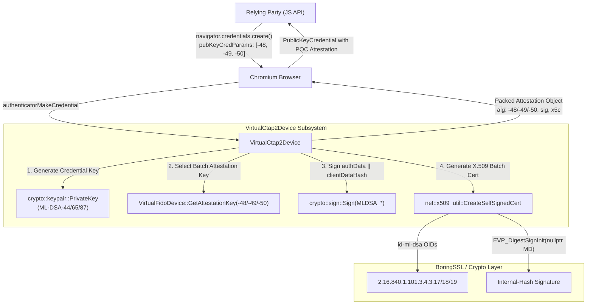

# RFC / Design Proposal: Post-Quantum Cryptography (PQC) Updates to Chromium Virtual Authenticator

**Status**: Proposed  
**Author**: Chromium WebAuthn / Identity Team  
**Subsystem**: `//device/fido`, `//content/browser/webauth`, `//net/cert`  
**Target Branch**: `feat/pqc-virtual-authenticator`  
**Tracking Issue**: CrBug / W3C WebAuthn Post-Quantum Alignment  

---

## 1. Executive Summary

As the cryptographic community transitions toward quantum-resistant algorithms (FIPS 204 / ML-DSA), the W3C WebAuthentication Working Group and the FIDO Alliance are drafting specifications to register and test Post-Quantum Cryptography (PQC) digital signature algorithms for WebAuthn credentials and CTAP2 authenticators.

This proposal specifies the design and implementation to enable full support for **COSE Algorithms -48 (ML-DSA-44), -49 (ML-DSA-65), and -50 (ML-DSA-87)** within Chromium's test authenticator framework (`VirtualCtap2Device` / `VirtualFidoDevice`), including **self-signed batch attestation certificate generation**.

This work is tracked in a dedicated local branch (`feat/pqc-virtual-authenticator`) separate from the WebAuthn Level 4 Make-Then-Confirm (`mtcDebug`) extension branch (`feat/webauthn-l4-mtc-debug`).

---

## 2. Background & Problem Statement

### 2.1 COSE Algorithm Identifiers for ML-DSA
The IANA COSE Algorithms Registry defines the following identifiers for Module-Lattice-Based Digital Signature Algorithm (FIPS 204):

| COSE Algorithm | Constant | Parameter Set | Security Category | Public Key Size | Signature Size |
|---|---|---|---|---|---|
| **`-48`** | `kMlDsa44` | ML-DSA-44 (Dilithium2) | NIST Level 2 | 1,312 bytes | 2,420 bytes |
| **`-49`** | `kMlDsa65` | ML-DSA-65 (Dilithium3) | NIST Level 3 | 1,952 bytes | 3,309 bytes |
| **`-50`** | `kMlDsa87` | ML-DSA-87 (Dilithium5) | NIST Level 5 | 2,592 bytes | 4,627 bytes |

### 2.2 Prior Gaps in Chromium's Test Authenticator
While Chromium’s low-level crypto wrapper ([`crypto::keypair::PrivateKey`](file:///Users/jbradley/.gemini/antigravity/scratch/chromium/src/crypto/keypair.h)) already supports generating ML-DSA keys via BoringSSL:
1. **Hardcoded Attestation Key**: `VirtualFidoDevice` relied on a static ECDSA P-256 key (`kAttestationKey`).
2. **Hardcoded Attestation Algorithm**: In `VirtualCtap2Device::DoMakeCredential`, attestation signatures were hardcoded to `ECDSA_SHA256` with `"alg": -7`.
3. **Inability to Generate ML-DSA X.509 Certificates**: `net::x509_util::CreateSelfSignedCert` only supported RSA and ECDSA OIDs. Because ML-DSA is a pure signature scheme with internal hashing, attempting to pass an external digest (`EVP_sha256()`) caused BoringSSL's `EVP_DigestSignInit` to fail.
4. **Default Advertised Algorithms**: `VirtualCtap2Device::Config::advertised_algorithms` only advertised `kEs256` by default.

---

## 3. Architecture & Technical Design



---

## 4. Detailed Implementation Changes

### 4.1 X.509 Certificate Generation (`//net/cert/x509_util.cc`)
1. **Register ML-DSA Object Identifiers (OIDs)**:
   - `id-ml-dsa-44`: `2.16.840.1.101.3.4.3.17` (`0x60, 0x86, 0x48, 0x01, 0x65, 0x03, 0x04, 0x03, 0x11`)
   - `id-ml-dsa-65`: `2.16.840.1.101.3.4.3.18` (`0x60, 0x86, 0x48, 0x01, 0x65, 0x03, 0x04, 0x03, 0x12`)
   - `id-ml-dsa-87`: `2.16.840.1.101.3.4.3.19` (`0x60, 0x86, 0x48, 0x01, 0x65, 0x03, 0x04, 0x03, 0x13`)
   - RFC 5280 parameters for ML-DSA must be omitted (`null_param = false`).

2. **Digest Handling for Pure Signatures**:
   For `EVP_PKEY_ML_DSA_*`, set `md = nullptr` in `EVP_DigestSignInit(ctx.get(), nullptr, md, nullptr, issuer_key)`.

### 4.2 Virtual FIDO Device Core (`//device/fido/virtual_fido_device.*`)
1. **Parameterized Batch Attestation Keys**:
   `VirtualFidoDevice::GetAttestationKey(CoseAlgorithmIdentifier algorithm)` generates and caches per-algorithm static test keys using `base::NoDestructor`:
   - `kMlDsa44Key` via `crypto::keypair::PrivateKey::GenerateMldsa44()`
   - `kMlDsa65Key` via `crypto::keypair::PrivateKey::GenerateMldsa65()`
   - `kMlDsa87Key` via `crypto::keypair::PrivateKey::GenerateMldsa87()`
   - `kAttestationKey` (ECDSA P-256) for `kEs256` and legacy fallbacks.

2. **Parameterized Attestation Certificate Generation**:
   `GenerateAttestationCertificate` forwards `algorithm` to select the corresponding private key and issue a certificate conforming to W3C WebAuthn §8.2 Packed Attestation requirements (subject `CN=Batch Certificate, OU=Authenticator Attestation, O=Chromium, C=US`).

### 4.3 Virtual CTAP2 Protocol Implementation (`//device/fido/virtual_ctap2_device.*`)
1. **Configuration**:
   - `Config::advertised_algorithms` defaults to `{kEs256, kMlDsa44, kMlDsa65, kMlDsa87}`.
   - `Config::batch_attestation_algorithm` allows tests to explicitly choose the attestation key algorithm, or automatically defaults to matching the credential algorithm.
2. **Signature Dispatch**:
   `DoMakeCredential` maps the chosen attestation algorithm to `crypto::sign::SignatureKind`:
   - `kMlDsa44` -> `crypto::sign::SignatureKind::MLDSA_44`
   - `kMlDsa65` -> `crypto::sign::SignatureKind::MLDSA_65`
   - `kMlDsa87` -> `crypto::sign::SignatureKind::MLDSA_87`
   - `kEs256` -> `crypto::sign::SignatureKind::ECDSA_SHA256`
3. **Response Attestation Map**:
   `ConstructMakeCredentialResponse` dynamically assigns `"alg": static_cast<int64_t>(attestation_algorithm)` instead of `-7`.

---

## 5. Branch & Version Control Strategy

To keep upstream contributions clean and modular:

```
origin/main
   │
   ├── feat/pqc-virtual-authenticator (THIS PROPOSAL)
   │      - net/cert/x509_util.cc (ML-DSA OIDs & pure signature support)
   │      - device/fido/virtual_fido_device.* (PQC batch attestation keys)
   │      - device/fido/virtual_ctap2_device.* (PQC packed attestation responses)
   │      - device/fido/virtual_ctap2_device_unittest.cc (Unit tests)
   │
   └── feat/webauthn-l4-mtc-debug (GENERAL MTC EXTENSION PROPOSAL)
          - WebAuthn Level 4 Make-Then-Confirm client extension
          - IDL, Blink bindings, and Mojo IPC for mtcDebug
```

Both branches remain completely decoupled and can be merged or cherry-picked independently.

---

## 6. Verification & Test Plan

1. **Automated Unit Testing** (`device_unittests`):
   - Add `TEST_F(VirtualCtap2DeviceTest, PostQuantumBatchAttestationIsValid)`:
     - Issues `MakeCredential` requests with algorithms `-48`, `-49`, and `-50`.
     - Validates that `"fmt": "packed"`.
     - Validates that `"alg"` matches the requested PQC algorithm.
     - Validates that `"x5c"` parses into a valid `net::X509Certificate`.
     - Verifies certificate subject, validity dates, and basicConstraints.
2. **End-to-End WPT (Web Platform Tests)**:
   - Verify browser-level WebAuthn APIs (`navigator.credentials.create({publicKey: {pubKeyCredParams: [{type: "public-key", alg: -48}]}})`).
