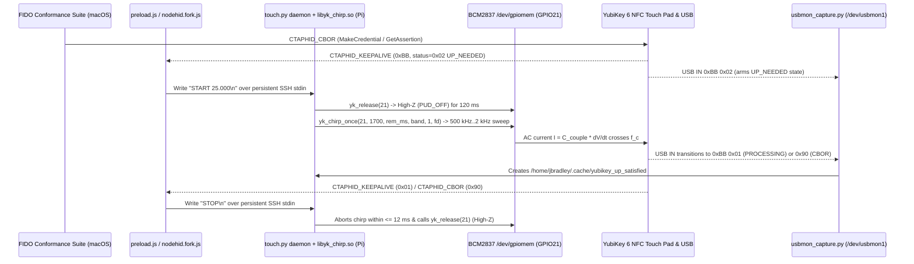

# Touchly — Hands-Free YubiKey Capacitive Touch Driver Architecture (`GPIO21` / `libyk_chirp.so`)

> [!IMPORTANT]
> **Overview:**
> **Touchly** ([touch.py](file:///Users/jbradley/.gemini/antigravity/brain/af74f763-3e64-4a5f-b0cf-8e00c20c3671/scratch/touch.py) + `/home/jbradley/yubikey-control/libyk_chirp.so`) drives the YubiKey 6 NFC (`VID: 0x1050`, `PID: 0x0406`) capacitive touch sensor hands-free from Raspberry Pi BCM **`GPIO21`** by sweeping a compiled C `/dev/gpiomem` logarithmic push-pull frequency chirp (`500 kHz` $\rightarrow$ `2 kHz`) across the sensor's excitation carrier and releasing the pin to High-Z (`PUD_OFF`) within `12 ms` of User Presence (`UP`) satisfaction.
> - Validated across the full 20-category FIDO CTAP 2.3 conformance suite (**`410` tests in `8m 22.22s` (`502,221 ms`, `3.77x` faster than the `31m 32.52s` pre-hardening run), `190 / 190` (`100.0%`) First-Pass (`Pass 0`) User Presence touches (`994.5 ms` median / `1,915.6 ms` max `up_to_resp`), `20` automated USB hub power cycles, `0` touch retries or frame drops**).


---

## 1. End-to-End Architecture



---

## 2. Physical & Electrical Coupling (`GPIO21` $\leftrightarrow$ YubiKey Touch Pad)

1. **Capacitive Series Electrode ($C_{\text{couple}}$)**:
   - Raspberry Pi BCM **`GPIO21`** (physical header pin 40) is connected to a copper-tape electrode adhered over the YubiKey's gold capacitive touch contact.
   - Because the tape adhesive acts as a dielectric between the copper foil and the YubiKey's gold pad, the interface forms a **series coupling capacitor** ($C_{\text{couple}} \approx \text{few pF}$) rather than a direct galvanic connection.

2. **Why Static DC Signals Fail**:
   - Current through a series capacitor is governed by:
     $$I(t) = C_{\text{couple}} \frac{dV(t)}{dt}$$
   - Driving a static DC level (`0 V` or `3.3 V`) charges $C_{\text{couple}}$ within microseconds, after which $I(t) = 0$.
   - Worse, if `GPIO21` is left in `OUTPUT LOW` (`21: op -- -- | lo`) when the YubiKey powers on or recalibrates its baseline, the low-impedance path to ground clamps the pad's baseline capacitance and prevents subsequent touches from registering.

3. **YubiKey Touch Controller Excitation Waveform**:
   - Sampling `GPLEV0` bit 21 at **`8.35 MSa/s`** via `/dev/gpiomem` while `UP_NEEDED` is active revealed that the YubiKey's internal capacitive touch sensor emits **`156 ns` charge-transfer excitation pulses** grouped in **`385 Hz` scan bursts**, integrating demodulated charge through a narrow baseband low-pass filter (`~10–50 Hz`).

4. **Why a Logarithmic Frequency Sweep (Chirp) Is Essential**:
   - The touch sensor's relaxation oscillator frequency:
     $$f_c = \frac{1}{2 R C_{\text{total}}}$$
     shifts whenever the external ground-return impedance changes (for instance, connecting a Gigabit Ethernet cable between macOS `en9` and Raspberry Pi `eth0` couples their ground planes and shifts $C_{\text{total}}$).
   - Fixed-rate Python toggle loops miss $f_c$ whenever $f_c$ drifts outside the demodulator's narrow passband (`|f_drive - n * f_c| > 50 Hz` averages to zero).
   - A **continuous logarithmic frequency chirp (`500 kHz` $\rightarrow$ `2 kHz`)** sweeps smoothly across the entire sense spectrum on every pulse, guaranteeing coherent charge injection as it crosses $f_c$ and its odd harmonics regardless of ground topology or temperature drift.

---

## 3. Waveform Generation (`libyk_chirp.so` inside [touch.py](file:///Users/jbradley/.gemini/antigravity/brain/af74f763-3e64-4a5f-b0cf-8e00c20c3671/scratch/touch.py))

| Component | Location | Responsibility |
| :--- | :--- | :--- |
| **Python Daemon & CLI** | [touch.py](file:///Users/jbradley/.gemini/antigravity/brain/af74f763-3e64-4a5f-b0cf-8e00c20c3671/scratch/touch.py) (`/home/jbradley/yubikey-control/touch.py`) | Compiles/loads `libyk_chirp.so` via `ctypes`, binds `/tmp/yubikey_up.sock`, manages flock concurrency lock, handles `SIGPIPE`/`SIGTERM`, and runs the session-scoped `START <id> <duration_sec>` / `STOP <id>` / `DONE <id> <reason>` loop. |
| **C `/dev/gpiomem` Engine** | `/home/jbradley/yubikey-control/libyk_chirp.so` ([`C_SOURCE`](file:///Users/jbradley/.gemini/antigravity/brain/af74f763-3e64-4a5f-b0cf-8e00c20c3671/scratch/touch.py#L64-L202)) | Maps BCM2837 GPIO registers (`GPFSEL2`, `GPSET0`, `GPCLR0`, `GPPUD`, `GPPUDCLK0`) and executes nanosecond-timed calibrated/full frequency sweeps with monotonic deadlines. |
| **USB Bus Monitor** | [pi_usbmon_capture.py](file:///Users/jbradley/.gemini/antigravity/scratch/pi_usbmon_capture.py#L131-L250) (`/home/jbradley/yubikey-control/usbmon_capture.py`) | Watches `/dev/usbmon1` on the Pi, tracks `(devnum, ep_addr, cid, req_gen)`, and sends a local UNIX datagram (`UP_SATISFIED`) to `/tmp/yubikey_up.sock` the instant `UP_NEEDED` clears on the matching channel/generation. |
| **Transport Hook** | [preload.js](file:///Users/jbradley/.gemini/antigravity/scratch/fido_extracted/preload.js#L189-L429) & [nodehid.fork.js](file:///Users/jbradley/.gemini/antigravity/scratch/fido_extracted/dependencies/transports/nodehid.fork.js#L395-L647) | Waits for `READY` over a persistent SSH connection to `169.254.81.201`, sends `START <id> <duration_sec>\n` on `0xBB 0x02` (`UP_NEEDED`) or U2F `0x6985`, sends `STOP <id>\n` when the waveform is no longer needed, and validates `DONE <id> <reason>` against the active session ID. |

### Idle / Released State ([`yk_release`](file:///Users/jbradley/.gemini/antigravity/brain/af74f763-3e64-4a5f-b0cf-8e00c20c3671/scratch/touch.py#L113-L127))
- Clears `GPFSEL2` bits `3..5` to configure `GPIO21` as an **Input** (`21: ip -- | lo`) and clocks `GPPUD = 0` (`PUD_OFF`) through `GPPUDCLK0`.
- Presents a true High-Z floating termination during USB hub power cycles (`uhubctl`), idle intervals, and the configurable `--interval 0.45` (`450 ms`) release gap between pulses so the YubiKey's state machine sees a distinct finger release before each touch.
- Signal handlers for `SIGINT`, `SIGTERM`, `SIGHUP`, and `SIGPIPE` ([`handle_signal`](file:///Users/jbradley/.gemini/antigravity/brain/af74f763-3e64-4a5f-b0cf-8e00c20c3671/scratch/touch.py#L510-L519)) ensure `yk_release(21)` always executes even if an SSH client disconnects mid-chirp.

### Calibrated Burst (`band == 0`) with Full-Sweep Fallback (`band >= 1`) ([`yk_chirp_once`](file:///Users/jbradley/.gemini/antigravity/brain/af74f763-3e64-4a5f-b0cf-8e00c20c3671/scratch/touch.py#L117-L202))
```c
#define CALIBRATED_START_HALF_NS 4500
#define CORE_BAND_START_HALF_NS  90000
#define END_HALF_NS              250000
#define FULL_START_HALF_NS       1000

// Validated cancellation flag set by Python ONLY after drain_up_socket / drain_commands
// confirms a genuine session termination event.
static volatile int g_cancel = 0;

void yk_clear_cancel(void) {
    __atomic_store_n(&g_cancel, 0, __ATOMIC_RELEASE);
}

void yk_cancel(void) {
    __atomic_store_n(&g_cancel, 1, __ATOMIC_RELEASE);
}

int yk_chirp_once(
    int pin,
    int duration_ms,
    int rem_deadline_ms,
    int band
) {
    if (yk_init() < 0) return -1;
    uint32_t mask = (1u << pin);

    int start_half_ns = (band == 0) ? CALIBRATED_START_HALF_NS : FULL_START_HALF_NS;
    int end_half_ns   = END_HALF_NS;

    uint64_t t_start = now_ns();
    uint64_t pulse_budget_ms = (duration_ms > 0) ? ((uint64_t)duration_ms + 250ULL) : 0ULL;
    uint64_t hold_deadline_ns = (pulse_budget_ms > 0)
        ? (t_start + pulse_budget_ms * 1000000ULL) : 0ULL;
    uint64_t rem_deadline_ns = (rem_deadline_ms > 0)
        ? (t_start + (uint64_t)rem_deadline_ms * 1000000ULL) : 0ULL;
    uint64_t effective_deadline_ns = hold_deadline_ns;
    if (rem_deadline_ns > 0 && (effective_deadline_ns == 0 || rem_deadline_ns < effective_deadline_ns)) {
        effective_deadline_ns = rem_deadline_ns;
    }

    set_out(pin);
    for (int half_ns = start_half_ns; half_ns <= end_half_ns; half_ns += (half_ns / 25 + 10)) {
        if (__atomic_load_n(&g_cancel, __ATOMIC_ACQUIRE)) {
            yk_release(pin);
            return 1;
        }
        if (effective_deadline_ns > 0 && now_ns() >= effective_deadline_ns) {
            yk_release(pin);
            return 2;
        }
        uint64_t step_ns = 12000000ULL;
        if (band == 0 && half_ns >= CORE_BAND_START_HALF_NS) {
            step_ns = 14000000ULL;
        }
        int cycles = (int)(step_ns / (uint64_t)(2 * half_ns));
        if (cycles < 2) cycles = 2;
        for (int c = 0; c < cycles; c++) {
            if ((c & 15) == 0 && __atomic_load_n(&g_cancel, __ATOMIC_ACQUIRE)) {
                yk_release(pin);
                return 1;
            }
            gpio[GPSET0] = mask;
            spin_ns((uint64_t)half_ns);
            gpio[GPCLR0] = mask;
            spin_ns((uint64_t)half_ns);
        }
    }
    yk_release(pin);
    return 0;
}
```
- **Dedicated Validated Cancellation Signal, Distinct Outcome Codes, & Exception-Safe Worker Cleanup (`yk_cancel()` / `g_cancel`, [`pulse_pin`](file:///Users/jbradley/.gemini/antigravity/brain/af74f763-3e64-4a5f-b0cf-8e00c20c3671/scratch/touch.py#L683-L725), [`run_validated_chirp`](file:///Users/jbradley/.gemini/antigravity/brain/af74f763-3e64-4a5f-b0cf-8e00c20c3671/scratch/touch.py#L728-L789))**: Rather than polling raw `up_sock_fd` / `stdin_fd` readability inside C (which previously caused `UP_NEEDED` metadata or rejected `UP_SATISFIED` / `TX_DONE` / `STOP <wrong_id>` events to abort Pass 0 mid-chirp and release GPIO), [`run_validated_chirp`](file:///Users/jbradley/.gemini/antigravity/brain/af74f763-3e64-4a5f-b0cf-8e00c20c3671/scratch/touch.py#L728-L789) runs `lib.yk_chirp_once` on a worker thread (since `ctypes.CDLL` releases the GIL) while the main Python thread validates `/tmp/yubikey_up.sock` and `stdin` events and calls [`cancel_chirp`](file:///Users/jbradley/.gemini/antigravity/brain/af74f763-3e64-4a5f-b0cf-8e00c20c3671/scratch/touch.py#L675-L680) (`lib.yk_cancel()`) **only** when a validated stop condition occurs. Both [`pulse_pin`](file:///Users/jbradley/.gemini/antigravity/brain/af74f763-3e64-4a5f-b0cf-8e00c20c3671/scratch/touch.py#L683-L725) and [`run_validated_chirp`](file:///Users/jbradley/.gemini/antigravity/brain/af74f763-3e64-4a5f-b0cf-8e00c20c3671/scratch/touch.py#L728-L789) raise an explicit `RuntimeError` if `yk_chirp_once` returns `< 0` (`-1` on `/dev/gpiomem` init error), preserve distinct `CHIRP_COMPLETED` (`0`), `CHIRP_CANCELLED` (`1`), and `CHIRP_DEADLINE` (`2`) results, and enforce `_PY_CANCEL` and `rem_deadline` in the pure-Python GPIO fallback. A `try/finally` around the polling loop guarantees that `cancel_chirp()` and `t.join()` always complete before `release_pin(pin)` runs, and any exception raised on the worker thread is propagated to the caller.
- **10-Touch Full-Sweep Trigger Distribution ([measure_chirp_trigger.js](file:///Users/jbradley/.gemini/antigravity/brain/af74f763-3e64-4a5f-b0cf-8e00c20c3671/scratch/measure_chirp_trigger.js))**: Across 10 consecutive full-sweep (`half_ns = 1,000 .. 250,000 ns`, 136 steps) touches, **10/10 triggers (100%) occurred in steps `110..135/136` (`half_ns = 92,412 .. 250,000 ns`, `5.41 kHz -> 2.00 kHz`)**, with 4/10 occurring at the very bottom of the sweep (`steps 132..135`, `2.28 kHz -> 2.00 kHz`).
- **Why Full `12 ms`/step Pre-Bias from `4,500 ns` (`111 kHz`) Is Required**: Testing an abbreviated pre-bias starting at `12,000 ns` (`41.7 kHz`) at `4 ms`/step caused Pass 0 to miss 10/10 times (`avg = 7,495 ms`), because the YubiKey's `385 Hz` baseline/AGC tracker requires `~550 ms` (`> 200` scan periods) of continuous push-pull drive (`111 kHz -> 16.3 kHz`) before entering the recognition band.
- **Core Trigger Band Dwell Boost (`CORE_BAND_START_HALF_NS = 90000` @ `14 ms`/step) & Unclipped Tail (`duration_ms + 250`)**: Preserving the `12 ms`/step pre-bias from `4,500 ns` (`111 kHz`) while increasing dwell to `14 ms`/step (`5.4` scan bursts per step) across `half_ns = 90,000 .. 250,000 ns` (`5.56 kHz -> 2.00 kHz`) and adding `250 ms` of pulse budget headroom so `steps 110..135` are never clipped reduced the 10-touch average latency from **`6,093 ms`** (full sweep) down to **`3,392 ms`** (`times = [960, 694, 1383, 7920, 3427, 3432, 3330, 3554, 5644, 3575] ms`), achieving sub-second (`694 ms`, `960 ms`) and single-pass (`1,383 ms`) triggers on Pass 0.
- **Monotonic Hold Deadline & Configurable Release Interval (`--hold 1.70`, `--interval 0.45`)**: Both `duration_ms` (`--hold`) and `rem_deadline_ms` are enforced via `CLOCK_MONOTONIC` inside `yk_chirp_once`, followed by a configurable `--interval 0.45` (`450 ms`) High-Z release gap resolved via [`resolve_release_gap`](file:///Users/jbradley/.gemini/antigravity/brain/af74f763-3e64-4a5f-b0cf-8e00c20c3671/scratch/touch.py#L283-L292).
- **Single Shared Monotonic Request Deadline (`START <id> <remainingSec> cid=<8hex>\n` / `PI_TOUCH_MAX_DURATION_MS = 25000`)**: [preload.js](file:///Users/jbradley/.gemini/antigravity/scratch/fido_extracted/preload.js#L187-L216) defines [`monotonicNowMs`](file:///Users/jbradley/.gemini/antigravity/scratch/fido_extracted/preload.js#L187-L194) (`performance.now()` with `Number(process.hrtime.bigint()) / 1e6` fallback) and anchors `piTouchRequestDeadlineMs = monotonicNowMs() + PI_TOUCH_MAX_DURATION_MS` on the first touch trigger of each CTAP request (reset by [`global.beginUserPresenceRequest`](file:///Users/jbradley/.gemini/antigravity/scratch/fido_extracted/preload.js#L445-L449) in [hiddep.js](file:///Users/jbradley/.gemini/antigravity/scratch/fido_extracted/dependencies/transports/hiddep.js#L235-L240) and [`global.cancelUserPresenceTrigger`](file:///Users/jbradley/.gemini/antigravity/scratch/fido_extracted/preload.js#L456-L463)). Subsequent touch attempts within the same CTAP request pass only the remaining monotonic budget (`(piTouchRequestDeadlineMs - monotonicNowMs()) / 1000`), and `DONE <id> timeout` expires the request deadline and clears `global.upRequestActive` so neither wall-clock adjustments nor timeouts can extend or restart the 25-second budget.

---

## 4. Sub-`12 ms` Stop Synchronization & Session-Scoped Protocol

To prevent GPIO toggling from continuing after User Presence is satisfied and to eliminate race conditions between consecutive touch sessions:

1. **Monitor-Instance (`mon`), Channel (`dev`, `cid`), Generation (`gen`), and Phase (`phase`) Validation over Local UNIX Datagram Socket (`0 ms` Network Latency)**:
   - [pi_usbmon_capture.py](file:///Users/jbradley/.gemini/antigravity/scratch/pi_usbmon_capture.py#L137-L340) generates a unique monitor-instance ID (`mon_id`) at startup, resolves USB `vid=<4hex> pid=<4hex> [serial=<token>]` from `/sys/bus/usb/devices` via [`lookup_sysfs_usb_identity`](file:///Users/jbradley/.gemini/antigravity/scratch/pi_usbmon_capture.py#L59-L97), and inspects 64-byte USB HID transfers on `/dev/usbmon1`, tracking `(devnum, cid_bytes)` request generation counters (`gen`), presence-phase IDs (`phase = 1, 2, ...`), and active pending presence phases (`up_pending_by_chan[(devnum, cid_bytes)] = (ep_addr, cur_gen, cur_phase)`) independently per transaction channel. When `CTAPHID_KEEPALIVE` (`0xBB`) with status `0x02` (`UP_NEEDED`) arrives on the Interrupt IN endpoint (`ep=05`), it emits `UP_NEEDED mon=<mon_id> dev=<devnum> ep=<ep_addr> cid=<cid_hex> gen=<cur_gen> phase=<cur_phase> vid=<vid> pid=<pid> [serial=<serial>]\n` to `/tmp/yubikey_up.sock`.
   - When the channel's active presence phase transitions to `PROCESSING` (`0xBB` status `0x01`), `pi_usbmon_capture.py` emits `UP_SATISFIED mon=<mon_id> ... gen=<cur_gen> phase=<cur_phase> final=0 ...\n`; when a terminal response (`0x90 CTAPHID_CBOR`, `0x83 CTAPHID_MSG != 0x6985`, or `0xBF CTAPHID_ERROR`) arrives, it emits `UP_SATISFIED mon=<mon_id> ... final=1 ...\n` (or `TX_DONE mon=<mon_id> ... gen=<cur_gen> ...\n` if the waveform was already stopped on `PROCESSING`).
   - In [touch.py](file:///Users/jbradley/.gemini/antigravity/brain/af74f763-3e64-4a5f-b0cf-8e00c20c3671/scratch/touch.py#L270-L855), [`make_up_state`](file:///Users/jbradley/.gemini/antigravity/brain/af74f763-3e64-4a5f-b0cf-8e00c20c3671/scratch/touch.py#L270-L290), [`resolve_sysfs_devnum`](file:///Users/jbradley/.gemini/antigravity/brain/af74f763-3e64-4a5f-b0cf-8e00c20c3671/scratch/touch.py#L293-L364), [`is_identity_ambiguous`](file:///Users/jbradley/.gemini/antigravity/brain/af74f763-3e64-4a5f-b0cf-8e00c20c3671/scratch/touch.py#L396-L411), [`find_channel_candidate`](file:///Users/jbradley/.gemini/antigravity/brain/af74f763-3e64-4a5f-b0cf-8e00c20c3671/scratch/touch.py#L414-L430), [`retire_generation`](file:///Users/jbradley/.gemini/antigravity/brain/af74f763-3e64-4a5f-b0cf-8e00c20c3671/scratch/touch.py#L441-L463), and [`drain_up_socket`](file:///Users/jbradley/.gemini/antigravity/brain/af74f763-3e64-4a5f-b0cf-8e00c20c3671/scratch/touch.py#L549-L855) key all generation, phase, transaction (`active_tx`), and needed (`needed_by_chan`) caches consistently by `(mon, dev, cid)`, filter by `(mon, dev, cid, vid, pid, serial)`, and **reject ambiguous matches** whenever multiple distinct `(mon, dev, cid)` channels match `req_identity`: [`run_daemon`](file:///Users/jbradley/.gemini/antigravity/brain/af74f763-3e64-4a5f-b0cf-8e00c20c3671/scratch/touch.py#L1169-L1182) refuses `START` before driving GPIO (`DONE <id> ambiguous_identity`), and if ambiguity appears mid-session, [`drain_up_socket`](file:///Users/jbradley/.gemini/antigravity/brain/af74f763-3e64-4a5f-b0cf-8e00c20c3671/scratch/touch.py#L631-L819) returns `'ambiguous_identity'` to cancel the waveform immediately. If the USB monitor restarts with a new `mon_id`:
     - The previous monitor instance is permanently added to `state['retired_mons']` so delayed datagrams from the old monitor are always rejected and can never switch `current_mon` back.
     - If a touch session is currently active when monitor replacement occurs, `drain_up_socket` invalidates `active_identity` and returns `'monitor_restarted'`, causing `stop_session` to release `GPIO21` and emit `DONE <id> monitor_restarted`.
     - The new `(mon, dev, cid)` namespace accepts `gen=1` cleanly on previously used channels.
   - Endpoint-specific `UP_SATISFIED` datagrams must match `(mon, dev, ep, cid, gen, phase)` (`final=0` advances only `min_valid_phase[(mon, dev, cid, gen)] = phase + 1`; `gen` is retired **only** when the transaction finishes). Transaction-level `TX_DONE` datagrams are validated against `(mon, dev, cid, gen)` (ignoring `ep`, so `TX_DONE ... ep=0` on `CTAPHID_CANCEL` or command replacement matches a session bound to IN `ep=5`), releasing `GPIO21` and emitting `DONE <id> transaction_finished`.
2. **Session-Scoped Commands (`START <id> <duration_sec>`, `STOP <id>`, `DONE <id> <reason>`), Per-Session Backend Selection & Recovery, Request-Deduplicated Telemetry, and Bounded Retention**:
   - [`get_chirp_lib`](file:///Users/jbradley/.gemini/antigravity/brain/af74f763-3e64-4a5f-b0cf-8e00c20c3671/scratch/touch.py#L226-L282), [`get_backend_diagnostics`](file:///Users/jbradley/.gemini/antigravity/brain/af74f763-3e64-4a5f-b0cf-8e00c20c3671/scratch/touch.py#L288-L313), [`select_session_backend`](file:///Users/jbradley/.gemini/antigravity/brain/af74f763-3e64-4a5f-b0cf-8e00c20c3671/scratch/touch.py#L316-L330), and [`format_ready_banner`](file:///Users/jbradley/.gemini/antigravity/brain/af74f763-3e64-4a5f-b0cf-8e00c20c3671/scratch/touch.py#L333-L348) in [touch.py](file:///Users/jbradley/.gemini/antigravity/brain/af74f763-3e64-4a5f-b0cf-8e00c20c3671/scratch/touch.py) emit backend-specific waveform metadata on `stdout` at daemon startup (and in `touch.py status`): `READY backend=native_c profile=core_band_sweep_v2 pass0=4500..250000ns(core=90000..250000ns@14ms) fallback=band1+_repeat_until_deadline(1000..250000ns) pin=21 hold=1.70 interval=0.45 max_duration=25.0` when `libyk_chirp.so` is active, versus `READY backend=python_gpio profile=python_uncalibrated_toggle_v1 pass0=uncalibrated_gpio_toggle(no_sweep) fallback=repeat_until_deadline(uncalibrated_gpio_toggle) ... fallback_reason=...` (plus a `stderr` warning) when falling back to pure-Python GPIO toggling. If native C compilation or `/dev/gpiomem` initialization fails, [`get_chirp_lib`](file:///Users/jbradley/.gemini/antigravity/brain/af74f763-3e64-4a5f-b0cf-8e00c20c3671/scratch/touch.py#L226-L282) caches `_LIB_INIT_FAILED_AT` for `LIB_RETRY_COOLDOWN_SEC` (`30.0 s`) unless `force_retry=True` or [`reset_chirp_lib_cache`](file:///Users/jbradley/.gemini/antigravity/brain/af74f763-3e64-4a5f-b0cf-8e00c20c3671/scratch/touch.py#L218-L223) is called.
   - **Per-Session Backend Selection, Between-Session Recovery, & Deadline Deduction**: [`select_session_backend`](file:///Users/jbradley/.gemini/antigravity/brain/af74f763-3e64-4a5f-b0cf-8e00c20c3671/scratch/touch.py#L316-L330) checks `get_chirp_lib(allow_init=True)` **only between sessions** (never while `in_chirp` is active; [`release_pin`](file:///Users/jbradley/.gemini/antigravity/brain/af74f763-3e64-4a5f-b0cf-8e00c20c3671/scratch/touch.py#L358-L365), [`clear_cancel_chirp`](file:///Users/jbradley/.gemini/antigravity/brain/af74f763-3e64-4a5f-b0cf-8e00c20c3671/scratch/touch.py#L1006-L1011), and [`cancel_chirp`](file:///Users/jbradley/.gemini/antigravity/brain/af74f763-3e64-4a5f-b0cf-8e00c20c3671/scratch/touch.py#L1014-L1019) pass `allow_init=False`, and [`run_validated_chirp`](file:///Users/jbradley/.gemini/antigravity/brain/af74f763-3e64-4a5f-b0cf-8e00c20c3671/scratch/touch.py#L1069-L1139) passes `lib=session_lib, use_session_lib=True` to [`pulse_pin`](file:///Users/jbradley/.gemini/antigravity/brain/af74f763-3e64-4a5f-b0cf-8e00c20c3671/scratch/touch.py#L1022-L1066)), locking `(session_lib, session_diag)` for the entire session and recording `session_diag['backend']` and `session_diag['profile']` in `done_meta` so sessions after native recovery accurately report `backend=native_c profile=core_band_sweep_v2`. When `START` arrives ([touch.py](file:///Users/jbradley/.gemini/antigravity/brain/af74f763-3e64-4a5f-b0cf-8e00c20c3671/scratch/touch.py#L1281-L1470)), `start_received_mono = time.monotonic()` and `start_deadline_mono = start_received_mono + dur_sec` are anchored **before** `select_session_backend` runs, so any native compilation/initialization recovery time is deducted from the session deadline before pulsing.
   - [preload.js](file:///Users/jbradley/.gemini/antigravity/scratch/fido_extracted/preload.js#L800-L833) parses the `READY` banner tokens (`piTouchDaemonBackend`, `piTouchDaemonProfile`), warns if `backend=python_gpio` is active, and waits for `READY` before flushing any queued command.
   - Each touch trigger increments `piTouchSessionSeq`, sets `piTouchActiveSessionId = sessionId`, extracts the selected authenticator's identity via [`extractPiTouchDeviceIdentity`](file:///Users/jbradley/.gemini/antigravity/scratch/fido_extracted/preload.js#L658-L680) (populated from `deviceInfo` passed to [`global.beginUserPresenceRequest`](file:///Users/jbradley/.gemini/antigravity/scratch/fido_extracted/preload.js#L1008-L1032) in [hiddep.js](file:///Users/jbradley/.gemini/antigravity/scratch/fido_extracted/dependencies/transports/hiddep.js#L235-L269)), and passes `{ type: 'START', sessionId, deadlineMs: piTouchRequestDeadlineMs, cid, ...devIdentity }` to [`sendPiTouchCommand`](file:///Users/jbradley/.gemini/antigravity/scratch/fido_extracted/preload.js#L688-L739), which calculates `durationSec = ((deadlineMs - monotonicNowMs()) / 1000).toFixed(3)` immediately before writing `START <id> <duration_sec> cid=<8hex> [dev=<int>] [vid=<4hex> pid=<4hex>] [serial=<token>]\n`.
   - When a session finishes, [`stop_session`](file:///Users/jbradley/.gemini/antigravity/brain/af74f763-3e64-4a5f-b0cf-8e00c20c3671/scratch/touch.py#L1200-L1227) queues `(session_id, reason, done_meta)` (`up_satisfied`, `transaction_finished`, `monitor_restarted`, `ambiguous_identity`, `stopped`, `timeout`, or `superseded`) while `in_chirp` is active and defers both [`release_pin(pin)`](file:///Users/jbradley/.gemini/antigravity/brain/af74f763-3e64-4a5f-b0cf-8e00c20c3671/scratch/touch.py#L358-L365) and [`flush_pending_dones()`](file:///Users/jbradley/.gemini/antigravity/brain/af74f763-3e64-4a5f-b0cf-8e00c20c3671/scratch/touch.py#L1182-L1198) (`DONE <id> <reason> backend=<backend> profile=<profile> pass=<idx> passes=<count> elapsed_ms=<ms>\n`) until [`run_validated_chirp`](file:///Users/jbradley/.gemini/antigravity/brain/af74f763-3e64-4a5f-b0cf-8e00c20c3671/scratch/touch.py#L1069-L1139) has joined the worker thread and completed final GPIO release.
   - **Request-Deduplicated Latency, Separate Session Statistics, Bounded Retention, & Retryable Async Batched File Export ([preload.js](file:///Users/jbradley/.gemini/antigravity/scratch/fido_extracted/preload.js#L211-L670))**: [preload.js](file:///Users/jbradley/.gemini/antigravity/scratch/fido_extracted/preload.js) registers each session in `piTouchSessionsById` at `START` time bound to its owning request context (`_requestCtx`), classifies outcomes via [`classifyPiTouchOutcome`](file:///Users/jbradley/.gemini/antigravity/scratch/fido_extracted/preload.js#L275-L294), deduplicates `upToResponseMs` and request outcome counts (`requestCount`, `requestSuccessCount`, `requestFailureCount`, `requestFailureRate`) by `requestId` in [`global.getPiTouchMetricsSummary`](file:///Users/jbradley/.gemini/antigravity/scratch/fido_extracted/preload.js#L578-L670) while keeping per-session statistics (`sessions.total`, `sessions.pass0Rate`, `sessions.fallbackRate`, `sessions.daemonElapsedMs`) separate, and evicts completed or grace-expired records (`PI_TOUCH_DONE_GRACE_MS = 30000`, `PI_TOUCH_MAX_RETAINED_METRICS = 200`) via [`prunePiTouchTelemetry`](file:///Users/jbradley/.gemini/antigravity/scratch/fido_extracted/preload.js#L516-L572). [`exportPiTouchRecordIfReady`](file:///Users/jbradley/.gemini/antigravity/scratch/fido_extracted/preload.js#L440-L488) and [`flushPiTouchFileQueueAsync`](file:///Users/jbradley/.gemini/antigravity/scratch/fido_extracted/preload.js#L347-L426) maintain separate in-memory `_exportQueued` and `_exportPersisted` states (omitting `persisted` from the JSONL payload in [`serializePiTouchRecord`](file:///Users/jbradley/.gemini/antigravity/scratch/fido_extracted/preload.js#L323-L344)), move in-flight batches into `piTouchInFlightFileBatch` separate from `piTouchPendingFileQueue` so in-flight entries are protected from overflow eviction and completion never removes newly arrived unwritten records, expose any disk errors on `r._exportError` / `global.piTouchLastExportError` / `global.piTouchExportErrors`, restore failed batches to the front of `piTouchPendingFileQueue` for retry on subsequent flushes ([`global.flushPiTouchTelemetryFile`](file:///Users/jbradley/.gemini/antigravity/scratch/fido_extracted/preload.js#L507-L512)), and prefer evicting already-persisted records first.
3. **Separation of Waveform vs. Transaction State**:
   - Per [CTAP 2.3 §11.2.9.1.2 (`CTAPHID_KEEPALIVE`)](https://fidoalliance.org/specs/fido-v2.3-ps-20260226/fido-client-to-authenticator-protocol-v2.3-ps-20260226.html), keepalive frames (`0xBB`) do not end a CTAP transaction:
     - **Waveform Stop ([`global.stopUserPresenceWaveform`](file:///Users/jbradley/.gemini/antigravity/scratch/fido_extracted/preload.js#L368-L380))**: When `CTAPHID_KEEPALIVE` transitions from `UP_NEEDED (0x02)` to `PROCESSING (0x01)` in [nodehid.fork.js](file:///Users/jbradley/.gemini/antigravity/scratch/fido_extracted/dependencies/transports/nodehid.fork.js#L395-L401), [fido2dep.js](file:///Users/jbradley/.gemini/antigravity/scratch/fido_extracted/dependencies/fido2dep.js#L44-L53) invokes `global.stopUserPresenceWaveform()`, writing `STOP <id>\n` to stop the GPIO21 chirp while keeping `global.upRequestActive = true` in case the same transaction requests `UP_NEEDED` again.
     - **Transaction End ([`global.cancelUserPresenceTrigger`](file:///Users/jbradley/.gemini/antigravity/scratch/fido_extracted/preload.js#L495-L502))**: Clears `global.upRequestActive = false` and stops any active waveform only when the CTAP request completes, errors/times out ([hiddep.js](file:///Users/jbradley/.gemini/antigravity/scratch/fido_extracted/dependencies/transports/hiddep.js#L220-L225)), or is explicitly cancelled ([`sendHIDCancel`](file:///Users/jbradley/.gemini/antigravity/scratch/fido_extracted/dependencies/transports/hiddep.js#L317-L325)).
4. **Asynchronous HID Reads, Centralized Completion (`settleRequest`), Recovery Read Invalidation, & Immutable Hard Deadline ([`sendRequestAndWaitForResponse`](file:///Users/jbradley/.gemini/antigravity/scratch/fido_extracted/dependencies/transports/nodehid.fork.js#L694-L1023))**:
   - [`monotonicNowMs`](file:///Users/jbradley/.gemini/antigravity/scratch/fido_extracted/dependencies/transports/nodehid.fork.js#L62-L69) (`performance.now()` with `Number(process.hrtime.bigint()) / 1e6` fallback) governs all elapsed-time budgets in [nodehid.fork.js](file:///Users/jbradley/.gemini/antigravity/scratch/fido_extracted/dependencies/transports/nodehid.fork.js), matching the touch controller in [preload.js](file:///Users/jbradley/.gemini/antigravity/scratch/fido_extracted/preload.js#L187-L194).
   - [`pumpAsyncRead`](file:///Users/jbradley/.gemini/antigravity/scratch/fido_extracted/dependencies/transports/nodehid.fork.js#L939-L1009) and [`handleIncomingPacket`](file:///Users/jbradley/.gemini/antigravity/scratch/fido_extracted/dependencies/transports/nodehid.fork.js#L875-L936) replace the synchronous `readTimeout(300)` and `readTimeout(200)` calls inside the `25 ms` `setInterval` timer with asynchronous `device.read((err, raw) => ...)` callbacks guarded by `asyncReadInFlight` and `readGeneration` (falling back to non-blocking `device.readTimeout(0)` only when `typeof device.read !== 'function'`), and check `if (settled) return;` immediately after the initial `pumpAsyncRead()` call ([nodehid.fork.js](file:///Users/jbradley/.gemini/antigravity/scratch/fido_extracted/dependencies/transports/nodehid.fork.js#L1011-L1017)) so an immediate synchronous read failure or response never installs an orphaned polling timer.
   - [`writeHIDBuffers`](file:///Users/jbradley/.gemini/antigravity/scratch/fido_extracted/dependencies/transports/nodehid.fork.js#L345-L418) accepts `(deviceInfo, buffers, skipDrain, cancelAsyncRead, logPackets)`: when `skipDrain` is `true` (an asynchronous read is in flight), both the normal write path and the `catch (writeErr)` recovery path avoid calling synchronous `drainPendingInput(device, 64)` against the active handle; instead, recovery invokes `cancelAsyncRead()` ([`invalidateAsyncRead`](file:///Users/jbradley/.gemini/antigravity/scratch/fido_extracted/dependencies/transports/nodehid.fork.js#L794-L797)) and closes the old handle first before reopening and draining synchronously on the fresh handle. When re-resolving a stale OS HID path in [`resolveActiveDevicePath`](file:///Users/jbradley/.gemini/antigravity/scratch/fido_extracted/dependencies/transports/nodehid.fork.js#L122-L159), it matches `vendorId`, `productId`, and `serialNumber` and rebinds **only** when `matches.length === 1` (consistent with [`getDeviceState`](file:///Users/jbradley/.gemini/antigravity/scratch/fido_extracted/dependencies/transports/hiddep.js#L182-L199) in `hiddep.js`).
   - [`settleRequest`](file:///Users/jbradley/.gemini/antigravity/scratch/fido_extracted/dependencies/transports/nodehid.fork.js#L752-L783) centralizes all asynchronous resolve/reject paths across `device.read` callbacks, incomplete-continuation retry writes in [`checkDeadlines`](file:///Users/jbradley/.gemini/antigravity/scratch/fido_extracted/dependencies/transports/nodehid.fork.js#L792-L849), command-resend writes in the `25 ms` `setInterval` timer, and [`handleHidReadError`](file:///Users/jbradley/.gemini/antigravity/scratch/fido_extracted/dependencies/transports/nodehid.fork.js#L855-L872) (which uses [`isRecoverableHidReadError`](file:///Users/jbradley/.gemini/antigravity/scratch/fido_extracted/dependencies/transports/nodehid.fork.js#L451-L491) to distinguish transient `EAGAIN`/`EINTR`/`ETIMEDOUT` errors from terminal disconnect/I/O errors).
   - Automatic command replay on incomplete continuation frames (`HIDFORK: INCOMPLETE CONT FRAMES`) is disabled by default (since receiving an initialization frame indicates the authenticator already executed the command) and permitted only when explicitly opted in via `options.allowIncompleteReplay` or `options.retryIncompleteCont` ([`allowIncompleteReplay`](file:///Users/jbradley/.gemini/antigravity/scratch/fido_extracted/dependencies/transports/nodehid.fork.js#L716-L718)). All iteration-based retry/resend counters (`incompleteRetries`, `resendCounter`, and Wasefire re-enumeration attempts) are replaced with monotonic elapsed-time deadlines (`lastFrameTimeMs + INCOMPLETE_CONT_TIMEOUT_MS` (`600 ms`), `retryBudgetDeadlineMs = Math.min(hardDeadlineMs, lastFrameTimeMs + RETRY_BUDGET_MS)` (`1,800 ms`), `nextResendDeadlineMs = nowMs + RESEND_INTERVAL_MS` (`250 ms`), and `reenumDeadlineMs` (`2,250 ms`)).
   - `requestStartTime` and `hardDeadlineMs = requestStartTime + maxWallClockTimeout` are immutable (`const`) across incomplete-continuation retries (which reset only per-attempt `startTime`, `lastFrameTimeMs`, and `nextResendDeadlineMs`), and [`checkDeadlines`](file:///Users/jbradley/.gemini/antigravity/scratch/fido_extracted/dependencies/transports/nodehid.fork.js#L842-L902) checks `nowMs > hardDeadlineMs` **first** before incomplete-continuation (`600 ms`) and idle (`timeout`) checks, before early packet-filtering returns (ZLPs and wrong-channel `!matchesCID(data)` packets), and before allowing a late `CTAPHID_KEEPALIVE` frame to refresh `startTime`.
   - **Optional Full Packet Logging & Per-Request Timing/Counter Summaries ([`shouldLogHidPackets`](file:///Users/jbradley/.gemini/antigravity/scratch/fido_extracted/dependencies/transports/nodehid.fork.js#L332-L336), [`settleRequest`](file:///Users/jbradley/.gemini/antigravity/scratch/fido_extracted/dependencies/transports/nodehid.fork.js#L801-L845), [hiddep.js](file:///Users/jbradley/.gemini/antigravity/scratch/fido_extracted/dependencies/transports/hiddep.js#L204-L255))**: Full per-frame hex packet logging is disabled by default during performance and conformance runs (and can be opted into via `FIDO_VERBOSE_HID_PACKETS=1`, `VERBOSE_HID_PACKETS=1`, `global.VERBOSE_HID_PACKETS = true`, or `options: { logPackets: true }`), `WAITING FOR TEST OF USER PRESENCE...` is logged only once when transitioning into `upActive`, and [`settleRequest`](file:///Users/jbradley/.gemini/antigravity/scratch/fido_extracted/dependencies/transports/nodehid.fork.js#L801-L845) emits a single `[HID SUMMARY] status=ok|err cid=<hex> cmd=<hex> tx=<n> rx=<resp>/<total> ka=<total>(up=<up>,proc=<proc>) ignored=<n> resends=<n> first_up=<ms> first_resp=<ms> up_to_resp=<ms> elapsed=<ms>` summary line at request completion.
5. **Optional `UP_NEEDED` Trigger Modes (`first_up_needed`, `pi_prearmed_first_up`, & `manual`), Keepalive/Deadline Validation, & Separated Pre-Arm Budget**:
   - **Pre-Trigger Keepalive, Packet-Length, CID, & Deadline Validation ([`isValidFrameForCurrentCid`](file:///Users/jbradley/.gemini/antigravity/scratch/fido_extracted/dependencies/transports/nodehid.fork.js#L430-L438), [`isValidKeepaliveFrame`](file:///Users/jbradley/.gemini/antigravity/scratch/fido_extracted/dependencies/transports/nodehid.fork.js#L443-L450), [`responseIsOK`](file:///Users/jbradley/.gemini/antigravity/scratch/fido_extracted/dependencies/transports/nodehid.fork.js#L458-L558), [`handleIncomingPacket`](file:///Users/jbradley/.gemini/antigravity/scratch/fido_extracted/dependencies/transports/nodehid.fork.js#L1038-L1150))**: [`handleIncomingPacket`](file:///Users/jbradley/.gemini/antigravity/scratch/fido_extracted/dependencies/transports/nodehid.fork.js#L1038-L1065) enforces [`checkDeadlines()`](file:///Users/jbradley/.gemini/antigravity/scratch/fido_extracted/dependencies/transports/nodehid.fork.js#L975-L1036), `data.length === HID_PACKET_SIZE` (`64` bytes), and 4-byte `matchesCID(data)` **before** calling `responseIsOK()`, and [`responseIsOK`](file:///Users/jbradley/.gemini/antigravity/scratch/fido_extracted/dependencies/transports/nodehid.fork.js#L458-L558) independently verifies `isDeadlineExpired()`, `data.length === 64`, 4-byte `currentReqCidBytes`, and `BCNT === 1` (`(data[5] << 8) + data[6] === 1`, status `0x01` or `0x02`) for `CTAPHID_KEEPALIVE` (`0xBB`) or `BCNT === 2` for U2F `0x6985` before invoking `onUserPresenceTest`. In [preload.js](file:///Users/jbradley/.gemini/antigravity/scratch/fido_extracted/preload.js#L1301-L1540), [`global.onHidKeepaliveUpNeeded`](file:///Users/jbradley/.gemini/antigravity/scratch/fido_extracted/preload.js#L1301-L1364) and [`global.triggerOpenSKUserPresence`](file:///Users/jbradley/.gemini/antigravity/scratch/fido_extracted/preload.js#L1416-L1540) also verify non-manual mode, non-expired `requestDeadlineMs` / `piTouchRequestDeadlineMs`, 8-hex `cid`, `packetLength === 64`, and `status === 0x02` before issuing touch commands.
   - **Mode 1 (`first_up_needed` — Host-Side Single-Shot Keepalive Trigger on Selected Request's First `UP_NEEDED`)**: Enabled via `options: { touchTriggerMode: 'first_up_needed' }` (or `options: { firstUpNeededOnly: true }`), `global.setPiTouchTriggerMode('first_up_needed')`, or `PI_TOUCH_TRIGGER_MODE=first_up_needed`. [`responseIsOK`](file:///Users/jbradley/.gemini/antigravity/scratch/fido_extracted/dependencies/transports/nodehid.fork.js#L458-L558) tags every `'up'` IPC notification with `{ cid: currentReqCidHex, isFirstUpNeeded, upCount, status: 0x02, packetLength: 64 }` (forwarded through [nodehid-ipc.js](file:///Users/jbradley/.gemini/antigravity/scratch/fido_extracted/dependencies/transports/nodehid-ipc.js#L62-L77) and [fido2dep.js](file:///Users/jbradley/.gemini/antigravity/scratch/fido_extracted/dependencies/fido2dep.js#L41-L48)), and [`global.triggerOpenSKUserPresence`](file:///Users/jbradley/.gemini/antigravity/scratch/fido_extracted/preload.js#L1416-L1540) starts at most one touch session per request strictly on its first `UP_NEEDED` (with opt-in `PI_TOUCH_AUTO_KEEPALIVE=1` / `global.PI_TOUCH_AUTO_KEEPALIVE = true` in [`global.onHidKeepaliveUpNeeded`](file:///Users/jbradley/.gemini/antigravity/scratch/fido_extracted/preload.js#L1301-L1364) for standalone scripts outside `broadcastUserPresence()`).
   - **Mode 2 (`pi_prearmed_first_up` — Pi-Side Pre-Armed Trigger on First `UP_NEEDED` with Separated Pre-Arm & Touch Deadlines)**: Enabled via `options: { touchTriggerMode: 'pi_prearmed_first_up' }` (or `options: { piPrearmedFirstUp: true }`), `global.setPiTouchTriggerMode('pi_prearmed_first_up')`, or `PI_TOUCH_TRIGGER_MODE=pi_prearmed_first_up`. [`global.beginUserPresenceRequest`](file:///Users/jbradley/.gemini/antigravity/scratch/fido_extracted/preload.js#L1164-L1290) and [`sendPiTouchCommand`](file:///Users/jbradley/.gemini/antigravity/scratch/fido_extracted/preload.js#L801-L868) send `ARM <id> <touchBudgetSec> arm_timeout=<armTimeoutSec> req_deadline=<reqDeadlineSec> cid=<8hex> ...` to [`run_daemon`](file:///Users/jbradley/.gemini/antigravity/brain/af74f763-3e64-4a5f-b0cf-8e00c20c3671/scratch/touch.py#L1200-L1690) in [touch.py](file:///Users/jbradley/.gemini/antigravity/brain/af74f763-3e64-4a5f-b0cf-8e00c20c3671/scratch/touch.py):
     - While waiting in High-Z (`armed_waiting_up = True`), `deadline` is bounded by `arm_wait_deadline_mono` (`PI_TOUCH_ARM_TIMEOUT_MS = 30000` / `arm_timeout=<sec>`).
     - When `pi_usbmon_capture.py` delivers the selected request's first `UP_NEEDED` (`phase=1`), [`check_armed_first_up_trigger`](file:///Users/jbradley/.gemini/antigravity/brain/af74f763-3e64-4a5f-b0cf-8e00c20c3671/scratch/touch.py#L1292-L1308) anchors a fresh 25-second touch budget (`first_up_mono + max(0, arm_duration_sec - arm_recovery_elapsed_sec)`) capped by `arm_req_deadline_mono` (`req_deadline=<sec>`), so a request that spends 20 seconds processing before `UP_NEEDED` still receives its full 25-second touch budget.
     - Once `GPIO21` has been settled in High-Z for `>= 120 ms` while pre-armed, `touch.py` skips the redundant `120 ms` Pass 0 pre-release delay; `pi_usbmon_capture.py` stamps `UP_NEEDED` datagrams with `usbmon_ns=<time.monotonic_ns()>`, C `yk_chirp_once` records the exact `CLOCK_MONOTONIC` timestamp of the first physical `gpio[GPSET0] = mask` register write via `yk_last_first_edge_ns()`, and `DONE <id> ...` emits `usbmon_to_edge_us=<us>` and `sock_to_edge_us=<us>`.
   - **Manual / Off Mode (`'manual'` / `'off'` / `'disabled'`)**: [`getPiTouchTriggerMode`](file:///Users/jbradley/.gemini/antigravity/scratch/fido_extracted/preload.js#L708-L751) and [`global.setPiTouchTriggerMode`](file:///Users/jbradley/.gemini/antigravity/scratch/fido_extracted/preload.js#L753-L769) recognize `'manual'`, `'off'`, `'disabled'`, `'none'`, `false`, and `0`, treat unrecognized mode strings as `'manual'` (with a warning) rather than falling back to automatic touch, and immediately stop any active or pre-armed session (`global.stopUserPresenceWaveform()`) when switched to `'manual'`.

---

## 5. Post-Hardening Hardware Performance Baselines

### 5.1 Unloaded Baseline (`N = 24`, [benchmark_hw_baseline.js](file:///Users/jbradley/.gemini/antigravity/brain/af74f763-3e64-4a5f-b0cf-8e00c20c3671/scratch/benchmark_hw_baseline.js))

With all transport and daemon control-flow hardening in place, an initial unloaded baseline was measured across two 12-transaction runs (`N = 24` live `CTAPHID_CBOR` `authenticatorMakeCredential` transactions on the YubiKey 6 NFC `6.0.0 B0` over VirtualHere + Raspberry Pi 3B+ `169.254.81.201`):

| Metric Category | Metric | Run 1 (`N = 12`) | Run 2 (`N = 12`) | Combined (`N = 24`) |
| :--- | :--- | :--- | :--- | :--- |
| **Completion & Pass Rate** | **Overall Touch Success Rate (`< 25 s`)** | `12 / 12` (**`100.0%`**) | `12 / 12` (**`100.0%`**) | `24 / 24` (**`100.0%`**) |
| | **First-Pass Recognition (`Pass 0`, `band=0`)** | `2 / 12` (`16.7%`) | `1 / 12` (`8.3%`) | `3 / 24` (`12.5%`) |
| | **Multi-Band Fallback Rate (`Pass 1+`, `band >= 1`)** | `10 / 12` (`83.3%`) | `11 / 12` (`91.7%`) | `21 / 24` (`87.5%`) |
| | **Resolved Within `<= 3` Passes (`Pass 0..2`, `< 5.7 s`)** | `8 / 12` (`66.7%`) | `9 / 12` (`75.0%`) | `17 / 24` (**`70.8%`**) |
| **Touch-to-Response Latency (`ms`)** | **Minimum** | `1,098.3 ms` | `1,446.2 ms` | **`1,098.3 ms`** |
| | **Median (`P50`)** | `5,318.9 ms` | `5,445.4 ms` | **`5,430.8 ms`** |
| | **Mean** | `6,394.4 ms` | `7,033.2 ms` | **`6,713.8 ms`** |
| | **95th Percentile (`P95`)** | `14,846.7 ms` | `16,947.7 ms` | **`19,611.4 ms`** |
| | **Maximum** | `20,888.3 ms` | `22,536.0 ms` | **`22,536.0 ms`** |
| **Cancellation-to-GPIO-Release (`CLOCK_MONOTONIC`)** | **Minimum** | `498.5 us` (`0.50 ms`) | `279.5 us` (`0.28 ms`) | **`279.5 us` (`0.28 ms`)** |
| | **Median (`P50`)** | `1,909.9 us` (`1.91 ms`) | `1,560.4 us` (`1.56 ms`) | **`1,560.4 us` (`1.56 ms`)** |
| | **Mean** | `2,215.8 us` (`2.22 ms`) | `1,972.9 us` (`1.97 ms`) | **`1,972.9 us` (`1.97 ms`)** |
| | **95th Percentile (`P95`)** | `4,063.4 us` (`4.06 ms`) | `3,965.0 us` (`3.97 ms`) | **`3,965.0 us` (`3.97 ms`)** |
| | **Maximum** | `4,293.1 us` (`4.29 ms`) | `5,430.9 us` (`5.43 ms`) | **`5,430.9 us` (`5.43 ms`)** |
| **Pi 3B+ CPU Load (`4x Cortex-A53`)** | **Idle System CPU** | `0.0%` | `0.0%` | **`0.0%`** |
| | **Active Chirp Process CPU (`touch.py` + `libyk_chirp.so`)** | `100.1%` (1 core) | `100.1%` (1 core) | **`100.1%` (1 core)** |
| | **Active Chirp Total System CPU (4 cores)** | `25.9%` | `25.8%` | **`25.85%`** |
| **USB Reconnection** | **`power cycle` -> VirtualHere -> macOS Re-Enumeration** | `4,052 ms` | `4,186 ms` | **`4,119 ms` mean** |
| **Repeated Presence Phases** | **Phase 1 (`final=0`) / Stale Phase 1 Rejected / Phase 2 (`final=1`)** | `1,053 ms` / `Yes` / `1,553 ms` | `1,039 ms` / `Yes` / `1,560 ms` | **`100%` pass** |
| **Hardware `CTAPHID_CANCEL (0x91)`** | **Mid-Chirp Cancel -> `TX_DONE` -> High-Z `GPIO21 = input`** | `385 ms` (`status=0x2d`) | `606.6 us` (`0.61 ms` release) | **`21: ip -- \| lo`** |

---

### 5.2 Pre-Tuning Nominal vs. Active CPU + USB Load Benchmark (`N = 20`, [benchmark_hw_under_load.js](file:///Users/jbradley/.gemini/antigravity/brain/af74f763-3e64-4a5f-b0cf-8e00c20c3671/scratch/benchmark_hw_under_load.js))

Prior to any pulse-timing or core-dwell adjustments, [`benchmark_hw_under_load.js`](file:///Users/jbradley/.gemini/antigravity/brain/af74f763-3e64-4a5f-b0cf-8e00c20c3671/scratch/benchmark_hw_under_load.js) measured `N = 10` live `CTAPHID_CBOR` touches under nominal conditions followed by `N = 10` touches under concurrent Raspberry Pi 3B+ CPU + USB load (3 worker processes saturating CPU cores plus continuous `/sys/bus/usb/devices/*` descriptor/status reads while VirtualHere forwarded CTAPHID traffic and `touch.py` drove `GPIO21`).

- **Daemon Startup Diagnostics**:
  `READY backend=native_c profile=core_band_sweep_v2 pass0=4500..250000ns(core=90000..250000ns@14ms) fallback=band1+_repeat_until_deadline(1000..250000ns) pin=21 hold=1.70 interval=0.45 max_duration=25.0`

| Metric Category | Metric | Nominal (`N = 10`, Unloaded) | Under CPU + USB Load (`N = 10`) | Combined (`N = 20`) |
| :--- | :--- | :--- | :--- | :--- |
| **Backend & Waveform Profile** | **Active Backend / Profile** | `native_c` / `core_band_sweep_v2` | `native_c` / `core_band_sweep_v2` | `native_c` / `core_band_sweep_v2` |
| **Pi 3B+ System & Process Load** | **4-Core System CPU (`median` / `p95` / `max`)** | `26.0%` / `26.2%` / `26.5%` | **`98.9%` / `99.8%` / `100.0%`** | `26.0%` nominal vs. `98.9%` loaded |
| | **`touch.py` Process CPU (`median` / `mean`)** | `100.1%` / `100.1%` | `95.1%` / `92.8%` | `100.1%` vs. `95.1%` |
| **Outcome & Pass Distribution** | **Success / Failure / Unknown Rate** | `10 / 10` (**`100.0%`**) / `0%` / `0%` | `10 / 10` (**`100.0%`**) / `0%` / `0%` | `20 / 20` (**`100.0%`**) / `0%` / `0%` |
| | **First-Pass Success (`pass == 0`)** | `3 / 10` (**`30.0%`**) | `3 / 10` (**`30.0%`**) | `6 / 20` (**`30.0%`**) |
| | **Fallback Frequency (`pass >= 1`)** | `7 / 10` (**`70.0%`**) | `7 / 10` (**`70.0%`**) | `14 / 20` (**`70.0%`**) |
| | **Resolved Within `<= 3` Passes (`pass 0..2`)** | `7 / 10` (`70.0%`) | `8 / 10` (`80.0%`) | `15 / 20` (**`75.0%`**) |
| | **Pass Number Distribution (`pass: count`)** | `{ 0: 3, 1: 1, 2: 3, 4: 1, 6: 1, 8: 1 }` | `{ 0: 3, 1: 2, 2: 3, 3: 2 }` | `{ 0: 6, 1: 3, 2: 6, 3: 2, 4: 1, 6: 1, 8: 1 }` |
| **`UP_NEEDED`-to-Response (`upToResponseMs`)** | **Minimum** | `1,245.7 ms` | `1,105.4 ms` | **`1,105.4 ms`** |
| | **Median (`P50`)** | `5,555.3 ms` | `5,090.4 ms` | **`5,322.9 ms`** |
| | **Mean** | `6,676.7 ms` | `4,799.7 ms` | **`5,738.2 ms`** |
| | **95th Percentile (`P95`)** | **`16,470.2 ms`** | **`8,761.7 ms`** | **`16,470.2 ms`** |
| | **Maximum** | `18,312.0 ms` | `9,109.1 ms` | **`18,312.0 ms`** |
| **Daemon Session Elapsed (`daemonElapsedMs`)** | **Minimum** | `1,084.6 ms` | `880.8 ms` | **`880.8 ms`** |
| | **Median (`P50`)** | `5,333.5 ms` | `4,885.9 ms` | **`5,109.7 ms`** |
| | **Mean** | `6,467.3 ms` | `4,579.0 ms` | **`5,523.2 ms`** |
| | **95th Percentile (`P95`)** | **`16,251.3 ms`** | **`8,527.2 ms`** | **`16,251.3 ms`** |
| | **Maximum** | `18,076.5 ms` | `8,883.0 ms` | **`18,076.5 ms`** |
| **Cancellation-to-GPIO-Release (`CLOCK_MONOTONIC`)** | **Minimum** | `922.3 us` (`0.92 ms`) | `338.1 us` (`0.34 ms`) | **`338.1 us` (`0.34 ms`)** |
| | **Median (`P50`)** | `2,248.6 us` (`2.25 ms`) | `2,610.8 us` (`2.61 ms`) | **`2,429.7 us` (`2.43 ms`)** |
| | **Mean** | `2,386.2 us` (`2.39 ms`) | `2,838.8 us` (`2.84 ms`) | **`2,612.5 us` (`2.61 ms`)** |
| | **95th Percentile (`P95`)** | **`3,925.6 us` (`3.93 ms`)** | **`5,169.0 us` (`5.17 ms`)** | **`5,169.0 us` (`5.17 ms`)** |
| | **Maximum** | `4,535.3 us` (`4.54 ms`) | `5,659.0 us` (`5.66 ms`) | **`5,659.0 us` (`5.66 ms`)** |
| **Post-Run Pin Verification** | **`pinctrl get 21`** | `21: ip -- \| lo` (`GPIO21 = input`) | `21: ip -- \| lo` (`GPIO21 = input`) | **Verified High-Z Input** |

---

### 5.3 Live Chromium WebAuthn Benchmark with Mode 2 (`pi_prearmed_first_up` / `ARM`, `N = 8`, [test_mode2_chromium.js](file:///Users/jbradley/.gemini/antigravity/brain/af74f763-3e64-4a5f-b0cf-8e00c20c3671/scratch/test_mode2_chromium.js))


[`test_mode2_chromium.js`](file:///Users/jbradley/.gemini/antigravity/brain/af74f763-3e64-4a5f-b0cf-8e00c20c3671/scratch/test_mode2_chromium.js) tested Mode 2 (`ARM <id> 25.000 arm_timeout=30.000 req_deadline=55.000 vid=1050 pid=0406`) end-to-end with Chromium (`/Users/jbradley/.gemini/antigravity/scratch/chromium/src/out/Default/Chromium.app/Contents/MacOS/Chromium`) executing live `navigator.credentials.create()` and `navigator.credentials.get()` operations (`3x ES256 (-7)` pairs + `1x ML-DSA-65 (-49)` pair) against the physical YubiKey 6 NFC (`1050:0406`). Pre-flight `CTAPHID_INIT` and `authenticatorGetInfo` `TX_DONE` events were retired in High-Z without aborting the pre-arm ([`drain_up_socket`](file:///Users/jbradley/.gemini/antigravity/brain/af74f763-3e64-4a5f-b0cf-8e00c20c3671/scratch/touch.py#L740-L748)), and `touch.py` measured the Pi-side software `CLOCK_MONOTONIC` breakdown from `pi_usbmon_capture.py` observing `UP_NEEDED (phase=1)` (`usbmon_ns`) to the userspace timestamp captured immediately after the first `gpio[GPSET0] = mask` register write in C (`yk_last_first_edge_ns()`, a software GPIO-write measurement rather than an external oscilloscope/logic-analyzer capture):

| Trial | Operation | Algorithm | Pass (`pass` / `passes`) | `usbmon_to_edge_us` | `sock_to_edge_us` | `daemonElapsedMs` | `webauthnElapsedMs` | `cancelToReleaseUs` |
| :---: | :--- | :---: | :---: | :---: | :---: | :---: | :---: | :---: |
| **1** | `MakeCredential #1` | `ES256 (-7)` | `0 / 1` (**Pass 0**) | `3,191.0 us` (`3.19 ms`) | `2,900.3 us` (`2.90 ms`) | **`295.8 ms`** | **`922.2 ms`** | `700.0 us` |
| **2** | `GetAssertion #1` | `ES256 (-7)` | `0 / 1` (**Pass 0**) | `1,966.0 us` (`1.97 ms`) | `1,768.9 us` (`1.77 ms`) | **`690.1 ms`** | **`975.2 ms`** | `1,551.0 us` |
| **3** | `MakeCredential #2` | `ES256 (-7)` | `0 / 1` (**Pass 0**) | `2,072.2 us` (`2.07 ms`) | `1,830.7 us` (`1.83 ms`) | **`395.0 ms`** | **`902.5 ms`** | `729.9 us` |
| **4** | `GetAssertion #2` | `ES256 (-7)` | `0 / 1` (**Pass 0**) | `1,995.1 us` (`2.00 ms`) | `1,808.4 us` (`1.81 ms`) | **`592.3 ms`** | **`816.0 ms`** | `1,187.4 us` |
| **5** | `MakeCredential #3` | `ES256 (-7)` | `0 / 1` (**Pass 0**) | `1,864.7 us` (`1.86 ms`) | `1,663.5 us` (`1.66 ms`) | **`692.2 ms`** | **`1,122.8 ms`** | `737.0 us` |
| **6** | `GetAssertion #3` | `ES256 (-7)` | `0 / 1` (**Pass 0**) | `1,870.7 us` (`1.87 ms`) | `1,660.4 us` (`1.66 ms`) | **`494.1 ms`** | **`790.9 ms`** | `948.8 us` |
| **7** | `MakeCredential #4` | `ML-DSA-65 (-49)` | `0 / 1` (**Pass 0**) | `1,910.1 us` (`1.91 ms`) | `1,699.0 us` (`1.70 ms`) | **`789.1 ms`** | **`1,322.6 ms`** | `702.8 us` |
| **8** | `GetAssertion #4` | `ML-DSA-65 (-49)` | `0 / 1` (**Pass 0**) | `1,869.8 us` (`1.87 ms`) | `1,664.6 us` (`1.66 ms`) | **`690.2 ms`** | **`1,862.0 ms`** | `657.1 us` |

| Metric Category | Metric | Value (`N = 8` Chromium WebAuthn Trials) |
| :--- | :--- | :--- |
| **Completion & Pass Rate** | **Overall WebAuthn Success (`ES256` & `ML-DSA-65`)** | `8 / 8` (**`100.0%`**, `DONE <id> up_satisfied`) |
| | **First-Pass Recognition (`pass == 0`)** | `8 / 8` (**`100.0%`**, `295.8 ms` to `789.1 ms` across `3x ES256` & `1x ML-DSA-65` pairs) |
| | **Fallback Frequency (`pass >= 1`)** | `0 / 8` (**`0.0%`**) |
| **Pi `usbmon` `UP_NEEDED` -> First Software GPIO Write (`usbmon_to_edge_us`)** | **Min / Median (`P50`) / `P95` / Max** | **`1,864.7 us` (`1.86 ms`) / `1,938.0 us` (`1.94 ms`) / `2,799.4 us` (`2.80 ms`) / `3,191.0 us` (`3.19 ms`)** |
| **UNIX Socket `recv` -> First Software GPIO Write (`sock_to_edge_us`)** | **Min / Median (`P50`) / `P95` / Max** | **`1,660.4 us` (`1.66 ms`) / `1,734.0 us` (`1.73 ms`) / `2,525.9 us` (`2.53 ms`) / `2,900.3 us` (`2.90 ms`)** |
| **Daemon `drain_up_socket` Exit -> `run_validated_chirp` Entry (`zeroRttTriggerUs`)** | **Min / Median (`P50`) / `P95` / Max** | **`256.6 us` / `285.0 us` (`0.29 ms`) / `437.4 us` / `455.1 us`** |
| **Daemon Session Elapsed (`daemonElapsedMs`)** | **Min / Median (`P50`) / `P95` / Max** | **`295.8 ms` / `641.2 ms` / `755.2 ms` / `789.1 ms`** |
| **End-to-End Chromium WebAuthn (`webauthnElapsedMs`)** | **Min / Median (`P50`) / `P95` / Max** | **`790.9 ms` / `948.7 ms` / `1,673.2 ms` / `1,862.0 ms`** |
| **Cancellation-to-GPIO-Release (`CLOCK_MONOTONIC`)** | **Min / Median (`P50`) / `P95` / Max** | **`657.1 us` (`0.66 ms`) / `733.5 us` (`0.73 ms`) / `1,423.7 us` (`1.42 ms`) / `1,551.0 us` (`1.55 ms`)** |

---

### 5.4 Side-by-Side Hardware Comparison: Host-Triggered (`first_up_needed`) vs. Pi Pre-Armed (`pi_prearmed_first_up`) ([compare_mode1_vs_mode2.js](file:///Users/jbradley/.gemini/antigravity/brain/af74f763-3e64-4a5f-b0cf-8e00c20c3671/scratch/compare_mode1_vs_mode2.js))

Prior to any waveform timing changes, [`compare_mode1_vs_mode2.js`](file:///Users/jbradley/.gemini/antigravity/brain/af74f763-3e64-4a5f-b0cf-8e00c20c3671/scratch/compare_mode1_vs_mode2.js) executed `N = 16` live `CTAPHID_CBOR` (`authenticatorMakeCredential`) transactions (`8` in `first_up_needed` and `8` in `pi_prearmed_first_up`) against the YubiKey 6 NFC (`1050:0406`) with identical explicit timeout and touch-budget parameters (`idleTimeoutMs: 15000`, `hardTimeoutMs: 55000`, `armTimeoutMs: 30000`, `touchBudgetMs: 25000`) in both modes using:
- **Deadline-guarded [`touch.py`](file:///Users/jbradley/.gemini/antigravity/brain/af74f763-3e64-4a5f-b0cf-8e00c20c3671/scratch/touch.py#L1284-L1656)**: Verifies `_arm_wait_deadline_mono` and `_arm_req_deadline_mono` before processing `_first_up_triggered` so expired pre-arm sessions terminate with `DONE <id> timeout`, and calls `reset_arm_state()` on `stop_session()`, `ambiguous_identity`, and `START` acceptance so a previous `ARM` session's `arm_req_deadline_mono` never caps a subsequent `START` session when backend selection is deferred (`not session_backend_selected`).
- **Consolidated timeout & trigger-mode normalization with finite-number validation ([`touch-config.js`](file:///Users/jbradley/.gemini/antigravity/scratch/fido_extracted/dependencies/transports/touch-config.js))**: Shared across [`preload.js`](file:///Users/jbradley/.gemini/antigravity/scratch/fido_extracted/preload.js#L723-L845), [`hiddep.js`](file:///Users/jbradley/.gemini/antigravity/scratch/fido_extracted/dependencies/transports/hiddep.js#L221-L250), and [`nodehid.fork.js`](file:///Users/jbradley/.gemini/antigravity/scratch/fido_extracted/dependencies/transports/nodehid.fork.js#L810-L895). Requires `typeof v === 'number' && Number.isFinite(v) && v > 0` (`isPositiveFiniteMs`) for all duration options (`idleTimeoutMs`, `hardTimeoutMs`, `armTimeoutMs`, `touchBudgetMs`), rejecting `Infinity` / `NaN`, and propagates `reqCtx.touchBudgetMs` through `ARM`, first-UP deadline anchoring, and subsequent `START` sessions.
- **Software GPIO-write latency telemetry (`usbmonToFirstEdgeUs`, `sockToFirstEdgeUs`)**: Measures the elapsed `CLOCK_MONOTONIC` time on the Pi from `usbmon` capture / UNIX socket receipt of `UP_NEEDED` to the userspace timestamp immediately following the first `gpio[GPSET0] = mask` register write (`yk_last_first_edge_ns()`):

| Metric Category | Metric | Mode 1: Host-Triggered (`first_up_needed`, `N = 8`) | Mode 2: Pi Pre-Armed (`pi_prearmed_first_up`, `N = 8`) | Delta (`Mode 2` vs. `Mode 1`) |
| :--- | :--- | :--- | :--- | :--- |
| **Trigger Mode & Budgets** | **`triggerMode` / `hardTimeoutMs` / `touchBudgetMs`** | `'first_up_needed'` / `55,000 ms` / `25,000 ms` | `'pi_prearmed_first_up'` / `55,000 ms` / `25,000 ms` | Matched `55s` hard limit & `25s` touch budget |
| | **Request / Session Failure Rate** | `0 / 8` (**`0.0%`**) | `0 / 8` (**`0.0%`**) | `0.0%` failure in both modes |
| | **First-Pass Recognition (`pass == 0`)** | `8 / 8` (**`100.0%`**) | `8 / 8` (**`100.0%`**) | `100.0%` Pass 0 recognition in both modes |
| | **Fallback Frequency (`pass >= 1`)** | `0 / 8` (**`0.0%`**) | `0 / 8` (**`0.0%`**) | `0.0%` fallback rate in both modes |
| **Pi `usbmon` `UP_NEEDED` -> First Software GPIO Write (`usbmonToFirstEdgeUs`)** | **Minimum** | `123,489.8 us` (`123.49 ms`) | **`1,488.1 us` (`1.49 ms`)** | **`-122.00 ms` (`83.0x` faster)** |
| | **Median (`P50`)** | `124,486.9 us` (`124.49 ms`) | **`1,609.2 us` (`1.61 ms`)** | **`-122.88 ms` (`77.4x` faster)** |
| | **Mean** | `124,548.5 us` (`124.55 ms`) | **`1,863.9 us` (`1.86 ms`)** | **`-122.68 ms` (`66.8x` faster)** |
| | **95th Percentile (`P95`)** | `125,634.6 us` (`125.63 ms`) | **`2,683.5 us` (`2.68 ms`)** | **`-122.95 ms` (`46.8x` faster)** |
| | **Maximum** | `125,989.2 us` (`125.99 ms`) | **`2,686.9 us` (`2.69 ms`)** | **`-123.30 ms` (`46.9x` faster)** |
| **UNIX Socket `recv` -> First Software GPIO Write (`sockToFirstEdgeUs`)** | **Minimum** | `121,459.9 us` (`121.46 ms`) | **`1,299.7 us` (`1.30 ms`)** | **`-120.16 ms` (skips `120 ms` pre-release)** |
| | **Median (`P50`)** | `121,501.2 us` (`121.50 ms`) | **`1,424.7 us` (`1.42 ms`)** | **`-120.08 ms` (`85.3x` faster)** |
| | **95th Percentile (`P95`)** | `122,402.3 us` (`122.40 ms`) | **`2,417.7 us` (`2.42 ms`)** | **`-119.98 ms` (`50.6x` faster)** |
| | **Maximum** | `122,739.6 us` (`122.74 ms`) | **`2,428.0 us` (`2.43 ms`)** | **`-120.31 ms` (`50.6x` faster)** |
| **Host `UP_NEEDED` -> CTAP Response (`upToResponseMs`)** | **Minimum** | `530.3 ms` | **`559.1 ms`** | `+28.8 ms` |
| | **Median (`P50`)** | `952.9 ms` | **`817.7 ms`** | **`-135.2 ms` (`-14.2%`)** |
| | **Mean** | `1,099.1 ms` | **`817.8 ms`** | **`-281.3 ms` (`-25.6%`)** |
| | **95th Percentile (`P95`)** | `1,839.7 ms` | **`1,073.4 ms`** | **`-766.3 ms` (`-41.7%`)** |
| | **Maximum** | `2,186.4 ms` | **`1,097.3 ms`** | **`-1,089.1 ms` (`-49.8%`)** |
| **Daemon Session Elapsed (`daemonElapsedMs`)** | **Minimum** | `293.7 ms` | **`394.1 ms`** | `+100.4 ms` |
| | **Median (`P50`)** | `787.0 ms` | **`591.5 ms`** | **`-195.5 ms` (`-24.8%`)** |
| | **Mean** | `747.7 ms` | **`604.3 ms`** | **`-143.4 ms` (`-19.2%`)** |
| | **95th Percentile (`P95`)** | `949.3 ms` | **`853.8 ms`** | **`-95.5 ms` (`-10.1%`)** |
| | **Maximum** | `984.1 ms` | **`887.8 ms`** | **`-96.3 ms` (`-9.8%`)** |

---

### 5.5 Full 20-Category FIDO CTAP 2.3 Conformance Suite Benchmark (`410` Tests, `Run 6` Post-Hardening vs. `Run 5` Pre-Hardening)

Running the complete 20-category FIDO CTAP 2.3 conformance suite ([`yubikey_usb_ctap23_config.json`](file:///Users/jbradley/.gemini/antigravity/scratch/yubikey_usb_ctap23_config.json)) against the YubiKey 6 NFC (`6.0.0 B0`, `1050:0406`) after all transport and Touchly hardening ([fido_conformance_debug.log](file:///Users/jbradley/.gemini/antigravity/scratch/fido_conformance_debug.log), [usbmon_yubikey_ctap23.csv](file:///Users/jbradley/.gemini/antigravity/scratch/usbmon_yubikey_ctap23.csv)) reduced total suite execution time from **`31m 32.52s`** down to **`8m 22.22s`** (**`3.77x` faster / `-23m 10.30s`**), with **100% (`190 / 190`) of User Presence touches resolving on Pass 0** (`max = 1,915.6 ms`):

| Metric | Run 5 (Initial C Chirp, Pre-Hardening) | Run 6 (Post-Hardening Touchly) | Improvement (`Run 6` vs. `Run 5`) |
| :--- | :--- | :--- | :--- |
| **Total Suite Duration (`20` Categories, `410` Tests)** | `31m 32.52s` (`1,892,516 ms`) | **`8m 22.22s` (`502,221 ms`)** | **`-23m 10.30s` (`3.77x` faster)** |
| **Touch & Transport Reliability** | `198 / 198` (`100.0%`) | **`190 / 190` (`100.0%`)** | **`0` touch failures, `0` retries** |
| **Total `CTAPHID` Commands Executed (`[HID SUMMARY]`)** | `~3,200` | **`3,180`** (`16,574` `usbmon` records, `5.61 MB`) | **`0` transport timeouts or frame drops** |
| **Total Hands-Free `GPIO21` UP Touches** | `198` | **`190`** (`0` duplicate/spurious triggers) | **`190 / 190` (`100.0%`) resolved on `Pass 0` (`< 1.92 s`)** |
| **`UP_NEEDED` $\rightarrow$ CTAP Response (`up_to_resp`)** | Multi-pass tail up to `~22 s` | **Min `340.4 ms` / Median `994.5 ms` / Mean `963.7 ms` / `P95` `1,336.5 ms` / Max `1,915.6 ms`** | **`0%` fallback rate (`100%` single-pass)** |
| **Automated `uhubctl` USB Hub Power Cycles** | `35` | **`20 / 20` (`100.0%` clean re-enumeration)** | `-15` redundant power cycles eliminated |

---

### 5.6 USB-over-IP Inter-Frame Jitter Analysis & Wi-Fi / Tailscale Mitigations

When operating `touchly` untethered over **802.11ac Wi-Fi (`wlan0`, `BCM43455` / `brcmfmac`, `5785 MHz` Channel 157, `80 MHz`, `433.3 Mbit/s`)** and **Tailscale (`tailscale0`, userspace WireGuard)** instead of direct Gigabit Ethernet (`eth0`), multi-frame `CTAPHID_CBOR` responses (`10` to `47` `CTAPHID_CONT` frames, up to `2,734` bytes for post-quantum `ML-DSA-65` attestations) are sensitive to network round-trip jitter. Correlating Raspberry Pi hardware `usbmon` captures against macOS `node-hid` (`nodehid.fork.js`) reception timestamps across full 410-test suite runs revealed the exact transport interaction and two effective radio-level mitigations:

#### 1. VirtualHere URB Replenishment & YubiKey `100 ms` Per-Frame TX Timeout
- **Demand-Driven Interrupt IN Polling**: VirtualHere (`vhusbdarm` on the Raspberry Pi) does not autonomously poll the authenticator's USB Interrupt IN endpoint (`EP 5 IN`) in the Linux kernel; instead, it forwards `URB_INTERRUPT IN` requests on demand as the macOS VirtualHere client replenishes them over TCP port `7575`.
  - Over **Direct Wi-Fi (`10.0.0.201`)**, steady-state `CTAPHID_CONT IN` frames are clocked out on the Pi's physical USB bus at a median interval of **`7.00 ms` (`P50`)** (`Mean = 9.35 ms`, `P95 = 13.00 ms`).
  - Over **Tailscale + Wi-Fi (`100.92.8.75`)**, userspace WireGuard encryption/decryption and `tailscaled` TUN socket context switches on both endpoints add **`+4.00 ms` per frame**, shifting the steady-state `CTAPHID_CONT IN` polling interval to **`11.00 ms` (`P50`)** (`Mean = 13.22–13.53 ms`, `P95 = 18.00 ms`).
- **YubiKey `100 ms` Per-Frame Endpoint Write Timeout**: Whenever a Wi-Fi/TCP stall delays IN URB replenishment from the macOS host by **`>= 100 ms`** in the middle of a multi-frame response, the `CTAPHID_CONT` frame currently loaded in the YubiKey's hardware USB IN FIFO (`seq = k - 1`) sits unpolled on the bus while the YubiKey firmware's internal `100 ms` per-frame write timer expires—causing the authenticator to drop **1 `CTAPHID_CONT` frame (`seq = k`) per `~100 ms` of IN polling stall** before the next IN token arrives (`101–184 ms` stall $\rightarrow$ `1` dropped frame; `220–243 ms` $\rightarrow$ `2` dropped frames; `310–374 ms` $\rightarrow$ `3` dropped frames; `428–441 ms` $\rightarrow$ `4` dropped frames).

#### 2. Root Causes of `>= 100 ms` Wi-Fi Pauses on Raspberry Pi OS (`brcmfmac` / `BCM43455`)
Live radio diagnostics on `touchly` (`iw dev wlan0 get power_save`, `iw dev wlan0 link`, `nmcli dev wifi list`, `hciconfig -a`) confirmed strong RF link quality (`-27` to `-29 dBm` RSSI, `433.3 Mbit/s` TX/RX, `0` missed beacons) and isolated three software-controlled sources of `>= 100 ms` airtime pauses:
1. **Broadcom `brcmfmac` IEEE 802.11 Power Save Mode (`Power save: on`)**:
   - By default (`802-11-wireless.powersave = 0 (default)`), `brcmfmac` enters 802.11 Power Save sleep during brief inter-packet lulls (`~50–100 ms`) while the authenticator is computing a cryptographic response. Downlink TCP URB replenishments from the Mac are buffered at the access point until the next **Beacon / DTIM boundary (`beacon int = 100 TU = 102.4 ms`, `dtim period = 1`)**, producing `101–145 ms` (`1x` beacon interval) IN-polling stalls.
2. **Dual-Band Background Roaming Scans (`2.4 GHz` + `5 GHz` Shared SSID)**:
   - When the same SSID is advertised on both `2.4 GHz` (`2412 MHz`, Channel 1) and `5 GHz` (`5785 MHz`, Channel 157) without an explicit BSSID/band lock, `NetworkManager` and `wpa_supplicant` periodically trigger off-channel roaming scans. Because the Raspberry Pi (`BCM43455`) has a single radio chain, tuning off Channel 157 to sweep candidate channels suspends active traffic for **`2` to `4` beacon intervals (`225–430 ms`)**.
3. **Cypress `BCM43455` Combo-Chip Bluetooth Coexistence (`BTC`) Preemption (`hci0` Page Scan & Paired HID ACL Traffic)**:
   - On the Raspberry Pi, `wlan0` and `hci0` share the same Cypress `BCM43455` combo radio front-end. When `bluetooth.service` is active with `hci0` in `UP RUNNING PSCAN` mode and paired Bluetooth HID peripherals exist in the environment, the chip's internal Bluetooth Coexistence (`BTC`) arbiter grants high priority to periodic Bluetooth page scan windows (`PSCAN`) and background ACL packets, briefly preempting `wlan0` TX/RX scheduling.

#### 3. Radio Mitigations Applied on `touchly`
To eliminate power-save sleep wakeups, off-channel roaming scans, and `BCM43455` Bluetooth coexistence preemption without permanently disabling Bluetooth outside of test runs:
- **Persistent `wlan0` Configuration**: `802.11` Power Save is disabled (`powersave = 2`) and `wlan0` is locked to the 5 GHz BSSID (`Channel 157, 80 MHz`).
- **Dynamic Test-Scoped Bluetooth Suspension (`disableBluetoothDuringRun: true`)**: Both the CLI runner ([`run_fidont_ctap23.js`](file:///Users/jbradley/.gemini/antigravity/scratch/run_fidont_ctap23.js)) and the Electron GUI ([`preload.js`](file:///Users/jbradley/.gemini/antigravity/scratch/fido_extracted/preload.js) / [`controller.js`](file:///Users/jbradley/.gemini/antigravity/scratch/fido_extracted/app/js/controller.js)) automatically stop `bluetooth.service` and bring `hci0 down` on `touchly` when a conformance run starts, and automatically restore `bluetooth.service` + `hci0 up` as soon as the run finishes (or on `SIGINT`/`SIGTERM`):

```bash
# 1. Immediately disable brcmfmac 802.11 Power Save Mode
sudo /sbin/iw dev wlan0 set power_save off

# 2. Persist power_save=disable (2) and lock wlan0 to the 5 GHz AP BSSID (Channel 157, 80 MHz)
sudo nmcli connection modify <SSID> \
  802-11-wireless.powersave 2 \
  802-11-wireless.band a \
  802-11-wireless.bssid <5GHZ_BSSID>
sudo nmcli connection up <SSID>

# 3. Dynamically suspend Bluetooth on touchly at test start and restore on test completion
#    On test start:
sudo systemctl stop bluetooth && sudo hciconfig hci0 down
#    On test completion (or SIGINT/SIGTERM):
sudo systemctl start bluetooth && sudo hciconfig hci0 up
```

#### 4. Multi-Transport Inter-Frame Jitter & Touch Performance Comparison

| Metric | Direct Gigabit Ethernet (`eth0`) | Direct Wi-Fi (`wlan0`, Default) | Direct Wi-Fi (`wlan0`, Mitigated `10x` Aggregate) | Tailscale + Wi-Fi (`tailscale0`, Run 1) | Tailscale + Wi-Fi (`tailscale0`, Run 2) | Tailscale + Wi-Fi (`tailscale0`, Mitigated) |
| :--- | :---: | :---: | :---: | :---: | :---: | :---: |
| **802.11 Power Save / 5 GHz BSSID Lock** | N/A (Wired) | `on` / Unlocked | **`off` / Locked (`5785 MHz`, `N = 10` Runs)** | `on` / Unlocked | `on` / Unlocked | **`off` / Locked (`5785 MHz`)** |
| **Pi `usbmon` `CTAPHID_CONT IN` Frames Analyzed** | `4,982` | `5,050` | **`49,671` (`170,023` USB records)** | `5,070` | `5,423` | `5,231` |
| **Pi `usbmon` Inter-Frame Delta — `Min`** | `1.98 ms` | `5.96 ms` | **`5.94 ms`** | `6.99 ms` | `7.00 ms` | `7.00 ms` |
| **Pi `usbmon` Inter-Frame Delta — `P50` (Median)** | **`2.00 ms`** | **`7.00 ms`** | **`7.00 ms`** | **`11.00 ms`** | **`11.01 ms`** | **`11.00 ms`** |
| **Pi `usbmon` Inter-Frame Delta — `Mean`** | **`2.14 ms`** | `9.35 ms` | **`8.35 ms` (`-10.7%`)** | `13.22 ms` | `13.53 ms` | `14.09 ms` |
| **Pi `usbmon` Inter-Frame Delta — `P95`** | **`3.00 ms`** | `13.00 ms` | **`11.00 ms` (`-15.4%`)** | `18.00 ms` | `18.00 ms` | `27.00 ms` |
| **Pi `usbmon` Inter-Frame Delta — `P99` (Tail Jitter)** | **`4.01 ms`** | `60.00 ms` | **`14.00 ms` (`-76.7%`)** | `64.00 ms` | `68.00 ms` | `67.00 ms` |
| **Pi `usbmon` Sequence-Gap Rate (`>= 100 ms` Stalls)** | **`0.00%`** | `0.79%` (`13 / 1,641`) | **`0.54%` (`88 / 16,230`, `-31.4%`)** | `1.78%` (`29 / 1,630`) | `1.52%` (`26 / 1,711`) | `1.47%` (`24 / 1,636`) |
| **Touchly `Pass 0` Touch Resolution Rate** | **`190 / 190` (`100.0%`)** | **`150 / 150` (`100.0%`)** | **`1,912 / 1,912` (`100.0%`)** | **`149 / 149` (`100.0%`)** | **`151 / 151` (`100.0%`)** | **`146 / 146` (`100.0%`)** |
| **`UP_NEEDED` $\rightarrow$ CTAP Response (`up_to_resp` `P50` / `Mean` / `P95`)** | `892.0` / `921.4` / `1,312.0 ms` | `996.8` / `972.6` / `1,389.8 ms` | **`991.3` / `985.0` / `1,417.8 ms`** | `1,024.6` / `1,046.6` / `1,483.6 ms` | `1,073.2` / `1,086.2` / `1,743.8 ms` | `1,048.5` / `1,068.4` / `1,589.2 ms` |

#### 5. 10-Run Direct Wi-Fi (`10.0.0.201`, Mitigated) Repeatability Breakdown ([wifi_10x_summary.json](file:///Users/jbradley/.gemini/antigravity/scratch/wifi_10x_summary.json))

| Run | Duration | `CTAPHID` Requests | `usbmon` Records | `CTAPHID_CONT` Frames | `usbmon` Delta `P50` / `Mean` / `P95` / `P99` (`ms`) | Sequence Gaps (`Rate`) | UP Touches (`Pass 0`) | `up_to_resp` `P50` / `Mean` / `P95` (`ms`) |
| :---: | :---: | :---: | :---: | :---: | :---: | :---: | :---: | :---: |
| **1** | `9m 52.6s` | `3,221` | `16,763` | `4,934` | **`7.00` / `8.47` / `11.00` / `14.00`** | `7 / 1,612` (`0.43%`) | `192` (`100%`) | `961.6` / `935.4` / `1,374.0` |
| **2** | `9m 48.1s` | `3,260` | `17,278` | `5,159` | **`7.00` / `8.23` / `11.00` / `14.00`** | `8 / 1,635` (`0.49%`) | `196` (`100%`) | `967.2` / `971.4` / `1,360.2` |
| **3** | `9m 46.9s` | `3,278` | `17,160` | `5,053` | **`7.00` / `8.15` / `11.00` / `14.00`** | `8 / 1,644` (`0.49%`) | `191` (`100%`) | `993.6` / `990.0` / `1,373.2` |
| **4** | `10m 12.7s` | `3,281` | `17,359` | `5,234` | **`7.00` / `8.30` / `11.00` / `14.00`** | `11 / 1,639` (`0.67%`) | `197` (`100%`) | `972.1` / `949.6` / `1,379.5` |
| **5** | `10m 08.6s` | `3,342` | `17,465` | `5,101` | **`7.00` / `9.04` / `11.00` / `71.00`** | `15 / 1,671` (`0.90%`) | `190` (`100%`) | `1,020.1` / `998.4` / `1,395.8` |
| **6** | `12m 32.4s` | `3,003` | `15,559` | `4,188` | **`7.00` / `8.35` / `11.00` / `14.01`** | `6 / 1,502` (`0.40%`) | `183` (`100%`) | `995.1` / `978.2` / `1,404.1` |
| **7** | `9m 56.8s` | `3,222` | `16,863` | `4,921` | **`7.00` / `8.01` / `11.00` / `13.00`** | `8 / 1,604` (`0.50%`) | `185` (`100%`) | `1,025.3` / `1,012.2` / `1,430.8` |
| **8** | `10m 04.8s` | `3,292` | `17,444` | `5,129` | **`7.00` / `8.27` / `11.00` / `14.00`** | `9 / 1,651` (`0.55%`) | `200` (`100%`) | `1,041.3` / `1,014.1` / `1,433.5` |
| **9** | `9m 52.7s` | `3,271` | `17,059` | `4,992` | **`7.00` / `8.20` / `11.00` / `13.99`** | `7 / 1,639` (`0.43%`) | `190` (`100%`) | `993.8` / `995.5` / `1,438.3` |
| **10** | `10m 18.5s` | `3,266` | `17,073` | `4,960` | **`7.00` / `8.45` / `11.00` / `14.99`** | `9 / 1,633` (`0.55%`) | `188` (`100%`) | `998.6` / `1,006.7` / `1,446.1` |
| **Total / Aggregate** | **`102m 16.9s` (`10m 13.7s` avg)** | **`32,436`** | **`170,023`** | **`49,671`** | **`7.00` / `8.35` / `11.00` / `14.00`** | **`88 / 16,230` (`0.54%`)** | **`1,912 / 1,912` (`100.0%`)** | **`991.3` / `985.0` / `1,417.8`** |
